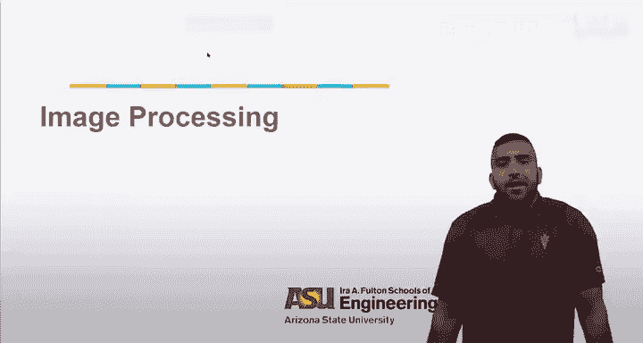
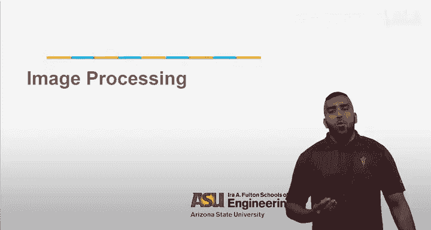
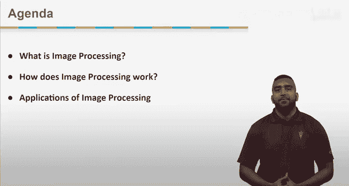
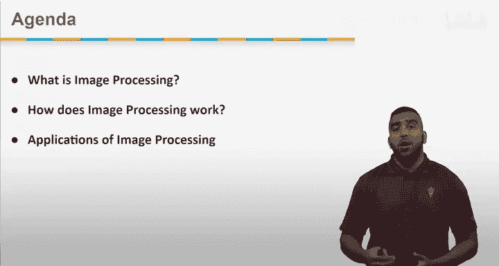
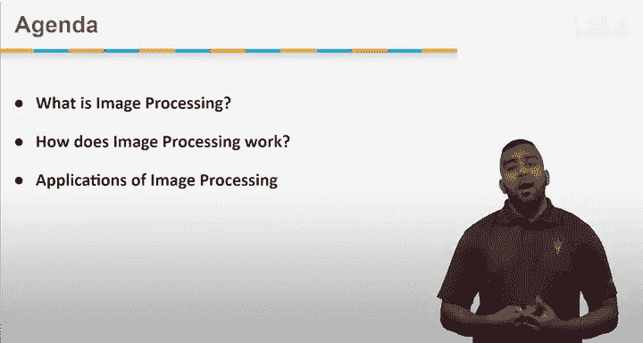
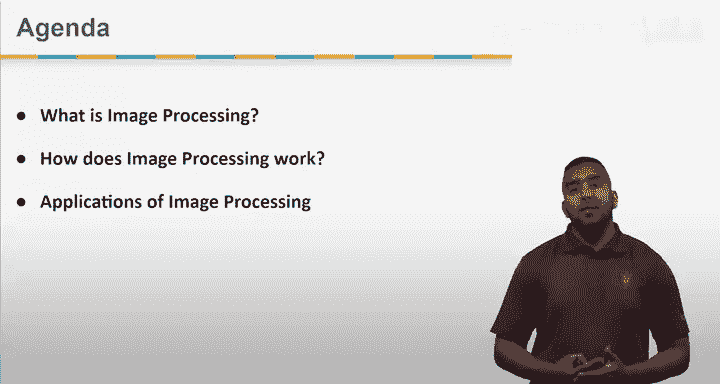
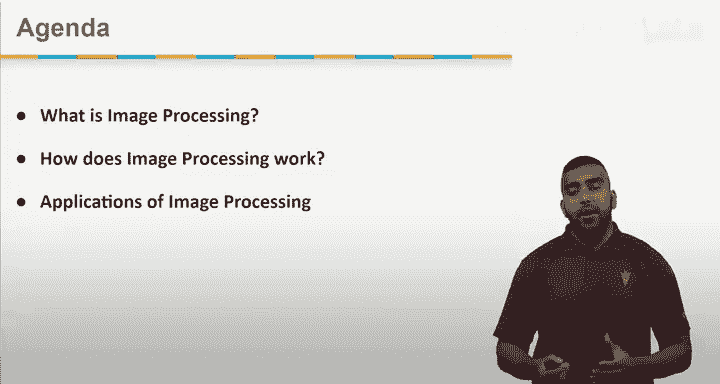

# 亚利桑那州立大学《Python： A Guided Journey from Introduction to Application》中英字幕 - P67：12_图像处理概述.zh_en - GPT中英字幕课程资源 - BV1J38GzbETT

This lecture is about image processing。

Welcome back in this lecture we'll be going over image processing。

In today's agenda， we'll cover what is image processing， how does image processing work。

 and what are some of the applications of image processing。

Now keep in mind that this is a high level overview of what image processing is。

 if you would like to know more about it， there are many。

 many articles that you can refer to that explain the nitty gritty details。

 but for now we're just going to go over an overview。

So what is image processing？Image processing is the approach of manipulating an image to either enhance the quality of an image or extract useful information from the image for further operations or analysis you could basically manipulate the image in your favor to see or extract any data that you want from it。

So image processing is frequently used in the industry for visualization， information extraction。

 pattern recognition， classification， segmentation， and much， much more。

It can also be used to classify what an object is just by having a mathematical algorithm。

 analyze the array of pixels in an image and compare the data to known feature vectors for the classification to occur。

So we have an example right here of object detection versus image segmentation versus image classification。

Now you can see that with object detection， we have a box which you can learn more about class that determines there is an object in front of the camera。

 augment segmentation basically augments the image from the object from the image and an image classification is able to classify what is the object in this case。

 it's a doc。So how does image processing work。Well。

 the first step is to perform image acquisition where the sensors capture and digitize all the images。

The second step is to enhance the image， basically the details are brought out to enhance certain results that we want。

The third step is to restore the image， or image restoration。

 where the appearance of the image is improved for better data collection。

The fourth step is to process the image color or color image processing where the colors are used to extract features of interest。

The fifth step is wavelets and multi resolution processing。

 which represent images in a variety of degree resolutions。There's more。

 The sixth step is compression where we reduce the storage to save the image。

The next step or the seventh step is morphological processing。

 where image features that are useful for shape and representation are extracted。

The eighth step is image segmentation， where images are partitioned into specific objects。

The ninth step is where representation and description takes place it's the process where labels are assigned to an object based on the description。

Now a1 step is knowledge base。Knowledge database is finally created based on coded knowledge in an image processing system。

So here are two applications of image processing it's commonly used in autonomous vehicles here we could see that we have a camera that's able to determine what is the objects in front of it it's able to determine that two separate cars there may be a person on the sticker of the car on the back of the vehicle in this other image we're able to classify objects like in this case we have we have this object is a dog these are people you could see traffic lights are identified。

 it's frequently used in autonomous vehicles in autonomous driving so that's one major plus point of using image processing。

Thanks for watching。