# 亚利桑那州立大学《Python： A Guided Journey from Introduction to Application》中英字幕 - P68：13_生成对抗网络（GANs）概述.zh_en - GPT中英字幕课程资源 - BV1J38GzbETT

This lesson we're going to go over generative adversarial networks。

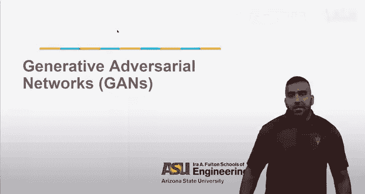

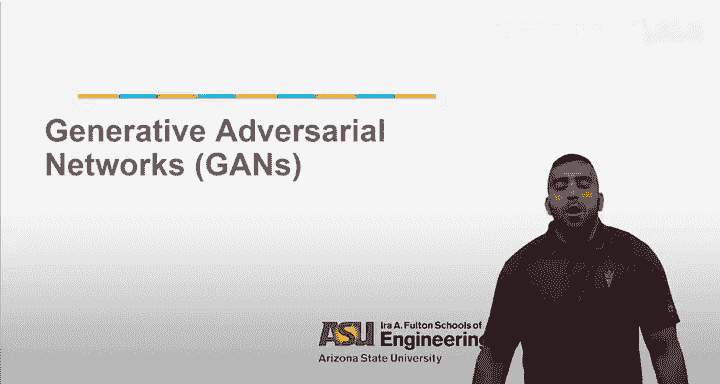

Welcome back。In this lesson， we're going to go over generative adversarial networks， or GNS。

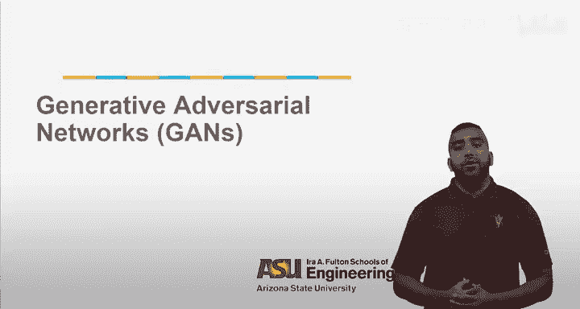

Today's agenda we'll cover what the GANs are， how do they work。

 and what are some applications that are utilized in today's industry。

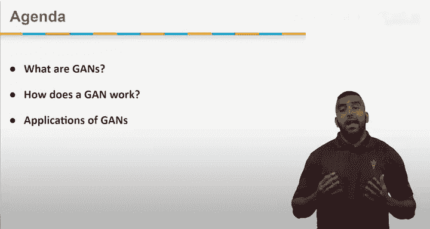

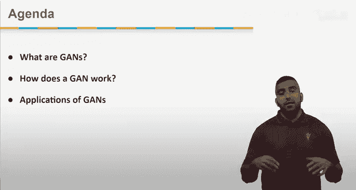

So what is again， again， or it's an acronym for a generative adversarial network？

Generative adversarial networks are used to generate images that cannot be distinguished from real images。

Generative adversarial networks are an approach taken in generative modeling that utilizes deep neural networksEssential。

 we want to be able to create images that we can't discern from the actual real images they have to look very。

 very close or alike。

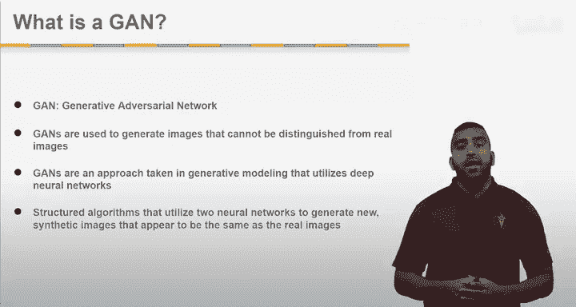

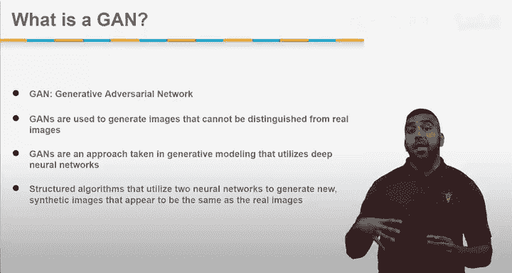

Strucd algorithms that utilize two neural networks to generate new synthetic images are used。

 and these synthetic images appear to be the same as the real images， that's our goal。

So how does a generative adversarial network work Well， we utilize two machine learning models。

We use the generator， which creates the images based on provided parameters。

 the generator randomly selects values from input parameters that come in the form of ranges。

The generator also undergoes training to select the proper values。

Our second machine learning model we're going to be using is the discriminator。

 which decides if the images are fake or real。The discriminator is trained with real and artificial images。

 and it fails at first， but improves as a greater number of decent samples are provided。

Now keep in mind， these two models compete against each other。

 which is why they are known to be adversarial， the generator is trying to generate the fake images so that the discriminator has a hard time determining whether the images are real or not which one's the real image which one's the fake。

 that's essentially how the GN works。

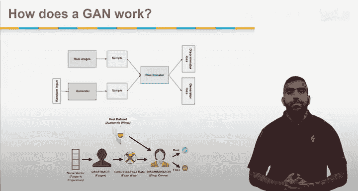

So here we have two illustrations that depicts how generative adversary network works。

 we start by passing in random input to the generator where the generator eventually forms samples。

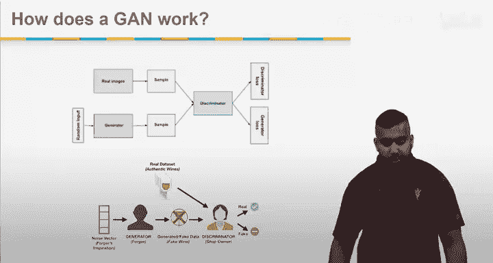

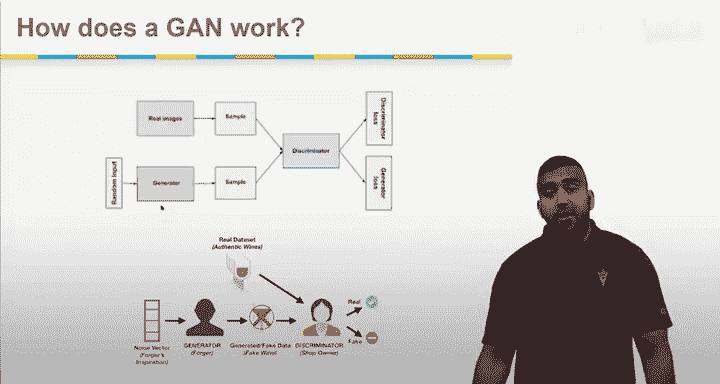

Then we also pass in samples from real images and we pass that into discriminator as well。

 so we have our fake and we have our real pictures passed into the discriminator the discriminator will then determine what is the fake image and what is the real image or what is the image that the generator created and what is the real image from there if it determines it correctly then the generator will lose but if the discriminator guesses incorrectly then the discriminator will face a loss so that's how the discriminator and the generator constantly competing against each other。

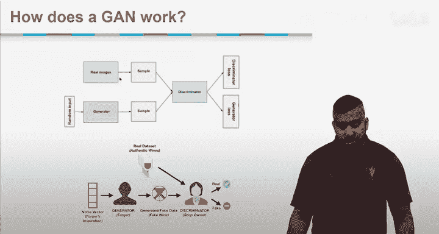

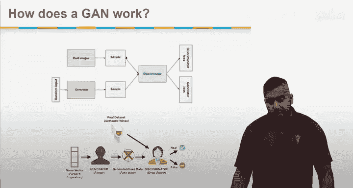

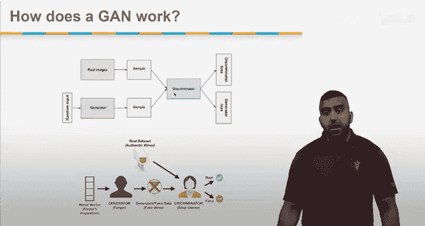

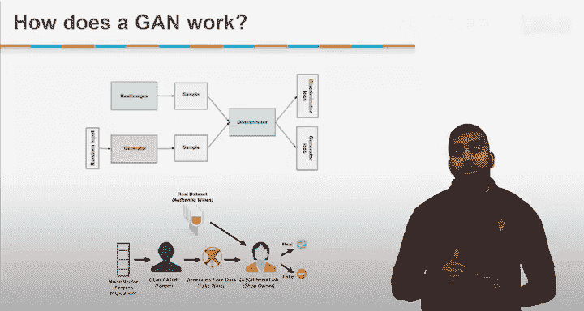

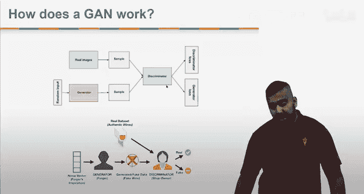

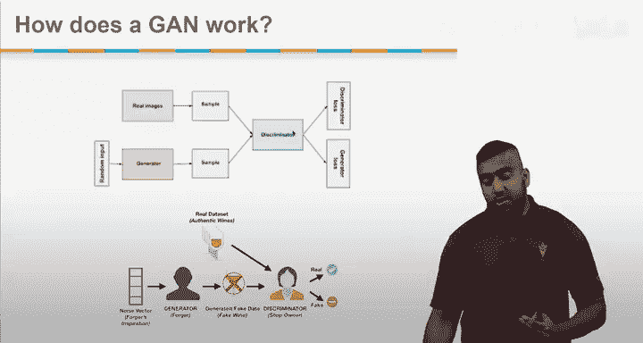

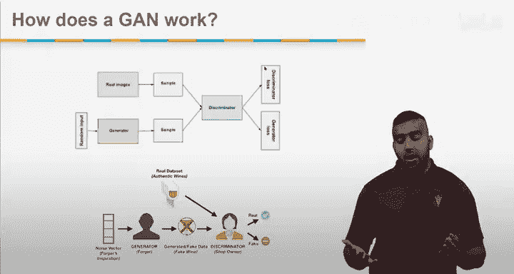

Now in this other illustration right here， we can see that we have a noise vector that's passed into the generator。

 generator will then generate some duplicate images or fake images。

 and thatll be passed into the discriminator along with the real images provided from the data set。

 and then the discriminator will determine what's real and what's fake。

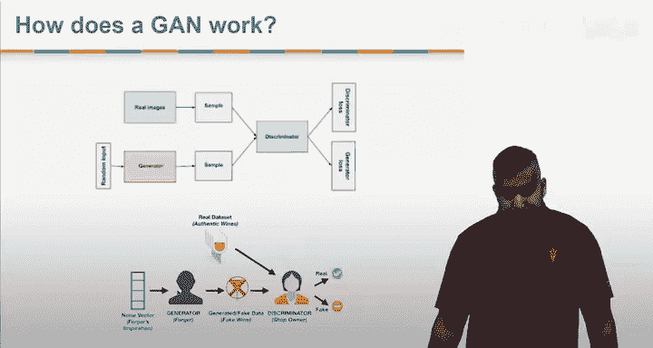

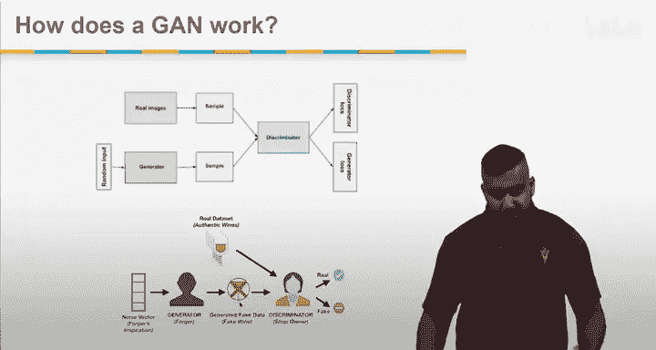

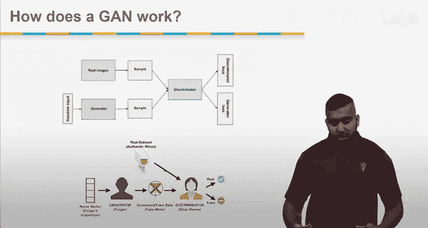

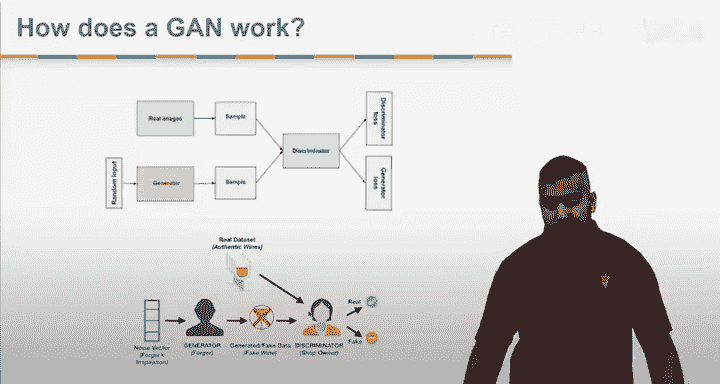

So what are some application of generative adversarial networks used in today's industry。

 well GANS can be used to create deep fakes， which are fake images or fake videos that have been created and modified。

Now， these fake videos created and modified by Gs can be utilized for real time video manipulation。

 meaning they could be utilized to adjust any sort of video that's。

Currently being processed at that current time。The machine learning algorithm can map the mouth of an actor onto another individual to change what that individual may have stated in another video。

GAans are also being utilized to identify deep fakes and separate the fake images or videos from the real ones。

 Basically when we want to find the truth， that's why Gs are so popular or so frequently used in today's industry。

Thanks for watching。