# 亚利桑那州立大学《Python： A Guided Journey from Introduction to Application》中英字幕 - P69：14_课程回顾.zh_en - GPT中英字幕课程资源 - BV1J38GzbETT

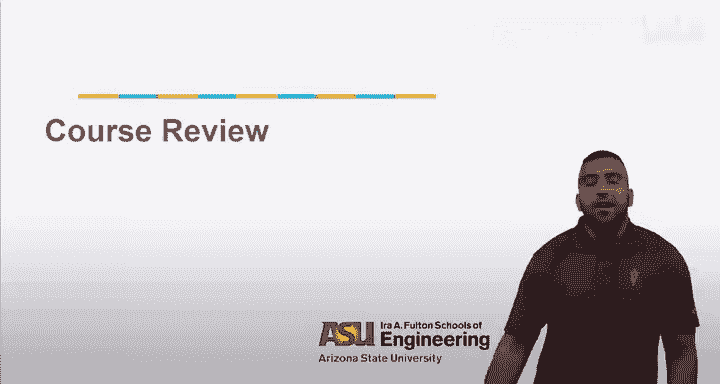

In today's lesson， we'll be going over the course review。

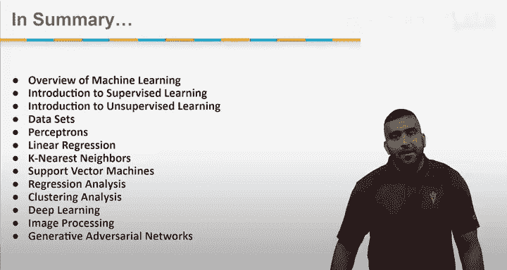

So you made it in this entire course， we have covered numerous topics regarding machine learning。

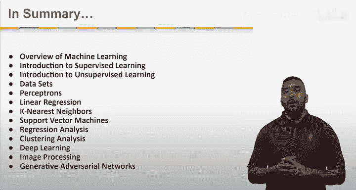

We went over an overview of machine learning， an introduction to supervised learning。

 and an introduction to unsupervised learning， you learned about two of the most biggest branches of machine learning there is。

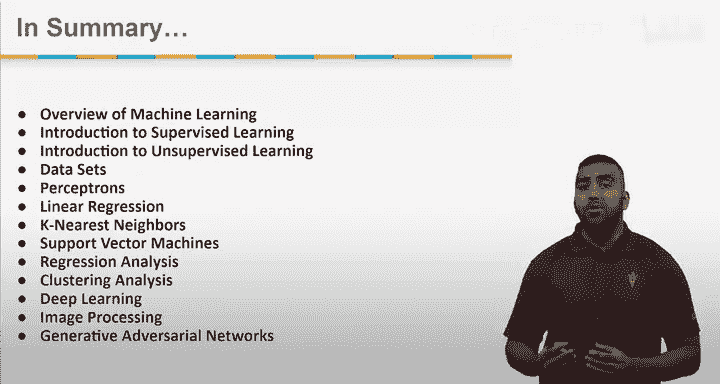

You also learned about data sets。

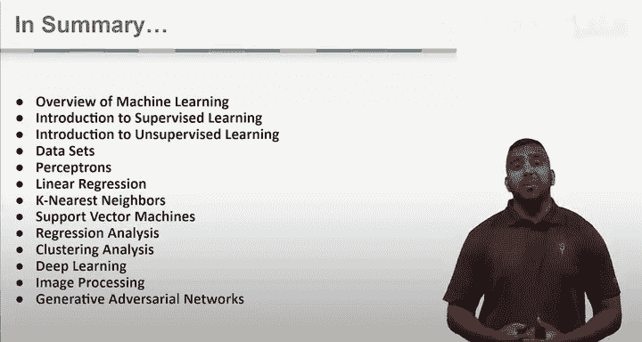

And then different types of machine learning algorithms such as perceptrons， linear regression。

 k ears neighbors， and support vector machines you also learned about regression analysis and clustering analysis。

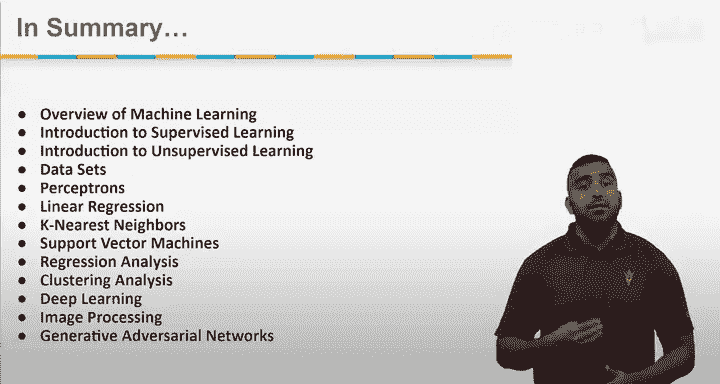

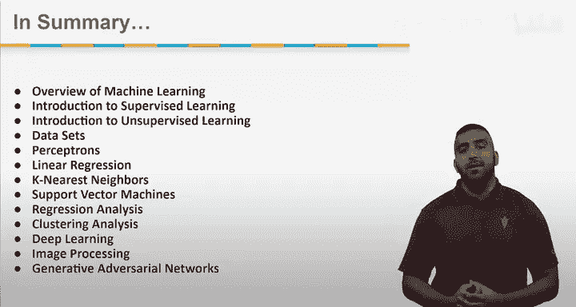

Then youll got a brief overview about some machine learning applications that are utilized in the industry today such as deep learning。

 image processing， and generative adversarial networks。

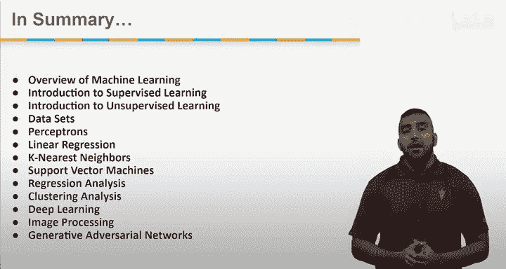

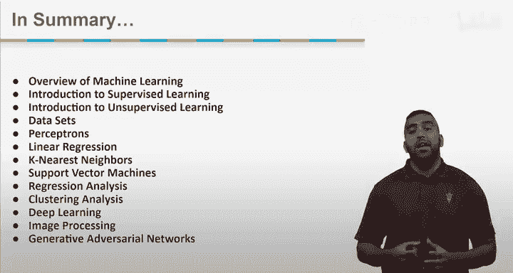

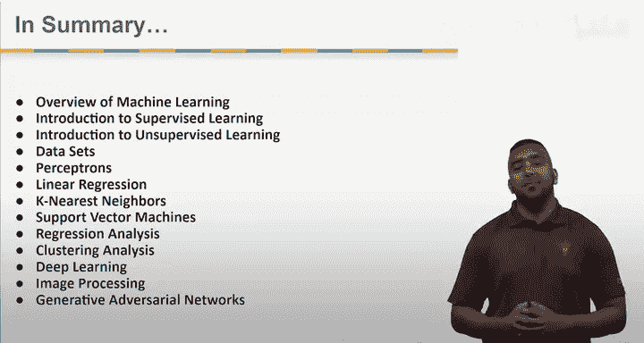

I commend you on the completion of this course and thanks for watching。

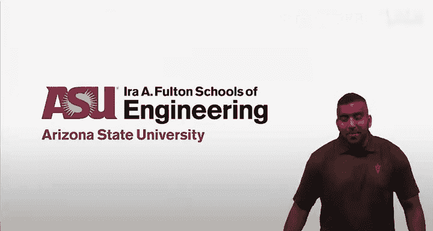