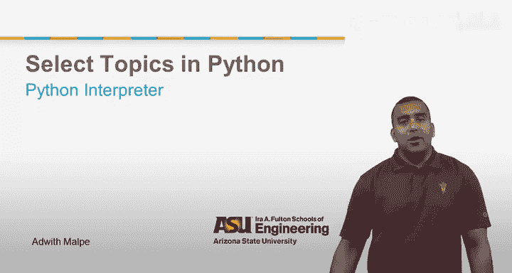
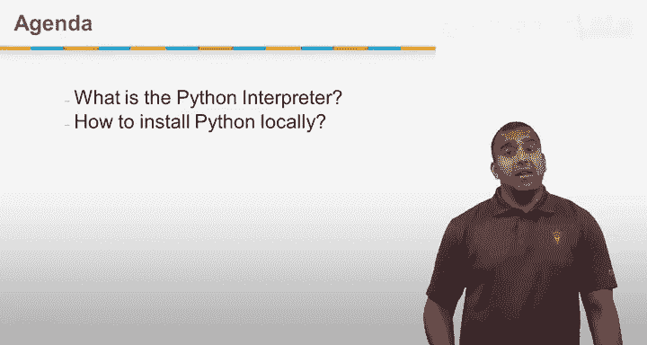
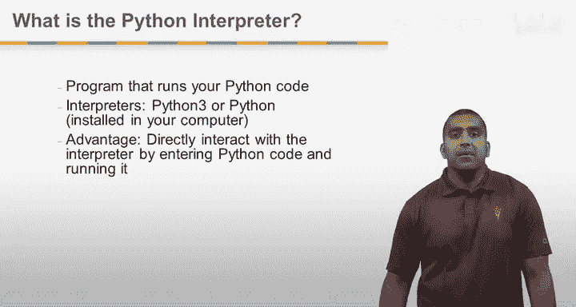
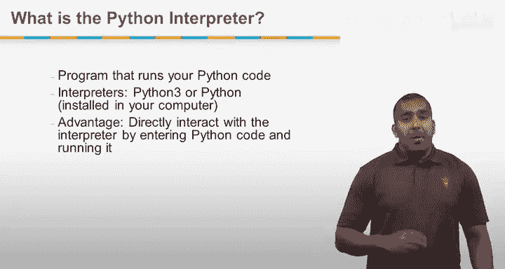
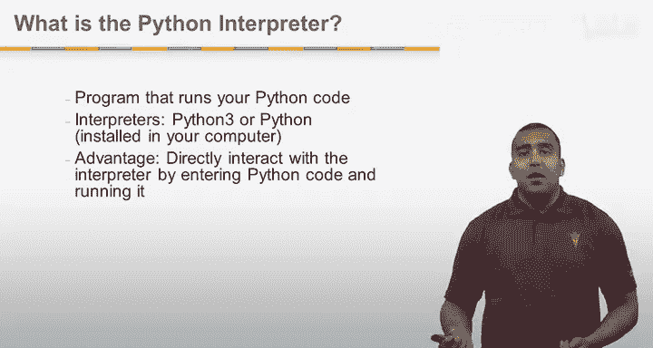
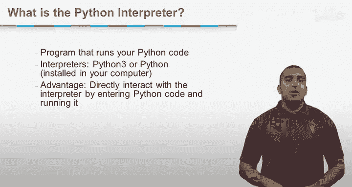
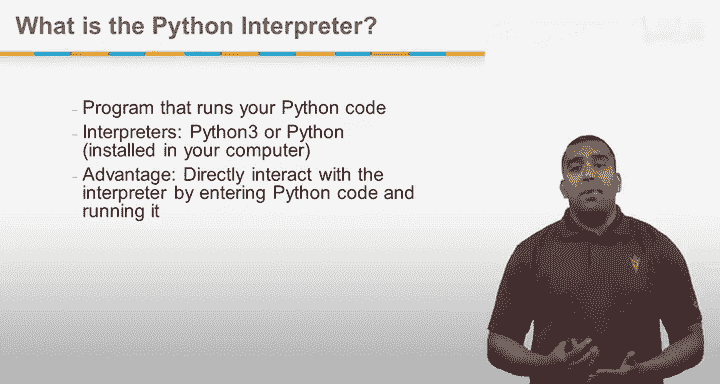
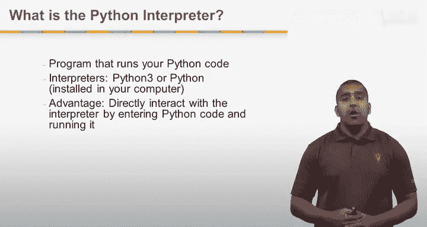

# 亚利桑那州立大学《Python： A Guided Journey from Introduction to Application》中英字幕 - P6：5_Python解释器原理.zh_en - GPT中英字幕课程资源 - BV1J38GzbETT

Welcome back In this video， we're going to be talking about the Python interpreter。

So for today's agenda， we'll be learning about what is the Python interpreter and how to install Python locally。

So what is the Python interpreter？Essentially。The Python interpreter is a program that runs your Python code。

Interpreters that can be utilized are Python 3 or Python。

 it depends on what's installed on your computer。

Now， the biggest advantage of having a Python interpreter is that directly you can directly interact with the interpreter by entering Python code and running it。

So how to install Python locally Now in this lesson there are a few links that have been attached that can walk you through a step by step process on how to install Python to your machine。

 however， for the duration of this course， we'll be using an online IDE。

 otherwise known as a programming tool where you don't have to download anything and you can begin writing code right away without having to spend time downloading anything。

So some fun facts that you may want to know is that Python comes pre installedsled on a Mac operating system。

To check what version of Python you have， you just have to enter the following commands in your terminal。

 either Python 3 dash version or Python dash dash version。

Another article to read about how to install Python based on your operating system is provided in this lesson。

Thanks for watching。