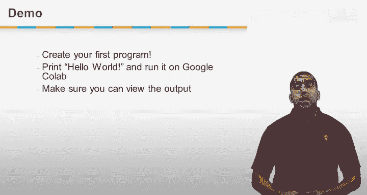
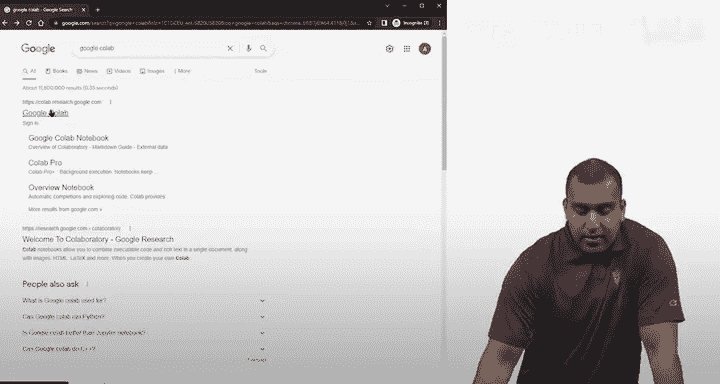
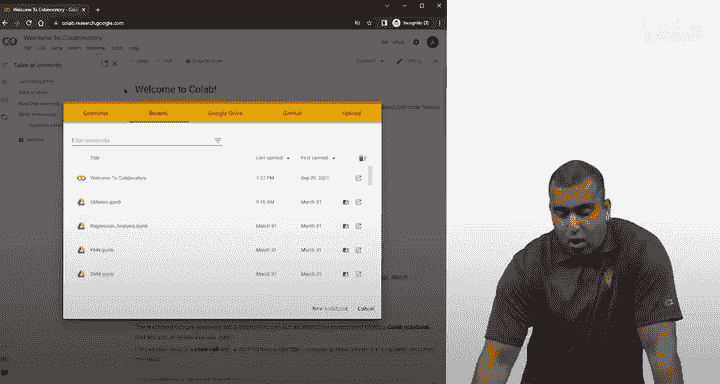
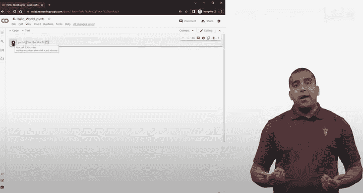
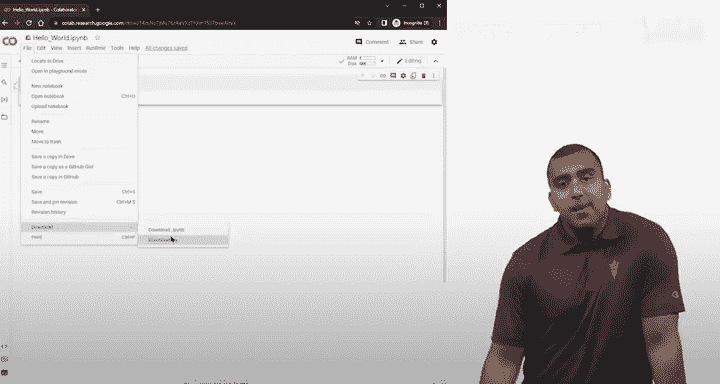
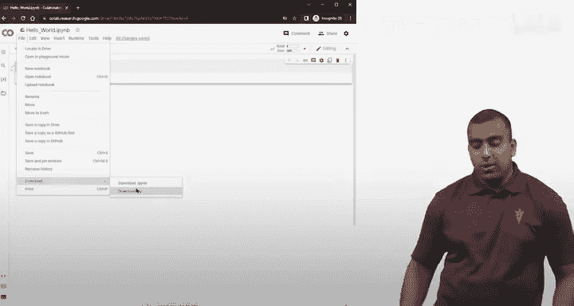
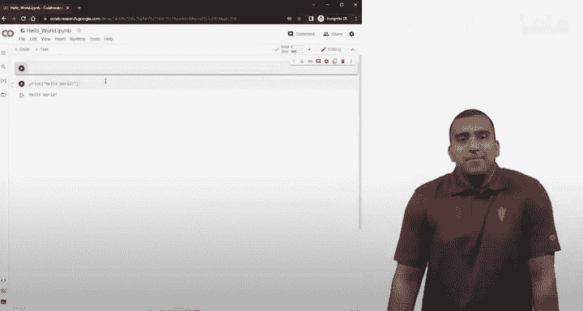

# 亚利桑那州立大学《Python： A Guided Journey from Introduction to Application》中英字幕 - P7：6_Google Colab平台简介.zh_en - GPT中英字幕课程资源 - BV1J38GzbETT

Welcome。In this lesson， we're going to be learning about Google CollLab and what is it？

So some of the things we're going to be covering in today's agenda include， as I mentioned。

 what is Google Collab， the features of Google Collab。

 why we use Google Collab and how to use Google Collab。

 followed by a demo where I show you how to get set up。So what is Google Collab。

 Google Collab is an online IDE， otherwise known as an online programming tool or development environment where you can write your Python code without having to make any installation or download anything onto your computer locally。

So we know that we have an executable document that lets you write。

 run and share code in Google Drive， that's pretty much what Google Collab is。

Every script or notebook， as mentioned， is where you write your code。

These notebooks are connected to cloud based runtime。

 so you don't have to download any compiler or anything of that sort to run your code。

You can execute Python code without any required setup on a local machine。

And the biggest benefit of all is that you can share your notebooks so you can show other people your code and write code with them。

Here's some more features of Google Collab。Cells are where you may enter your code or text that describes the code block。

 so you can actually rather than writing an entire script with all your code。

 you can break down your script into individual cell blocks where you can write your code and test individual code blocks。

Now there are two types of cells， code cells and text cells。

 code cells are where you write your code and text cells are where you enter your text that describe your code。

Control enter is to run the current cell on your keyboard。

 If you don't want to press the play button on the cell， you can press control enter。

Now you can also press shift enter， which will run the current cell and create a new cell right underneath。

You can run individual cells at a time or you can also run the entire script when you want to。

So why are we using Google Coab， There's no configuration that's required It's we have free access to GPUs。

 meaning we can crunch big sets of data much more efficiently， and it's easy to share your code。

Through coab。Now， you can also view your output under an executed cell。

 which makes life a lot easier as opposed to having to scroll down to the very bottom of the script to see what happened。

Texiles are formatted using Markdown text， which is plain text documented format that's rendered on the page itself。

In the textiles， you may enter headings， paragraphs， lists。

 and mathematical formulas that may describe your code。Now how do we use Google Coab。

 The first step is to make sure that you are signed into your Gmail account if you don't have one。

 you may need to create one。The second step is to click on the file and create a new notebook。

You can change the name of your script at the top left from untitled zero to I andB to the name of your file Now keep in mind。

 these are all I files because we are using an online IDE once you've written your code。

 you can go ahead and download the script as a P file to run it on your computer locally if you want。

Step four， you can finally begin en codingd and finally step  five。

 if you would like to run the script as I mentioned before， you can go to fileile。

 download and download dot Pi to be able to download your script as a dot P file。

So let's go ahead and go with our first demo， we're going to create our first program where we print Hello world to the screen and we run it on Google Collab。

 we want to make sure that we can view the output as well。

So as you can see here， I opened up a new tab on Google and I entered Google Collab。

Make sure you are signed into your Gmail account。Once you're signed into your Gmail account。

 go ahead and click that first link that says Google Coab。

As long as you're signed in， it should take you to this welcome page right here。

All you need to do is click file new notebook， or if it takes you to this prompt。

 you can click new notebook and it'll take you to a page where it's completely new。

 there is no entered code， nothing like that of that sort。

 and you can see over here we have our Python script， the name of our Python script。

 which is called untitled 1ip and B。

I want to call this。Hello。World。Then from there， I'm going to go ahead and print。Excuse me。Hello。😊。

World。All I have to do then is I can either hit C enter on the keyboard or click this play button right here。

😡。

And what it'll do is it'll run your cell。 This is a cell。 that's our cell。 and here's our output。

 Hello world。Congratulations， you've officially written your first program。From there。

 if you want to try running your program onto a programming tool such as visualual Studio code。

 you can go ahead and click file。Download， download dot pi to be able to download this to a dot pi file and you can run that script locally on your machine。

That's it for today， thanks for watching。

