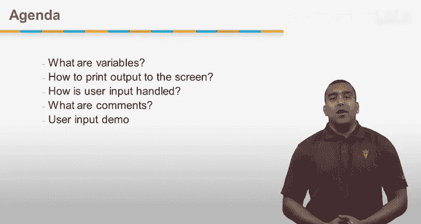
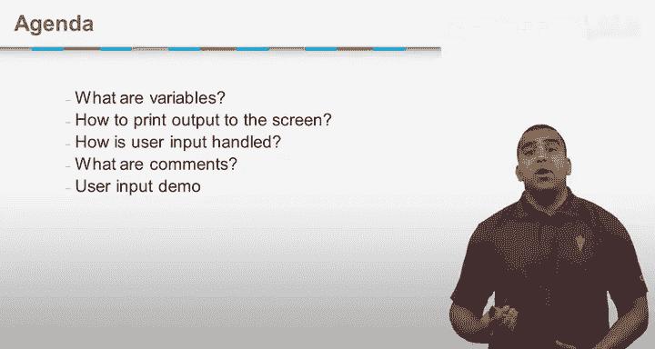
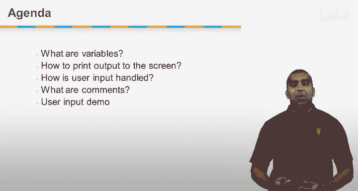
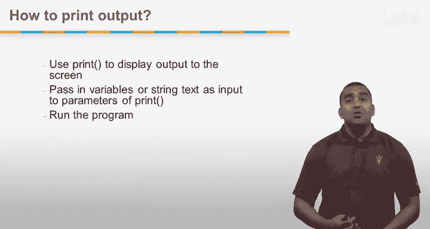
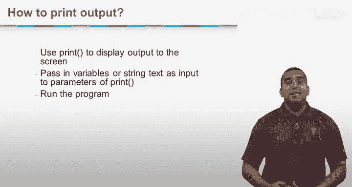
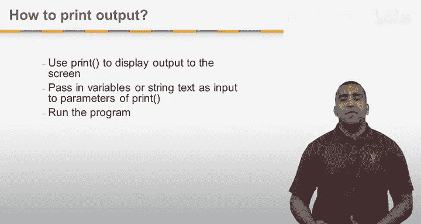
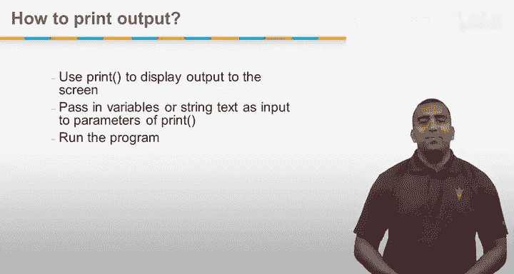
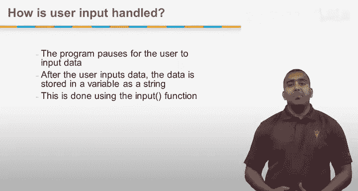
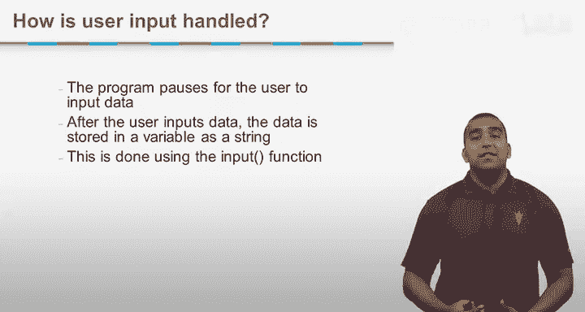

# 亚利桑那州立大学《Python： A Guided Journey from Introduction to Application》中英字幕 - P8：7_Python用户输入与屏幕输出实现.zh_en - GPT中英字幕课程资源 - BV1J38GzbETT

Welcome。In this lesson， we'll be going over user input and output。

In today's agenda， we're going to cover water variables， how to print output to the screen。

How is user input handled， what are comments， and we'll finally wrap up with a user input demo where you can interact or code on your own。

So what are variables？Well， variables are reserved memory locations that are used to store data。

They occupy memory space based on the type of value that we assign。To create a variable in Python。

 create a variable name followed by an equal sign and then pass a value。In the following bullet。

 we have this structure variable name is equal to a value。When a variable is created。

 Python will determine the data type to the variable based on the value assigned。

How to p your output？Use the print function to display output to the screen。

Passen variables or string text as input to parameters of the print function and finally run the program you'll understand this more in our demo。

How is user input handled？The program pauses for the user to input data。

After the user inputs data， the data is stored in a variable as a string。

This is done using the input function。

What are comments。Comments are human readable descriptions of lines of code or code blocks。

They explain what a line of code or a code block is doing。

Commenting can help code maintenance and find bugs match more quickly。

Well documented code is as important as correctly working code。

 It's really important to make sure that you include your comments so that other programmers understand what you're doing。

Now let's go ahead and proceed to our demo。So as you can see。

 I went ahead and I created this script ahead of time。

 and you can go ahead and play around with it as you have access in it in this lesson。

I named the script user input demo and up here you can see that I've created comments now comments are denoted or created using the hashtag symbol。

Now you can see that I've listed that right here and you can also see that I included a comment that says。

 always comment your code。Now keep in mind comments do not execute anything。

 the sole purpose of comments is for you to understand what your code's doing and if you just want to see what or explain your code and make sure that you understand what it's doing。

 include comments， it won't execute or print anything。Now。

 comments are used by programmers to explain what a line of code or a code block does。

Here's an example where I've included a bunch of comments that describes a function provides a function name and includes a description of what the function does。

In this next cell， you can see that if I want to print Hello world。

 I use the print function to display output to the screen When I run this cell。

 you can see that it prints hellello world to the screen。

It will also print Wee to your first python program when I run it。😊。

Now let's create a variable called the username。Here we have a variable called username。

 and we pass it in of value or a string value name called TM。Where Tim is the username？

Now let's go ahead and print Hello， Tim， how do we do that？

We call the print function passing a string parameter， in this case， hello。Comma。

Pass in the username， which is another value we want to pass to the print function。

 What that will print is itll print Hello Tim to the screen。

Notice the difference between these following two statements right here。In this print statement。

 we are printing， is this your first program with no space before the double quotes？Plus。

 the user underscore name， plus the question mark。Now。

 what that will do without the space is that it will print the username without a space right after the word program。

That's if we're using the plus symbol Now if we were to use the comma。

 you could see that the comma already takes into account the space。

 hence why we have Hello space Tim。To make sure that you want to you're using or you're including spaces in your print statements with the plus operator。

 do you have to make sure。That you include a space after a string has been entered。

 plus the variable plus another string。 So now you can see here is this your first program space Tim。

Moving on to the next example， we're going to be entering user input。In this example。

 I'm going to go ahead and create a print statement that says print， welcomee， my name is BPP。

 and I'm your personal chatbot。In this next line of code。

 I included a comment that describes what it's doing user input is passed in using input。

The name of the user is the variable name， which takes in a value from the function。

 the input function， which prompts the user to enter your name here。Now。

 this string parameter or string value pass into your input is typically meant to display to the user what should they enter into the program。

So here you can see after I run it， it prompts to the user enter to your name here。

I had entered my name and it says， in result， nice to meet Jad with。 that comes from this line here。

 where I'm printing， Nice to meet you plus the variable name of user plus new line。😊。

So I'm passing that user input to a variable which I can then use to output it in this statement right here。

In this next line of code， we're going to go ahead and create another variable called user Task。

 which takes into input， what can I do for you today？And finally， I'll print。

 I will En the user task。For you today， so it's basically storing the user input into a variable and you can display that to the screen using the print statement。

In our final example， we created three variables， first student。

 second student third student with a bunch of names。

 and we're going to go ahead and print them to the screen， you can see that I did that here。

 followed by commas。And after I've printed it to the screen。

 I'm creating another variable for the course name。

 and I'm asking the user by calling the input function to enter the course the students should take the user will enter the name of the course that the user will take。

 and I finally print that out to the screen by calling the print function saying the students will take comma and I pass in the course name as a parameter to the print function followed by another string this semester。

 so as a result， this should say the students will take calculus this semester。Now。

 I strongly advise you to play around with the code， enter your own parameters， your own values。

 whatever you want to do to make sure you really understand how this works。Thank you。

