# 亚利桑那州立大学《Python： A Guided Journey from Introduction to Application》中英字幕 - P9：8_Python变量与数据类型.zh_en - GPT中英字幕课程资源 - BV1J38GzbETT

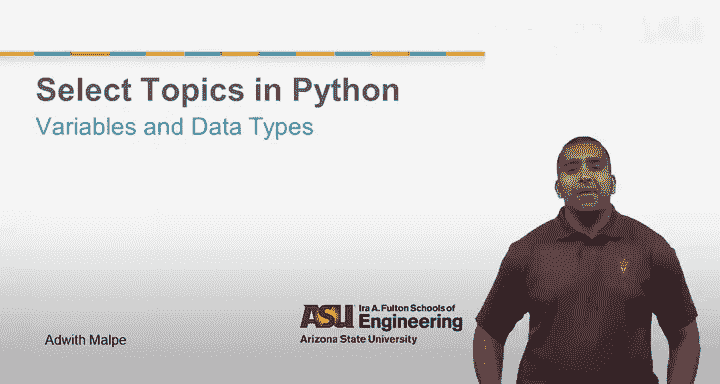

Welcome。In this lesson， we'll be covering variables and data types。

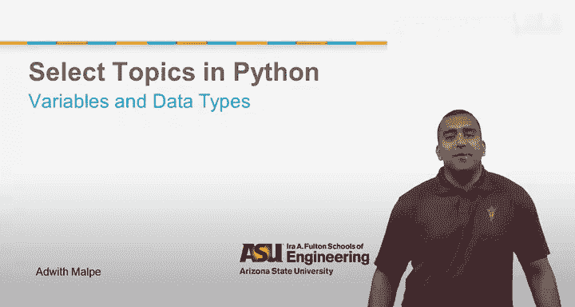

So in today's agenda， we're going to cover what are data types， how are data types handled in Python。

 and we're going to go over a demo。

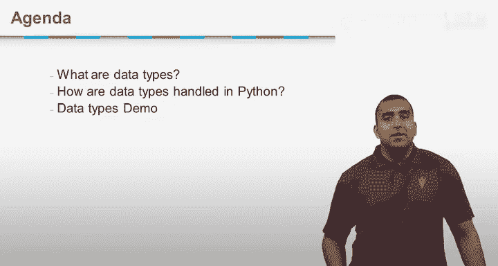

So what are data types。Data types are a type of classification of data。

Data types instruct the interpreter how the programmer will use the data。

Basic data types supported by Python include integers， floating point numbers， complex numbers。

 strings， and Booles。Built in data types include binary types， booleyan types， set types。

 mapping types， sequence types， numeric types and text type I know that's a lot and if you're really curious to know more about builtin data types there are attached resources that are very very useful to read that can give you more of an in-depth explanation as to what each type is but for the sake of simplicity we'll be going over the basic data types in our demo。

So what are integers integers are a data type that store hold numbers that range from22147483。

647 to 2147，483，647？

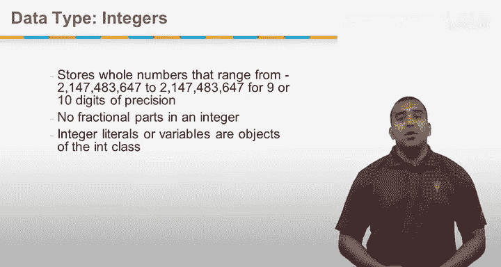

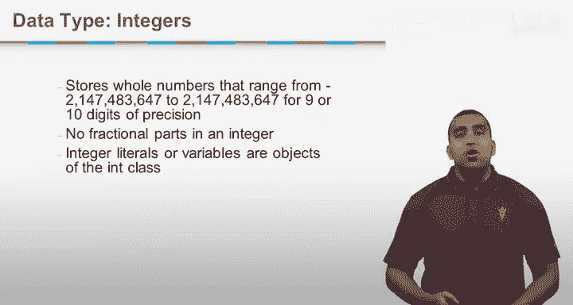

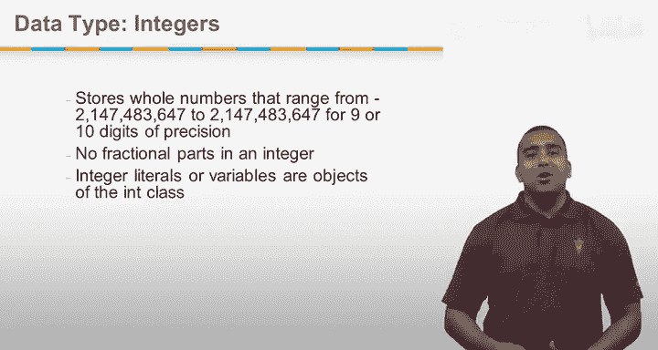

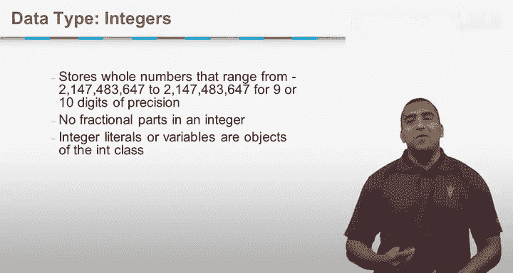

For nine or 10 digits of precision， that's a lot。

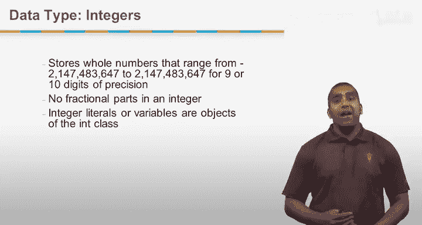

Now， there are no fractional parts in an integer。

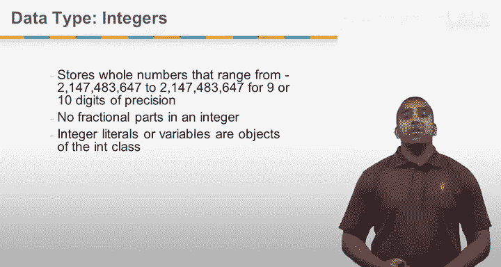

Integer literals or variables are objects of the integer based class。

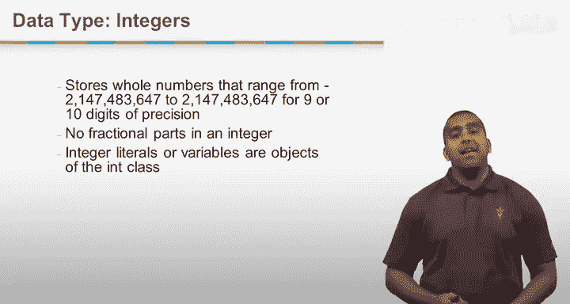

Floats are another data type that represent real numbers and use the decimal point to separate the numeric value into an integer and a fractional part。

 for example， we have the value of pi which is 3。14 another example is 1。6754。

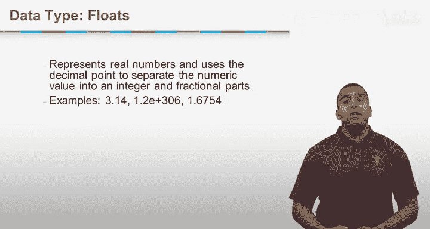

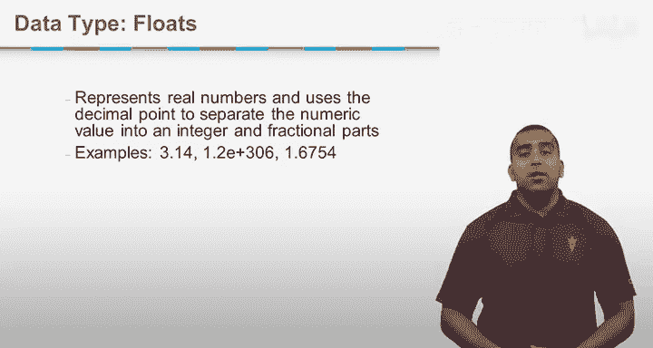

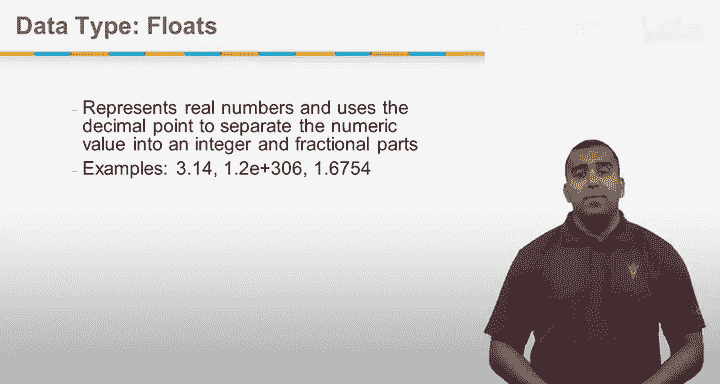

Another。Data type are complex numbers。 complex numbers are created from two real numbers and are comprised of a real part and an imaginary part。

The imaginary part is expressed by adding a J or J after the number in Python。

 a complex number is created by assigning the real and imaginary part to a variable example。

 a complex number is 3+ 6J or 6+ 15J。The next data type we're going to be covering is strings Strs ares of bytes representing Unicode characters。

Strings are a collection of one or more characters that are put in single quotes， double quotes。

 or even triple quotes。There is no character data type in Python。

 a character is a string with a length of one and is represented by the string class in Python。

Examples include a name such as mine， Ad， Hello World， or there are four cars in the parking lot。

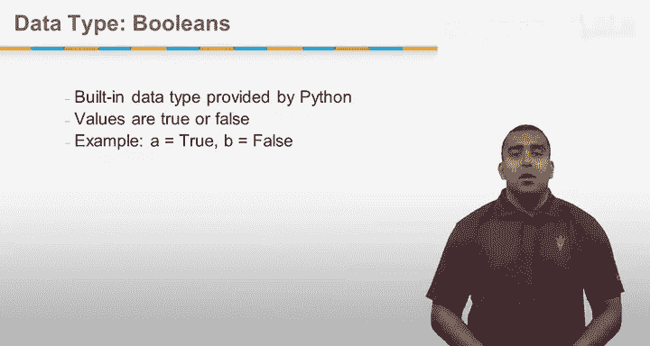

The next data type we're going to be covering is booleying。

Bulllions are a built in data type that is provided by Python the values of a boolean are true or false。

 so an example we're setting a variable A or a variable B to be set to true and false。

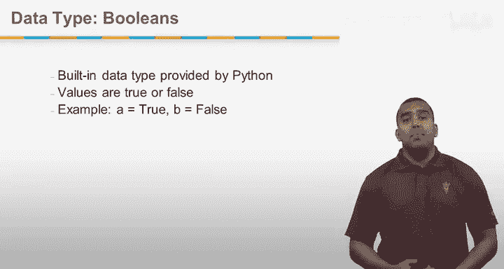

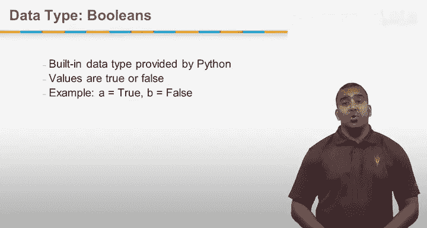

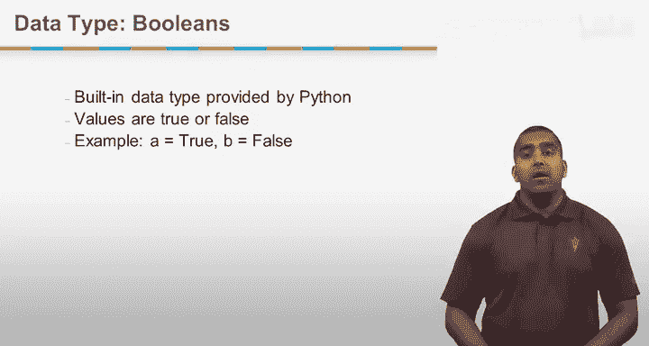

How is how are data types handled in python。

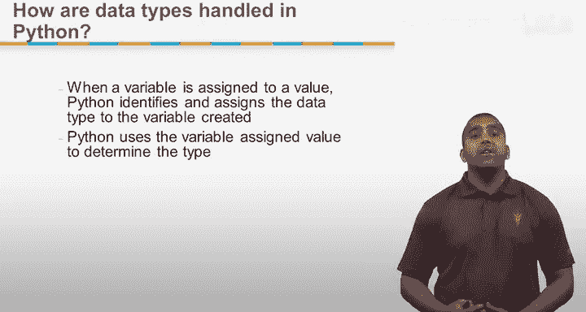

Now， when a variable is assigned to a value， Python identifies and assigns the data type to the variable created。

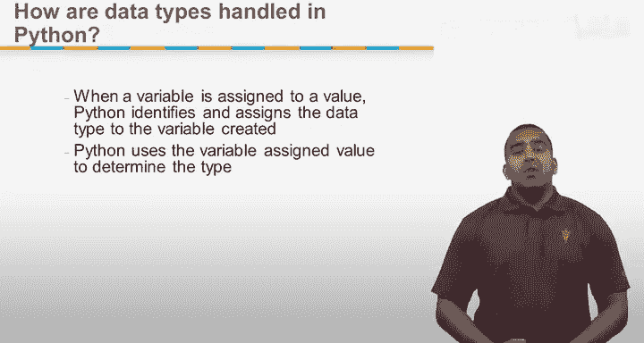

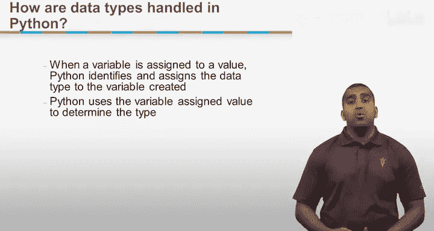

Python uses the variables assigned value to determine the type。

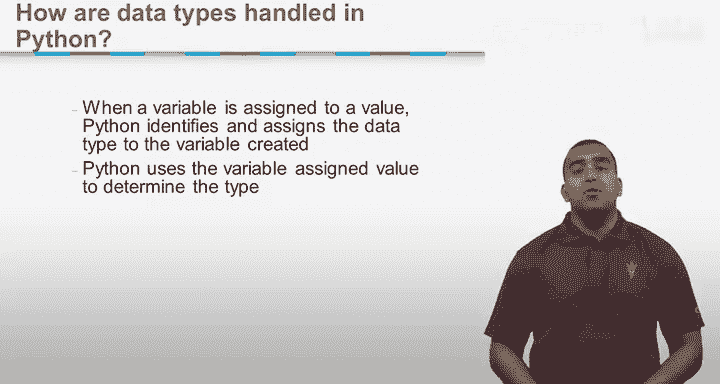

Let's move on to our demo。

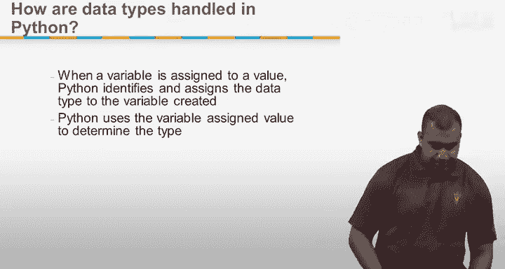

So in this first code block here， you can see that I've created a bunch of variables with different types here we've created a variable called integer value which takes an integer value。

 the next float value variable takes in a float value of 3。

14 complex value variable takes in a value of 1。2J。

A large float variable takes in 2 e to 24th value and a small float takes in 3 e to negative7 as a value。

 then we have a string value variable which takes in of value called Python users group。

So what we're going to do is we' going to print the type of each of each variable。

 So here you can see I'm calling the print function passing in。Then the variable in this case。

 integer value followed by a string is of type followed by I'm calling the type function here。

 which will return the type of the variable。 So in this case I'm calling the type function and passing the integer value as a parameter that should return class int as displayed here after I've run the code。

 Now I'm doing the same thing for the remaining variable。 So in this case。

I'm calling the type on the float value variable and that will return class float。Here。

I'm also returning the type of the complex value which will return class complex。

 and I'm repeating that the exact same steps for the large float。

 the small float and the string value， and you can see that they're returning all of the classes for each respective type。

In the next code block， we can see here that when we're printing。Varis。

 there's a unique way of doing it。 So if you， you can see what happens when you print out an integer complex value and a float value with plus versus using versus converting them to a type string。

 So here we're printing the integer value is plus integer value。

 Now what that's going to do is you're going to get an error。

 If you were to comment these lines of code right here， comment that out。

 and you were just to run this code block over here。What that will do is it'll give you an error。

And that error is that you're trying to print a string and an integer together when print will only print the string。

 So what we need to do to fix this problem is we need to convert the type of each of these variables。

To the type string。And we do that by casting。Casting is where we are explicitly calling the type in this case。

 string or STR on the variable name， so if I pass in integer value to the string function STR function。

 that will convert our integer value to a string type。

 same with flow value if I call string STR on that flow value， it'll convert it to a string type。

 and so forth with the remaining variables。That's why when we execute this portion of code。

 it will run successfully and it will not air out。 In this case。

 it prints out the output successfully。😊，So yeah， so make sure when you're running this。

If you have to， it's mutually exclusive， so you either have to come this portion and then run it or you comment this portion and then run it。

 but you cannot run it together because this portion will give you an error。Okay。

That's it for this video， thank you。