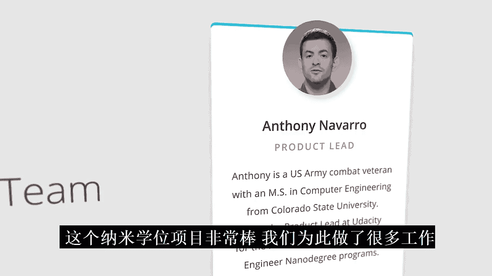
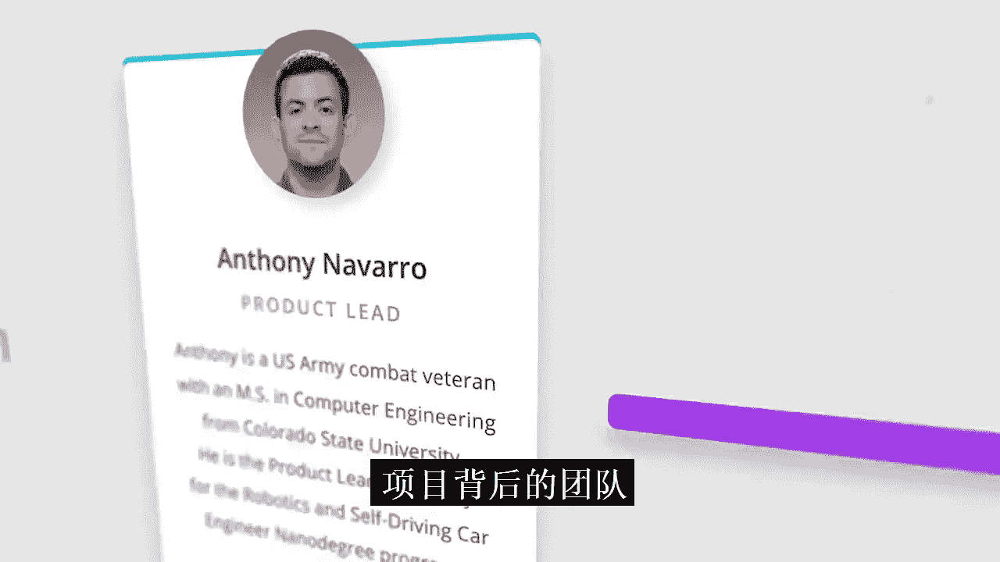
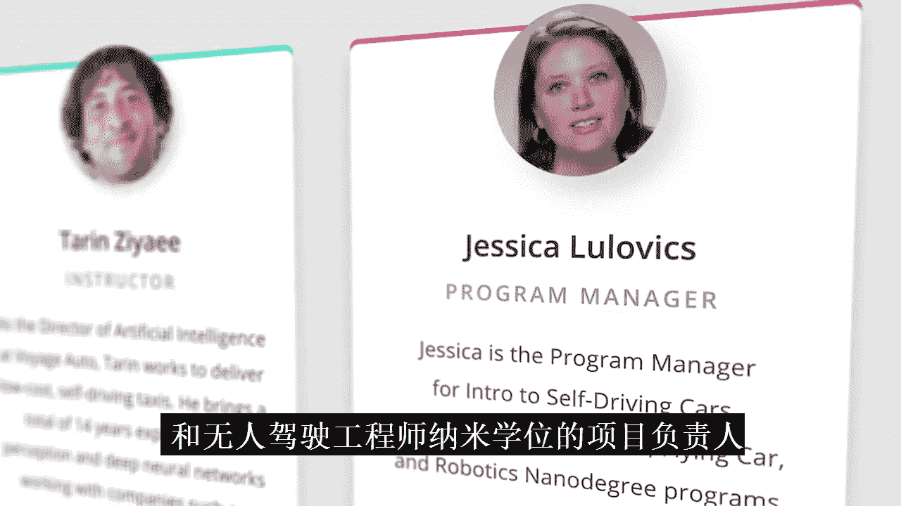
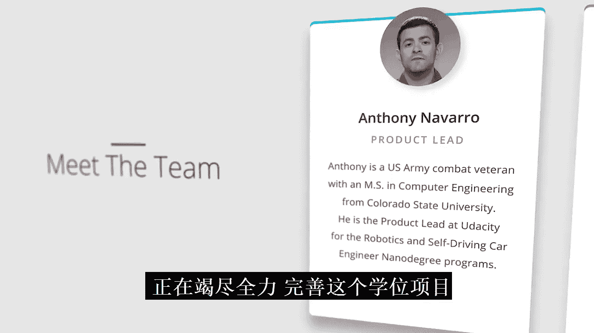

# 优达学城（Udacity）：无人驾驶汽车纳米学位项目-十位大牛亲授自动驾驶技术，硅谷前沿科技（计算机视觉⧸车道识别⧸感知控制⧸人工智能⧸谷歌） p01 1. Part 01-Module 01-Lesson 01_Introduction [BV1Vd4y1r7QG_p1]

Hi， my name is Sebastian and along with a talented group of people here at Uacity and from our industry partners。

 I shall be your friendly instructor for this nano degree program。😊。

Now we put this together to make the basics of selfdiving cars very accessible。

 you'd be given a chance to learn about data structures and basic math。

 different programming languages， planning， perception control。

 based rule and stuff like this firsthand and write computer code that effectively implement a very basic version of a selfdiving car。

When you're done， you can consider yourself very knowledgeable about self drivingriving cars because you've learned all the basics。

 there is a advanced version available Uac that I'll talk about later that goes into more depth。

 but consider yourself one of the very first pioneers learning about self drivingriving cars。😊。

So let's meet the team。Hather， I'm Anthony and I'm the product lead for Intro to selfdriving Cars here at Udacity。

 I'm excited to help start your journey towards becoming a self-diving car engineer。

 There is a lot of work that goes into making this great nanodree program。

 and we want to take a few moments to introduce you to the team who helped make this possible。😊。

Hi， I'm Andy。 I'm the curriculum lead for this project。

 I've been teaching and learning at Uuddacity for five years。

 and self driving cars are a world changing technology。

 and the mathematics and computer science principles that underlie them are fascinating。

 I really can't wait to introduce you to this incredible world。😊。

Hi， I'm Czanne Kamacho and I'm a content developer at Uacity。

 I'm an expert in computer vision which is how machines like self-driving cars visually perceive and respond to the world。

 and I'm excited to teach you about vision and other foundational programming and math concepts that all self-driving cars rely on when they make decisions on the road。

Hi， I'm Alicia White， I'm an embedded systems engineer with over 20 years of experience in all sorts of industries。

 I wrote Ma Em systems for O'reilly， and I host embeddedded。 FM。

 a podcast about the many aspects of engineering。

I'm here to help you understand why C++ is so important to the development of self-driving cars Hi。

 I'm Terran， I'm the director of AI here at Voyage and I'm super excited to joining the classroom and teach you about machine learning and computer vision。

Hi， I'm Jessica。 I'm the program manager for your Na degreeree program。

 as well as for the Se drivingiving car Engineer Na degreeree program。

 I'm really looking forward to having you in the program and really excited for you as you start this journey。

 If you ever need anything for me， you can come find me in the Slack community。😊。

Hi， I'm Erica， I'm the student experience coordinator。

 Feel free to ping me on Slack or email support at udati。com。😊。

There are even more people behind the scenes that are doing everything they can to make this program great。

 Now what do you say we get started？

Welcome to the Na degreeee program。 We both worked individually on the self driving car Na degreee program。

 I worked on courses called path planning and localization。

 and I worked on lane finding and computer vision。 When we release a self driving car in a degree program。

 there was a ton of interest from students in industry。

 But it turns out that building a self driving car isn't easy。

 and so many of the courses were approached from a very technical standpoint。😊。

And some people who enrolled in that program found themselves blocked by things like math notation。

 programming concepts and programming languages。 So Andy。

 who do we make this curriculum for The person we had in mind when we design this curriculum has some programming experience。

 maybe 40 hours or so， they're comfortable with algebra。

 and they hopefully get some enjoyment from thinking through and solving hard problems。

 even when those problems use math。If this describes you and you're looking to fill that gap or just get more experience with the programming and a math behind self drivingriving cars。

 this program will prepare you for the more advanced curriculum， so let's get started。

Before we go too far， we wanted to take a second to give you the chance to warm up your skills we have created a fun comic and a series of questions that will help you gauge how confident you are in your abilities Don't worry this isn't great it or anything it's just for your personal use and to help you prepare for class。

