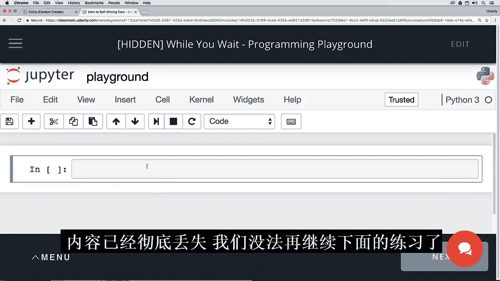
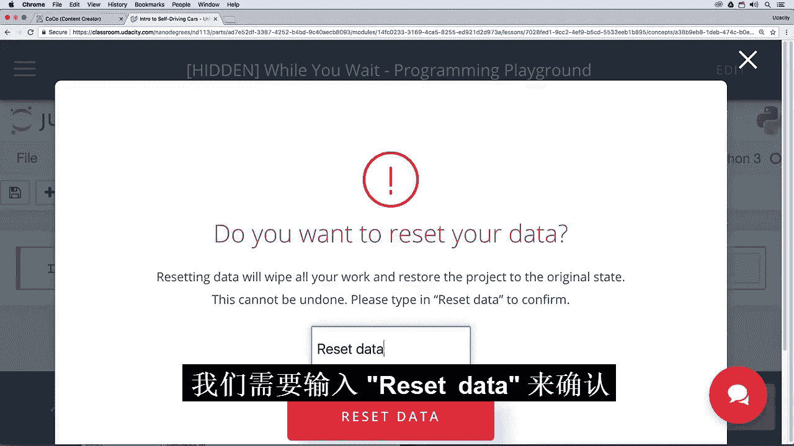
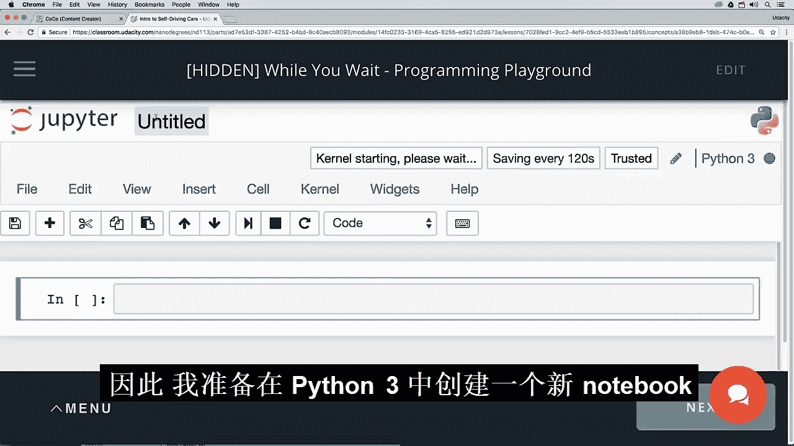
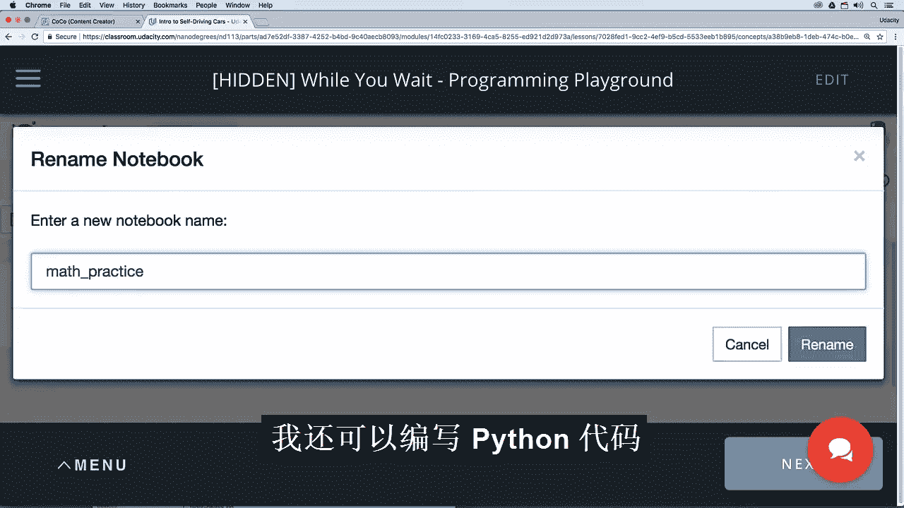
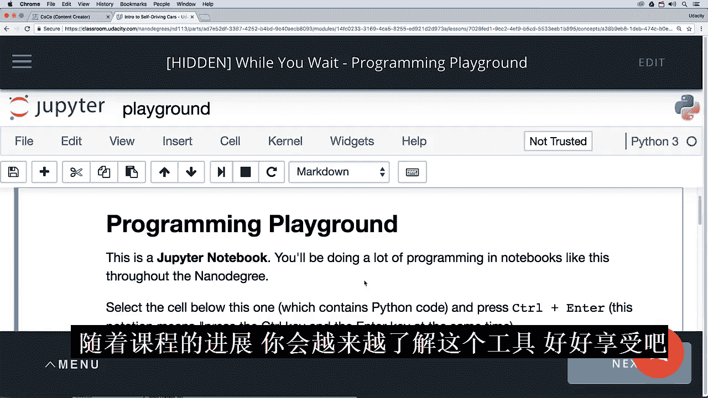

# 优达学城（Udacity）：无人驾驶汽车纳米学位项目-十位大牛亲授自动驾驶技术，硅谷前沿科技（计算机视觉⧸车道识别⧸感知控制⧸人工智能⧸谷歌） p02 2. Part 01-Module 02-Lesson 02_Get Ready [BV1Vd4y1r7QG_p2]

Hopefully， you not only enjoyed Carlin or Friend's adventure。

 but you learned a little something about your skills。 If you felt like that was really easy， great。

 sounds like you're ready to dive into the content。 If you struggled a little bit， no worries。

 that's why we're here。 At the end of this orientation。

 We will give you some resources that you can check out before the classroom opens。

 Use these to refresh your bath and programming skills。 Again， none of it is required。

 We just want to help you be successful in graduating this program。😊，Immediately after this video。

 you're going to see something that looks like this。 And this is called a Jupiter notebook。

 It is a great tool for writing and documenting Python code。😊，So as you can see。

 this notebook is made of cells。And I've got a cell highlighted now。

 and I can use my arrow keys to navigate up and down through the cells。And this cell。

 as you can see here， is a markdown cell。And I don't want to talk too much about these。

 except to say that markdown is a sort of fancy way to make text look a little nicer so。

Sometimes you'll see these cells in this format， and this can be a little bit annoying。

 and if you don't know what to do， it can be a big problem。Basically。

 this format is showing you the editing mode， so here you can see the syntax for making something header。

And here you can see the syntax for making something bold。If you ever wind up in this mode。

 you want to get back to the nicer looking mode。 So just like control and enter works in markdown cells。

 we can also look at a code cell。 and here we have a Python comment followed by a print statement。

 and I can do control and enter here。And sure enough， it printed hellello world。

Now there's actually another way you can run a cell and that's by pressing shift and enter。

 and that does the same thing except it advances your cursor down to this cell below。

 that's actually really nice。 So when you see a notebook like this one and you start at the top you can just kind of advance through by pressing shift enter。

 shift enter， shift enter。And I'm going to let you play with this more on your own。

 But there are two important things I do want to say first。 Numb one， this is your workspace。

 You can do whatever you want in these notebooks。 you will not cause any lasting damage。

 There's nothing to break。 So， for example， I could go here。

 and let's say I want to delete every single cell for some reason。

 I'm going to press the D key twice to delete a cell。And I'm going to do that in every single one。

All right， so all my cells are gone。I could even save it。

Now you may think we've caused lasting damage and we'll never be able to return to this exercise。

 but that is not true down here in the bottom， we select menu and then go to reset data。

And it looks ominous， but it's okay。 we just type in reset data to confirm。

The reason it's so hard to delete is because， you know， this is your workspace。

 You may have a lot of work on here that you don't want to delete。

 So we just want to be sure that you don't do anything you don't want to do。 But sure enough。

 after any reset data， we're back to where we started。

So that's the first thing I wanted to say you cannot cause lasting damage and the second I want to say is that again。

 this is really your workspace， you can even create new files， you can do whatever you want。

 so I'm going to create a new notebook in Python 3， maybe I'll call it math practice。

And I can play on the Python code。 Let's try 2 plus2。

Sure enough， it's equal to4 and I can browse all of my files by clicking on this Jupyter logo。 Oh。

 it's prompting me to stay because I haven't saved my changes。 that's good。

 Let me go through that process of saving the changes。I can click on the Jupiter logo again。

And then I can see all of my files， math practice and playground are both here so I can click on Playground。

And I'm back here。Alright， I just want to show you those few things you'll learn more as you play around in this programming playground and you'll learn more about how to use this tool throughout the nanore。

 Have fun。

