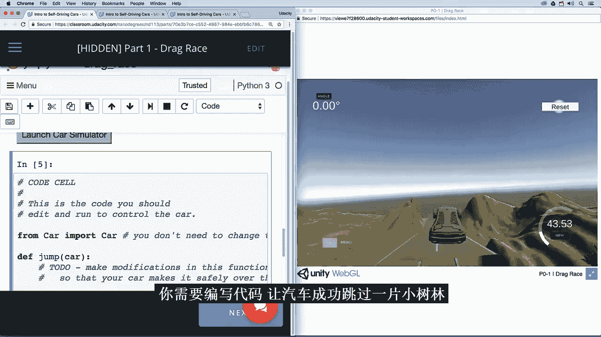
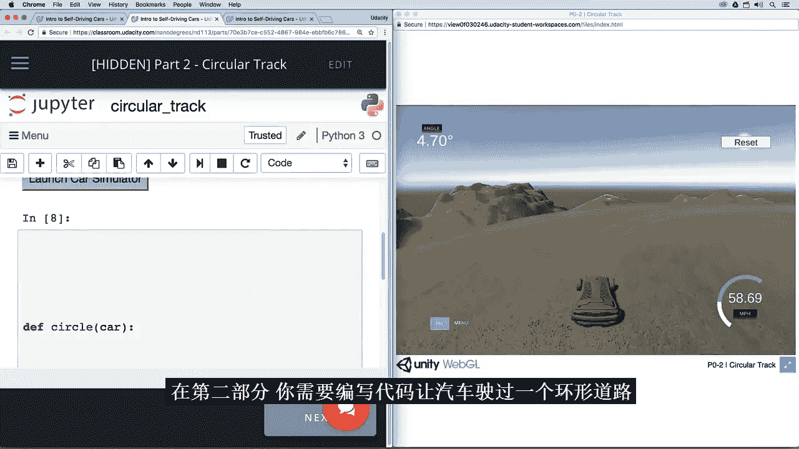
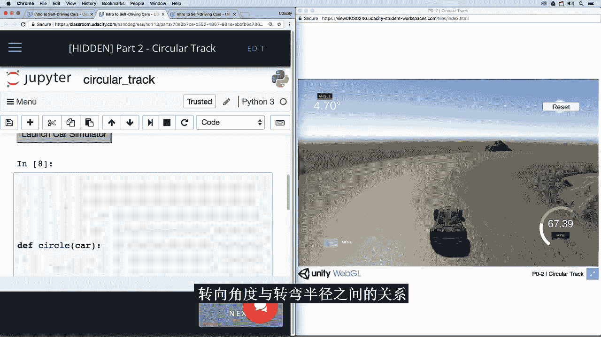

# 优达学城（Udacity）：无人驾驶汽车纳米学位项目-十位大牛亲授自动驾驶技术，硅谷前沿科技（计算机视觉⧸车道识别⧸感知控制⧸人工智能⧸谷歌） p04 4. Part 02-Module 01-Lesson 02_Joy Ride [BV1Vd4y1r7QG_p4]

Welcome to Project Ze， This is a quick project that gives you a chance to get your hands dirty。

 writing code that controls a simulated car。This project has three parts。

 and in each part you'll write code to solve a particular driving situation。In the first part。

 youri code that lets a car successfully jump over a small grove of trees。 Now。

 this isn't a common self driving car problem， but the real goal here is just to get you used to the programming interface that you'll be working with。

 In part 2， youri code that lets a car navigate a circular track。 and in doing so。

 you'll be exploring the relationship between steering angle and turning radius。😊。

We won't get into the math now， but later we'll dig into this math more deeply and refer back to this part of the project when we do。

 in the third part， you'll write a function which actually performs a sequence of steps to do something that a lot of human drivers really struggle to do。

Parael park， a car。