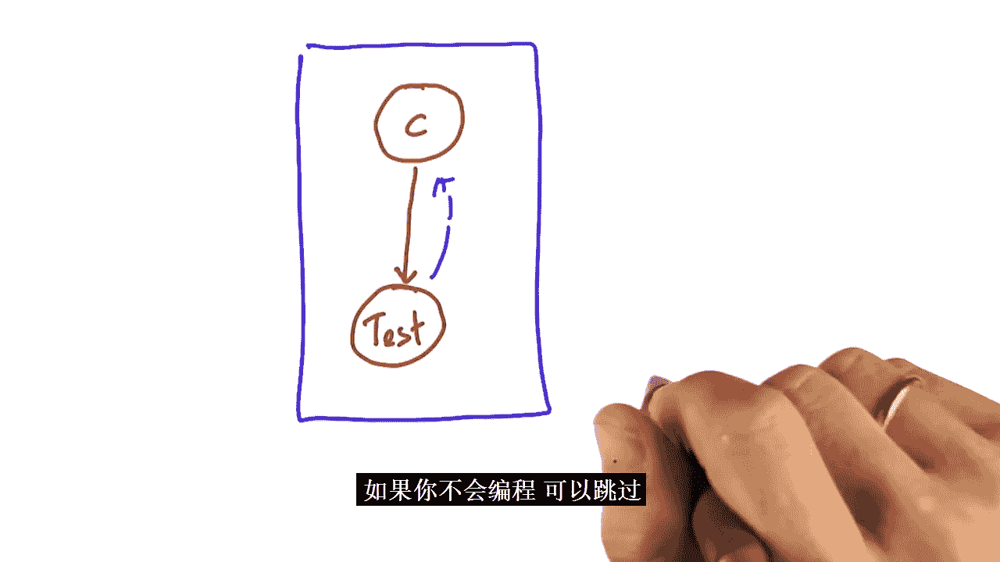

# 优达学城（Udacity）：无人驾驶汽车纳米学位项目-十位大牛亲授自动驾驶技术，硅谷前沿科技（计算机视觉⧸车道识别⧸感知控制⧸人工智能⧸谷歌） p08 8. Part 02-Module 01-Lesson 06_Bayes' Rule [BV1Vd4y1r7QG_p8]

Let's talk a bit more about why uncertainty is so important in the field of robotics and self driving cars。

 We know that measurements like the speed， the direction and the location of a car are challenging to measure。

 and we can't measure them perfectly。 There's some uncertainty in each of these measurements。

 We also know that many of these measurements affect one another。 For example。

 if we're uncertain about the location of a car， We can reduce that uncertainty by collecting data about the car surroundings and its movement。

😊，Selfdriving cars measure all of these things from a car's speed to the scenery and objects that surround it with sensors。

 And though these sensor measurements aren't perfect。

 when the information they provide is combined using conditional probability and something called Bay rule。

 They can form a reliable representation of a car's position， It movement and its environment。

 Let's take a look at Bayase rule。 Bayase rule is extremely important in robotics。

 and it can be described in one sentence， given an initial prediction if we gather additional related data。

 data that our initial prediction depends on。 We can improve that prediction， For example。

 let's say our initial prediction also known as a prior belief is an estimate of a car's location on a road。

 This might be the location given by a slightly inaccurate GPS signal。

 Then we use sensors to gather data about the car's surroundings and how the car is moving。😊。

How do you think this sensor data can help us improve our initial location prediction？

Once we gather sensor data about the car's surroundings and its movement。

 we can then use this information to improve our initial location prediction。 For example。

 say we sense lane markers and specific terrain， and we say hm actually。

 we know from previously collected data， that if we sense lane lines close to the sides of the car。

 the car is probably located in the center of the lane。

 We also know that if we sense that our tires are pointed to the right。

 we're probably on a curved section of the road。😊。

So this sensor data， combined with what we already know about the road and the car。

 gives us more information about where our location is most likely to be。

 so using this sensor information， we can improve our initial prediction and better estimate our car's location。

Byase rule gives us a mathematical way to correct our measurements and lets us move from an uncertain prior belief to something more and more probable。

 You'll see Bays rule come up again and again in robotics。 And in this lesson。

 you'll gain a greater understanding of Bayes rule。 So this unit is a tough one。

 You're going to talk about perhaps the holy grail of probabilistic inference。

 It's called Bayes rule。😊，Base what is based on Reverend Thomas Bes。

 who used this principle to infer the existence of God。

 but in doing so he create entirely a new family of methods that has vastly influenced artificial intelligence and statistics。

So let's dive in。Let's use the cancer example for my last unit。

 say there's a specific cancer that occurs in 1% of the population in the test for this cancer and with 90% chance。

 it is positive if we have this cancer C。That's usually called the sensitivity。Of a test。

 But the test sometimes is positive， even if you don't have C。So let's see。With another 90% chance。

 it is negative if we don't have C， this usually called the specs。Xi。😔，tivity。So here's my question。

 without further symptoms， you take the test。And the test comes back as positive。

 What do you think is not the probability of having that specific type of cancer to answer this。

 let's draw a diagram。 So pause these are all the people。 And some of them。

 exactly 1 per cent have cancer。99% cent is cancer free。 We know there's a test。

That if you have cancer。Correctly， this diagnosed with 90% chance。

So if you draw the area where the test is positive。Cancer and。Test positive。

Then this area over here is 90 per cent of the cancer circle。 However， there isn't the full truth。

 The test sentence is positive， even。If the person doesn't have cancer。In fact， in our case。

 that happened to be in 10% of all cases。 So if you have to add more area。

It's as big as 10% of this large area。It is as big as 10% of this large area。

Where the test might go positive， but the person doesn't have cancer。

So this blue area is 10% of all the area over here minus the little small cancer circle。 and clearly。

 all the area outside these circles。Porsponds to situation of no cancer。And the test is negative。

So let me ask you again。Suppose you have a positive test。What do you think？

With a prior probability of cancer of 1%。A sensitivity and specivity of 90%。

Do you think your new chances are now。90% or 8%。Or still just 1%。

And I would argue it's about 8 per cent。 In fact， as we'll see。

 you'll come out at 8 and a third per mathematically。

And the way to see this in this diagram is this is the region in which the test is positive。

 by having a positive test， you know you're in this region and nothing else matters。

 You know you're in this circle。But within this circle。

 the ratio of the cancerous region relative to the entire region is still pretty small。 it increased。

 obviously having a positive test。Changes your cancer probability。

 but it only increase it by a factor of about 8， as we'll see in a second。

 So this is the essence of base rule， which I'll give you in a second。

 There are some sort of a prior by which we mean the probability before yourvanna test。

 And then you get some evidence from the test itself。

 And that all leads you to what's called a posterior probability。No。

 this is not really a plus operation。 In fact， in reality it iss more like a multiplication。

 but semantically what base does is it incorporates some evidence from a test。

Into your prior probability to arrive at a posterior probability。So just make this specific。

In our cancer example， we know that the prior probability of cancer。Is 0。01。

 which is the same as 1 per cent。 The posterior of the probability of cancer。

 given that our tests is positive， abbreviated here as positive is the product of the prior times or test sensitivity。

Which is。Or the chance of a positive result， given that I have cancer。

 And you might remembered this sum was 0。9。Or 90%。 Now， just to warn you。

 this isn't quite correct to make this correct， we also have to compute the posterior for the non cancer option。

Briy has not cancer。Given a positive test。And that's using the prayer。We know that P of not C is 0。

99。It's 1 minus P of c times the probability of getting a positive test result， given not C。

Realize these two equations are the same， but exchange C for not C。

 and this one over here takes a moment to compute。 We know that our test gives is a negative result if it can free 0。

9 chance。 and as a result it gives us a positive result in the cancer free case with 10% chance。

 Now what's interesting is that this is about the correct equation except。

The properties don't add up to one。To see， I'm going to ask you to compute those。

 so please give give me the exact numbers for the first expression。

And the second expression written over here。Using our example up there。Obviously， P of c is 0。01。

Times 09 is 0。009， where is 0。99。Times 0。1， this guy over here is 0。099。

What we've computed here is the absolute area in here。Which is 0。009 in the opposite area in here。

 which is 0。099。The normalization proceeds in two steps。

 We just normalize these guys to keep the ratio the same， but make sure they add up to one。

 So it's first compute the sum of these two guys。 Please let me know this。And yes， the answer is 0。

108。 Techically， what does V means is the probability of a positive test result that' still area in the circle that it has marked you and my virtue of what we learned last is just the sum of these two things over here。

 which gives us 0。108。And now， finally， we can with the actual posterior。

 whereas this one over here is often called the joint probability of two events。

 and the posterior is obtained by dividing this guy over here。With this normalizer。

 So let's do this over here。 Let's divide this guy over here。

By this normalizer to get my posteror distribution having cancer。

 given that I received deposit positive test results to divide this number by this。And we get 0。0833。

As to know the same for the N non cancer version， Pick the number over here to divide and divide it by the same nominizer。

In the answer is 0。9167， approximately。Why don't you for a second add these two numbers and give me the result。

And the answer is one， as you would expect。 Now， this was really challenging。

 You can see a lot of math on this slide。 So let me just go over this again。And make it much。

 much easier for you。But Vivi said that we had a situation。With a prior。

 a test has a certain sensitivity and a certain specivity。 When you receive， say。

 a positive test result， What you do is you take your prior。

 you multiply in the probability of this test result， given and C。

 and you multiply in the probability of the test result， given and not C。

 So this is your branch for the consideration that you have cancer。

This is your branch for the consideration of no cancer。 When you're done with this。

 you arrive at a number。 The no combines the cancer hypothesis with the test result。

 both for the cancer hypothesis and the not cancer hypothesis。Now， what you do。

 you add those up and then normally。Don't add up to1。 You get a certain quantity。

 which happens to be the total probability that the test is what it was。 This case， positive。

 And all you do next is divide or normalize this thing over here。

By the sum over here in the same on the right side。

 the divider is the same for both cases because this is your cancer branch， your non cancer brain。

 But this guy doesn't depend on the cancer variable anymore。

 What you now get out is the desired posterior probability and those add up to one。

 If you did everything correct。 As shown over here。 This is your algorithm for a base rule。Now。

 the same algorithm works if your test says negative。And we practice this in just one second。

 Suppose your test results as negative。 You could still ask the same question。

 Now what's my probability of having cancer or not。

 But now all the positives in here become negatives。

 The sum is the total probability of a negative test result， and many now divide。By this guy。

 you now get the posteror probability for cancer and non cancer。

 assuming you had a negative test result， which， of course， will be much。

 much more favorable for you because none of us want to have cancer。 So look at this。For a while。

And let's now do the calculation for the negative case using the same numbers I gave you before。

 I'm going to do this step by step this time around so I can really guide you through the process。

We begin with our prior probability， our sensitivity and our specivity。

 and I want you to begin by filling in all the missing values。 so is the probability of no cancer。

 probability of negative， which is the negation of positive givenancy and probability of negative positive。

Give a not see， and obviously this is still in 0。99 as before 0。1 and 0。1。

I hope you got this correct。Now assume the test comes back negative。

 the same logic applies as before， so please give me the combined probability of cancer。

 given the negative test result and the combined probability of being cancer free。

Given the negative test result。The number here is 0。001。And it's the product of my prior for cancer。

 which is 0。01。And the probability of getting a negative result in the case of cancer。

 which is right over here，0。1。 If I multiply these two things together I get 0。001。

 the probability here。Is 0。891。 and what I'm multiplying is the prior probability of not having cancer。

 which is 0。99。With the probability of seeing a negative result in the case of not having cancer。

 and that is the one right over here， 0。9。 So if we multiply 0。99 with 0。9， I actually get 0。891。

So let's compute the normalminizer， you know remember what this was。And the answer is 0。892。

 You just add up these two values over here。And finally。

 tell me what is the posterior probability of cancer given that we know that we had a negative test result and the probability of not having cancer。

 given that if we had a negative test result， please give me your numbers here。

This is approximately 0。0011， which we get by dividing 0。001。By the normalizer 0。892。

 and the posterior probability of being cancer free after the test is approximately 0。9989。

And that's obtained by dividing this probability over here by the normalizer。 And not surprisingly。

 these two valuess indeed add up to one。 Now， what's remarkable about this outcome is really what it means Before the test。

 we had a 1 per cent chance of having cancer。Now we have about a ninth of a percent of having cancer。

So our cancer probability went down by about a factor of9。

 so the test really helped us gaining confidence of your cancer free。Conversely。

 before we had a 99% chance of being cancer free， now it's 99。89%。

So all the numbers are working exactly how you expect them to work。Let me know make your life harder。

 Suppose our probability of a certain other kind of disease is 0。1。 So 10% of the population has it。

 Our test in the positive case， is really informative。But there's a 0。

5 chance that if I'm cancer free。That the test indeed says the same thing。

 So the sensitivity is high。The specivity is lower。

 and let's start by filling in the first three of them。Obviously， these are just 1 minus those，0。9，0。

1 and0。5。 Notice that these two numbers may very well be different。 Theres no contradiction here。

 These guys have to add up to one。 So given not see the probability of positive and negative have to add to1。

 but these guys don't takes a lot of practice to understand which numbers have to add up to1。

 but I set it up in a way that you should have gotten it right。Now comes the hard part。

What does P of C common negative？And the answer is 0。01， P of c is 0。1。

 and P of negative given c is also 0。1。 So if you multiply those to a 0。1。

Now what's the same for P of not C common negative。And the answer is 0。45， not C is 0。

9 and negative given not C is 0。5。 So 0。9 times 0。5 is 0。45。What's this guy over here。Well。

 you just add up these two numbers to get 0。46。So tell me what the final two numbers are。

The first one is 0。01 divided by the normalizer 0 dot 4，6， And that it gives us 0 dot 0217。

 And the second one is。This curve over here is 0。45， divided by 0。46， and it gives us。0。97。A3。

In these are the correct posteris， we started out of the chance of 10% of having cancer。

 we got a negative result we download to about 2% of having cancer。

Let's now consider the case where the test result is positive。

 and I want you to just give me the two numbers over here。Not the other ones。So once again。

 we have 0。9，0。1 and 0。5 over here， very quickly multiplying this guy with this guy over here。0。09。

 this guy with this go over here。ze，4，5。Eding up gives us。005，4。And dividing those correspondingly 0。

9 divided by 0。54 gives us 0。166 and so on in 0。8，3，3 and so on，4 dividing 0。45 by 054。

And what this means with a positive test result， our chance of cancer increase from 0。1 to 0。16。

 obviously our chance of having no cancer decrease accordingly。You got this。So let's just summarize。

In base rule， you have a hidden variable you care about whether they have cancel or not。

I we can measure it directly。 And instead， we have a test。

We have a prior of how frequent this variable is true。

 and the test is generally characterized by how often says positive when the variable is true and by often says negative。

In variable as false。Basedase on or prior multiplies in the measurement。

 which in this case is soon to be the positive measurement to give us new variable and does the same for or actual measurement。

 given the opposite assumption about our hidden variable cancer。

And that multiplication gives us this guy over here。 We add those two things up。

 and it gives us a new variable， and then we divide these guys to arrive at our best estimate of the hidden variable C。

 given our test result。 And in this example， I use the positive example as a test result。

But he might do the same with a native example。 This was exactly the same as in our diagram。

 In the beginning， there was a prior of all case that have this specific variable to be true。

 We noticed inside this prior。To can cover the region for which a test result applies。

 We noticed the test result might also apply。When the condition is not fulfilled。

 so this expression over here and this expression over here corresponds exactly to the we area over here and the green area over here。

But then we notice that these two areas don't add up to one the reason there's lots of stuff outside。

 so we calculated the total area， which was this expression over here。P pauses。

 And then we normalized these two things over here by the total area to get the relative area that is assigned to the red thing was the green thing。

 And it was done by just dividing by the total area in this region over here。

 thereby getting rid of any of the other cases。Now， I should say if you got this。

 you learn something really significant about statistics and probability。

 This is totally non trivial， but it comes in very handy。 So I'm going to。

Practices with you using a second example。 In this case， you are a robot。

 This robot lives in a world of exactly two places。 There's a red place。In a green place。R and G。

 Now， say initially， this robot has no clue where it is。 So the prior probability for either place。

 red or green。Is 0。5。 It also has sensors you can see through its eyes。

 but its sensors tend to be somewhat unreliable。So probability of seeing red at the red grid cell is 0。

8 in the probability of seeing green。E the greener itself。Is also 0。8。 Now。

 suppose the robot sees red， What are now the posterior probabilities that the robot。Is。

At the red cell。Given that it just saw red。 and conversely。

 what's probability that it's at a green cell， even though it's saw red。 Now。

 you can apply base rule and figure that out。And this example gives us funny numbers。

The for red is 0。8。The month forgvin is 0。2。 and has all to do with effect that in the beginning of what had no clue where is。

 the joint for red。After seeing greater is 0。4， the same for green is 0。1。0。4 plus 0。1 S to 0。5。

 if you now normalize 0。4， divide by 0。5， you get 0。8 and if you normalize 0。1 by 0。5， you get 0。2。

If I'll change some parameters， say the robot knows the probability 0， It said red。 and therefore。

 a probability 1。 It's on the green cell as a prior。 Please calculate once again。

 using base rule these posteriors。 And have to warn you， this is a bit of a tricky case。

And the answer is。The prior isn't affected by the measurement。So if probably is0。

 It's a red and probably a one。 It's a green， despite the fact that it saw red。To see this。

 you find that the joint of being at red and seeing red is 0 times 0。8。 That's 0。

 the same joint for green is 1 times 0。2，0。2。So we have to normalize 0 and 0。2。

 the sum of those is 0。2。So it's divide 0 by 0。2 gives us still 0， and 0。2 divided by 0。2 gives us 1。

 and these are exactly the numbers over here。Let's change this example even further。

 Let's make this over here as 0。5 and revert back to a uniform prior。

Please go ahead and calculate our post probability。Now， the answer is about 0。615 was 0。385。

These are approximate once again， 0。5 times 08 is 0。4。0。5 times。Or minus this guy again， 0。5 0。25。

8 those up0。65。Normalizing 0。4 divided by 0。65 gives approximately 0。615。0。25 divided by 0。

65 is approximately 0。385。 So now you got it。I will now make her life really heart。

 S there are three places in the world， not just two。A red one and two green ones。

 And for simplicity de quantum A， B And C。 let's assume that all of them have the same prior probability of a third or 0。

333 and so on。 Let's not say the robot Cs red and as before for probability of seeing red in cell A is 0。

9 or will the seeing green in cell B is 0。9。But we is seeing in green in C C is also 0。9。

 So what I've changed is I've given the hidden variable。

 kind of like the cans and non cancercer variable， three states， It's not just two as before。

 A or or B， It's not A， B or C。 Let's solve this problem together because it follows exactly the same recipe as before。

 even though it might not be obvious。 So let me ask you。What is the joint of being and cell a。

After having seen the red color， this is the join us before。And just like before。

 we multiply the prior with this guy over here。Tick it 0。3。What's the joint for cell B。Well。

 the answer is we multiply or prior over third with the probability of seeing red in cell B。

 Now seeing green has 0。9 probability。 So red is 0。1， So 0。1 times this over here gives 0。033。

Finally， probability of C when you see red， what is that？

And the answer is exactly the same as this cow over here。

Because the prior is the same for B and C and those probabilities are the same for B and C。

 so this should be exactly the same。So use the 100000 dollar question， what is our normalminizer？

And the answer is you just add those up。And now we calculate the desired posterior probability for all three possible outcomes。

 So please。Plug them in over here。As usual， we divide this guy over here by the normalminizer。

 which gives us 0 to 818， realize all these numbers are a little bit approximate here。

Same for this guy， it's approximately 0。091。And this is completely symmetrical，0。091。 in surprise。

 these guys all add up to one。So what have you learned？In base rule。

 there might be more than just two underlying causes of cancer， non cancer， there might be3。

4 or5 any number， you can apply exactly the same math， but you have to keep track of more values。

In fact， the word might also have more than just two test outcomes here。 It was red， or green。

 but it could be red， green or blue。 And this means that our measurement probabilities will be more elaborate to have to give you more information。

 but the math remains exactly the same。 We can now deal with very large problems that have many possible hidden causes of where the word might be。

And we can still apply base4 to find all these numbers。 Let me give you one final test。

 This test is actually directly taken from my life。 and you'll smile when you see my problem。

 I used to travel a lot。 It was so bad for a while。 that would find myself in a bed。😊。

Not knowing what country I'm in。 I kid you Not。 So let's say I'm gone 60 per cent of my time。

 And I went home。 only 40 per cent of my time。 Now， it's summer。 I live in California。

 and it typically doesn't rain in the summer。 Whereas in in many of the countries I travel to。

 There's a much higher chance of rain。 So let's now say I lie my bed Here I am lying in bed。

 and I wake up。 and I open the window。 and I see it's raining。 Let's now apply base rule。

 What do you think is's probability。I am home。 now that I see it's raining。

 Just give me this one number。And I get 0 to 0，2，1，7。Which is a really small thing。

 And the way I get there is by taking home times the probability of rain at home， normalizing it。

Using the same number over here， plus the calculation for the same probability of being gone。

Theres 0。6 times the if I'm going as the probability of 0。3。And that。Rezo to 0。0217。

 or the better of 2%。 Did you get this。If so， you now understand something that's really interesting。

 You' are able to look at a hidden variable， understand how a test can give you information back about this hidden variable。

 and that's really cool because it allows you。😊，To apply the same scheme to great many practical problems in the world。

 congratulations in our next unit， which is optional。 I let you program all this。

 So you can try the same thing in an actual programming interface and write software that implements things such as base rule。

 but not to worry this is optional。 if you don't know how to program。 Just skip the next unit。😊。

