# 优达学城（Udacity）：无人驾驶汽车纳米学位项目-十位大牛亲授自动驾驶技术，硅谷前沿科技（计算机视觉⧸车道识别⧸感知控制⧸人工智能⧸谷歌） p09 9. Part 02-Module 01-Lesson 08_Probability Distributions [BV1Vd4y1r7QG_p9]

Now we talk about probability distributions。 A probability distribution is the way in which a self driving car represents its internal beliefs about the world。

 So when a car， for example， sees a tree。Then internally。

 it uses a probable distribution to represent its belief of the chances is facing a tree。

So let's dive in。You've seen how autonomous vehicles sense their environments and then use that information to lower their uncertainty and improve their predictions about a car's movement and surroundings。

But how do autonomous vehicles actually represent uncertainty in the real world？

They use probability and probability distributions probability distributions are a mathematical way to represent uncertainty across all possible outcomes。

For example， in the case of locating a vehicle， the possible outcomes are all the places where the vehicle could be。

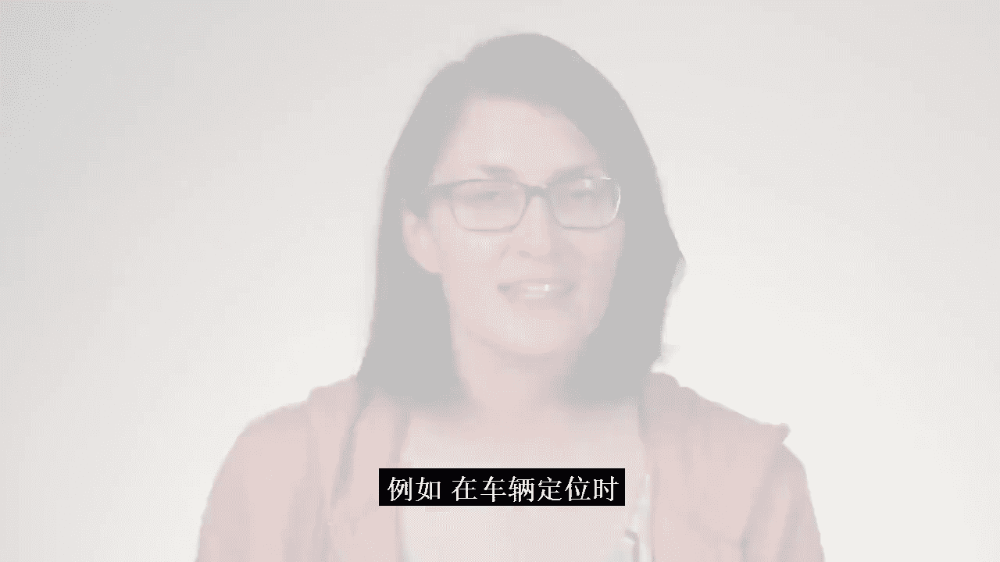

When a vehicle first turns on， the car has no idea where it is。

How do you think you could represent this initial uncertainty mathematically？

If you have no idea where a car is located in the world。

 the probability distribution for its location will look completely flat。

The probability of it being anywhere， say in San Francisco or in Tokyo， will be the exact same。

The probability that the car will be at any particular location will be a constant value that's the same at every location。

 So the probability distribution can be represented by a constant horizontal line on a graph that shows the probability of all these outcomes。

But as we gather more information， this distribution will change。

Say we get a GPS sensor reading that tells us that we're a lot closer to San Francisco than to Tokyo。

The location probability goes up near the GPS measurement。

 and the probability goes down in regions far from the GPS measurement。

And even though the GPS signal isn't perfect， you have more information about the likely location of your car。

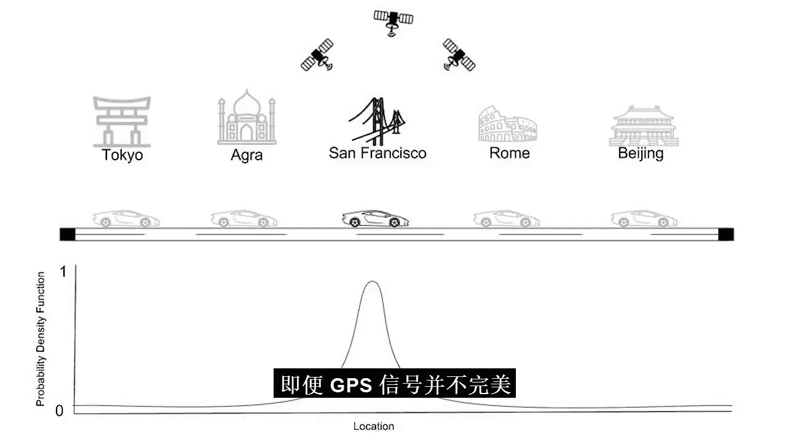

The vehicle is never 100% sure of its location， yet through sensing。

 the vehicle increases its certainty。The shape of the probability distribution tells you the most likely locations and the least likely locations of the vehicle。

Probability distributions are really useful ways to visualize and represent uncertainty。

 not just in single vehicle localization， but also in tracking the locations of pedestrians。

 bicycles and other moving vehicles around a car。These distributions are also used in representing uncertainty in sensor measurements。

Remember that autonomous vehicles are robots on wheels so everything from sensing。

 measuring and moving will involve some uncertainty。

 So in this lesson you're going to learn how to draw and interpret probability distributions。

 This will prepare you for vehicle localization and object tracking。

 So today I want to talk a little bit more about probability distributions。

 and specifically talk about what's called continuous distributions because there's some caveat that you should be aware of as you go forward in this class。

 So here's a new prop it's a Nf gun they actually shoot like this。

 and we have a lot of those uudacity。😊。

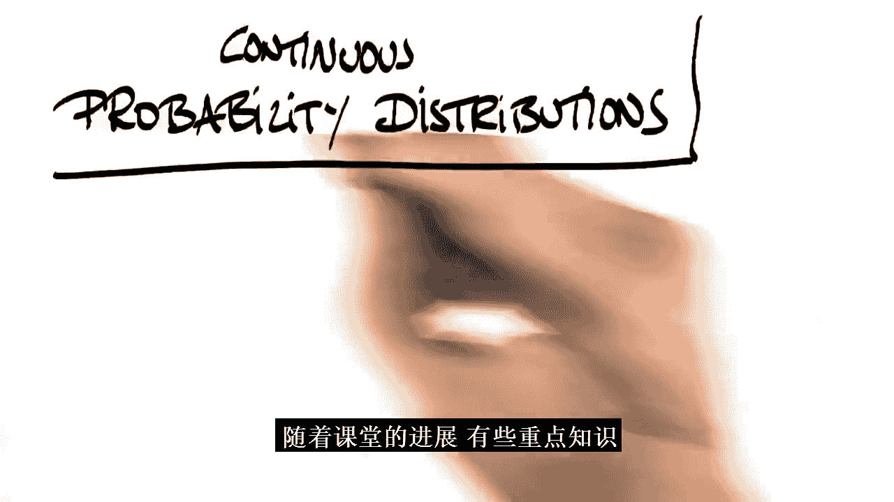

And I want to now do an experiment in which I shoot a projectile and some hits the ground。

 say between this location over here and this location over here， I just don't know。

To call this A And B， the question I want to raise is a tricky one。 Consider any location X。

 assume that the angle of the nerve can is somewhat random。

 And so is the pressure behind the projectile。 What's the probability that any specific x that you might choose is the correct one。

And the answer is 0， nothing else but 0， because any specific value over here is just really。

 really unlikely。 So unlikely we can' give it a probability。

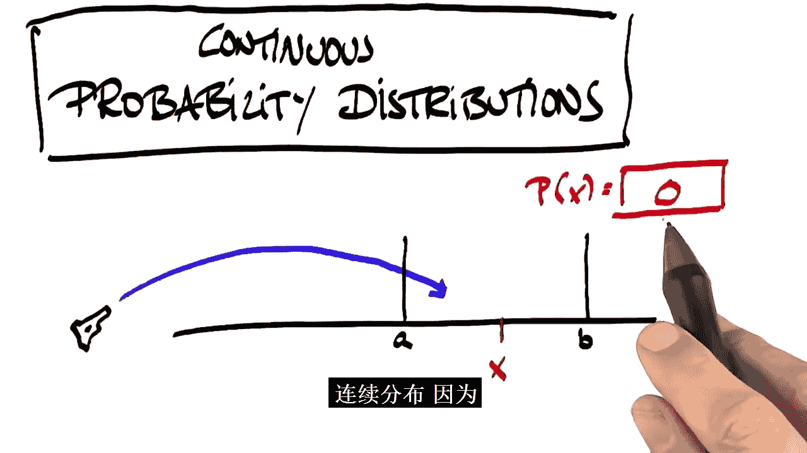

This is a more common example。 It's called the wheel of fortune。

 We are twisting an object like a bottle or like a pen and then devices at a specific angle。

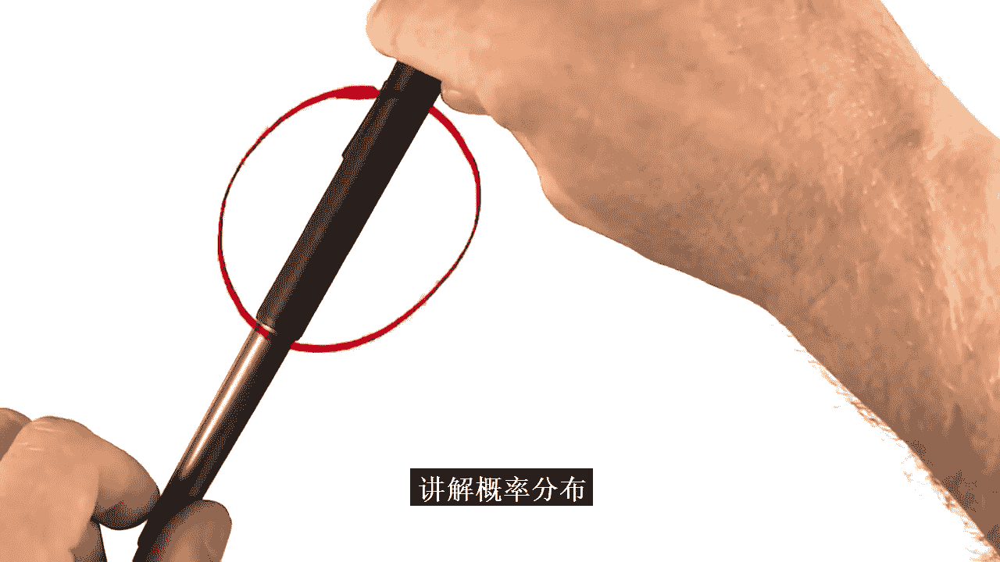

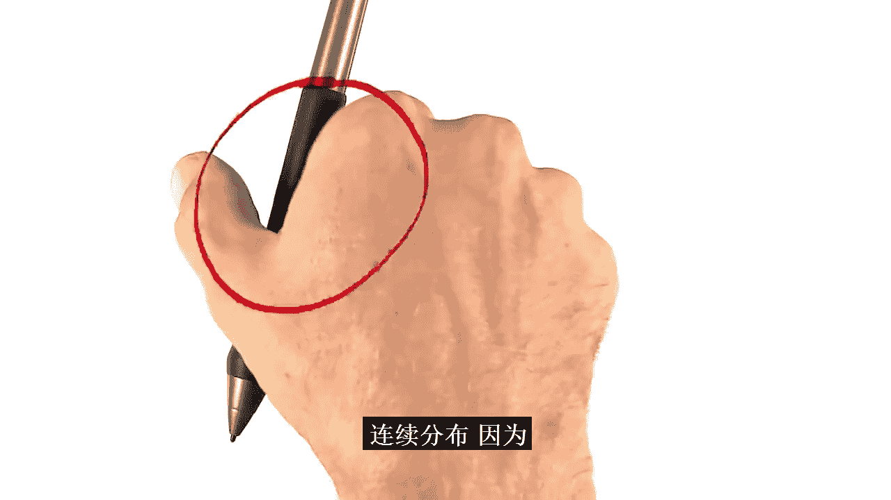

We all know that angles go between 0 and 360 degree。 So let's pick a specific angle。

 What is the probability that our object has the very precise angle，180 degrees。And the answer is 0。

 It's 0 for any other number，1，79。99。179。98 and so on。 Each angle has probability 0。 That's because。

Getting that exact angle right with exact the right decibels。You just won't be able to get there。

So now here is the conundrum。Does this mean that the object stops nowhere， Yes or no。Say yes。

 if you believe it stops nowhere。And， of course， it stops。 So no the right answer。

 But the bizarre thing is it's going to have an angle like this one over here。

 This might be  hundred1。374819 and so on。 And this number truly has probability 0。

 So whatever the outcome is， that specific outcome。

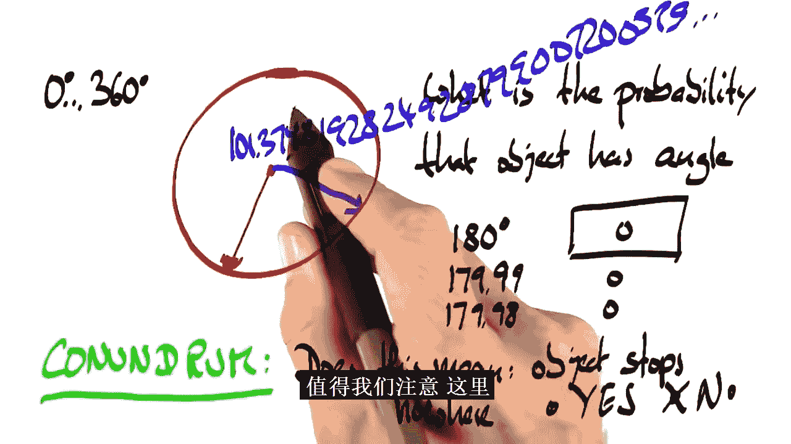

Will be unlikely so unlikely as probability 0。 And it's one of the bizarre things about probability when you go to continuous spaces in continuous distributions。

 every outcome has probability0。 and that might sound entirely counterintuitive， and it is。

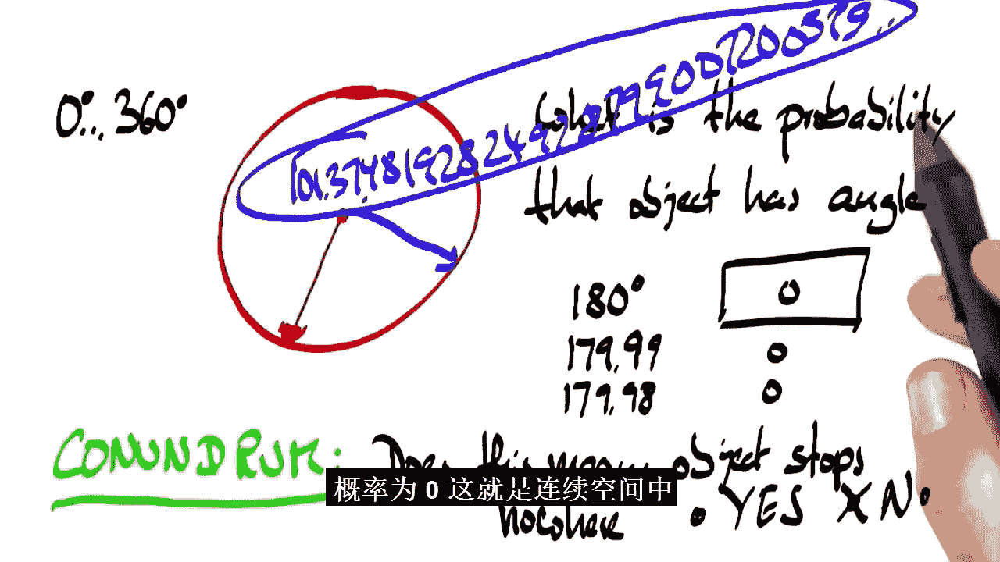

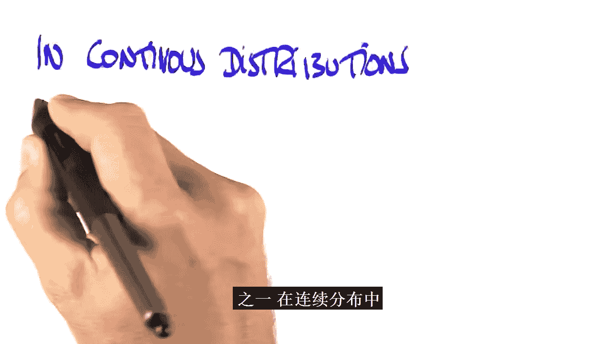

But it's important to understand。let's now redefine how to treat continuous distributions。

 Here's our circle again， and here's the bottle that we are spinning。 Let's call the outcome X。

 That's the final angle。

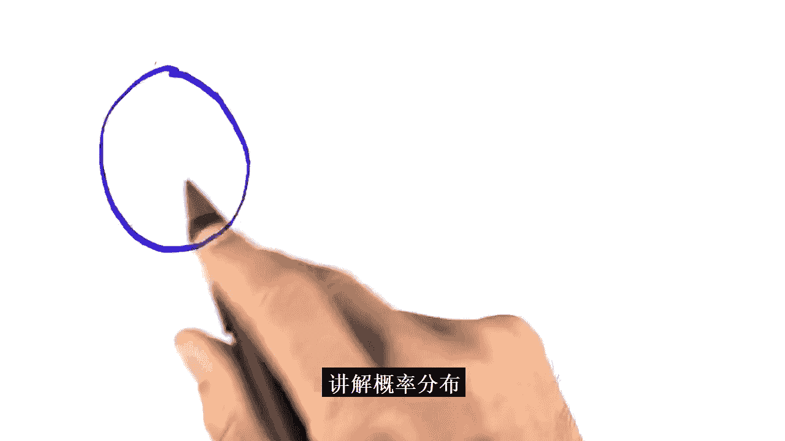

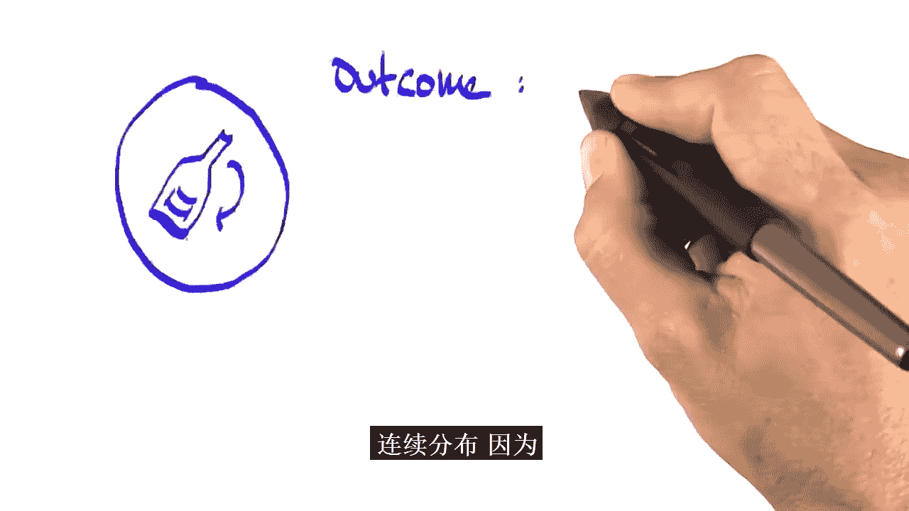

Of which the bottle arrives。 Tell me what's the probability that x is between 0 and 180 degrees。

 Put the answer here。

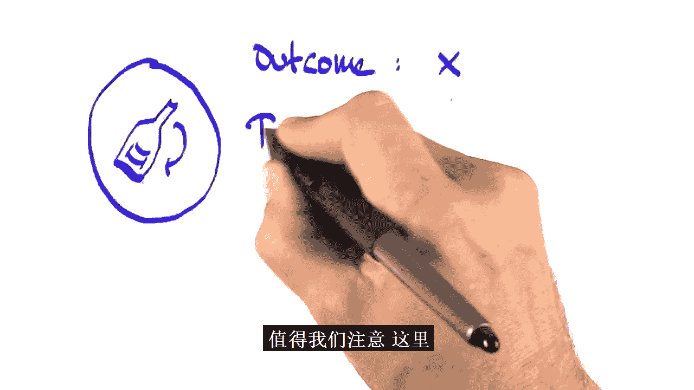

And you guess correctly， it's a half。 Theres a 50% chance of being between 0180 and a 50% chance of between 180 and 360。

 How about the interval，260 degree all the way to 290 degrees。 What's the probability。

This actually a 12，0。0833 and so on。Okay， let's make this interval really really small。

 Let's see we go from 1，79 degrees to 1，80 degrees。 So it's specific up to a single degree。

 but it' still an ever so slight range in the spectrum over here。 What's the probability。It's 0。

002777， which is the same as 1 over 360。 So obviously。

 the probability for any interval defined by A And B is the size of the interval divided by 3 60。

 And if you got those right。 you understand all this。

 So I'm now going to teach you a concept that is very deep or the density of a probability。

 And it's kind of like a probability for a continuous spaces。

 but not exactly it's just a good motivator to think of a density as a of the probability of your continuous spaces。

 Let's take the bottle example。 We know that the outcome of turning the bottle lies between 0 and 3 60 degrees。

 So given what we learned， you want to assign 0。😊。

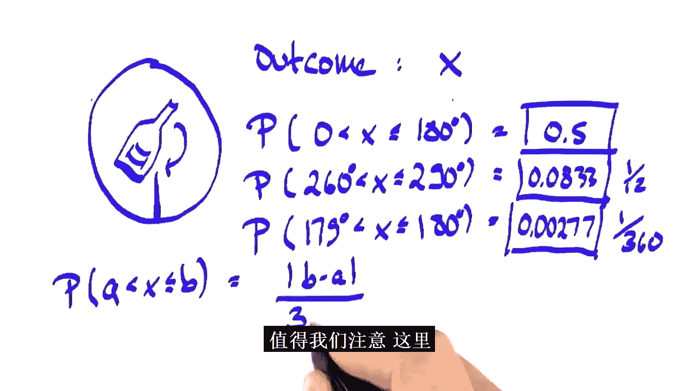

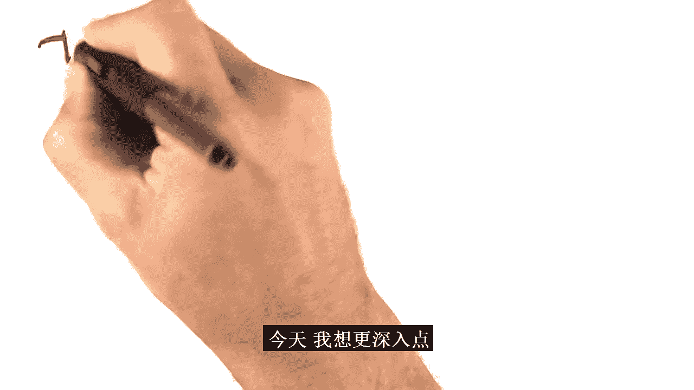

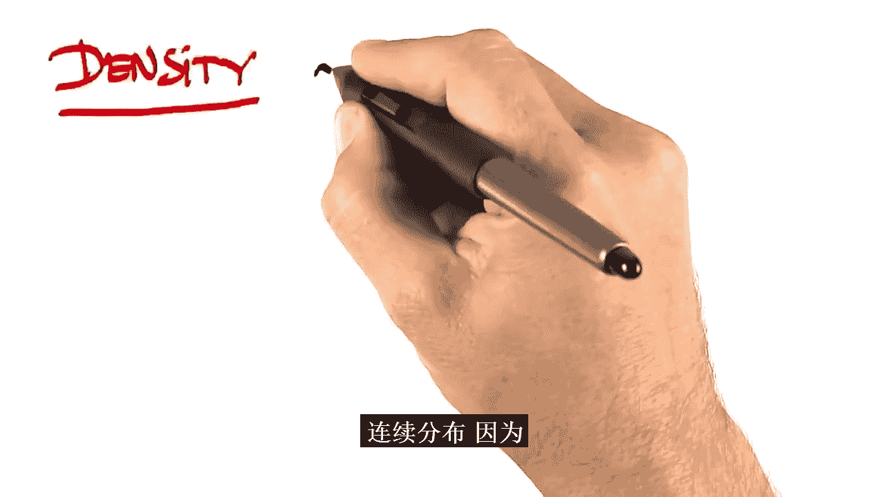

To anything outside that range。 But inside this range， we'd love to give a value and say， look。

 there's a function here。 There renders every outcome in this interval。Equally likely。

 So you want construct this function for me。 and I give you two constraints。 Constraint number one。

 each outcome in the range of 0，2，3，60 has an equal value and constraint number 2。

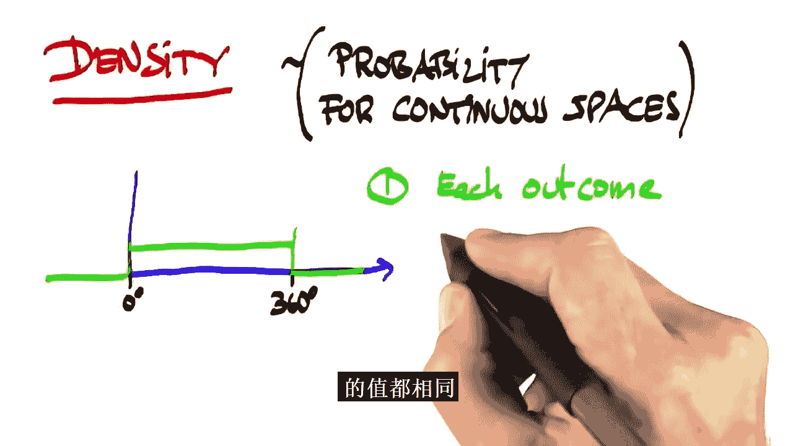

The area under this function， sums up or integrates。2，1， which means。This area over here is just one。

 So tell me， what is this function for x's that are between 0 and 3，60 degrees。

 There's a single numericalmer value that goes in here， and you have to guess it。And the answer is。

 again，0 dot 0，0，2，7，7，7 and so on。Which is the same as one over 3，60。

And the way to see this is that the width of this interval over here is 360。

 We didn't know the height， which is what I ask you to guess。But if we multiply 3，60 by  one over 3。

60， then the area of this rectangle over here becomes  one。 So let's do this again。

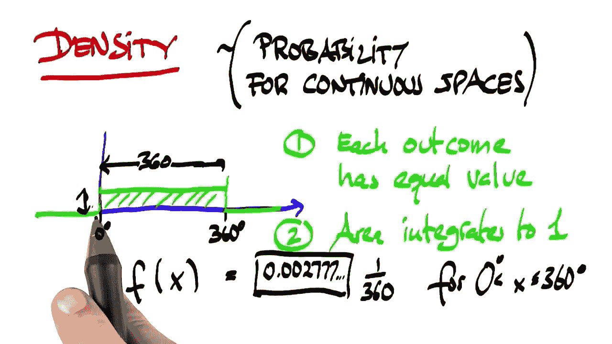

Suppose to look at the date and time。 you were born and a specifically look not the date。

Not in the time。But just the seconds of the time。 So it could be that we've drawn exactly as the minute began。

 in which case of was 0 or exactly at second 59。282。 I don't know。

 Let's assume it's completely uniform。 There's no preference to be born early in the minute or late in a minute。

 I'm going to ask you two questions now。For any such thing。

 X where x is the seconds of the time stampamp。What's the probability of that specific x and what's the density of that specific x？

And might me， these are actually different questions。And the correct answer is 0。

 Any specific continuous thing is 0 for uniform distribution。

 we find that the interval were talking about skate between 0 and 60。

 So the correct answer is 1 over 60， and it is 0。01666。

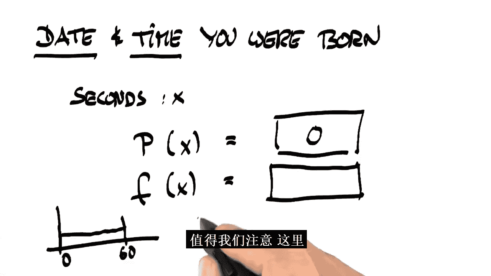

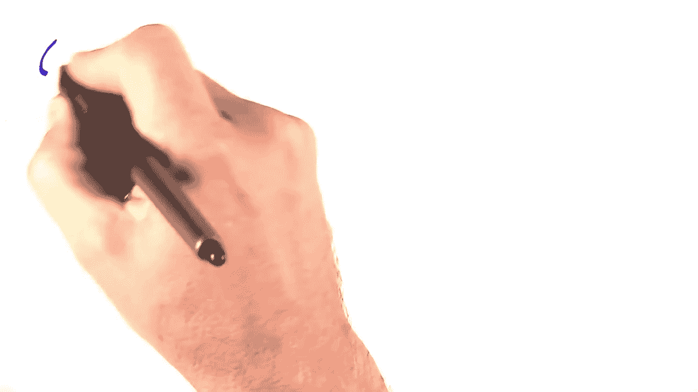

So here's a new quiz。 And in this quiz， we'll be looking into densities that are。

Non uniform in particular， I'm looking at the time of day when people are born。

 And let's assume for this exercise that it's twice as likely to be born before noon than in the afternoon or the evening。

 So if you look at the time of day and the density for the time of day。

 I wonder if the shape is like this this is 0 and this is midnight by at 24。Perhaps， like this。

Or more like that。 Pick the one that you think is most plausible。This is the 1 I would pick。

 And the reason if it's twice as likely to be born before noon。

 that means the density in the morning， before noon should be twice as high as the density in the afternoon。

 And that's best depicted by this diagram over here。 This one would be uniform。

 So ignoring the effect twice as likely。 And this is even worse。

 It emphasizes the afternoon over the morning。😊。

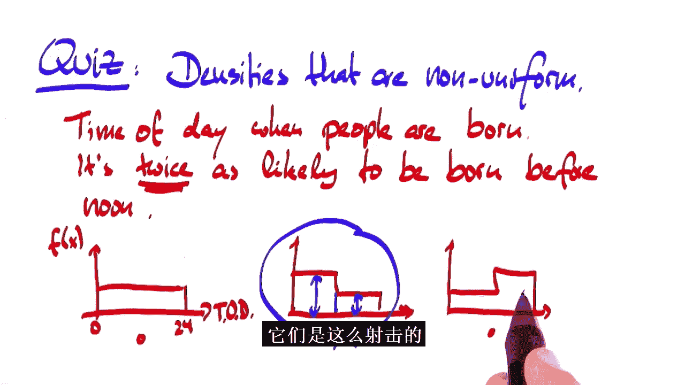

And now comes the hard part。 I want you to calculate the actual density。

 We know that the density for。The birth time to be before noon is twice as large as the density for being born after noon。

 So here's my density function， time of day。

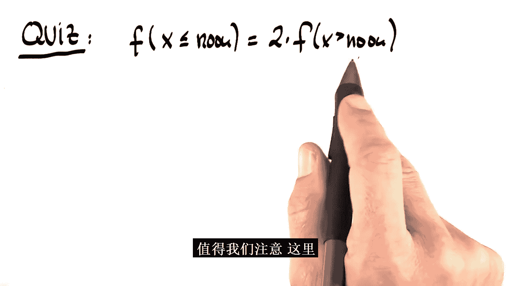

X。And f of x。And you already identified the shape， and there's now two parameters， A and B。

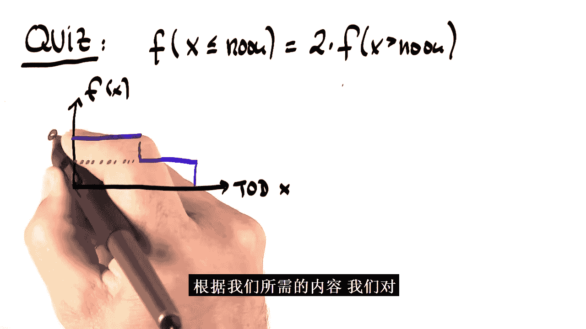

I want you to figure out for me what a is。And what be is assuming that the basic unit here is in ours prodently。

There's 24 hours。Horizontally in this interval as a hint。

 make sure that the area underneath sums up to one。And here's how I calculated。

 These three areas over here are all of the same volume。 Since they have to add up to one。

 Each of those has exactly a third。 Now， let's start with the right one。

 If this is the third in area， and we have to cover 12 hours。Then， B。Equals the third。Times the 12。

 which is 0。0277。 The one on the left is exactly Pa size，0。0555， which is2 third times the 12。

 once 1，18th。And if we multiply a。By 12， because the density over here applies to 12 hours plus B by times 12。

 Tell me what the resulting number is。And I hope you got this right is， of course， one。

 because the surface area has to add the one。 This' is just the cross check over here， whereby1。

18th times 12 is。2 thirds and 1，36 times 12 is one third and two thirds plus 1 third equals 1。

 So this was an example of a non uniform density that you were able to compute。 As you can tell。

 each specific birth time has exactly probability 0。 and this is just a density。

See here's another quiz。 We're dropping a package out of an aircraft， and the package goes down。

And if we happen to know， it takes between 3 and 3 and a half minutes to reach the ground。

 And let's say in between， the probability density is uniform， asking you the same question again。

There's something to be learned here。Yes 3。Hes three and a half。Obviously， the density outside is 0。

Is uniform， and there's a value here， a。And I want you to tell me， what is a。And in my calculation。

 a is 2。 And the reason is the normalizer over here is a half from3 to3 and a half to multiply a half with two gives us the area of one。

 which is what we want to have。For density。 Now， what's interesting here。 A is larger than one。

 probabilities are never larger than one。 They're bounded above than one。

 but densities can be larger than one。 In fact， if this package were to arrive between3 minutes and 3 minutes and one second。

 then this would be 60。😊，Because it's 60 seconds in a minute。

So it is possible that densities become largerer than one。

 That's a bit confusing if you think of its probability。 But you should know that this is the case。

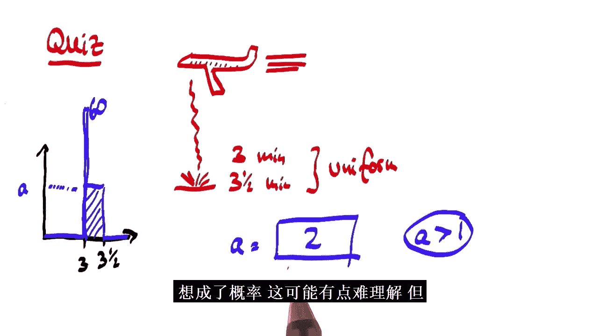

Let me ask another trick question。 And that's somewhat academic for a function F to qualify as identity。

 which of the conditions have to be fulfilled， has to be positive， non negative。

 continuous and small or equal to one。 Check any or all that apply。Including the none of above。

 if you believe none of those apply。And this is a really tricky question。 So， clearly。

Densities don't have to be positive everywhere。 It suffices to be no negative。

 And I gave you examples where outside a certain interval。 densityity was 0。0 is not positive。

0 is just non negative。 Now， densities don't have to be continuous。

 I gave an example of a density like this。 And over here， where the density jumped。

 youre a point of discontinutinuity。 So continuous is not correct。

 And if you got this wrong noob bigic deal， The word continues might not even mean much to you。

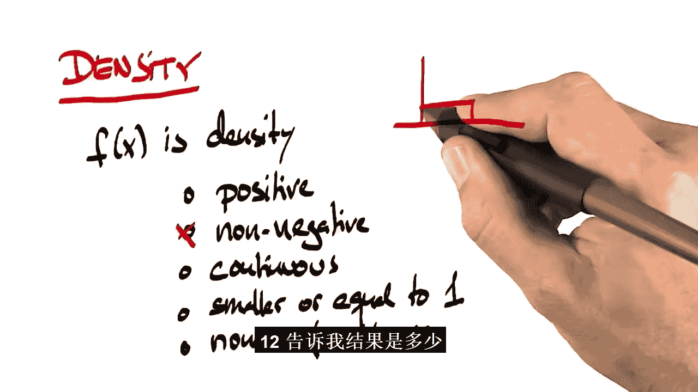

But it's one of these things to know about densities。 Now， small or equal to  one。

 That's a really tricky one。 And I would submit that's not correct。 And here's why。

 Suppose you have a density。It assigns uniform probability only to values between 0 and 0。1。

Then the height of this density。Could be 10， it's1 over the0。1。And as a result。

 it's possible that densities can exceed one。 And that is a key point that makes them different from probabilities。

 Probabilities are always small and equal to one。 Densities can be larger than one。

So you just learned about the concept of a probability density。 And that's very cool。

 You now't know what the uniform density is。 You've encountered a new type of density that had a step in the middle。

 And later in this class， we can to see densities that are really funny like this one over here。

 called the Gaussian。 We get back to this after we talk about large numbers。😊。

And something funky called the central limit theorem， or C， L T。

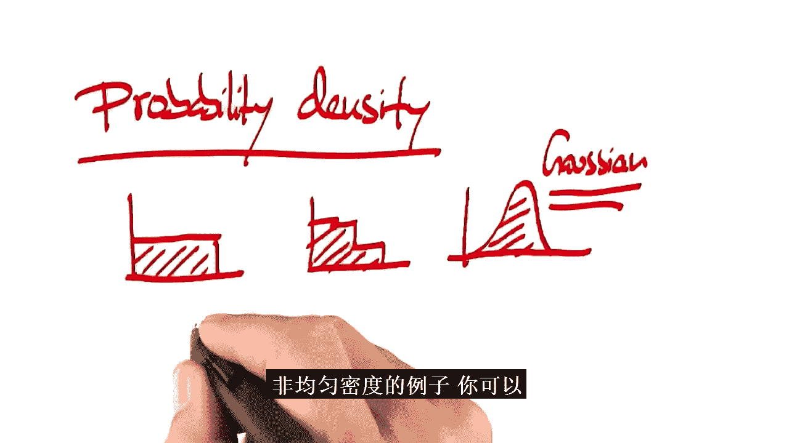