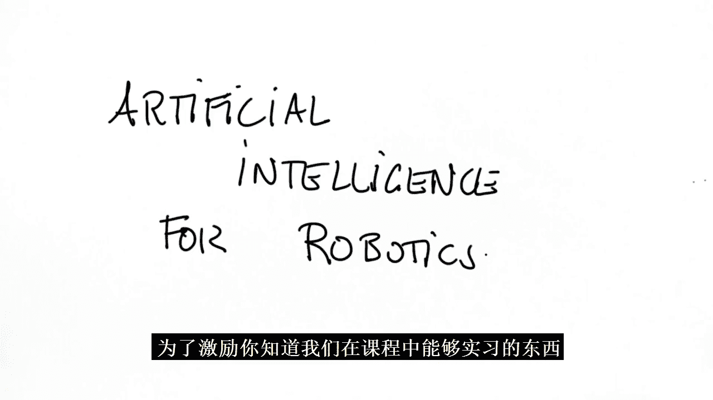
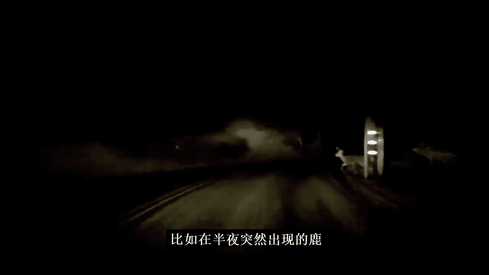
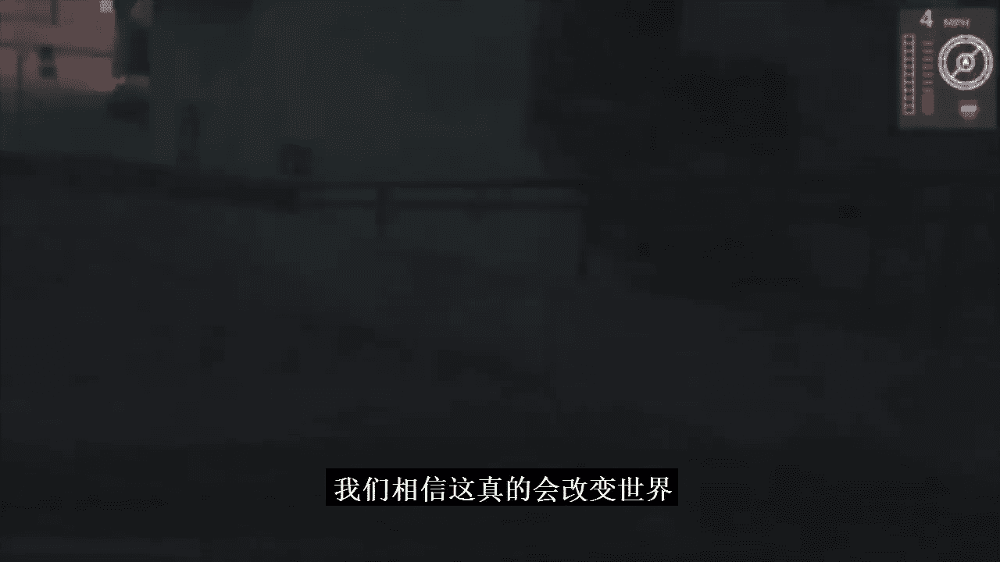
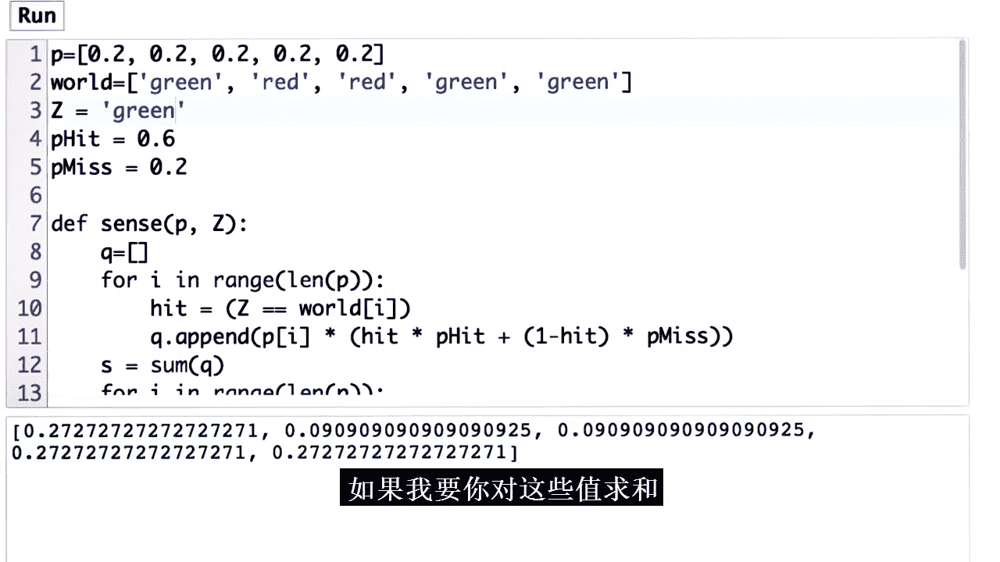
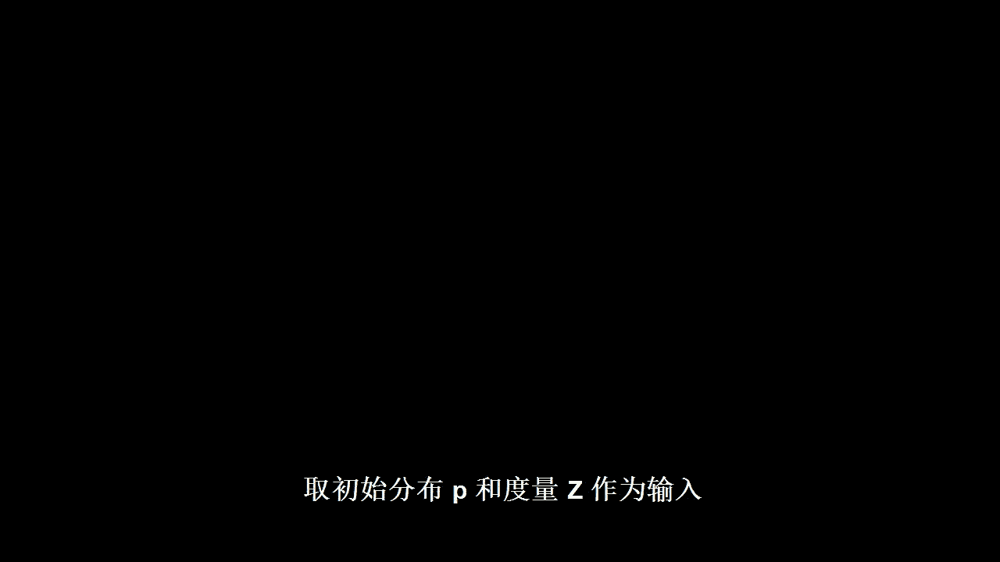
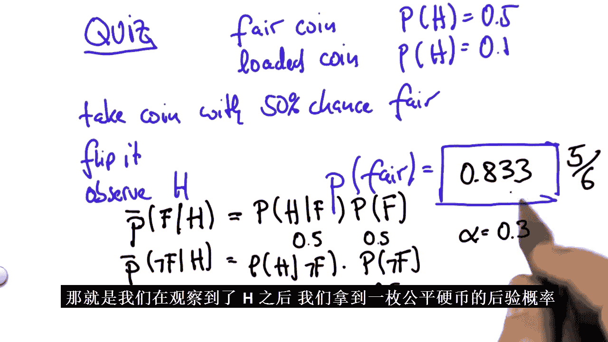

# 优达学城（Udacity）：无人驾驶汽车纳米学位项目-十位大牛亲授自动驾驶技术，硅谷前沿科技（计算机视觉⧸车道识别⧸感知控制⧸人工智能⧸谷歌） p12 12. Part 02-Module 01-Lesson 11_Robot Localization [BV1Vd4y1r7QG_p12]

I started working at UdacD almost six years ago， and my first project was helping to make a course called How to Program a Self drivingiving car。

That course has since been rednewmed AI for robotics。

 and the lesson you're about to watch is the first lesson from that course。Now。

 I've had a lot of time in the last six years to learn way more about self driving cars than is even covered in this course。

But I still find myself rewatching these lessons， and every time I do， I learn something new。

At this point， I think I've seen lesson in you about to watch maybe 10 times。

So if you're a long time Ud asky student， you might recognize this lesson and a few others you'll encounter in this nanon degree。

 You are， of course， welcome to skip any lesson that you don't feel like rewatching。

 But I suspect that if you do choose free watchtch， you'll probably pick up something new either way。

 enjoy。😊，So welcome to artificial Intelligence for robotics。

 You are entering an exciting seven weeks class， which you learn how to program self driving cars。😊。

And just to motivate what we're trying to achieve in this class。

Let me show you some videos。So my interest in self driving cars started with the Dpa Grand Chage in 2004。

 in which my team at Stanford developed Stanley a robot that could drive itself through the Mojave Desert。

 The vehicle was based on a Volkswang tour wreck。 It was equipped with all kinds of sensors like GPS and laser。

And it was able to make its own decisions without any human input whatsoever。

The D Grand challenge was a governmentponed race that took place in 2005。

 Here we see robot Stanley moving to the desert completely without a human and board。

 The task was to drive a desert trail for about 130 miles。 and whoever was fastest within the race。

 He were passing a different robot by Carnegieal University about 1 hundred，10 miles into the race。

 Our robot was able to navigate really steep mountainous roads and able to avoid collisions with rocks or falling down a cliff。

All based on its ability to use what I'm going to teach you in this class after almost 7 hours and 131 miles。

 I returned all the way to the starting base as the first robotbo to ever finish a Dpper Grand challenge。

Winning Stan University 2 million bucks and Stanley。

 a place in the Smithsonian Museum of American History。

This work LED to the urban challenge in which we built another robot called Junior that eventually took second place。

 The urban challenge was a follow up race by DRPper， and which cars were asked to drive in traffic。

 So whereas the grand challenge was kind of a motionless desert floor， this was a mock urban city。

 where the robot was able to interact with other traffic and had to follow traffic rules as in this left turn over here。

Had to be able to stay on lanes with very high precision。

 accommodate oncoming traffic and just drive confidently in a situation that re resembled a small city。

😊，This LED at Google to a sequence of experiments known as the Google self driving car。

 And I believe these are the best robotic cars out there today Here we see one of our pres on University Avenue in Palo Alto。

 kind of undetected， driving just like a human driver， but this car is driving by itself。😊。

Our cars have been able to drive hundreds of thousands of miles all across California and some of Nevada in downtown areas like San Francisco。

 on busy highways。😊，In here， in Monterey， a small coastal city in California with lots and lots of pedestrians。

And these are all completely self driven moments where the car is able to accommodate things like deers in the headlight in the middle of a night or even crooked Lombard Street in San Francisco。

 as shown in this video。😊。

This is what I'm doing on my day job。 I really love with my team building self driving cars。

 We believe it's going to be changed the world。😊。

And in this class。That's what I hope to enable you to do。 So let's dive in。

The very first problem I'm trying to solve is called localization。

And involves a robot that's lost in space。 It could be a car。 It could be a mobile robot。

 So here's this environment。And the poor robot has no clue awareness this。Similarly。

 we might have a car driving on a highway。And this car would like to know where it is。

 is it inside the lane or is it crossing lane markers？Now。

 the traditional way to solve this problem uses satellites。

 and these satellites emit signals that the car can perceive。

 That's known as the GPS short for global positioning system。

And it's what you have in your dashboard。 If you have a car with GPS that shows you the maps and shows you where you are。

 Now， unfortunately， the problem with GPS is it's really not very accurate。

It's really common for a car to believe to be here， but it has two all the way up to 10 m of error。

 So if you try to stay in the lane with 10 m of error。

You are far off and you're driving right over here and you crash。

 So for our self driving cars to be able to stay in lanes using localization。

 we need something like 2 to 10 cm of error， and then we can drive with GPS in lanes。

So the question is， how can we know where we are with 10 centimeter accuracy。

 that's the localization question。In the Google self driving car localization plays a key role。

 we record images of the road surface。And then use the techniques I' am just about to teach you to find out exactly where the v is。

 And it does so with a few centimeter accuracy。 And that makes it possible to stay inside the lane。

 even if the lane markers are missing。So localization has a lot of math。

 But before I dive into mathematical detail， I want to give you an intuition for the basic principles。

 I want to tell you the story of how it Ro localizes。

 and then we can go through the math together so we can understand it。😊。

I also want to let you program your own localizer so you can program a self driving car。

Let me begin my story in a world where a robot resides。

 And let's assume the world has no clue where it is。Then we will model this with a function。

 that I'm going to draw into this diagram over here。

Where the vertical axis is the probability for any location in this world。

And the horizontal axis corresponds to all the places in this one dimensional world。

The way I'm going to model the robot's current belief about where it might be。

 its confusion is by a uniform function that assigns equal weight to every possible place in this world。

That is the state of maximum confusion。Now， to localize。

 the world has to have some distinctive features。 So let's assume there's three different landmarks in the world。

 There's a door over here。There's a door over here。And a third one way back here。

 And for the sake of the argument， let's assume they all look alike。 So they're not distinguishable。

 but you can distinguish the door from the nondo area， from the wall。Now。

 let's see how the robot can localize itself by assuming it senses and it senses that is standing right next to a door。

So all it knows now that is located likely next to a door。 How will this affect our belief。

Here's the critical step for localization。 If you understand this step， you understand localization。

The measurement of a door transforms our belief function， defined over possible locations。

To a new function， it looks pretty much like this。For the three locations adjacent to doors。

 we now have an increased belief。Of being there， whereas all the other locations have a decreased belief。

This is a probability distribution that assigns higher probability for being next to a door。

 and it's called a posterior belief。 with word posterior means its after a measurement has been taken。

Now， the key aspects of this belief is that we still don't know where we are。

 There's three do possible all locations。 and in fact。

 it might be that the sensors were erroneous and we accidentally saw a door where there is none。

 So there's still a residual probability of being at these pace over here。

 but these three bumps together really express our current best belief of where we are。

This representation is absolutely core to probability and to move over localization。

Now let's assume the robot moves。Say it moves to the right by a certain distance。

Then we can shift the belief。According to the motion。Anyway。

 this might look like it's about like this。 So this。Pump over here。 Made it to here。

This cave into over here。In this guy over here， obviously， this is a robot。 it knows。

 it knows this heading direction。 It's moving to the right in this example。But it。

 and it knows roughly how far it moved。 Now， robot motion is somewhat uncertain。

 We can never be certain whether robot moved。 So these things will be a little bit flatter than these guys over here。

The process of moving those beliefs to the vice side is technically called a convolution。

And let's now assume the robot sends again。 And for the sake of the argument。

 let's assume it sees itself right next to a drawer again。 So the measurement is the same as before。

Now， the most amazing thing happens。😊，We end up multiplying our belief。

 which is now prior to the second measurement。With a function it looks very much like this one over here。

 which has a peak at each door。An out comes a belief that looks like the following。

There's a couple of minor bumps， but the only really big bump is this one over here。

This one corresponds to this guy。Over here in the prior。

 And it's the only place in this p that really corresponds to the measurement of a door。

 whereas all the other places of doors have a low prior belief。 So as a result。

 this function is really interesting。 It's a distribution that focuses most of its weight under the correct hypothesis of the word being in the second door。

And it provides very little belief to places far away from doors。 At this point。

 robot has localized itself。If you understood this。

 you understand probability and you understand localization。So congratulations。

 you understand probability and localization， you might not know yet。

 but that's really a core aspect of understanding a whole bunch of things I'm going to teach you in the class today。

So let's move into our first programming exercise and let's program together the very first version of robot localization。

So here is a bit of program code， an empty list。 And what I'd like you to program is a world with five different cells or places where each cell has the same probability that the robot might be in that cell。

 So probabilities add up to one。Here' has a simple quiz for the cells x1 all the way to x5。

What is the probability of any of those xs。 So index I goes from 1 to 5。And the answer is 0。2。

 which is1， the total probability divided by5 grid cells。So our Python interface。

 I like you to take this code over here， which assigns to P an empty list and modified into code where P becomes a uniform distribution over 5 grid cells。

As expressed in a vector。Of five probilities。So here has an easiest solution。

 You just initialize the vector with 50。2s。Let's see if you can modify this to make a vector of length n。

Where I can vary the value of n。And get a resulting vector with n elements。So for any widths 5。

 it would get the same result as before。 But for any widths 10， I should get a vector of length 10。

Each of which would have value of 0。1。Any the answer is simple， use a full loop as shown here。

And you append to the list n elements each of size of one over n。

 The dot over here is really important。 It gives you the yeah。Floing point version。Unfortunately。

 if we leave it out， the result would just be zeros， which is not what you want。

So now we're able to initialize the initial belief of the V and the world over here。

So let's look at the measurement of this robot。In its world with five different grid cells。

 x1 through x 5。Let's assume two of those cells are colored red。 Where's the other three。Agreen。

As before， we assign uniform probability to each cell of 0。2。And our robot is now allowed to sense。

 And what it sees is a red colour。How will this affect my belief over different places？ Obviously。

 the ones for x 2 and x 3 should go up。And the ones for x 1， x 4 and x 5 shall go down。

 So I'm going now tell you how to incorporate this measurement into our belief with a very simple rule。

 a product， any cell where the colour is correct。 Any of the red cells will be multiplied。

With a relatively large number， say 0。6。That feels small， but as we'll see later。

 it's actually a large number。Whereas all the green cells will be multiplied with 02。

We look at the ratio of those。Then it seems about three times as likely to be in a red cell than it is to be in a green cell。

Because 0。6 is three times louder than 0。2。Lets do the multiplication for each of those five cells。

 Can you tell me what the result would be。Multiplying in the measurement in the way I've stated it。

You please for these five boxes。 fill out the number。And the answer is， obviously， for the red cells。

 we get a 。12， whereas for the green cells， we get a 004， which is the product of。02 times 0。

6 versuss 0。2 times 0。2。And this is， in principle， our next belief。 It only has one problem。

 which is it isn't a valid probability distribution。

 And the reason why is probability distributions always have to add up to one。So if they ask you。

 what's the sum of the all these values that we find out it doesn't add up to one。

 So please type in the sum of all these values。So if we add up all these values， you get 0 physics6。

To turn this back into a probability distribution， we will now divide each of these numberss by 036。

 Pro differentlyently， we normalize。 So please， in these five fields。

 enter your result for dividing 004 or 0。12 by 036。

 And please check that the sum of those truly adds up to 1。So 012 divided by 0。36 is the same as 12。

 divided by 36 is the same as a third。Or 0。333。And 0。04 divided by 36 is the same as 4 divided by 36。

 That is 1 over 9。And if you look at these numbers。A third plus a third plus3。

9th is another third gives exactly one。 So this is a probability distribution。

 which is often written in the following way。Probability of each cell， I。

 where I could range from 1 to 5。After。We've seen our measurement Z。

The probilist would also call it posterior distribution。Of place X， I， given measurement Z。

So let's implement all this。So here's our initial distribution。 Again。

 Heres our factor for getting the colour right or for getting it wrong。

And let's first start with an non normalizedmalized version。Write a piece of code that outputs P。

After multiplying in Phi and Ps at the corresponding places。

So one way to do this is to go explicitly through all these five different cases from 0 to 4 and multiply in manually the miss or hit case。

 This is not particularly elegant， but it does the job。 And as I hit the run button。

 we get the correct answer。 That's not normalized。And my next question。

 can you print out the sum of those to normalize them。

 Mo the program so you get the sum of all the piece。Well。

 it turns out Python gives you a function called sum。And if you now hit the run button。

You get the correct answer。I want to make this a little bit more beautiful。

 I will introduce a variable record world。😊，And for each of the five bread cells。

 world specifies the colour of the cell。 green， red， red， green， green。And further。

 I define the measurement Z to be read。Can you define a function called sends。

 which is the measurement update， which takes as input the initial distribution P and the measurement Z。

And all the other global variables。An output pie is a normalized distribution called Q in which Q reflects the non normalized product of our input probability。

 which will be 0。2 and so on。And the corresponding Phi or hepis in accordance to whether these colours over here agree or disagree。

So a call sends p comma Z。I expect to get the same vector as output as before。

 But now in a form of a function。 And the reason I'd like to have a function here is because later on。

 as we build a localizer， we will apply this to every single measurement over and over again。

 So this function shall really respond to any arbitrary P an arbitrary Z either better green and give me the non normalized Q。

😊，Which gives me the vector 0。04，0。12 and so on and so on。So here' is my solution。

 I start with an empty list over here， and I build it up using the append command over time。

 and I do so by itvating over all the elements in my imperability P。And I set it binary flag。

 whether my measurement that Ive received is the same。

 I would expect at the Ih grid cell over here from this list over there。 And that's the case。

 hit is positive。 It's true。 So we're going to multiply P with P hit。 and if it's false。

 then the flag hit will value to 0。1 minus hit be be1。 So you're going to multiply P with p miss。

 I build up the list， returnturn it and run it。 an out comes 0。04，0。12120。04 and 0。04 as expected。

 So let's take that same piece of code and modify it to give me a valid probability distribution。😊。

Please modify this code so it normalizes the output of the function sends So it adds up to one。

And here the three lines of code I use to program this in。 First。

 I compute the sum of a vector Q using the function sum， which makes it really easy。

 And then I go through all the elements in Q and just divide it by S， which is the normalization。

 And when I run it， I get a9， a third， a third， and9 and a9。

 So I've just implemented the absolute key function of localization。

 which is called the measurement update。Let's just go back to our example and see what an amazing thing you've just programmed。

 We had a uniform distribution over places。 Each place had a probability of 0。2。😊。

And then you wrote a piece of code that used the measurement to turn this prior into a posterior in which the probability of the two red cells was a factor of three larger。

In the posture of the green cells， you've done exactly what I gave you intuitively in the beginning as the secret of localization。

 You manipulate a probability distribution over places into a new one by incorporating the measurement。

 In fact， let's go back to our code and test in your code whether we get a good result。

 when we replace our measurement red by green。😊，So please type green into your measurement variable and rerun your code to see if you get the correct result。

So I'm now replacing the red by green over here。And I rerun my code and out these funny numbers。

Which is somewhere in there is the division by 44。 But you can see that the first。

 the fourth and the fifth grid cell have a much larger value than the grid cells in the middle。

So let's dive in。 In fact， I'd like you to modify this code a little bit more in a way that we have multiple measurements。

 So instead of Z， we're going to make a measurement vector called measurements。

 And I'm going to assume we're going to first sense red and then green。

Can you modify the code that updates the probability twice and gives me the posterior after both of these measurements are incorporated。

 In fact， can you modify in a way that any sequence of measurements can be processed of any length。

And the modification is simple。 We will call the procedure sense multiple times。 In fact。

 as often as we have measurements， which is the for loop over here。

 we grab the case measurement of element and apply to the current belief。

 and then recursively update that belief into itself。In this case， we run it twice。

 we print the output。 and for this specific example， we get back the uniform distribution。

 These are all 。2s approximately。 And the reason is we up multiplied each field once for a 0。

6 and down multiplied with a 0。2。 and these effects were in total the same for each cell。😊。

And as a result， we get the same output over here。 It's quite remarkable。

So before we done with localization， like to talk about robot motion。

 Suppose we have a distribution over those cells。Such as this one， a9th， a third， a third， a 9th。

 a 9th。 And even though we don't know whether robot it is， the what moves， and it moves to the right。

In effect fact， the way we go to problem is that we assume the word is cyclick。

 So if it drops off the rightmost cell and finds itself in the leftmost cell。 Suppose we know。

 for fact， the word moved exactly one grid cell to the right。Including the ci motion。

 Can you tell me for all these five values what the post probability is after that motion。

 And the answer is， all of these are shifted to the right。

So the9th and the leftmost sel comess over here， the third over here。And finally。

 the rightmost 9th finds itself on the left side。 So in the case of exact motion。

 we have a perfect robot。We just shift the probabilities by the actual overt motion。 Now。

 that's a degenerate case。But it's a good one to program first。 Let's program this one。

I'll define a function move with an input distribution P and a motion number U。

 where U is the number of grid cells that is moving to the right or to the left。

 And I want you to program a function that returns the new distribution Q after the move。

 where if u equals 0 Q is the same as P， If u equals 1。

 All the values are strictly shifted to the right by 1。If u equals 3。

 the suit shifted with the divide by 3。 If u equals -1， the suit shift to the left。

So please call the function with argument P。And a shift to the right by one。

 I've comeed out my measurement part because for now， I just don't want to do measurement updates。

 In addition to this， I'm going， I will use a very simple P that has a one at the second position in0 is elsewhere。

 Otherwise， if you were to use the uniform P， we couldn't even see the effect of the motion。

 whether that's problem correctly or not。And here's the solution。 We start with the empty list。

 We go through all the elements in P。And this is the tricky line。

 We will construct Q element by element by accessing the corresponding P and P is shifted by U。

And if this shift exceeds the range of P on the left。

We applied the model operator with the number of states as an argument。 in this case will be 5。Now。

 the reason why there is a minus sign is tricky to shift the distribution to the right， U equals one。

We need to find in P the element， one place to the left。

So rather than shifting P to the right directly。What I've done is I've constructed Q by searching for where the robot might have come from。

 and that's， of course， in hindsight from the left。Therefore， there's a minus sign over here。

 So I think about this， this is a little bit non trivialvial。

 but it's going to be important as you go forward and define probabilistic convolution and generalize this to the noisy case。

So let's talk about inequate word motion。We are again given five grid cells。

 And let's assume a robot executes its action with high probability correctly， says 0。8。But with 0。

1 chance， it finds itself short of the intended action。 and yet another 1。1 probability。

 It finds itself overshooting its target。 You can define the same for other U values。 say U equals 1。

 Then with 08 chance， it would end up over here。1， it stays in the same element。In 0。1。

 it hops two elements ahead。Now， this is a model of inaccurate word motion。

 This robot attempts to go u gridd cells。But occasionally falls short of its goal or overshoots。

 And that's a more common case。 robots， as they move accrue uncertainty。

 And it's really important to model this， because this is the primary reason why localization is hard because robots are not very accurate。

So we are now gonna look into this first from the mathematical side。

I will be giving you a prior distribution， and we're going to be using the value of U equals 2。

 And for the motion model that shifts over exactly two steps， we believe there's a 。8 chance。

And we assign a。1。To the cases with the robot over undershoots by exactly one。

That's kind of written by this formula over here， where the two。Gets 0。8 probability。

The one and the three end up with 0。1 probability。So I'm gonna to ask you now for the initial distribution that I'm writing up here。

 Can you give me the distribution after the motion。

And the answer is for our intended field over here at 0。8。The two neighbors，0。1。

And it's 0 and 0 over here。Well done。 Let's do this again， for different initial distribution。

Let's assume we have a 0。5。In this cell。And is 0。5 in this cell。

And remember that this is a cyclic motion model。 So whatever falls off on the right side。

 you'll fine on the left side。 Can you， again， for you if it's to fill in the posteror distribution。

And this is a pretty tricky question， which I'm going answer in two phases。 Let's just look at the 。

5 over here。8 of that， which is 0。4， ends up over here。And01 of this， which is 0。05。

 ends up over here。And the reason why I write it so small is because this is not the correct answer quite yet。

Let's look at the other 0。504 goes two steps，12 ends up over here on the left side。

 but 01 falls short， makes a 0。5 over here and 0。05 in the second grid cell。

 And interestingly enough for the cell on the right side。

 There's two possible ways you could have gotten there。Either by overshooting。

 studying in the second cell or under shootingoting， studying in the right cell。

 So the total probability over here is the sum of these two things，0。1。So this is the final answer，0。

4，0。05，0。05，0。4 and 0。1。 Let me give you a final example in which I assume a uniform distribution。

 and I want you to fill in for me the distribution after motion。The answer， as it turns out。

 will be just a 0。2 everywhere。 And the reason is， with every grid cell being equally likely。

 applying this motion model will still make each grid cell equally likely。 So let's pick one of them。

 Sa this one over here。We could have arrived here， in three different ways。

Perhaps we started the next two。And our motion went well。Thishi gives us a 0。2。Times the 0。8。

Perhaps we start at an x1 and we overshot， which gives us a 0。2。For the cell X1 times is 0。1。

For overhooting。Or perhaps we started the next three。And we undershot， which is 0。2 times 0。1。

 When we add those up。Then we find that it iss the same as 0。2。Times 1。

 because the factors over here add up exactly to one， which makes 0。2， and the result is 0。2。

You can apply the same logic to all the other cells。

 This guy over here could have come from this guy， this guy， this guy。

 where this one is a with 08 and the other two with 01。That's called a convolution。

 And as we'll see later， there's a very nice way to write this mathematically。

 a something called theorem of total probability。But for the time being， I'd like to program this in。

So I'm going to give us a probability exact 0。8， probability oversho 0。1 and probability findsho 0。1。

 and I'd like you to modify the move procedure to accommodate these extra probabilities。

And here's one way to implement this。 We're gonna introduce the auxiliary variable S。

 which we build up in three different steps。 We multiply the P value as before。

 for the exact set up by。P exact。And then we add to its two more multiplied by P overshot or piano shot where we are overhooting by going yet one step further than you or undershoot by cutting it short by one。

And then we add these things up and finally append the sum of those to our output probability Q。

 When we run this we get for our example prior of 0，1，00，0。 The answer 0，0。10。8，0。1 and 0。

So here's a question for you that is somewhat involved。 And you don't want to check your intuition。

 Suppose we have five grid cells as before with an initial distribution that assign one to the first grid cell and 0 to all of the other ones。

Let's assume we do U equals 1， which means with 08 chance in each action。

 we position 1 to the right with 01 chance， we don't move it all。 And with 01 chance again。

 we skip and move two steps。 And again， let's assume the world is cyclic。

 So every time I fall off on the right side， I find myself back on the left side。The question is。

 suppose I have run infinitely many motion steps。 Then I actually get a what's called a limit distribution。

 So what's going to happen to my robot if it never sends us but executes the action1 go on to the right。

On our little s environment。For， what will be the so called limit or stationary distribution be？

In the very end。And you might have guessed correctly。 It's the uniform distribution。

 And there is an intuitive reasoning behind us。 Every time we move， we lose information。

 That is in the initial distribution， we know exactly where we are。 One step in， we have a 。8 chance。

 But the  point8 will fall to something smaller as we move on。64， and so on。

The distribution of the absolute least information is the uniform distribution has no preference whatsoever。

 And that's really the result of moving many， many times。There's a way to derive this mathematically。

 but I can prove a property that's highly related， which is a balance property。Say we take x 4。

 and we like to understand how x 4 at some time T T corresponds to the previous time distribution over all these variables for this to be stationary。

 It has to be the same for differently， the probability of x 4 must be the same as 0。

8 probabilityb of x 2。Plus， 0。1 probability of x1 plus 0。1 probability of x3。

There's exactly the same calculation we did before where we ask， what's the chance of being x 4。

 Well， you might be coming from x 2， x1 or x 3。 And there's these probabilities 08。1 and 。

1 that govern the likelihood you might have been coming from there。

Those together must hold true in the limit when things don't move anymore。 Now。

 you might think there's many different ways to solve this。 and the point2 is just one solution。

 but it turns out point2 is the only solution。So if we plug in 0。2 over here， 0。2 over here， 0。

2 over here， we get 1 times 0。2， and that's 0。2 on the right side。

 so clearly those points2 over here meet the balance that is necessary to define a valid solution in the limit。

Then let's go back to our code。And move many times。 Let's move twice。

 So please write a piece of code。 the mixer robot move twice。

 starting with initial distribution as shown over here。0，1，0，0，0。

So heres a piece of code that moves twice by the same amount as before。

And the output now is a vector that assigns。066 is the largest value and not 。8 anymore。

Let's move a thousand times。Write a piece of code that moves 100 steps and gives me the final distribution。

So here's my code。 We have a loop for 100 steps。 We move 1 thousand times。

And the print the corresponding distribution over here。 it's 0。2 in each case， as expected。So wow。

 you've basically programmed the Google self driving car authorization。

 even though you might not quite know it yet。So let me tell you where we are。

 We talked about measurement updates， and we talked about motion。

 and we code these two routine sends and move。 Now。

 localization is nothing else but the iteration of sends and move。 There is an initial belief。

It is tossed into this loop。If you sense first， it comes to the left side。

And then localization cycles to this move， sense， move， sense， move， sense， move， sense， move。

 sense cycle。 And every time the robot moves， it loses information where the word is。

That's because remote motion is inaccurate。 And every time it senses， it gains information。

That is manifest by the fact that after motion， the probability distribution is a little bit flatter and a bit more spread out。

 And after sensing its focus a little bit more。In fact， as a footnote。

 there is a measure of information called entropy。And here。

 one of the many ways you can write it is the expected lock likelihood of the probability of each grid cell。

And without going into detail， this is a measure of information that the distribution has。

 and it can be shown that the update step， the motion step， makes the entropy go down。

And the measurement step makes it go up。 So you're really losing and gaining information。

 I would now love to implement this in our code。So in addition to the two measurements we had before。

 red and green， I'm going to give you two motion，1 and one。

 which means the word moves right and right again。 Can you compute the pursue distribution if they were first sense us red。

Then moves right by one。 then send the screen， then moves right again。

 And let's start with a uniform prior distribution。And here， the routine is very short。

 It goes through the measurements。 It assumes it has as many motions as measurements。

 It first applies the measurement as before。 and then implies the motion。

 And when it's done with it to print the output， and the output is interesting。The world has a green。

 a red， a red and a green in a green field。And the robot saw red， followed by a right motion。

 and then green。And that suggests that it probably started with the highest likelihood in gridit cell number 3。

Which is the rightmost of the two red cells。It's all read correctly。

It then moved to the white by one。 So green correctly， moved white again。

 and now finds itself most likely in the white most cell。

 This just looking at these values over here without any probabilistic math and any imation。

Let's look at the output。Pot2，01。08，16。38。Very correctly。

 they were most likely assigned this position to the rightmost cell， as should be。

 given this sequence of observations over here。Let's pick a different place。

Let's assume the robot saw red twice。 So it sends red。 It moves。 It sends red。 it moves again。

What is the most likely sell。It's a run the program。

 and we find that the most likely cell is the fourth cell。

And they makes sense because the best match of red red to the world is right over here and right over here。

And after seeing the second red， the word still moved one to the right finds itself in the fourth cell。

 as shown over here。Now， I want to celebrate with you the code that you just wrote。

Which is a piece of software that implements the essence of Google's self driving car's localization approach。

As I said in the beginning， it's absolutely crucial that the car knows exactly where it is relative to the map of its road。

And why the road isn't paint as green and red。There were his lane markers。

 And instead of those green and red cells over here。

We plug in the colour of the lane markings relative to the colour of the pavement。

 It isn't just one observation per time step。 It's an entire feed of observations。

 entire camera image。 but you can do the same with a camera image。

 So as long as you can correspond a camera image in your model with a camera image in your measurements。

😊，And then， a piece of code。Not much more difficult than what what you call it yourself is responsible for localizing the suit the Googles self driving car。

So you just implemented a major， major function that makes Google's cars drive itself。

So I think you should be really happy and proud of yourself。 and you should say to yourself。

 I just implemented localization。 Now， why on earth does it take Google that long to build a product that drives itself。

 Well， I two this the situation is a little more difficult。

 Sometimes robots get paved over and change and we're working on this。

 But what you've implemented is the core of Google's self driving car localization。 And。

 let me just summarize the essential things we've learned。😊。

We learn that localization maintains a function over all possible places where road might be。

Where each cell has an associated probability value。The measurement update function or sends。

Is nothing else but a product in which we take those probability values and multiply them up or down。

 depending on the exact measurement， because the product might violate the fact that probability abb1。

 It was a product followed by normalization。Motion。Was a convolution。

 And this word itself might sound cryptic， but it would really meant is for each possible location after the motion。

We reverse， engineered the situation and guessed whether what might have come from and then collected。

 be added the corresponding probabilities。 So something as simple as multiplication and addition。

Solves all of localization， and is the foundation for autonomous driving。

 I want to spend a few minutes and go over the formal definition of localization。

And I'm gonna introduce probability and ask you lots of questions。 Forly。

 we define a probability function。To be p of x。 And its a value that is bounded below and above by 0 and 1。

X often can take multiple values。 We have the case of five grid cells。

 Suppose you can only take two values。 There's only two grid cells， X 1 and x 2。

If the probability for x1 is0。2， what would be the probability for x2。

 So please enter the number ass a quiz， obviously。And the answer is 0。8。

 reason being that probabilitybabilities always add up to one。Let me ask a second question。

 And I know that's not particularly difficult。 What if P of x1 equals 0。And the answer is one。

 you got it。For our world with five different grid cells。

 S we know that the first four of them have1。1 probability。

What be the probability of the fifth and final grid cell。And the answer is 0。6。

They have to add up to one。 We subtract four times0。1。Which is 0。4。Give us 0。6。

 So that's the valid probability。Let's look into measurements。

 and they will lead to something called basees rule。You might have heard about base rule before。

 It's the most fundamental consideration in probabilistic inference。But the basic rule is really。

 really simple。Suppose。X is mag cell。And Z is my measurement。

 Then the measurement update seeks to calculate a belief over my location after seeing the measurement。

How is this computed， Well， it was really easy to compute in our localization example。

 And now I'm going to make it a little bit more formal。 It turns out base rule looks like this。

 And there will be likely be a little bit confusing。

 But what it does is it takes my prior distribution， P of X。

And multiplies in the chances of seeing a red or green tile for every possible location。

 and out comes， if we just look at the denominator here。

 the non normalizedized posterior distribution we had before。Recognize this。This was our prior。

 This was our measurement probability。 If we do this for all the grid cells。

 we put little index I over here。Then just the product of the prior of the grid cell times the measurement probability。

 which was large if the measurement correspond to the correct color and small。

 If you correspond to a false color， that product gave us the non normalized posteror distribution for the grid cell。

😊，You remember this because that's what you programmed。

 you programmed a product between the prior probability distribution and a number。

 The normalization is now the constant over here， P of Z。Technically。

 that is the probability of seeing a measurement devoid of any location information。

But let's not confuse ourselves。 The easiest way to understand what's going on is to realize that。

This is a function here that assigns to each griditz cell a number。

 and the P of Z doesn't have the griditz cell as an index。

 So no matter what griditz shall you consider。The P of Z is the same。 And here's the trick。

No matter what P of Z is， because the final posterior has to be a for distribution。

By normalizing these non normalized products over here。

We will exactly calculate P of Z for differently。 P of Z is the sum of all I of just this product over here。

 So this makes base rule really simple。 It's a product of our prior distribution with the measurement probability。

 which we know to be large。 the colours correct and small otherwise。😊。

We do this and assign it to a so called non normalized probability。

 which I'll do with a little bar over the P。And then I compute the normalizer， which I call alpha。

 is the sum of all these guys over here。 And then I just normalize。

 So my resulting probability will be one over alpha of the non normalized probability。

 This is exactly what we did。 and this is exactly base rule。

So let me ask you base rule in a context of a completely different example to see if you understand how to apply base rule。

This time， it's about cancer testing。 And is an example that is commonly studied in statistics classes。

 Suppose there exist a certain type of cancer。But the cancer is rare。

 Only  one in 1000 people asked the cancer。 Whereas 999 in000 people don't have it。

 illustrate by the probability of cancer and the probability of not cancer。

 Suppose we have a test and the test cannot come up positive or negative。

 The probability that the test triggers positive if have cancer is 0。8。

 and the probability that the test comes out positive。 Give them cancer free is only 0。1。So clearly。

 the test has a strong correlation to whether have cancer。 He is a really difficult question。

 Can you compete for me the probability of cancer。Given that I just received the positive test。

 let me emphasize this is not an easy question， but you should be able based on what I taught you to calculate this result。

 Think of the cancer non cancer as the robot position and think of the positive as whether the colouror observed is the correct one。

And the answer is 0。0079， in other words。Theres only a 079 per cent chance。

079 out of 100 that despite the positive test result that you have cancer。

 And you going to apply the exact same mechanics as we did before。

 The result of base rule not normalized of C， given pause is simply the product of my prior probability 0。

001。Times 。8。Which is the probability of a positive result in the cancer state。

 And that ends up to be 0。0008。 The non normalized probability for the opposite event。

 the non cancerous event， given a positive test is 0。999。Times 0。1。 And that is obviously，0。0999。

 Our normalizer is not the sum of these， both of those。Which is 0 dot 1007。

 Just add these two bags up over here。 So dividing 0。08， the non normalized probability by 0。

1007 gives us 0。079。We just applied base rule to compute a really involved probability of having cancer after seeing a test result。

 So let's look at motion， which will turn out to be something we will call total probability。

 You remember that we cared about a grid cell， X I， And we ask。

 what is the chance of being X I after overmotion。Now to indicate the after before。

 let me add a time index。 So T appear here iss an index for time。

 and I write it upper caps so there's no confusion with the index I， which is the grid cell。

You might remember the way we computed this was by looking at all the grid cells thevo could have come from one time step earlier index here by J。

 We looked at the prior probability of those grid cells at time T-1。

And we multiply it with the probability that our motion command would carry us from X J to X I。

 that's written as a conditional distribution。As follows。

So this was exactly what we implemented If there was our grid cells over here and we asked one time step later about a specific width cell over here。

 we would combine  point8 from over here， point1 from over here and  point1 from over here。

Into the probability of this grid cell， that's the same formula as here。This is no Xi。

And the way we find the proor probability for Xi is to go through all possible places from which we could have come。

 all the different Js。 look at the prior probabilities multiplied by the probability that I transition from J to I give my motion command。

 which in this case is co1 to the right side。Now， in probability terms。

 people often write it as follows P of A equal with sum of R B， P of A given B hence P of B。

 This is just the way you'd find it in textbooks。 And you can see directly the correspondence of A as a place I at time T。

And all the different bes as the possible prior locations。

 that is often called the theorem of total probability。

 and the operation of a weighted sum over other variables is often called a convolution。

Let me test total probability in a quiz。 Suppose I flip a coin， and the coin can have tails or heads。

 And suppose it's a fair coin。So probability of tail or of heads is both a half。

 Now let's say that coin comes up tail。 They I just accept and don't do anything。

But suppose it comes on heads， and then flip it again。 And after one flip， I accept the result。

So my quiz for you is， what is the probability that the final result is heads。

 And that's an example of total probability。And the answer is a quarter。

 It's easy to see that the probability of heads in step 2 is the probability of heads in step 2。

Condition on heads， instead step 1。Times probability of heads in one。Plus， that's the sum。

Probability of heads in step 2 give me a tail in step 1， transferability of。Til。In step 1。

 And now the way I set it up， those things here are equally likely。 However。

 if we did have tail in step 1， you would never toss the coin again and just accept it。

 So it's impossible that in step 2， I flip over to head。It's probably the0。 Whereas if I found head。

 I would flip again。 And then thes 0。5 chance I， I arrive at head。If I look at this。

 then this all becomes 0。And these guys multiply to a quarter， and the final answer is a quarter。

 Let me make a final quiz in which I have a coin whose probability。 I don't know。

 So there's multiple coins。 One is fair， and one is loaded。

 The fair coin has a probability of heads of 0。5。 The loaded coin has a probability of heads of 0。1。

 Here's what I'm going to do。 I'm going grab a random coin with 50% cent chance。

 So the fair coin will be chosen with 50% chance。 and the loaded coin will be chosen with 50 per chance。

 But I don't know which one of this。 I flip it， and I observe heads。

 What's the probability that the coin I hold in my hand is fair。 App anything you've learned before。

 One of the rules you've learned before is exactly that Ive want to apply here。😊。

And let's work this out。 What I'm really asking is the probability of a fair coin。F。

 given better observed。H， this has nothing to do with total probability and all with base rule。

 because I'm talking about observations。 The non normalized probability， according to base rule。

 is obtained as follows。 The probability of observing H for the fair coin is 0。5。

 and the probability of having grabbed the fair coin was 0。5 as well。

 The non normalizedmal probability of not f given H， which is the loaded coin。 is probability of H。

 given not f， which we know to be 0。1。 That's the one over here。

 times the probability of not picking a fair coin， which is 0。5， ends up to be 0。05。

 If we now normalize。 we get alpha equals 0。25 plus 0。05， it is 0。3。 If we now normalize。The 0。

25 over here。With 0。3， we get 0。833。Which is the same as 5 divided by 6。 Since our post probability。

 we hold the fair coin after we observed H。

