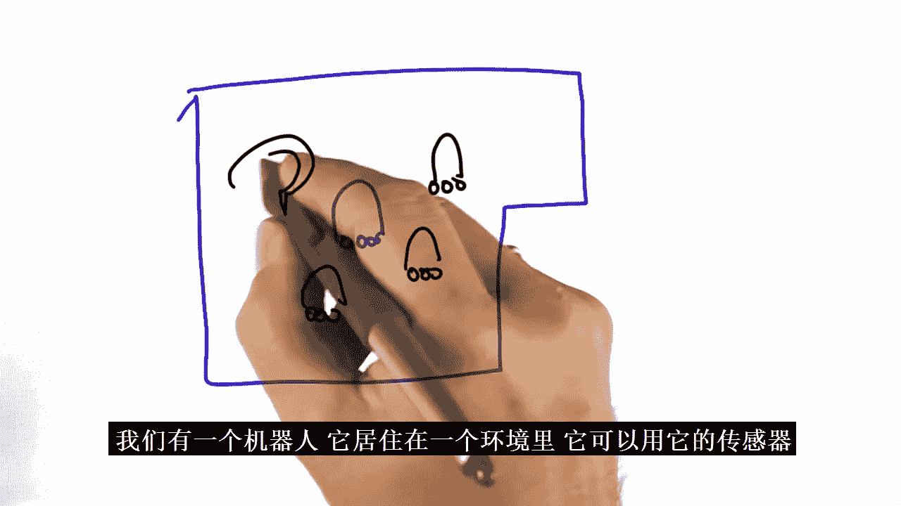
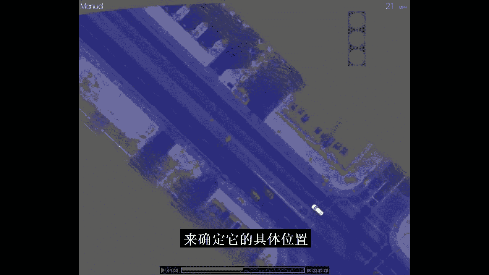
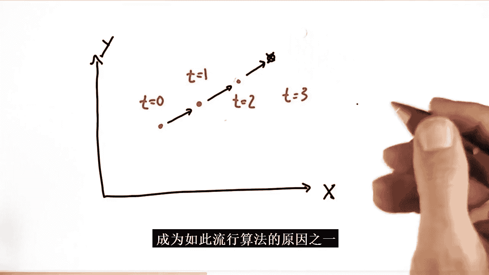

# 优达学城（Udacity）：无人驾驶汽车纳米学位项目-十位大牛亲授自动驾驶技术，硅谷前沿科技（计算机视觉⧸车道识别⧸感知控制⧸人工智能⧸谷歌） p15 15. Part 03-Module 01-Lesson 02_Introduction to Kalman Filters [BV1Vd4y1r7QG_p15]

Welcome to my second class on Com filters， I want to take you on a little tour to where it all began。

 Stanford University behind me as Valil， Stanford's Autoal Researchsource Center and let's go inside。

So this is Ju， Stanford's most recent self-driving car it's the child of Stanley whom you can find in the National Museum of American History in Washington D and let me tell you something about the equipment that's on this car that makes it self-driving so this rotating thing over here is a laser range finder that takes distance scans 10 times to seconds about a million data point it'll be really important for the common filter class and I'm teaching you today its major function is to spot other cars so you don't run into them then also a camera on top there's a stereo camera system over here and in the rear there are antennas for a GPS a global positioning system that allows us to estimate where the cars in the world this is a supplemental system with the local class that just taught you。

This is the data that comes from the laser， you can see the car parked in the garage right now we see the back wall。

 these are all range measurements that tell you how far things are weight and they are essential as the input to the common filter that you're going to learn about today。

So Id like to take my students on a little journey to Stanford and show them a self driving car that uses sensors。

To sense the environment。 So let me dive into the class very much right now。So to our last class。

 we talked about localization。 We had a robot that lived in an environment and that it could use its sensors to determine where in the environment it is。

So here you can see the Google self driving car using a roadmap localizing itself。

But in addition， whatton in red are measurements of other vehicles， the car uses lasers。

And Raers to track other vehicles。And today we're going to talk about how to find other cars。

The reason why we'd like to find other cars is because we wouldn't run into them。

So we have to understand how to interpret sensor data to make assessments。

 not just where these other cars are， as in the localization case。But also， how fast they're moving。

So if you can drive in a way that avoids collisions within the future。

 it's important not just for cars， matters for pedestrians and for bicyclists。

And understanding where the cars are and making prediction where they're going to move is absolutely essential for safe driving in the Google car project。

So in this class， you'll talk about tracking。And the technique I'd like to teach you is called a Car fitter。

This is an insanely popular technique。For estimating the state of a system。

It's actually very similar to the probabilistic localization method we talked in the previous class。

 Monte Carlo localization。Their primary differences are that Carmenfield us estimate a continuous state。

 whereas in Monteal localization， we were forced to chop the world into discrete places。

And as a result， the common filter happens to give us a unmodal distribution。

And I'll tell you in the second what that means。Resmon Di Carlo was fine。

 with multimodal distributions。Both of these techniques are applicable to robot localization and tracking other vehicles。

 In fact， in the later class， we can learn about particle filters。

Which are yet another way to address the same problem。

 and indeed they are actually continuous and multimodal。

But for the time being that's looking into come and filter us and ignore these other two families or methods。

 Let me start with an example。 Consider the card down here。 Let's assume it seasons is measurement。

 an object here。Ye。Here。And here， for the time T with 0， T was 1，2 and 3。 Where would you assume。

The object would be a T plus 4。 Check one of those three boxes。And yes。

 you'd expect it right over here。From those observation。You would say that the velocity。

Points in the direction of this vector。So assuming no drastic change of velocity。

You expect that the fifth position be over here。So the common filter takes observations like these estimates future locations and velocities based on data like this。

 And today I'm going to teach you how to provide a piece of software。

 lets you take points like those， even if they're noisy and uncertain an estimate automatically where future locations might be。

 and at what velocity the object is moving。The Google self living car uses methods like these to understand where other traffic is based on radar and laser range data。

 So let's dive in。You remember our Markov model where the world was divided into discrete grids and be assigned to each grid cell probability。

Such a representation of probability over places is called a histogram。In that。

 it divides the continuous space into discrete， into finally many grid cells and approximates the pursue distribution by a histogram over the original distribution。

 And the histogram is a mere approximation to this continuous distribution。In common featuress。

 the distribution is given by what's called a Gaussian。

Gauussian is a continuous function over the space of locations。

 and the area underneath sums up to one。So here， our go in again。And if you call the space。X。

 then the Gaussian is characterized by two parameters。 The mean。

 often abbreviated with the Greek letter mu。In the width of the Gaussian。Often called the variance。

 And for reasons I don'm want to go into， its often written as a quadratic variable。Sigma square。

So any Gaussian。In 1 D， which means the parameter space over here is one dimensional。

 is characterized by mu and sigma square。So rather than estimate the entire distribution as a histogram。

 our task and common features is to maintain a mu in a sigma square that is our best estimate of the location of the object we are trying to find。

The exact formula。Is an exponential。Of a kvetic function。

 whether you take the exponent of this complicated expression over here。

The quidvetic difference of our query point x relative to the mean mu。Divided by sigma square。

Mly paper minus a half。N， if x equals mu。Then the enummerator becomes 0， and we have x of 0。

Which is one。It turns out we have to normalize this by a constant  one over the square root of2 pi sigma square。

 But for everything we talk about today， this constant won't matter。 So ignore it。

 What matters is we have an exponential of a codedvaritic function over here。

So let me draw you a couple of functions。And you tell me which one you believe。A Gaussian。

By checking the box on the right side。And please excuse my poor drawing skills here。

And the answer is this one is a Gaussian， this one。And this one。

And they are all characterized by this exponential dropover on both sides， the symmetrical。

And they have a single peak that is called unimmodal。This is a bimodal function， has two peaks。

And as a result is non Gaussian， the same is true over here and over here。So。

 these guys don't qualify。So let me ask you again about your intuition。And draw three more Gaussians。

And again， excuse my poor drawing skills here。And now I'm going to ask you about the covariance。

So for each of those， check exactly one box。 Is the covariance large。Medium。Was small。Obviously。

 one of those is the largest。 One is a medium， and one is small。And the answer is。

 this is the largest covariance。 It's the widest spread。 This is the smallest。And this is medium。

And to see how this is being found in the formula over here。

 the difference between x and Y is being normalized by the covaris。 So the larger this value。

 the less the difference over here matters。And as a result， the more the function is spread out。

So function with very right spread have the largest covariance。

 whereasas function with small spread have the smallest covariance。But differently。

 the sigma square covariance is a measure of uncertainty。The larger sigma square。

 the more uncertain we are about the actual state。 This is a very certain distribution。

 The our expected deviation is small。 This is a relatively uncertain distribution。

 but we know very little。So we track another car with our Google self driving car。

Which galaxy would you prefer？The first。Second or third。And the answer is the third。

 because that's the one that's most certain。And because it's most certain。

 it makes a chance of accidentally hitting another car， the smallest。

 just by the fact that we know more about the car than in two other distributions。

So you learn something really important。You learn the definition of a Gaussian。

You learned about the fact that these are unmodal distributions。They also symmetrical。

And you learn a little bit about how to use them as a belief in a probabilistic filter。

So let's go and program me Gaussian。So let me ask you to calculate the value F X。

 You will need a calculator for this。For the following values， muic withs 10， sigmas fake with 4。

 x equals 8。In the approximate answer is 0。12。X minus is mu squared。Is4。

Which is 10 minus8 with a square。Divided by 4。Equal to 1。

So the expression in the exponential is minus a2。which is about 0。6。In this guy over here。

Is approximately 0。2。Which gives us as a product 0。12。

So I won't torture with any more questions like these because they're really not fun。

 but we can program this now。So starting with the following source code。

I'm looking for a completion of this one line over here that returns the Gaussian function。

With arguments mu equals 10， sigma squared equals 4 and x equals 8。

And I want the output to be approximately 0。12。So， here's my solution。

This is the constant1 over square root of2 times pi times sigma。

And then I multiply with the exponential of minus 。5 times x minus mu square over sigma squared。

And that apply to the following numbers over here gives me 0。12。Now here's a question for you。

 how do I have to modify x the8。To get the maximum return value for this function F。

And the answer is I said with the same value as mule。

 in which case this expression over here becomes 0， and we get the maximum。

 We get the peak of the Gaussian。So we set x to the same value as mu to 10， and the output is 0。

2 approximately。So now let's look at the common filter。

The caafi represents all distribution by Gaussians。And just like in the last class。

 we talked about measurement cycles and motion cycles。

 the common filter iterates two different things。Measurement updates。And motion updates。

So this is identical to the situation before in localization。

 we've got some measurement and then we took a motion， here the math changes。

 but the basic principle applies。So let's do a quiz。

To see if we remember the material from last class。

You might remember that one of the two steps measurement of motion required a convolution and the other of a product。

 Please check the corresponding box。Measurements were implemented using products。

And motion using a convolution。 And if we don't know this。

 please go back and check the last class on localization。In fact， we talked about base rule。

And we talk about total probability， please again， check。

Whether base rule and total probabilityability apply to measurements or motions。

And the answer is the measurement the product was using base rule and motion was using total probability。

So in common filters。We it measurement and motion， this is often called a measurement update。

And it's often called prediction。And the update will use base rule。

Which is nothing else but a product。Or a multiplication。And this update will use total probability。

Which is a convolution。Or simply in addition。Let's talk first about。The measurement cycle。And then。

 the prediction cycle。Using。Our great， great， great Gaussians。For implementing those steps。

So suppose you're localizing another vehicle and you have a prior distribution that looks as follows。

It's a very right Gaussian。With the mean over here。And now I say we get a measurement。

That tells us something about the localization of the vehicle。And it comes in like this。

It has a mean over here， called new。And this example has a much smaller covariance for the measurement。

This is an example in our prior， we were fairly uncertain about the location。

But the measurement told us quite a bit as to where the vehicle is。

So here's a quiz for you with the new mean of the subsequent Gaussian。B。Over here。Over here。

Or over here。Check one of these three boxes。And the answer is， over here in the middle。

It's between the two old means， the mean of the prayer。And the mean of the measurement。

 And it's slightly further on the measurement site， because the measurement was more certain。

As to where the vehicle is。Then the prior， the more certain we are。

 the more we pull the mean in the direction of the certain answer。

Now here's a question that's really， really hard。Let me graph the New Gaussian。

I can draft when it's very wide。It's very peaky。Survivor to。

Measure with the peak of the New Gaussianiness。 This would be a very narrow and skinny Gaussian。

This will be one that whose with us in between the two Gaussian。

 And this is one that is even wider than the two original Gaussians。

 Which one do you believe is the correct posterior After multiplying these two Gaussians。

 This is an insanely hard question。 I'd like you to take your chances here and explain to the answer in just a second。

And very surprisingly， the resulting Gaussian is more certain。Then the two component Gaussians。

 That is the covariance is smaller than either of the twovari covariances in insulation。

 and intuitively speaking， this is the case because we actually gain information the two Gaussians together with higher information content than either Gaussian insulation So it looked like something like this。

And it is completely non obvious。 And you might have to take this with faith。

But I can actually prove it to you。Suppose we multiply two Gaussians。As in base rule。Por。

And a measurement probability。And the prior has a mean of mu and a variance of sigma square。

 and the measurement has a mean of mu and a covariance of r square。In the new mean， you prime。

Is the weighted sum of the old means。 The mule is weighted by R square。News waiteded by Sigma Square。

Normalized by the sum of those weight factors。In the new variance term。

One of right sigma must we are prime yet。For the new one， after the update。Is given by。

This equation over here。So let's put this into action。 We have a weighted mean over here。 Clearly。

 the prior Gaussian has a much higher uncertainty。 Therefore， sigma square is larger。

 And that means the mu is weighted much much larger than the mu。

 So the mean will be closer to the new than the mu。Which means itll be somewhere over here。

Interestingly enough， the variance term is unaffected by the actual means。

 It just uses the previous variances。 It comes up with the new one that's even peakier。

So the result might look like this。So this is the common situation for the measurement update step。

 where this is the prior。This is the measurement probability， and this is the posterior。

So let's practicerac these equations with a simple quiz。So here are our equations again。

And suppose I use the following Auss。These are Gaus seen with equal variances， but different means。

They might look as follows。Compute for me the new mean after the update and the new sigma square。

And the answer for the new mean is just the one in the middle。

 And the reason is both weights over here are equivalent。 So we can take the mean between mu and mu。

 which is 11。And the with sigma square is 2。If you take one over 4 plus one over 4。

Then we get one over2。So one over one over two equals 2。

Which means a new variance term is half the size of the previous variance terms。Let's do this again。

Suppose I mean is 10 and 13。And the variances are imbalanced。8ight。And 2。

Which corresponds to the following picture。There relatively V shallow distribution centered on 10。

And a much more py distribution。Send it on 13。Compute for me what the resulting mu prime and sigma square prime are。

And with a little bit of math， we find out that the new mean is 12。4。And then you sigma square as 1。

6。12。4 is much closer to 13 than 10。And that's because the Gaussian Senate on 13 has a much narrower variance than the one on 10。

And we find that the resulting variance is smaller than each of the two variances over here。

In particular， it' served with the variance。1 over1 over 8 plus one over 2。The same as one over。5，8。

Which results to 8，5th。Or 1。6 is just applyinging this formula over here。For the weighted average。

 we get。Two times 10。Plus 8 times 13。And then， we normalize。By the sum of those two things over here。

So this is 124， divided by 10 gives us 12。4。Let me ask a different quiz。Which follows from the mouth。

 but it tests you intuition。Suppose we have a prayer that sits over here。

And a measurement probability that sits over here， a really far away。

And both have the same covariance。They me first quiy where the new mean would be。

Is it going to be here。Here。😔，Here。We here。Please check the corresponding check mark。

 And the answer is here。 It's in the middle。 It's in the straight middle because these two variances are the same。

 So we just average the means。 Let me ask the hard question， now。Will it be a Gaussian like this。

Where the variance is larger。A gausing with the exact same variance。

Or an even more peaky Gaussian that's more certain than the two original factors in this calculation。

Please check exactly one of the three boxes over here。 And the answer is。

 it's the more peaky Gaussian。That is somewhat counterintuitive。

 You'd think if this is your initial guess， this is your measurement probability。

 You really don't know where you are， and you should pick a very right Gaussian。 But the truth is。

 our new sigma square。Is obtained independent of the means。 It's this formula over here。Now。

 because both means are the same。This resolves to。1 over two over sigma squared。

And that's the same as sigma square over 2， which means the new variance square。

Is half of the old one that makes it a narrow Gaussian。 So this one。

 the green one here that's the most picky is indeed the correct answer。

 This is very counterintuitive。But now you understand why。 and I hope。

You feel comfortable with the fact that we have actually gotten more information about the location。

 which is manifest by a more focused estimates。So let's go back and write a program。

In which we calculate the new mean。And the new variance term。

So I really just want you to provide a Python program that implements those equations so we can test them。

I am giving you a skeleton program， which has a function update that takes as an input。

A mean and a variance for the first distribution and a mean variance for the second distribution。

And outputs the new mean and the new variance of the product of those。

And here I am testing it with a mean of 10 in variance of 8。And the mean of 13 in avaris of two。

 which was one of our examples， in out come。The answer over here，12。4 and 1。6。Of course， Python。

Tends to not give you the exact output。 So there's a couple of zeros over here， But ignore those。

 The answers is effectively 12。4 and 1。6。Can you fill in those gaps？ And here is my answer。

 This is the expression for the mean。 This is one for the variance。I run it。

 I get the exact same answer。I run it again from other example of equal variances and 10 and 12 as a mean。

And， miraculously。The correct answer comes out 11 for the new mean and 2 for the new variance square。

If you programme this correctly， then congratulations。

 you've just programmed an essential update step in the common filter。 the measurement update step。

 That's really the difficult step in common filtering。 The other one。

 the prediction step or motion step is much， much easier to program。

So let's step a step back and look at what we've achieved。We knew there was a measurement update。

An emotion update。Which is also called prediction。And we know that the measurement update is implemented by multiplication。

 which is the same as base rule。And the emotion update。Is done by total probability， or in addition。

So we tackle the more complicated case， this is actually the ha mathematically。😊，And we solved it。

 If We gave an exact expression。 We even derived it mathematically。

And you were able to write a computer program that implements this step of the common filter。

I don't want to go into too much depth here。 This is a really， really easy step。

 Let me write it down for you。Suppose you live in a world like this。

This is your current best estimate of where you are， and this is your uncertainty。

And now say you move to the right side， a certain distance。

And that motion itself has its own set of uncertainty。

Then you arrive at a prediction that adds the motion command to the mean。

And it has an increased uncertainty。Over the initial uncertainty。

An intuitivetu this makes sense If you move to the right by this distance， in expectation。

 you are exactly where you wish to be， but you've lost information because your motion tends to lose information as manifest by this uncertainty over here。

Now， the math for this is really， really easy。 Your new mean is your old mean plus the motion often called U。

 So if you move over 10 m， this would be 10 m。 and your new sigma square is your old sigma square plus variance of the motion Gaussian。

This is all you need to know is just an addition， and I won't prove it to you because it's really trivial。

 But in summary， we have a Gaussian over here。 We have a Gaussian for the motion with you as the mean。

And R square as its own motion uncertainty and the resulting Gaussian in the prediction step just adds these two things up。

Mu plus U。And sigma square plus r square。Since this was so simple， let me quiz you。

We have a gaussian。Before the prediction step。Which muu equals 8 and sigma square equals 4。

We then move to the right。A total of。10。With emotion uncertainty of 6。No describe to me。

The predicted goes in。And give me the new mu。😔，And the new sick must swear。And the answer is。

 just add those up8 plus 1 was 18。4 plus 6 equals 10。 and that's it。So， let's program this。

I'm giving you a skeleton code。 This is the same update function as before。

 And now I would like you to do the predict function。

 which takes our current estimate in its variance。And the motion and its uncertainty。

And computes the new updated prediction， mean and variance。 So， for example。

 if our prior is 10 and 4， our motion is 12 and 4， I would like to get out to 22 and 8。

 according to the formulas I just given you。And yes， it its easy as this。

 we just add the two means in the two variances。 It's amazing This entire program over here implements a one dimensional common fiter。

😊，So this piece of code implements the entire common figuresure。

It goes through all the measurements elements， and it quietly assumes theres as many measurements as motions index by N。

 It updates the mu and sigma using this recursive formula over here。

When we plug in the n measurement and the measurement uncertainty。 It does the same with the motion。

 the prediction part over here。 It updates the mu and sigma recursively using the n motion and the motion uncertainty。

 and it prints all of those out。 So if we hit the run button I find that my first measurement update gets me effectively 5。

0。 It's 4。98。 And that makes sense because if we had a huge initial uncertainty。 and we z above 5。

 with a relatively small measurement uncertainty。 In effect， the resulting sigma square term is 3。98。

 which is better than 4 and 1000 slightly better than4。

 If we slightly more certain than the measurement itself。 We now apply the motion of 1。 we get to 5。

9。 Our uncertainty increases by exactly 2 from 3。9 to 5。98。😊，And then the next update comes in at 6。

 and it gives us a measurement of 5。99。 and now a reduced uncertainty of 2。39。

 And then we go to move to the right again by one。Which makes the prediction 6。99。

 and certainly goes up。 We measure 7。 We get to 6。99， almost 7， and certainly goes down。

We move 2 to the right， measure 9，1 to the right， measure 10， and move 1 again。

 The final thing is in motion。And if you look at the end result， our estimate is almost exactly 11。

Which is the result of 10 plus  one。And the uncertainty is 4。0 after the motion and 2。

0 after the measurement。This code that you just wrote。Implementments a full carel filter for1 D。

 So if we look at this。We have an update function that implements what actually is a relatively simple equation。

 in a prediction function， which has an even simpler equation of just addition。

 And then we apply it to a measurement sequence an emotion sequence with certain uncertainties associated。

 And this little piece of code over here。😊，Gives you a full common filter in oney。

 I find this really amazing。So let's plug in some other values。

 Suppose you're really certain about the initial position。 It's wrong。 It's 0。 It should be 5。

 but it's 0。 And now we assume a really small uncertainty guess what's going to happen to the final prediction。

As I hit the run button， we find this has an effect on the final estimate。 It's not 11。 It's only 10。

5。And the way this takes place is， initially。After our first measurement update。

 we believe in the position of 0。 This is 1。24 to the -10th。 But there really is small uncertainty。

 even smaller than this one over here。 we apply our motion update。 We add 1。

 We have a higher uncertainty。 And now， when the next measurement comes in 6。

 we are now more inclined to believe the measurement because our uncertainty is now basically2。

 as opposed to 0。001。 So we update our position to be 2。666， which is now jump away from 1。

 and we reduce our uncertainty。 Mo comes in 3。66 Un goes up。

 We now willing to update even more as we see the 7， we're willing to go to 5。1。

 but not quite all the way because we feel fairly confident wrong prior estimate。😊。

And this confidence makes it all the way to the end。Then we predict 10。

5 as opposed to 11 with a resil uncertainty of 3。98。 So we've corrected some of it。

 We were able to drag it into the right direction， but not all the way。

 because our false initial belief has such a strong weight in the overall equation。😊。

So now let's put everything together。 Let's write a main program that takes these two functions。

 updateate and predict and feeds it into a sequence of measurements and motions。

The example of've chosen here is the measurements are 5，6，7，9， and 10。 The motions are 1，1，2，1，1。

 This all would work out really well if the initial estimate was 5。

 by resetting it to 0 with a very large uncertainty of 10000。

 Let's assume the measurement uncertainty is constant 4 and the motion uncertainty is constant 2。

And when you run this， your first estimate for position should basically become 5，4。99。

 And the reason is your initial uncertainty is so large。

 the estimate is dominated by your first measurement。 Your uncertainty shrinks to 3。99。

 which is slightly better than the measurement uncertainty。 You then predict that you add one。

 but the uncertainty increases to5。99。Which is the motion uncertainty of 2。

 You update again based on the measurement 6。 You get your estimate of 5。99 m， almost 6。

 You move 1 again。 You measure 7， you move 2， you measure 9， you move 1， you measure 10。

 and you move a final  one and outcomes comes as the final result， a prediction of 10。

99 for the position， which is your 10 position moved by 1， and the uncertainty。

 the residual uncertainty of 4。Can you implement。So now we understand a lot about the one decom figure。

You've programmed one。You understand how to incorporate measurements。

 You understand how to incorporate motion。And you really implements something it's actually really cool。

 which is a full common filter for the 1 D case。 Now， in reality， we often have many these。

 And then things become more involved。 So I'm going to just tell you how things work with an example and why it's great to estimate it higher dimensional space state spaces。

 Suppose you have a two dimensional state space of X and Y， like a camera image， or in our case。

 we might have a car。😊，That uses a radar。To detect the location of a vehicle。Over time。

 then what the 2D common filter affords you is something really amazing。 And here's how it goes。😊。

Suppose at time T to 0， you observe。The object of interest to be at this coordinate。

 This might be another car in traffic for the Google self driving car。 One time step later。

 you see it over here。Another time step later， you see it right over here。

 Where would you now expect a time T was 3， the object to be。Let me give you three different places。

Please click at the most likely location。And the answer is here。

What the ca filter does for you if you do estimation in higher dimension spaces。

Is to not just go into x and y spaces。But allows you to implicitly figure out what the velocity of your object is and then use this velocity estimate to make a really good prediction about the future。

 Now， notice。The censer itself， only sees position。It never sees the actual velocity。

 The velocity is inferred from seeing multiple positions。

 So one of the most amazing things about common filters in tracking applications is that it's able to figure out。

 even though it never directly measures it。😊，The velocity of the object。

 and from there is able to make predictions about future locations that incorporate corporate velocity。

 that is just really， really， really great。 And that's one of the reasons why common filters are such a popular algorithm in artificial intelligence and a control theory at large。

😊。

