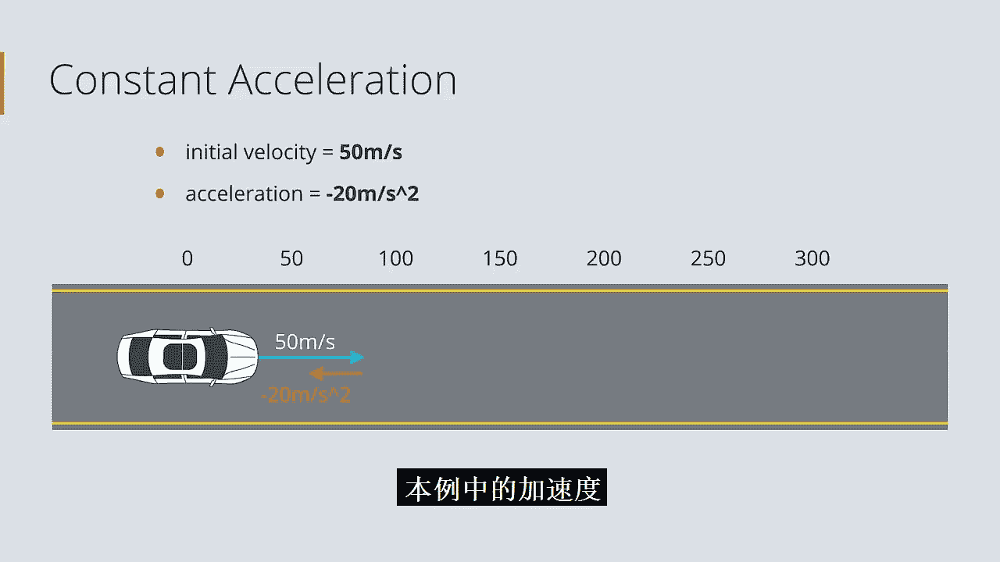
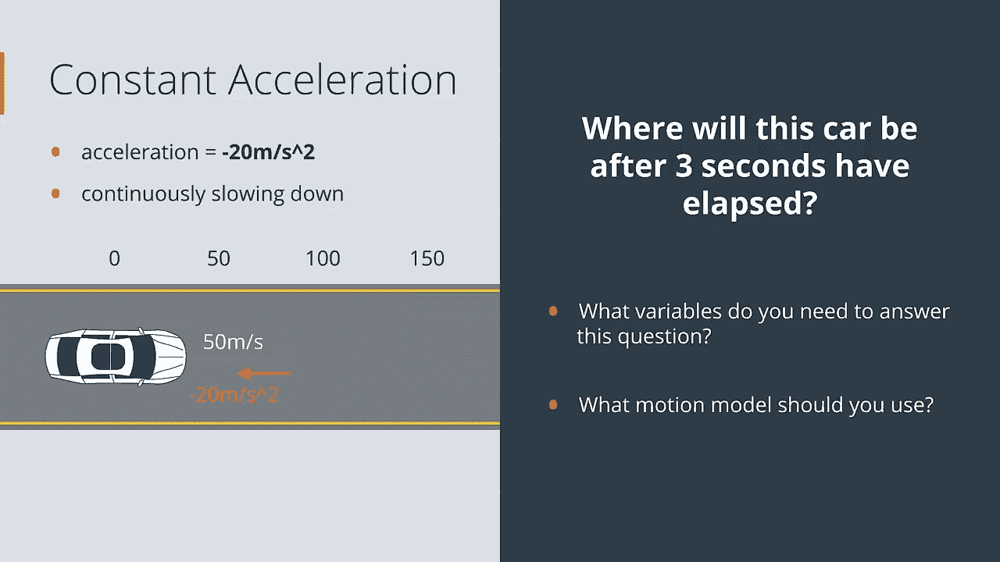
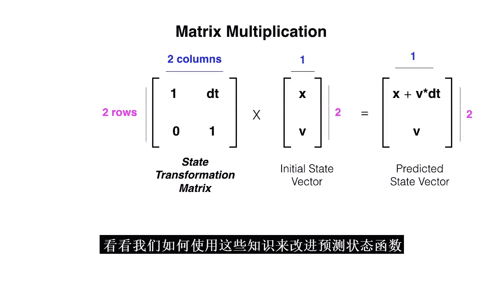

# 优达学城（Udacity）：无人驾驶汽车纳米学位项目-十位大牛亲授自动驾驶技术，硅谷前沿科技（计算机视觉⧸车道识别⧸感知控制⧸人工智能⧸谷歌） p16 16. Part 03-Module 01-Lesson 03_State and Object-Oriented Programming [BV1Vd4y1r7QG_p16]

All self driving cars go through the same series of steps to safely navigate through the world。

 You've been working on the first step， localization。 before cars can safely navigate。

 they first use sensors and other collected data to best estimate where they are in the world。

 In this lesson， we'll be talking about representing and predicting car movement。 But before we do。

 let's review all the steps that a common filter takes to localize a car。😊，First。

 we start with an initial prediction of our car's location and a probability distribution that describes our uncertainty about that prediction。

 Here's a one dimensional example in which we know that our car is on this one lane road。

 but we don't know its exact location。 And so our prior probability distribution is uniform。

 We then sense the world around the car。 This is called the measurement update step in which we gather more information about the cars surroundings and refine our location prediction。

 sayy we measure that we're about two grid cells in front of the stop sign。

 Our measurement isn't perfect， but we have a much better idea of our car's location。😊。

The next step is moving， also called the time update or prediction step。

 We predict where the car will move based on the knowledge we have about its velocity and current position。

 and we shift our probability distribution to reflect this movement。

This example shows a one cell movement to the right。

 And this gives us a new state estimate for the position of the car。

 The common filter simply repeats the sense and move measurement and prediction steps to localize the car as it moving。

The beauty of common filters is that they combine somewhat inaccurate sensor measurements with somewhat inaccurate predictions of motion to get a filtered location estimate that's better than any estimates that come from only sensor readings or only knowledge about movement。

 This is why a common filter is such a powerful localization method。😊，When you localize a car。

 you're interested in only the car's position and its movement。

 This is often called the state of the car。 The state of any system is a set of values that we care about In the cases you've been working with。

 The state of the car includes the car's current position X and its velocity in code。

 this looks something like this。 The state of the car gives us most of the information we need to form predictions about a car's future location。

 And in this lesson will see how to represent state and how it changes over time。😊，For example。

 say that our world is a one lane road， and we know that the current position of our car is at the start of this road at the 0 m mark。

 We also know the cars of velocity。 It's moving forward at a rate of 50 m per second。

 These values are its initial state。 What do you think the state of the car will be after3 seconds eapse。

Let's take a closer look at the last example。 The initial state of the car is at the 0 m position。

 and it's moving forward at a velocity of 50 m per second。

 Let's assume that our car keeps moving forward at a constant rate。😊，Every second， it moves 50 m。

 So after 3 seconds， it will have reached the 150 m mark， and its velocity will not have changed。

 That's what a constant velocity means。 Its new predicted state will be at the position 150 m。

 and with the velocity still equal to 50 m per second。 This is a reasonable prediction。

 and we made it using just one。 The initial state of the car。 And two。

 an assumption that the car is moving at a constant velocity。

 This last assumption can be mathematically represented by the physics equation。

 distance travel equals velocity times time。 This equation is also referred to as a motion model。

 And there are many ways to model motion。😊，This model assumes constant velocity。 In our example。

 we're moving at a constant velocity of 50 m per second for 3 seconds。

 and we formed our new position estimate with the constant velocity equation。

150 m equals 50 m per second times 3 seconds。😊，In order to predict where a car will be at a future point in time。

 you have to rely on a motion model。 It's important to note that no motion model is perfect。

 It's a challenge to account for outside factors like wind or elevation or even things like tire slippage and other uncertainties。

 But these models are still very important for localization。Next。

 you'll be asked to write a function that uses a motion model to predict a new state。Now。

 what if I gave you a more complex motion example， And I told you that our car starts at the same point at the 0 m mark。

 and it's moving 50 m per second forward。 But it's also slowing down at a rate of 20 m per second squared。

 That means that every second， the velocity decreases by 20 m per second。😊。

This value is referred to as acceleration。 acceleration in this case equals negative 20 m per second squared。

 This acceleration means that if the car starts at a speed of 50 m per second at the next second。

 it will be going 50-20 or 30 m per second。 And at the next second。

 it will be going 30-20 or 10 m per second。😊。

This slowing down is also continuous， which means it happens gradually over time。

For the next couple quizzes， I want you to keep in mind this question。

 where will the car be after three seconds with this initial state。I also want to ask you。

 what variables do you need to answer this question， In other words。

 what value should be included in the state and what motion model should we use to solve this problem。

Now you've seen two examples of car motion models In the first example。

 we assumed our car was moving at a constant velocity。

 but in the second example we said that the car was slowing down with a constant acceleration。

And after three seconds had elapsed， we ended up with different estimates for our car' state。

 depending on which motion model we relied on。In the case where the car was slowing down。

 we had to include an acceleration value in our calculations in order to predict where it would move。

 And so we also added this value to our car's state。 In fact。

 how many variables the state of our car contains depends on what motion model we use for a constant velocity model。

 position and velocity will suffice。 But for constant acceleration。

 you'll need to include an acceleration value as well。😊，And these are all just models for any state。

 you should always choose the smallest set of values that you'll need to work with your chosen motion model。

The one unifying theme in this lesson is representing and predicting state。

 but there are two threads that we'll use to explore this idea On the programming side。

 we'll use something called object oriented programming as a way to represent state and code。

 We'll use variables to represent state values and well create functions to change those values。

 On the mathematical side， we'll use vectors and matrices to keep track of state and change it。

 We'll learn all the necessary math notation and code as we learn more about predicting the state of the car。

You've been working with a predict state function that takes in a current state and some change in time DT。

And it outputs a new state estimate based on a constant velocity motion model。

It turns out a constant velocity model is actually a good， simple model to use。

 especially if changes in time are very small。Now， to track the state of a car over time as the car moves。

 you have to repeatedly call this function passing in new state estimates at each time step。

So as an example， let's say we have this initial state。At position。

 x equals0 and velocity equals 50 meters per second。I'll put these two values into a list。

 our initial state， and I'll print them out。So the initial state is x equals0 and velocity equals 50 meters per second。

Next， I want to know the next state after two seconds have passed。

 so I'll use my predict state function， passing in the initial state and a two second time difference。

 and I'll call the state S1 for the first state estimate。And I'll print out this result。

Our position x is now at 100 meters， and the velocity remains 50 meters per second。

Then say another three seconds have passed。I'll call the predict state function again。

This time I'll pass in our latest state estimate， state S1， and a three second time difference。

And I'll print out this value。Our position is now 2，50 m。

 and our velocity remains constant at 50 m per second。What about after three more seconds？

I'll have to pass in our latest state estimate， state estimate2。

 and three more seconds in time difference。And I'll print out the result， as you can see。

 we're basically calling the same line of code over and over again。

 but modifying the state input to be the latest state estimate。This repetition is tedious at best。

 and its bad coat。 As a programmer， you should always try to avoid unnecessary repetition。

Wouldn't it be nice to just tell a car to move and have its state update automatically as it moved。

 as opposed to writing the same line of code manually keeping track of the state over and over again？

Well， we can automatically keep track of state with the help of objects。Objects hold a state。

 They hold a group of variables also known as properties and functions。

 You can imagine an object like a box。 And within that box are variables that define the state of an object。

 like the position and velocity of a car object。 Objects also hold functions that tell us what the object can do。

 Like can the car move and turn and so on。 But we're getting ahead of ourselves。

 Let's first see an example of an object in action。So here。

 I'll show you how to interact with a car object that can keep track of its own state。 First。

 you'll see some import statements and some code that will go through in detail soon。

 But before we dive into the code that makes up an object， we'll learn how to interact with it。

So next you'll see some initial variables， first a world。

 and then some variables that should look familiar in initial position and velocity。This time。

 the position is in two dimensions， Y and X， and the velocity is also broken down into vertical and horizontal components。

 V， Y and V， X。 I'll make sure to run both of these。Then to create a car， which I named Carla。

I have to say car dot car and pass in some initial state。

 So I'm passing in some Y X position and velocity。 And lastly。

 I'm passing in a world which is just a 2D array。And I'll print out Carla's initial state。

 You'll notice that I can access Carla's state by saying Carla dot state。

And we see that the initial position is at 0，0， and the initial velocity is 01。

 which means it has some horizontal velocity to the right。Now this car object， Carla。

 has some visualization code too。And we can see where the car is at any given point using the display world function。

I can say Carla do display worldor。And when I run this code。

 I'll see the location of Kla and the size of the 2D world。Now， what else can Carla do。Well。

 we can tell Carla to move by saying Carla do move。

And Carla will move one grid cell in the direction of the initial velocity。

 which in this case is towards the right。 Let's test this movement by displaying the world again。

And we can see that Carla has moved one space to the right。 After this movement。

 we can also track the change in Carla's state， and I can print out its value using Carla dot state again。

And we can see that the state has actually updated。

 The position has moved one grid cell to the right， and the velocity remains constant。So somehow。

 Carla is keeping track of her own state。And what if we move a couple more times？

Let's track the change in state。And we see that we've moved two more to the right， zero come a 3。

And we can see the movement on our map of the world， by calling Carla。Dot display world once more。

So we know Car's state updates automatically。Carla can also turn left。

So let's tell Carla to turn left and move one space。And let's display the world。

We can see that color turns left at this spot and actually circles around the world。

And if we print out Carlos State by saying Carlos State is string Carla。 state。

We see that both the position and the velocity have changed。Our position is 3，3。

 which is reflected in our grid。And V， Y is now negative1， and V， X is 0。

 This means that there's no horizontal velocity。 There's only a negative vertical velocity。

 which means Carla is moving up our grid world。 Now。

 moving and turning left are all Carla can do for now。

 But we'll soon see how to add to her list of capabilities。 Here is our car do pi file。😊。

Let's take a look at the coat in here， line by line。First， you'll note the things in red。

 which are just comments that describe the class。It describes what the class does and what attributes it has。

And comments like these are good practice， especially if you want your code to be understood by other developers。

Now， if we scroll down a bit， one of the first things you see is our class car。

This looks a bit like a function declaration， but the word class lets Python know that the code that follows should describe the state and functionality of a car object。

Objects are also always capitalized， and so we see that car is capitalized here。Next。

 we see the inni function， which is responsible for creating space and memory to make a specific car object like Carla。

So when you run code like car dot car and pass in some initial parameters。

 This is the function that's called。 This is where the initial state is created from the position and velocity that are passed in。

 This is where the initial state is created from the position and velocity variables that are passed in。

 We also see variables for the car's world。 Its color and its path。

 We know the world is just a 2D grid。 The color will revisit。 But for now know。

 that's why our car appears red in our grid。 And the path is just going to be a list of locations that a car has visited that we can then visualize。

 So the most important lines of code in here are the state in the world。

 And all of the variables in here are something that a car object keeps track of。😊，Next。

 if we scroll down， is the move function。The description says the move function moves the car in the direction of the velocity and updates the state。

And this may look familiar from our predict state function。

 Move uses a constant velocity model to move the car in the direction of its velocity。 V X and VY。

 Move uses a constant velocity model to move the car in the direction of its velocity， VY and VX。

And if we look at one portion of this equation， we can see that it's our constant velocity model。

It says why our initial position plus our y velocity times。

 our change in time becomes our new predicted position。 And at the end。

 we update the car's state variable that was initialized in an it。

And this is how we track the state of the car as we move。Next， we see our turn left function。

 which simply rotates the velocity values to the left。

 And this function updates our state again with the new velocity。 And finally， at the end。

 we have this display world function， which you shouldn't change。 but feel free to read。

 This is responsible for displaying a grid world and our car within it。

 And it uses pie plot for visualization。 Next， it will be up to you to read through this code。

 understand how a car object like Carla tracks its own state。

 And together will help write some additional functions within this car class。

 So we're back in our car do pi file。 And let's see how we can actually modify this car object and add a color variable。

😊，Inside our class code， we can see that there' is a default color for our car。

 red represented by the character R。 So how do you think we might customize this， Well。

 just like with our state variables in our world， we can pass it in in our initialization parameters to do this in the usual way。

 we just add an extra parameter to our a knit function。😊，I'll call this parameter color。

I can also specify a default value for color equal to red， equal to the character R。

This color equals R means that if and only if a person does not specify a color parameter when a car object is created。

 it will， by default， be read。None of our other variables have a default value。

Then we also have to change this one other line of code。

And instead of saying self dot color equals R。We say self dot color equals color。

And this is the past in variable here。So now our knit function initializes the state of our car。

 gives our car a 2D world to traverse， and it specifies the color of the car。

All that's left to do is to test this out in executable code。So let's go into a new notebook。

Here are the usual import statements where we import our car class file。

 here are our usual import statements where we import our car class file。Next。

 I'll create car objects。Here I'm defining initial parameters and I'm creating Kla in the same way as I usually do。

And then I'll define some new initial parameters and I'll create a new car object。This time。

 I'll name the car Jeanette。A passion， an initial state， a world and a color。

And it'll say Jeanette equals car。 car and pest in our initial variables。As you can see。

 I'm passing in our initial state variables position2 and velocity2， and passing in the same world。

And I'm also passing in a color and specifying that Jeanette has a yellow color with the character Y as our last passed in variable。

An order is important here。 This should match the order in our car class file。

 So now I should have two cars， Carla and Jeanette。And I'll run this cell of the notebook。Now。

 if you get an error at this step， make sure you saved your car class file after you've changed it and restart your kernel by clicking kernel and restart and clear output。

So since I didn't get any errors， my next step will be to write some move code for both of these cars。

And this is just for fun and visualization。 First， I'm going to move Carla。

 telling Carla to move and turn left and move again， and then I'm going to display Carla's world。

We can see Carla's movement moving forward， then left and looping around the world。

 And we see that Carla is red。Red is the default color。

 since we didn't specify a color when we created Carla。 Let's scroll back down。Next。

 I'm going move Jeanette， turning left and moving and turning left and moving some more。

 And I'll display Jeanette's world。 We can see that Jeanette starve off at a different point and sort of looped around。

 creating a different path。 And we see that Jeanette is yellow， including the path。😊。

So this is pretty cool。 Adding more variables like a car color can be just a couple of lines of code。

 This is also the case with functions。 You can add their definitions to a class and then be able to access them。

 So far， you've seen that the state of a car contains multiple values。

 which we've been putting into a Python list， but these values are typically contained in one data type。

 a state vector。 A vector is similar to a list in Python in that it contains multiple values。

 but they are mathematically very different。😊，A vector is a kind of matrix， which for now。

 you can think of as a grid of numbers。 and matrices are a math data type。

 similar to something like an integer or a float。 And similar to an integer or a float。

 We can multiply matrices。 We can scale them， add two of them together and so on。

 This is called linear algebra。 And linear algebra will come up again and again in self drivingiv car systems。

 It's in everything from car movement to deep learning algorithms and image analysis。

 In this section， we'll see how state vectors and matrices can be used together to help us efficiently predict a new state and localize a car。

😊，Let's look at how vectors are used in the math behind self driving cars。

 The way we have been representing state is as a list of values， which just has a length。

 a length of two values in this case。But a state vector is a column of values whose dimensions are1 in width and M in height。

 and again， in this case， M is 2。This makes the state vector a special kind of matrix。

 and we'll see why being a column vector is important soon。

 Let's think about our predict state function again。

 It takes in an initial state and we store the position X and velocity V。

 and then we have a couple of lines of code that predict the next state based on a constant velocity motion model。

😊，We calculate the new position， new x， and put two values。

 the new position and the velocity into a new predicted state， a new list of two values。

 But with a state vector that holds these two values， X and V。

 we do not need to separate them to perform this calculation。

 We can actually perform these same calculations in just one multiplication step。

This step is a matrix multiplication step。Mattrix multiplication multiplies two grids of numbers like this2 by2 matrix and this2 by one state vector。

 which has a position x and a velocity v。And here's how this multiplication works。

This operation first multiplies the rows in this first matrix by the columns in the second。

 So these dimensions， the number of columns in this first matrix and the number of rows in the second have to be the same。

Step by step， this looks like one times x， which is just x。 and then v times Dt。

 So now we have the first row in the first matrix times the column in the second matrix。

The next step is to sum these two values to form a single new value in this new matrix。

 x plus v times Dt。Then we do the same with the next row。And we get0 times x plus1 times v。

And sum mean these values gives us just V。And that's it。

 You can see that this creates a new two by one vector with two values in it that may look familiar。

In fact， these are just our equations for our constant philosophy motion model。

After some change in time， X becomes x plus velocity times change in time， and v remains constant。

 And so matrix multiplication lets us create a new predicted state vector in just one multiplication step。

This is such a common way to predict a new state that this two by two matrix is often called the state transformation matrix。

Next， we'll test your knowledge about matrix multiplication and see how we can use this knowledge to improve the predict state function。

Great job getting this far。 Now， you've seen that we can transform the state of a car using matrix multiplication。

 This kind of linear algebra can be used to update multiple state variables in just one line of code。

 and this becomes really useful when you're working with big data sets and variables that represent our three dimensional world。

😊，Next you'll see how linear algebra is used to create a two dimensional common filter in the process you'll learn more about matrix operations and notation。

 and you'll be one step closer to creating an algorithm that is actually used to localize self- drivingriving cars。

