# 优达学城（Udacity）：无人驾驶汽车纳米学位项目-十位大牛亲授自动驾驶技术，硅谷前沿科技（计算机视觉⧸车道识别⧸感知控制⧸人工智能⧸谷歌） p17 17. Part 03-Module 01-Lesson 04_Matrices and Transformation of State [BV1Vd4y1r7QG_p17]

Right now， we've got a few threads in our hands。 We've got common filters。

 matrices in vectors and object oriented programming。

 And you might be certain to see how these threads all intertwine， but maybe not。😊。

At the end of this course， you're going to implement a matrix class which will be used to make a multidimensional come filter actually work。

 And once you do that， it should be crystal clear how these threads all intertwine。 But for now。

 we've got a bit more work to do with comet filters。

 So we're going to pick up where the common filter lesson you were watching earlier left off。

 And just to remind you of where you were when you left off。

 We're going to show you the very last video you saw from that lesson again。 Enjoy。😊。

So now we understand a lot about the one Dcoma figure。

You've programmed one。You understand how to incorporate measurements。

 You understand how to incorporate motion。

And he really implements something it's actually really cool。

 which is a full common filter for the 1 D case。 Now， in reality， we often have many Ds。

 and then things become more involved。 So I'm going just tell you how things work with an example and why it's great to estimate it higher dimensional space state spaces。

 Suppose you have a two dimensional state space of X and Y。 like a camera image or in our case。

 we might have a car。😊。

That uses a radar。

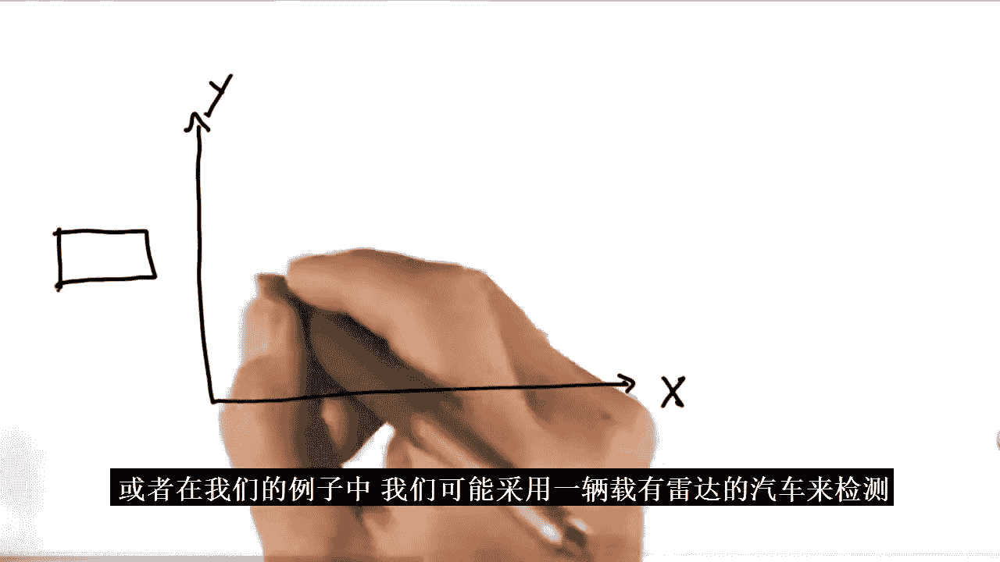

To detect the location of a vehicle。Over time， then what the 2D common filter affords you is something really amazing。

 And here's how it goes。😊，Suppose at time T to 0， you observe。

The object of interest to be at this coordinate。 This might be another car in traffic for the Google self driving car。

 One time step later， you see it over here。Another time step later， you see it right over here。

 Where would you now expect a time T was 3， the object to be。Let me give you three different places。

Please click at the most likely location。And the answer is here。

What the ca filter does for you if you do estimation in higher dimension spaces。

Is to not just go into x and y spaces。But allows you to implicitly figure out what the velocity of your object is and then use this velocity estimate to make a really good prediction about the future。

 Now， notice。The sensor itself only sees position。 It never sees the actual velocity。

 The velocity is inferred from seeing multiple positions。

 So one of the most amazing things about common filters in tracking applications is that it's able to figure out。

 even though it never directly measures it。😊，The velocity of the object。

 and from there is able to make predictions about future locations that incorporate velocity。

 That is just really， really， really great。 And that's one of the reasons why common filters are such a popular algorithm in artificial intelligence and a control theory at large。

😊。

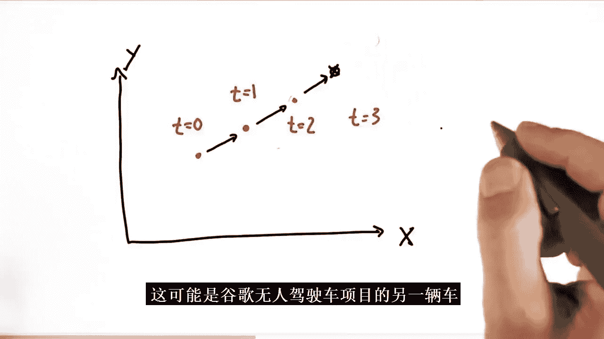

To explain how this works， I have to talk about high dimensional Gaussians。

These are often called。Mightyvari， Gaussians。

The mean is now a vector。With one element for each of the dimensions。

The variance square is replaced by what's called a covariance。

 and it's a matrix with D rows and D columns。 if the dimensionality of the estimate is D。

And the formula is something you have to get used to。I'm writing it out for you。

But you'll never get to see this again。Take you the truth。

 Even I have to look up the formula for this class。 so don't have it in my head。

 and please don't get confused。 Let me explain it to you more intuitively。

He has a two dimensional space。A two dimensional Gaussian is defined over that space。

And it's possible to draw the contour lines of the Gaussian。 They might look like this。

The mean of this Gaussian is this x0 y0 here。And the covariance now defines the spread of the Gaussian。

 as indicated by these controlt lines。A Gaussian with small amount of uncertainty might look like this。

It might be possible to have a fairly small uncertainty in one dimension。

 but a huge uncertainty in the other。He， the uncertainty in the X dimension is small and the white dimension is large。

 And when the Gaussian is tilted as shown over here。Then the uncertainty of x and y is correlatedrel。

 which means if I get information about X that actually sits over here。

They would make me believe that why probably sit somewhere over here。 That's called correlation。

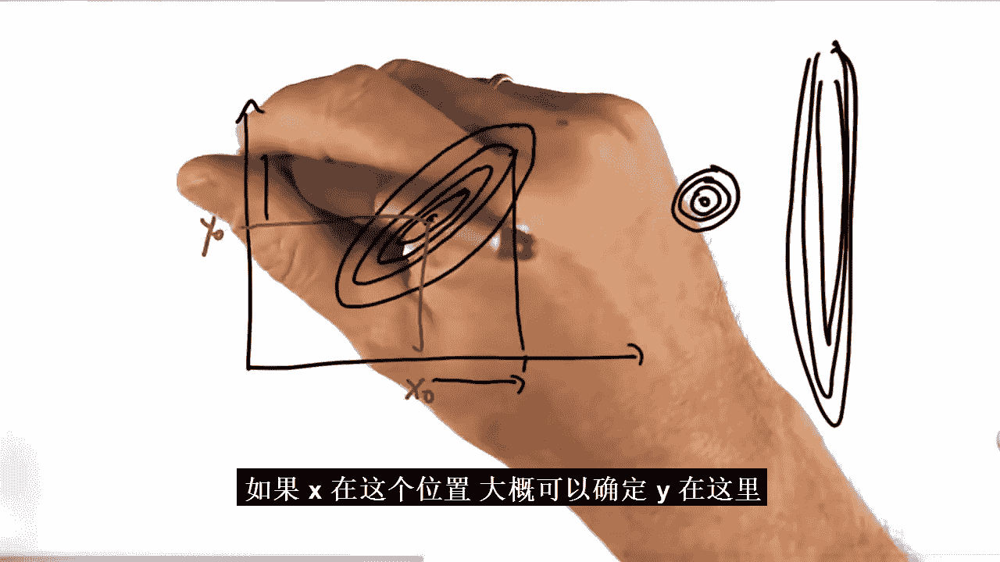

I can explain to you the entire effect of estimating velocity and using it in filtering。

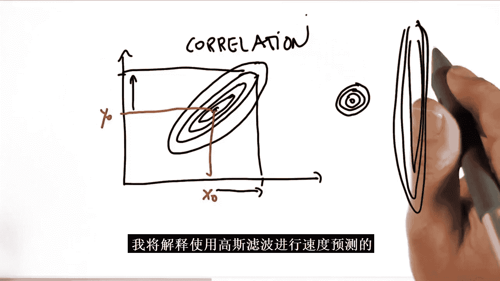

Using Gaussians like these。 And it becomes really simple。

 The problem I'm going to choose is a one dimensional motion example。Let's assume a t equals one。

 We see our object over here。 A t equals 2 right over here。 A T equal withs 3 over here。Then。

 you would assume。That atgue was4。The object sits over here。

And the reason why you would assume this is。Even though we've just seen these different discrete locations。

 you can infer from where there is actually velocity that drives the object to the right side to the point over here。

Now， how does a common filter address this。This is the true beauty of the common fiter。

In commonly the land。They're going to build a two dimensional estimate， one for the location。

 and one for the velocity， denoted X。Dot whether else we can be 0。It can be negative。

Or it can be positive。If initially， I know my location， but not my velocity。

 then I represent Gaussian that's elongated。Around the correct location。But really。

 really broad in the space of veillocophies。 Now let's look at the prediction step。

In the prediction step， I don't know my velocity。 So I can't possibly predict what the location Im want to assume。

But miraculously， there be some interesting correlation。So let's for a second。

 Just pick a point on this distribution over here。 Let me assume。My velocity is 0。Of course。

 in practice， I don't know thero。 But let me assume for a moment， the velocity is 0。

 Where would my posteror be after the prediction， Well， we know we started location 1。

With velocity of 0。 So my location will likely be here。Now。

 let's change my belief in the velocity and pick a different one。 Let's say the velocity is one。

 Where would my prediction be one time step later。Starting add location 1 and velocity 1。

 I give you three choices。Here。Here。😔，我 here。Please pick the one that makes most sense。

 and the answer is right over here。Wai。If a current starting point is the point over here for which we know the location is one and the velocity is one。

 and if we predict one time step in the future， then for that prediction。

 we know the location will be 2 and。The velocity might be liberal and certain。

 but it stays about the same。So we end up with a point of view。Let's do this again。

 Let me consider a velocity of2。Which means this is our starting point。

And let me ask you where you would expect。Among those choices to be the most plausible prediction to be。

 And just like before， it'll be over here with velocity of two initial position of one。

 we find ourselves in3。 And again， this model assumes that in the absence of more knowledge。

 diversity shouldn't really change。When you put all this together。

You find that all these possibilities on the Gasin over here。Link。To a Gaussian that doess like this。

And this is a really interesting two dimensional Gaussian。Which is should really think about。Clearly。

 if you were to project this Gaus in uncertainty into the space of possible locations。

 I can't predict a thing。 It's impossible to predict where the object is。

 And the reason is I don't know the velocity。Also， clearly。

 if I project this Gaussian into the space of X dot。

 then it is impossible to say what erosity is a single observation or a single prediction is insufficient to make that。

Observation， however， what we know is our location is correlated to the velocity。 The faster I move。

 the further on the right is the location。And this Gaussian expresses this。 If I， for example。

 figured out that my velocity was2， and I was able under this Gaussian to really nail that my location as we。

That is really remarkable。 You still haven't figured out where you are。

 We haven't figured out how fast we moving， but we've learned so much about the relation of these two things with this tiltiled Gaussian。

 And to understand how powerful this is， let's now fold in the second observation at time tea equal 2。

😊，This observation tells us nothing about the velocity。And only something about the location。

So if I voted to draw this as a Gaussian。It's a Gaussian just like this。

 which says me something about the location， but not about the velocity。

 But if I now multiply my prior from the prediction step。With the measurement probability。

 then miracckously， I get a Gaussian that sits right over here。

And this Gaussian now has a really good estimate。What my velocity is and a really good estimate。

 where I am。If I take this Gaussian and put it one step forward。Then I find myself right over here。

 That's exactly the effect we have over here。As I opted this a get Gaussian like this。

 I predict right over here。Think about this。 This is a really deep insight in how common filter work。

 in particular。We've only been able to observe one variable。 We've been able to model observation。

 to infer。There other variable。 And the way we've been able to infer is that there is a set of physical equations which say that my location after a time step is my old location。

Plus， my velocity。And this set of equation has been able to propagate constraints from subsequent measurements backed with this unobservable variable velocity。

 So we're able to estimate velocity as well。 This is really key to understanding common filter。

 it is key to understand how a Google self driving car estimates the location of our cars and is able to make predictions。

 even if it' is unable to measure velocity directly。 So there a big lesson here。😊。

The variables of a common filterer， they often call states because they reflect states of the physical world。

 like wheres the other car fast is moving。 They separate into two subsets。

 the observables like the momentary location and the hidden。Which， in our example， is the velocity。

 which I can never directly observe。 But because those two things interact。

 subsequent observations of the observer variables give us information。About these hidden variabless。

 So we can also estimate what these hidden variabless are。

 So from multiple observations of the places of the object， the location。

 we can estimate how fast it's moving。 That's actually true for all the different filters。

But because common filters happen to be very efficient to calculate when you have a problem like this。

 you tend to often use just the common filterr。

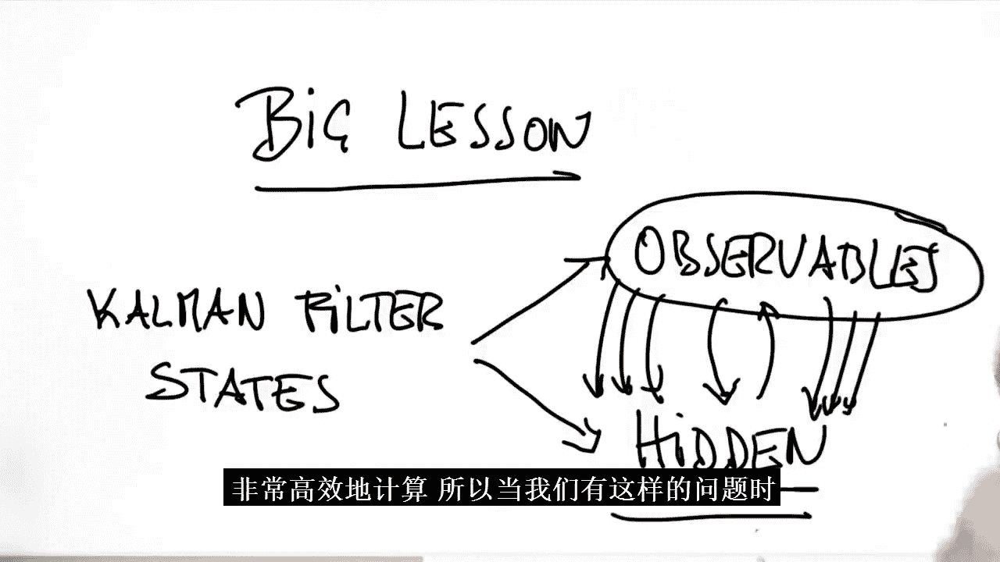

So we need design。

A common fit。 You need effectively two things for the state。You need a state transition function。

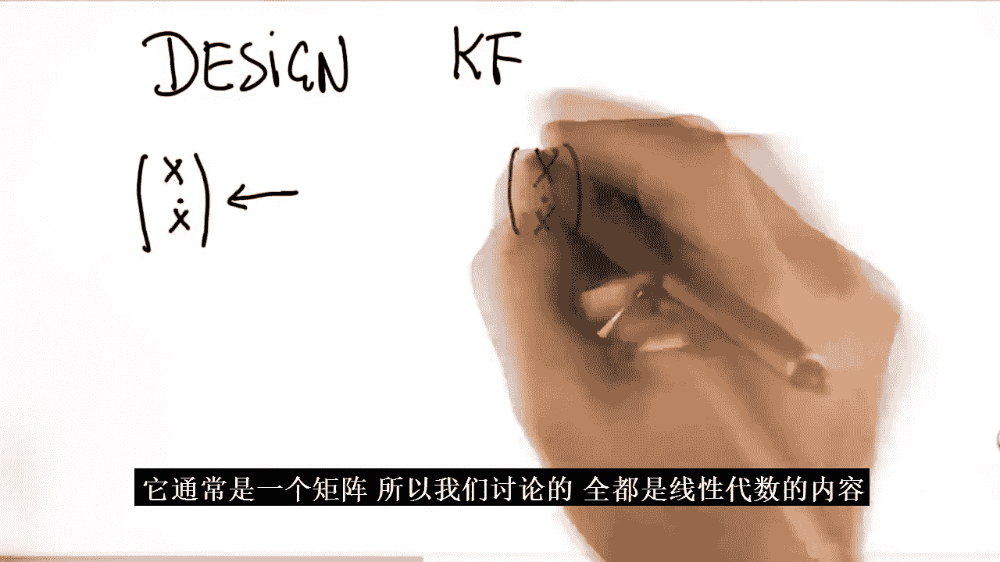

And that's usually a matrix。 So we are now in the world of linear algebra。 And for the measurements。

 you need a measurement function。 So let me give you those for our example of the oney motion of an object。

 We know that the new location is the old location。

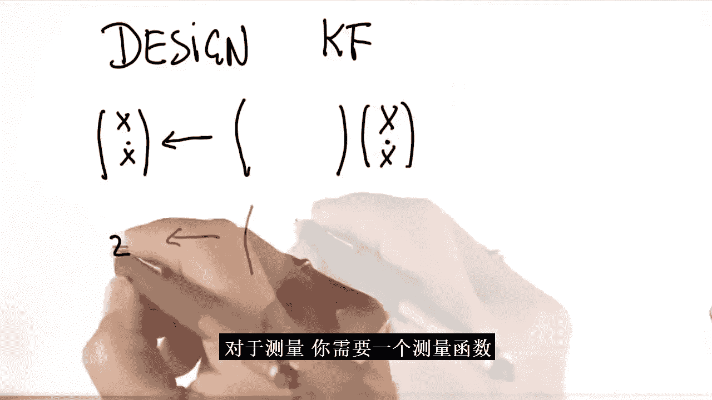

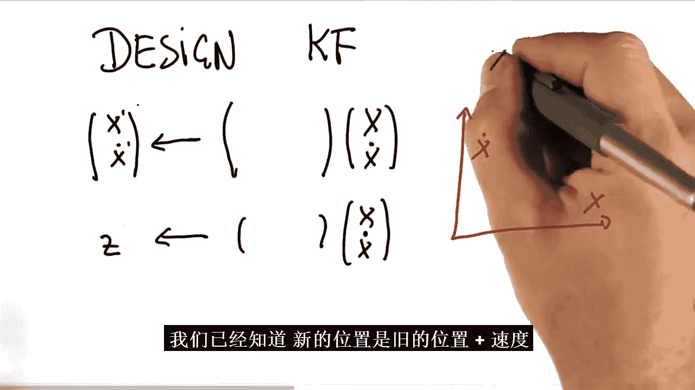

Plus， velocity， turning this into this matrix。 Y have a one over here。And a one over here。

 the new velocity should just be the old velocity。Because the 0 over here and a1 over here。

 If you multiply this matrix with this vector， this is exactly what you're getting。

And for the measurement， we only observe the first component of the place， not the velocity。

 and that uses a vector or matrix like this。So this mat will be called F。And is H。

The actual update equations for common feature are involved。And I give them to you。

 But please don't memorize them。 and I won't prove them for you。 Even the proof is very involved。

Every time I use them， I just look them up。There's a prediction step。Will I take my best estimate X。

Multiplied with the state transition matrix， matrix F。And I add whatever emotion I know。You。

That gives me my new ex。I also have a covariance that characters my uncertainty。

And that is updated as follows。

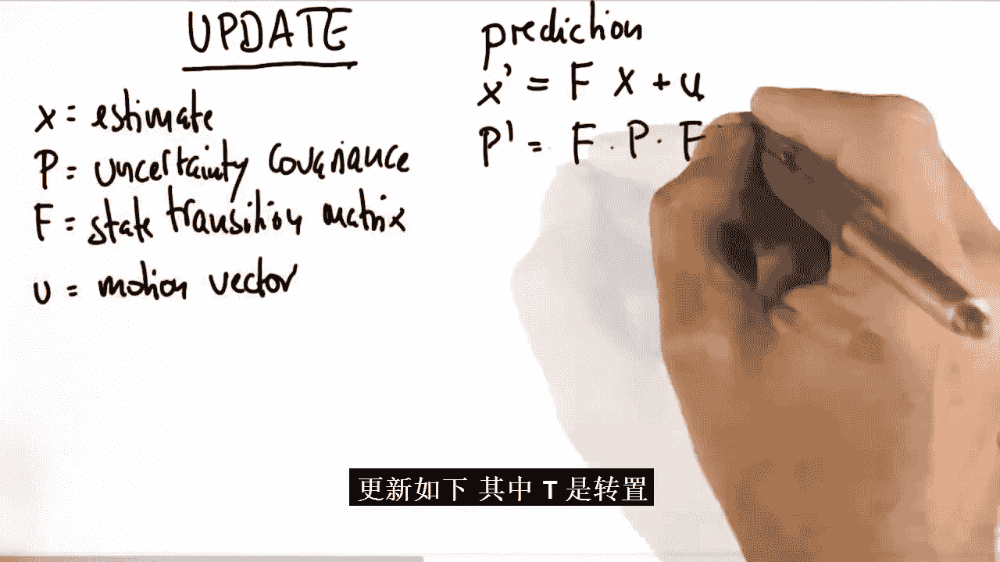

Where teased the transpose。There's also a measurement update tip。Weve used the measurement Z。

We compare the measurement with our prediction。Where age is the measurement function that maps the state to measurements。

Because this the。E。The error is mapped into a matrix S， which is obtained。

By projecting the system uncertainty into the measurement space。

 using the measurement function projection plus a matrix R， the character the measurement noise。

This is then mapped into a variable called K， which is often called the kman gain。

 where we invert the matrix S。 And then finally， we actually update our estimate。And no uncertainty。

Using what ought to be the most cryptic equation that you've seen in a long time。 Now。

 wrote this down so that you have a complete definition。

But this is something you should not memorize。 If you really wish to understand this math。

 It is happens to be just the generalization of the math I gave you to higher dimensional spaces。

 but I would recommend just not to worry about this。

 There is a set of linear algebra equations that implement。

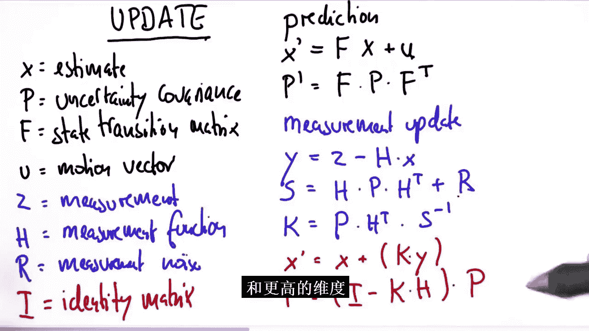

The common filter and higher dimensions。 at this point。

 it makes sense to recap everything we've been discussing recently。 So far， in this course。

 you have first learned about and implemented a one dimensional common filter。

 which could actually be used to track a vehicle like， for example。

 a train that's moving in one dimension。 And it would do that by using a Gaussian probability distribution to represent some belief about where the vehicle is。

Then you learn a bit about what we mean when we talk about a vehicle's state and how we can think of motion as a state transition。

Then you see how object oriented programming gives us a nice way to represent state in objects and to use methods to change or transition that state。

This LED to a more purely mathematical representation of state as lists of numbers also known as vectors。

 And then you saw how mathematically matrix multiplication can perform state transitions on these states。

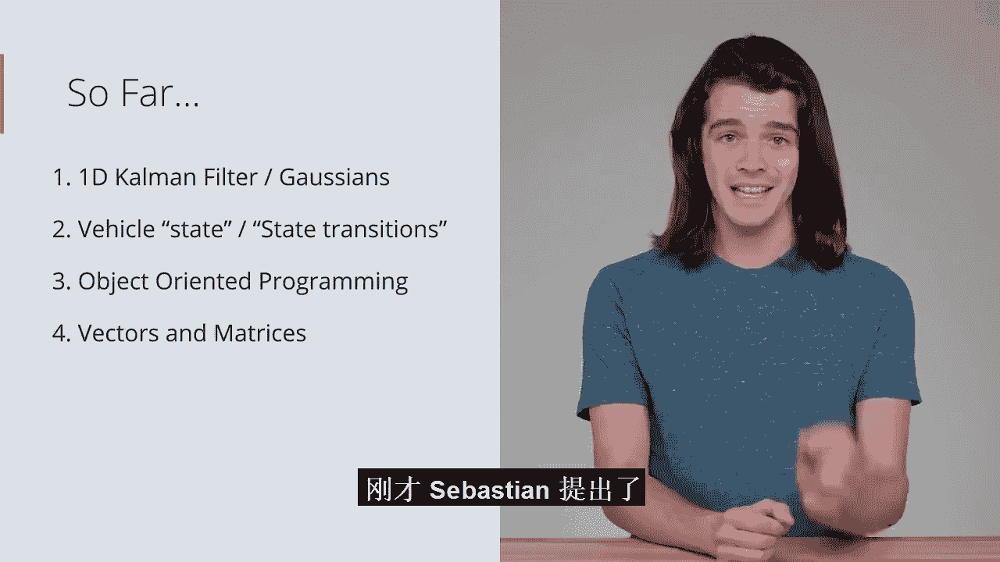

And just now， Sebastian brought up the idea of the many D common filter equations。

 which are actually useful for real driving situations。

 But he suggested that we not worry about the matrix math that underlies these equations。

 But since thisned degree is your first step towards a career where you're actually going to have to work with these equations in code。

 we actually are going to worry about them right now。😊，For the rest of this course。

 we are going to focus on building a working knowledge of matrix math。

 which is also known as linear algebra。 But what do I mean by working knowledge。

 As Sebastian has repeatedly said， it is not important to memorize equations。

 But as a self drivinging car engineer， it will be important for you to be able to find and use the equations you need when you need to use them。

So imagine that at some point in the future， you're working on the traffic prediction team for some self driving car company。

 and you're trying to build a prototype of some objectic tracking code。

You might create a file called I don't know Calman filterter。pi， and then， well。

 if you're like most people， you'd probably have to go to Google。And once you're there。

 you'd start typing in common filter。And you'd see a list of results， and as you can tell。

 I personally like Wikipedia。And what you'd see would look something like this。

 And since you wouldn't be looking to look through all the theory。

 you'd probably scroll right down to the common filter equations。Which looks something like this？

And unsurprisingly， they're separated into a predict and an update step。

 And you probably have an understanding of what those mean conceptually。

 But that doesn't necessarily mean you could do anything with all these equations。

 And that's kind of a shame。So the goal for this course and the project that follows is to make sure that when you see equations that look like these。

You'll be able to put them to use in the future。 What that means is you can translate the matrix math that you see on a page like Wikipedia into real code。

 so let's begin。So these are the common filter equations and all their beautiful complexity。

 But what do they all mean Before we jump into all the matrix math behind these equations。

 I'd like to just do some basic visual cleanup。 And to do that。

 I want to make three modifications to these equations。

 So let's just focus on this first equation here。 so I can explain what those modifications are。😊。

So the first thing I'm going to do to all these equations is just get rid of these hats。

Like the hats you are over the X。While the hat does have physical significance。

 it indicates that this variable is an estimate。 It's not for sure。

It doesn't have any mathematical significance， it's not telling us to do anything mathematically with these equations。

 so let's just get rid of those for now。Next， we're going to take all these x sub k given k minus1。

 and we're just going to replace that with x prime。Not only is this easier to look at。

 it's also consistent with the notation you've been using with Sebastian。Finally。

 we're just going to get rid of these lone ks。 They're kind of clattering things up。

 and I'd rather just look at an equation like this。So now we have this simplified equation。

 And remember， it's say math here just looks simpler。

 And let's take a look at what happens to all of the common filter equations When we apply these same three cleaning steps。

 and take equations which look like these， and we convert them。Two equations that look like these。

And this representation really lets us focus on the mathematical tools we're going to need in order to make Wikipedia articles useful to us。

In fact， we can actually use certain aspects of these equations right now to highlight what we're going to cover in the rest of the lesson。

 So first， let's focus on the difference between lowercase and uppercase。

 there's actually meaning there。Generally， lowercase variables indicate vectors。

 while uppercase variables indicate matrices， we'll talk more about this distinction in a minute。

We'll also talk about addition and multiplication of vectors and matrices。

We'll discuss one particularly special matrix called the identity matrix。

And we'll talk about two additional important operations called the transpo given by this little T superscript。

And the matrix inverse given by the little negative 1 superscript。

And if this seems like an overwhelming amount of stuff to learn in a very short time， remember。

 the goal here is not to memorize any of this。 The goal isn't even really to get a conceptual understanding of linear algebra。

 That will come with time。The goal now is to acquire a basic functional familiarity with the tool that is matrixtri math so that when you encounter it in future Google searches。

 you'll know where to begin。

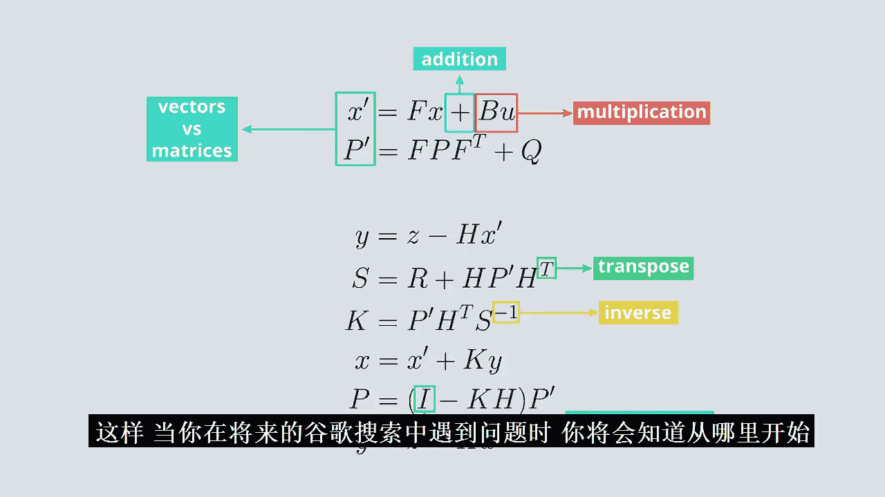

This is a lot of math。 And I get it。 I can tell you， I don't myself remember all these formulas。

 I have to look them up。 Even by in early days of viudacity。

 I made a course on robotics where I couldn't remember how to invert matrices。

 So I Googled it in a stole piece of code。 and then my team would really matter at me for stealing code from somebody else。

 even though everybody seals code these days。 but be going with you through this。

 So you get an understanding of the basic linear algebra。 And trust me。

 even if you understand the end day what the matrices and what a vector is and know what you can do with it。

 no matter how you do it。 that's very， very useful because it lets you do stuff in multidimensional spaces。

 and robots， the set cars live in multidimensional spaces， maps are highdimensional spaces。

 So let's forge on。😊。

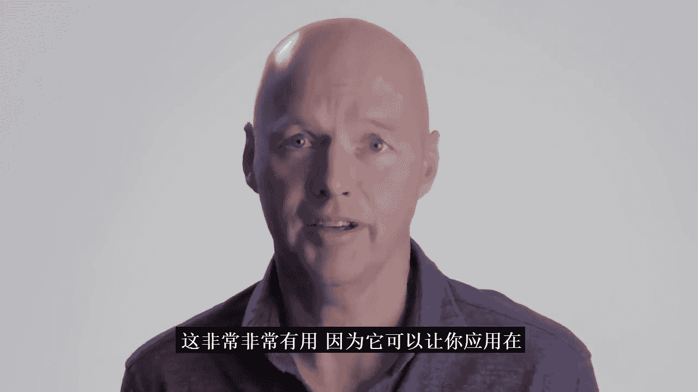