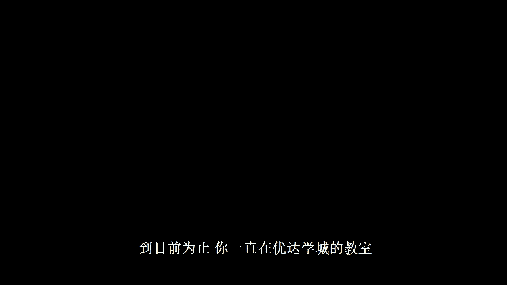
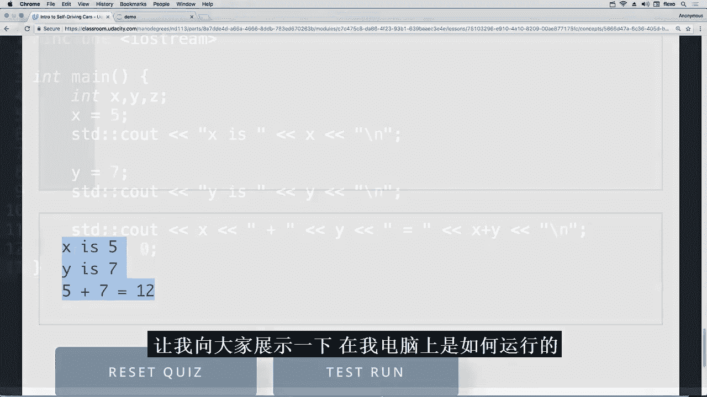
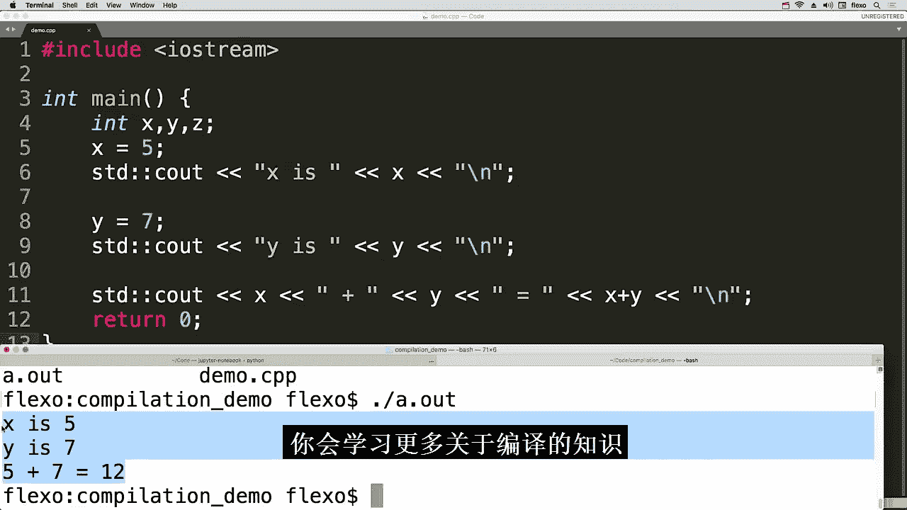

# 优达学城（Udacity）：无人驾驶汽车纳米学位项目-十位大牛亲授自动驾驶技术，硅谷前沿科技（计算机视觉⧸车道识别⧸感知控制⧸人工智能⧸谷歌） p21 21. Part 04-Module 01-Lesson 03_Practical C++ [BV1Vd4y1r7QG_p21]

So far， you've been writing code within the USD classroom in an environment that looks like this。

But you're also going to want to be able to run your programs locally on your own computer。

 and this brings up another important difference between Python and C++。

You learned about the first major difference at the beginning of the last lesson。

 and thats that Python is dynamically typed while C plus+ is statically typed。

 which is why you have to write words like int。Another major difference is that Python is what's called an interpreted language。

 whereas C++ is a compiled language。The thing is， when you write code in Python or C+ plus。

 the computer can't understand directly what you've written。

The code first needs to be translated into a language the computer understands。In Python code。

 there's a translator also known as an interpreter that goes line by line。

 first translating and then executing each line of code。Translate this line， execute it。

 Trans this line， execute it。 This process of translate， execute， translate。

 execute happens until you've reached the end of the file。 or in this case， the end of the code。 So。

And running the cell behaves as expected。The reality is a bit more complex than what I've described。

 but this is the general gist of an interpreted language like Python with a compiled language like C plus plus。

 all of the code is translated into a language the compiler can understand before any of it is executed。

 and this step is called compilation。Only after the program has been compiled can it later be executed or run。

And up until now， we've been hiding this compilation step from you。

When you've written code in the browser and then scrolled down and pressed test run。

We've been secretly compiling and then executing the code in the background。

So the language has felt interpreted to you up until now。

But when you write C++ code on your own computer， you're going to have to do the compilation step yourself。

 and let me show you what that looks like on my computer。

Here I've got that same file， I've called it demo。cppP。

And if I actually want to run this code on my computer。

 I have to first pull up something called a terminal。

And don't worry too much about what this terminal is for now。

 The only thing I want to show you is that when I type L S。

 which is a command to list all the files in my current directory。

The only thing I see is this demo do CPP for now。So now before I can run this code。

 I need to first compile it。 And for my computer， I do that by typing G plus plus。

Followed by the file name， in this case， demo。cppP。I hit enter。And nothing happens。

But if I do another LS。I now see this second file called AL。

 and this is a translated or compiled version of the code in demo。cP。

If I type dot slash A do out and hit enter。I get exactly the output I was hoping for in the rest of this lesson。

 you're going to learn more about compilation and will start working with C++ code on your own computer。

