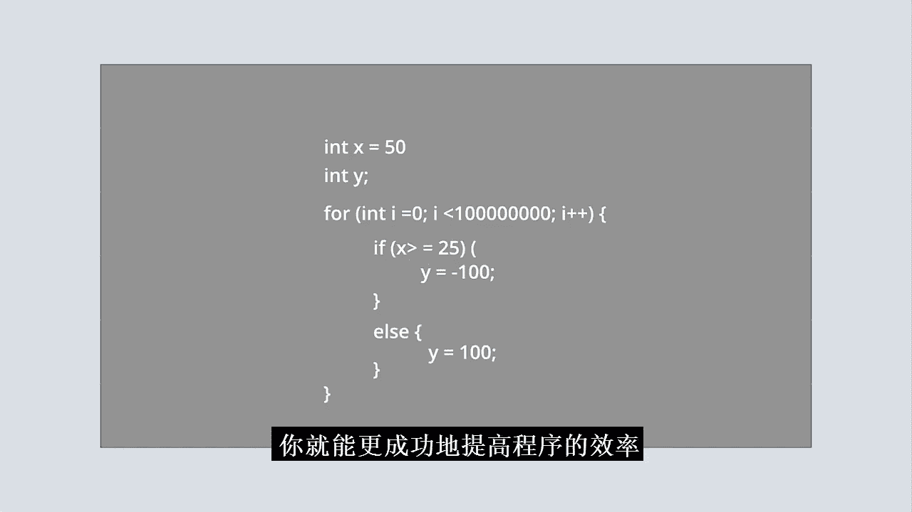
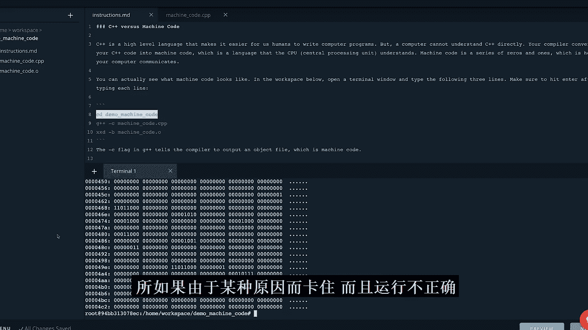
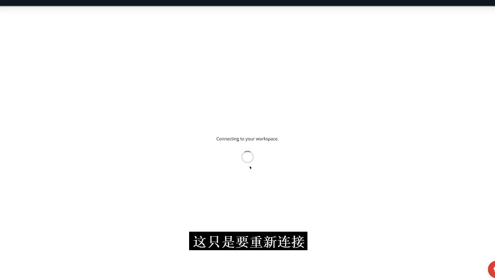
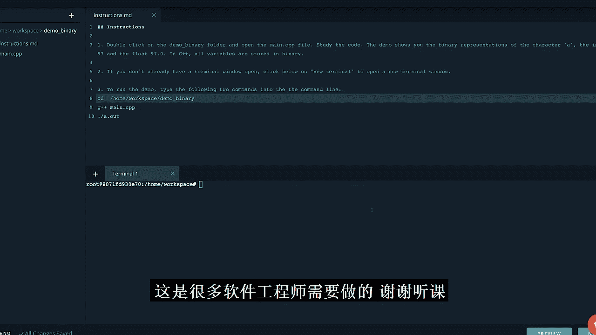
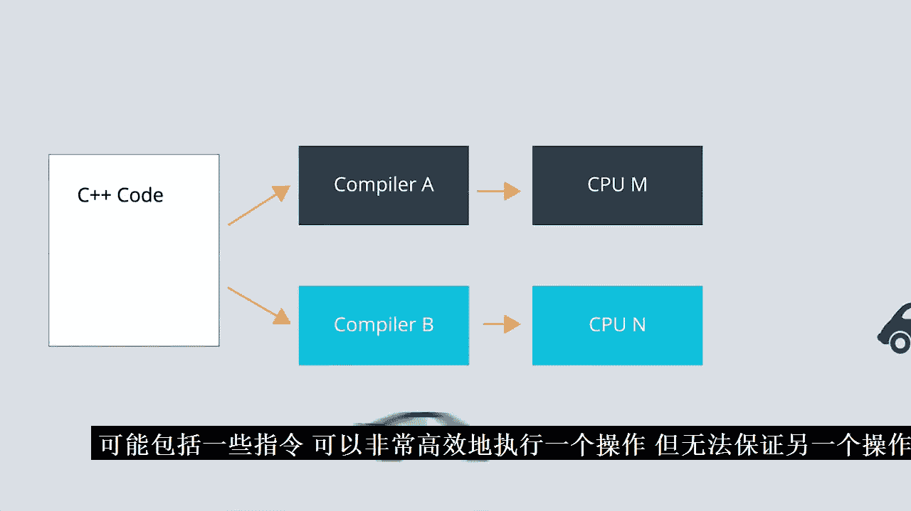

# 优达学城（Udacity）：无人驾驶汽车纳米学位项目-十位大牛亲授自动驾驶技术，硅谷前沿科技（计算机视觉⧸车道识别⧸感知控制⧸人工智能⧸谷歌） p24 24. Part 05-Module 01-Lesson 01_C++ Intro to Optimization [BV1Vd4y1r7QG_p24]

So it's me again Sebastian， hey， congratulations， you just completed something quite amazing。

 you translated something from Python to C++ and it sounds tedious。

 but I hope you learn from some of the basics how programming languages work and how different programming languages work because they are different both at my industry standard and both are really important。

😊，Next， we're going to dive into something that I had to do a lot when I was growing up as a programmer looking at low level language functions in C++ things like pointers and memory allocation those might sound very cryptic and alienating in the beginning。

 but they're essential to providing efficient and effective software in C++ and you need to know them。

 so let's dive in。😊，Hi， I'm Anthony， the product lead here at Udacity for robototics。

 You've already learned a lot of syntax in C++， including how to write functions and classes。

 Now you should feel confident that anything you could write in Python。

 you could also write in C++ but let's take a step back and talk about why are you learning C++ in the first place。

 It basically comes down to the fact that certain C++ programs run faster。

Autonomous vehicles need to make quick decisions to successfully operate in a dynamic environment。

Slicing off fractions of a millisecond from your programs might not seem like a lot。

 and maybe it isn't for just one occurrence of an instruction。

 but self-div cars execute billions or trillions of instructions in a small amount of time。

 so those milliseconds add up very quickly。Efficient code is very important if you want your car performing in action when you expect it to and not seconds later。

But how do you get your programs to run faster when using C++ Well once you have a program that runs correctly。

 you go through a process called code optimization code optimization generally allows your program to use less memory increase power efficiency or execute faster for this lesson we are going to primarily focus on getting C++ code to execute faster for almost every line of code you write。

 the computer will execute a corresponding instruction like writing to or from memory or running a mathematical calculation。

 even something simple like assigning an integer to a variable requires a computer to execute a set of instructions and write to memory。

Usually there are multiple ways to write a program and achieve the same results。

 and if you find a solution that requires fewer instructions for the computer to execute。

 well then quite simply your code will run faster。We have split this lesson into two parts First you will get an overview of what is happening inside the computer when you compile and run a C++ program。

This will give you some insight into what causes your program to slow down。

Then you will take what you've learned and use it to optimize C++ code。

When you complete this section， you will walk away with the ability， as Alicia White would say。

 to empathize with the computer。Optimization is all about eliminating instructions that are not needed while still getting the result you expect from your program。

The fewer times that a program has to access memory and perform calculations。

 the more efficient your program will be。 Optimization isn't just about shoving your code through some black box until its performance increases。

 It's about knowing how a computer works and executes your code and using that knowledge to your advantage。

 besides a storage medium like your hard drive。 a computer basically has two parts that are relevant to running your programs。

 The CPU and RamM。😊，The CPU or central Pro Unit has a section called the Control Unit。

 which carries out the instructions contained in your code。

Another section known as the arithmetic logic unit calculates mathematical and logical expressions。

Ram or randomand access memory is what your program uses to store your variables and instructions to support the execution of your program。

It is a storage medium like your hard drive， but it has much faster read and write times and is volatile。

 which means that when you turn your computer off， all the data disappears。

 Imagine if your hard drive did that every time you turned your computer off。In essence。

 the control unit in the CPU will read the next instruction in your code and execute it by writing data to RAM。

 reading data from RAM， or have the arithmetic or logic unit perform a calculation。Unlike Python。

 when you finish writing a program in C++， it needs to be compiled before you can execute it。

The compiler revwrites your code into a set of instructions that the CPU can understand called Maine code。

Which is basically the language of the CPU。SoA compiler is basically acting as a translator between how you understand and write code and how the CPU understands and reads code。

For example， you might write the line int x equals 5。

 the compiler would turn this line of code into something like this。

And the CPU would understand that to mean store the value of 5 to a specific location in RAM that can be accessed with an address tied to the variable X。

Another instruction would be able to retrieve the value of x by sending an instruction to the CPU that would query the value stored at the address tied to X。

And another instruction could take the value stored at the address for x， increment it by 10。

 and then update the new value in memory。All of these instructions take time to execute。

 and some operations like trigonometric functions and branches of an if statement。

 are known to be particularly inefficient。Let's take a series of if statements。

Here we have an assignment of the variable y based on the value of x。

This code is inefficient because it causes the CPU to compare the value of x twice。 However。

 if the first condition is false， the second condition is automatically true。Therefore。

 an optimization would be to rewrite the if statements with an if else statement like the following。

This version of the code only needs to do one comparison。

 You might be thinking that such a small change won't make much of a difference in speed。

 and with a single of occurrence like this， it probably won't。

But imagine if these statements were inside a for loop that ran thousands or millions of times。

Small inefficiencies definitely start to add up。Understanding how the computer operates helps you determine which calculations might be slowing your program down。

The more insight you have into what was happening inside the computer。

 the more successful you'll be at increasing the efficiency of your programs。

Hi， my name is Andrew Pastor and I am a content developer for the Intro to self driving car Na degreeree。

In this lesson， C++ intro to optimization and the following lesson， C++ optimization practice。

You'll be using a feature of the classroom that you haven't seen yet。

When you go to the next part of the lesson， an embedded command line tool will load that looks like this。

Usually when you use a computer， you're using your mouse and a graphical user interface to move files around。

 open files， create new files and open programs。 So there's another way that you can use your computer。

 and this is with the keyboard and entering commands directly to the computer。

 So this is essentially what we've set up for you in the classroom。 When you open this。

 this section of the classroom is actually connecting to a remote computer that contains files and allows you to run your C plus plus programs。

 So I wanted to give you an overview of what all of this is and how it works。😊。

On a Mac or on a Linux machine。There's a program called Terminal that allows you to do the same types of things that we're going to do here。

And the equivalent in Windows is called the console window。

 So when you go to the next part of the lesson， demo machine code。This is going to open。

And you'll see there are three big sections， plus a menu down here， and then this menu up here。

The menu up here is just to be able to navigate the classroom。

 which you should already be familiar with。This part here is showing you all of the files that are on this remote computer。

 so you can see that because we're in the demo machine code part of the lesson。

 we've automatically set it up that it goes to the folder demo machine code and has these two files in it which are opening automatically for you。

 but you can actually navigate through this with your mouse and see workspace and see all the demos in this lesson if you double click on a file or on a folder it'll open and you can see the files there。

 if you go to the back button， it'll take you to where you were before and you can just navigate it like anything you're probably used to on your computer。

😊，If you right click， you'll see some options like open move。

 which is to move a file to a different folder， rename， copy， download， delete。

And then this plus button is if you want to add a file。

 add a folder or upload something from your desktop that you were doing notice here it says Lchan is saved so everything you're doing here just get saved automatically anything you type in this part will get saved automatically and so you don't have to worry about saving things。

This part right here is a text editor。 So you can see this instructions do M file is really a text file that explains what the demo is。

 And then here you have machine code do cP， which is a C plus plus file。

 you can actually close these files， open these files by double clicking over here。

 it works kind of like your regular computer So then the next part is this big chunk down here where it says new terminal。

 no open terminals。 So this is where you're actually going to be able to write commands directly to this remote computer So if I click on new terminal here or on this plus sign。

 it's gonna open this new window。 So here it says home slash workspace。

 So that tells me that I'm actually here in the workspace folder。

 as you click on this part versus this part， they're actually not connected So if you want to。😊。

to different folders。In the terminal， you have to actually put commands in to do that。

The instructions actually talk about and give you the commands that you're going to need。

 so don't worry too much about that。So I'm going to go through an example of how you can use this to run your C plus plus code。

Every time this opens for you in the classroom， you're going to see this instruction file and it's going to tell you exactly what you need to type in down here and in what order。

You can either just go here and copy these commands and copy and paste them。

 and they'll just show up， and then you hit return and they'll run。 Or alternatively。

 you can type them out。 So without worrying too much about what all these commands do type this in。

 I'm saying C D change directory。 So now you can see that in the terminal I've changed folders。

 And now I'm inside this demo machine code folder。 And then I'm this next code here is going to compile my C plus plus。

Okay， and then you can see over here， this dot O file appeared。

And then it says in the instructions to type this out。 and this is the results of the demo。

 And if you read through the Read Me file or this instructions file。

 you'll understand what all of this is doing。The other part I wanted to mention is this menu down here。

 So if this freezes for some reason and it just isn't running right。

 you can always hit refresh workspace down here。 It's just going to reconnect。

Your work will be the same。 Everything is saved， but it just lets you start over again。

 If you want to reset everything and get back to the original code that we provided for you。

 you'll have to click on reset data， which opens this window here。

 and it says resetting data will wipe all of your work， restore the project to the original state。

And then you type in reset data and click。I really suggest you do not reset the data unless you have saved all of your work externally and downloaded it。

 because， for example， if you just want to reset these files and you hit reset data。

 it's going to reset everything and you're going to lose all of your work。

 So make sure that if you need to reset the data that you have right clicked on everything and you have downloaded all your code to the desktop or to wherever so that you can then uploaded again after you've reseted things。

Again， every single one of these lessons like demo binary over here。

 it opens the files for you and gives you instructions and tells you what to do。

 And if you want to see the code that is related to all of this。

 you just click here demo binary and you've got the instructions file in main dot CPP。 So again。

What you'll always be doing is you'll be opening this up， you'll be reading the instructions。

 you'll open a new terminal， you'll type these commands one at a time。

 hit enter and everything will run。 I am going to provide a link about what all of these commands are and what you can do。

 but it's not something that you need right now， but if you want to study it more and see how you can use the terminal not only in the classroom。

 but using it for yourself on your computer， it's something that is really helpful。

 and it's something that a lot of software engineers need to be able to do。😊。

So， thanks。From a high level perspective， you've been able to see that limiting CPU of instructions can make your code run faster。

As humans， we think about interacting with a computer in terms of a programming language like C++。

However， computers only understand instructions in binary。

 so everything you write will be seen by the computer as a series of zeros and ones。

Let's dive a little deeper into how the computer uses binary to store information in memory。

 understanding how your C++ program stores information can help you avoid unnecessary access to memory。

 which will waste valuable CPU cycles。Let's think about how you could represent a variable in binary。

Binary relies on powers of two to describe a value with the least significant digit usually on the right for each position in the binary representation。

 you take the binary value of1 or 0 and multiply it by the power of two associated with that position and using0 based numbering。

Finally， you add the results together to get the decimal value。

Now let's go through a few examples by looking at the binary representation of the numbers1 through5。

The decimal number0 is also zero and binary。To figure this out， you take 0 times 2 to the power of 0。

Which equals0， the decimal number1 is one in binary。

You can see this because1 times2 to the power of0。Equals 1。

10 in binary equals the decimal number two。 Now you're going to need two to the first power as well。

This is because one times 2 to the first power plus1 times2 to the zeroth power equals 2。

 following the same rules，1，1 in binary is3 in decciimal。

This is because one times 2 to the first power plus 1 times 2 to the0 with power equals 3，1，0。

0 in binary is foreign decimal。1 times 2 to the second power plus 0 times 2 to the first power plus 0 times 2 to the zeroth power equals 4。

 And finally，1，0，1 is 5 in decimal。 Following the same process。

 you would calculate 1 times 2 to the power of 2 plus 0 times 2 to the power of 1 plus 1 times 2 to the power of0。

Which equals 5。 you can represent any decimal digit using binary。 For example。

 the number 25 would be 1，1，0，0，1。And here you can see how to calculate this to get that result。

 The computer represents all variables in binary， not just integers。

 This means even characters and floating point numbers are represented in binary。

But your computer can't store an arbitrary amount of zeros and one at a time。Instead。

 memory is stored in collections of eight binary digits。Where each digit is called a bit。

You can think of your computer's memory in terms of these eight bit slots。

And each8 bit slot is called1 by in C plus plus the smallest variable would be an 8 B or 1 B character。

 A 16 B integer has 2 bys， and a 32 B integer uses 4 bys。 Afloat also uses 4 bys。

 In C plus plus your variables will always use the amount of memory specified by the variable type。

 For example， the number 3378。😊，It only needs 12 bits。But represented as a 16 bit integer。

 it will need two bytes with extra zeros padded to the left。And as a 32 bit integer。

 it will have much more zero padding， which basically means the most significant bits will be zero。

In C++， you can declare a 1632 or even a 64 bit integer。

All this means is that the integer is using two， four， or8 bytes of memory。

You can start to appreciate how the number of bits available becomes a constraint。

If an integer can only use 32 bits， then the maximum value would have all bits equal to1。

The decimal equivalent is 4，294967295。And that number is the maximum value that a 32 bit integer can store。

 and it is even less if you are using sine to numbers。

Now that you have an understanding of how to represent variables in binary。

You'll learn what C++ does to store and extract this information。

Remember that part of optimizing your code involves limiting the number of times your program reads and writes to memory。

You'll need some insight into when and why these Read&Wite operations happen。

Let's go into some detail about how C++ uses RAM。You can think of RAM as a set of slots where you can store information。

When your program executes data， it is usually stored in RAM。This data can be overridden and in fact。

 when you turn your computer off， data in RAM is erased because RAM is volatile。

 hence RA is used for temporary storage。Take a simple example like declaring a character variable。

When the X variable gets declared， your program will go into the computers RA and reserve space how much space will depend on the variables type in the case of a character variable。

 one byte gets reserved。Then when the X variable gets defined。

 the binary value for the character gets stored in Ram。In C++。

 the smallest unit of memory that your program can keep track of is one byte。

So what happens if your program defines another character variable？

The compiler will then assign this character to the next available byte。

 And what about an integer variable， Well， a 32 Bteger would take up 4 B of memory。

 So an integer variable would take up four spaces in Ram。

The compiler and computer architecture will determine exactly how much space each variable needs in order to optimize the program。

In general， the next variable gets placed above the previous variable。

 each byte also has an address so that the program knows where to find the variable。

This entire area where C++ places variable values has a special name called the Sta C++ uses the stack to efficiently manage reading and writing to memory for you。

When a function terminates and variables fall out of scope。

 the compiler frees up or deallos these memory locations working backwards。Besides a stack。

 the compiler offers other parts of memory for different tasks。

 like storing the text of your code and reserving space for global variables。

C++ also provides an area of memory called the Heap。

 where you can manually control when a variable gets removed from memory。

But how is all of this related to code optimization？

Reading from and writing to memory take time and thus can make your program slower if you declare and define a variable that you don't actually need。

 your program can slow down。If you copy a variable unnecessarily， your program can also slow down。

The stack also tends to be more efficient than the heap。

 so how you declare your variables can end up affecting your program's performance。Hence。

 the more you understand the consequences of each line of code， the better you can optimize。

That's what we mean when we talk about empathizing with the computer。

Understanding the limitations of your hardware help to make better coding decisions。At this point。

 you have seen how inefficient code can cause your program to slow down by performing unnecessary CPU operations and memory accesses Next we will discuss the practicalities of optimizing your code。

Code optimization is a big topic that involves analyzing algorithms。

 understanding how a computer executes instructions。

 and learning the nuances of both the programming language and the compiler you are using。

Coode efficiency also depends on the compiler and the hardware you are utilizing。

 many compilers will try to optimize code for you and different compilers might optimize in different ways。

C that works well in one case might not work efficiently in another application。

 and one CPU architecture's instruction set might have instructions to perform an operation very efficiently。

 while another may not。

Therefore， you cannot rely only on instinct when optimizing code。

 you need to test your code and find places that put high demand on your CPU。

 whether that be related to time， memory usage or power consumption。

And then any changes you make to your code need to be tested to make sure everything actually runs more efficiently as you expected it to。

Next， you will get a chance to optimize the C++ histogram filter。

You might remember from the introductory C++ lessons when Andy showed Alicia his code。

 Andy had translated his Python histogram filter code into C++ Alicia brought up that his code had a few inefficiencies。

 we are providing you with that inefficient code and your task is to make it run as fast as you can。

