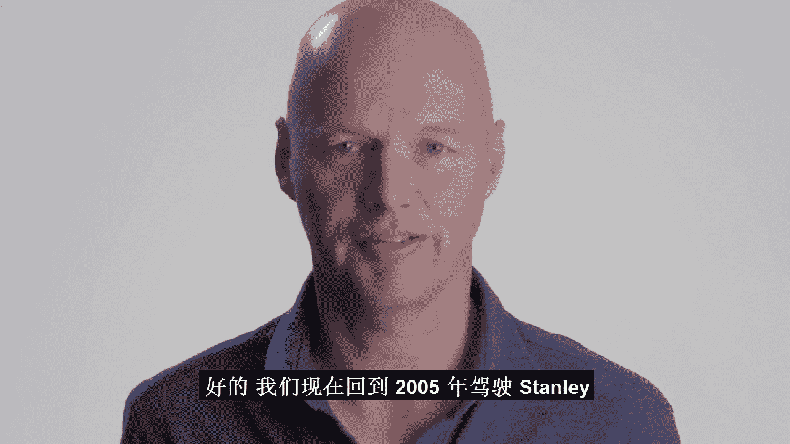
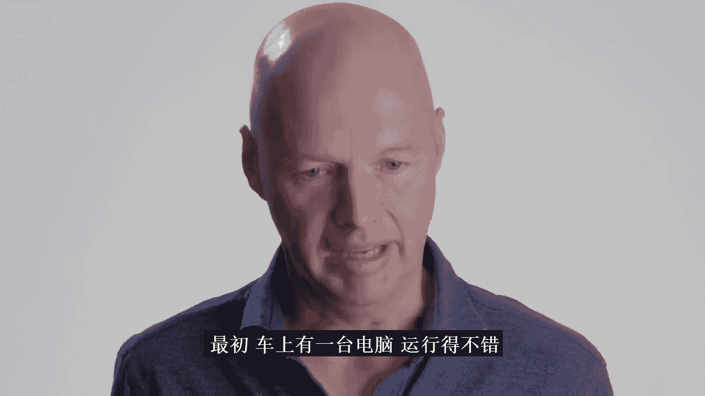
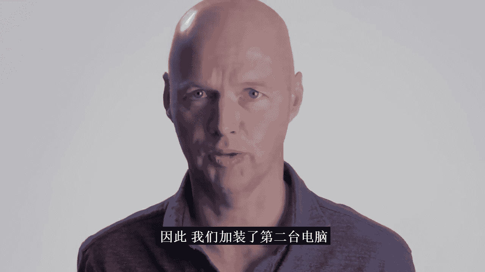
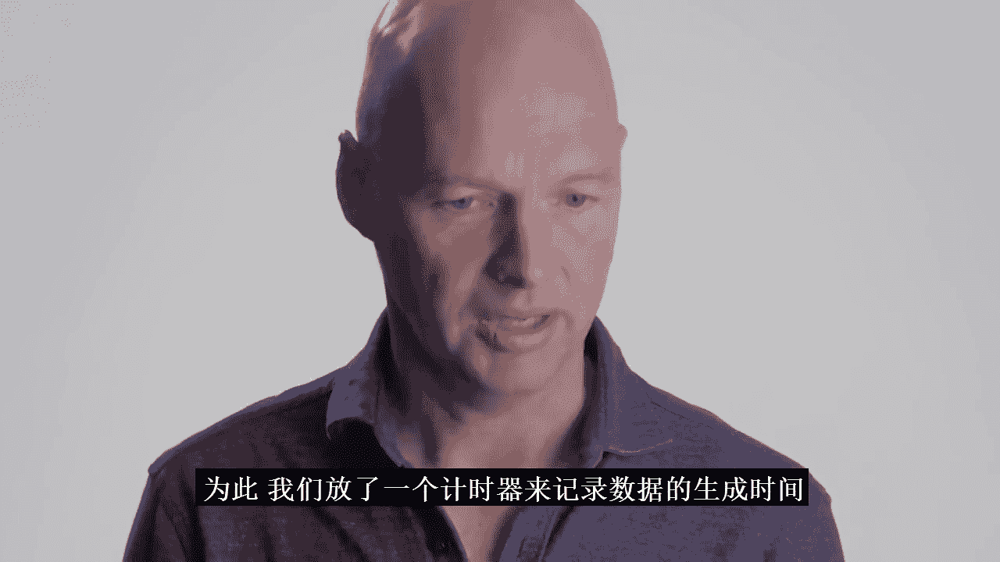
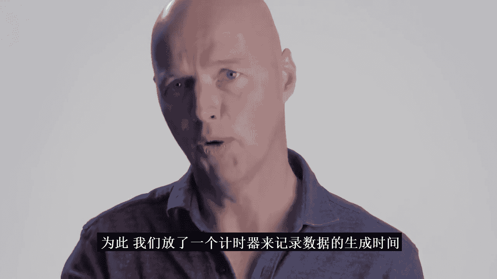
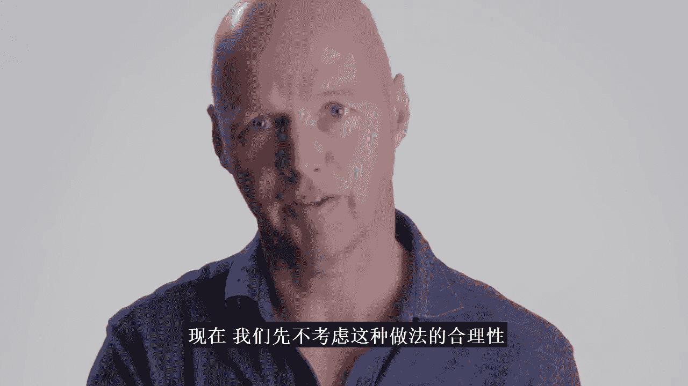

# 优达学城（Udacity）：无人驾驶汽车纳米学位项目-十位大牛亲授自动驾驶技术，硅谷前沿科技（计算机视觉⧸车道识别⧸感知控制⧸人工智能⧸谷歌） p25 25. Part 05-Module 01-Lesson 02_C++ Optimization Practice [BV1Vd4y1r7QG_p25]

So now that you suffer through all these wonderful things like pointers and memory allocation so let me tell you the story of the worst self-driving car buck that I ever caused and had to fix took me many months to find it okay so yeah back in 2005 driving Stanley the self-driving car through the Mojave Desert and initially we had one computer on board and everything was fine and then the computer was overloaded so we put a second computer on board。

And as a result， as you found out， every 40 miles。The robot would see a fake wall of obstacle in front of it。

 engage in a crazy， crazy swve and almost you kill us， but felt like killing us。

And then we had to intervene and take over。 and we knew the race was about 120 miles long。

 So every 40 miles of we would do this， we would not finish the race。 Okay so what was it， Okay。

 so were looking at the robot and on one computer1 fine and a second that doesn't。

I we were fabricabasted。 But it ended up being is we had put in a。

Timer for how old the data is。 they would give us a bound on how big an obstacle is。

 Let's take this for granted， for now。

In moving to two computers， we found that the clocks ran different speeds。

 pretty common on my different computers， And we installed computer software C plus plus to synchronize these clocks and everyone so often。

😊，This organization would set a clock value back。our test that would be contingent on the time elapsed would not have a negative number because time less was negative。

And that in conjunction with the vehicle bopping up and down over a little hump。Cast a fake obstacle。

Now， that was brutal， it took us literally months to find it。

 and we drove every day and every 40 miles or so we got this effect and we couldn't figure out what's going on。

Now I'm taking this story because。When you dive and become a software engineer。

Every little detail matters， and you have to understand how memory allocation works。

 how pointers work， how data structures work， because if you don't and you allocate memory twice or you forget to free it at some point your selfding car will effectively commit suicide。

 Okay so thanks for sticking with us and I hope you appreciate what you just learned。Okay。

 now you learn some of the low level features of C plus plus。 and thanks for。

 for enduring this with us。 Now comes the real challenge。

 How fast can you make your histogram filter。 I want to challenge you to use all those features to write the fastest possible C plus plus implementation。

 And once you found it， go to the slacklack channel。

 Tell others how fast your solution is and compare code， because that's where the real fun lies。😊。

