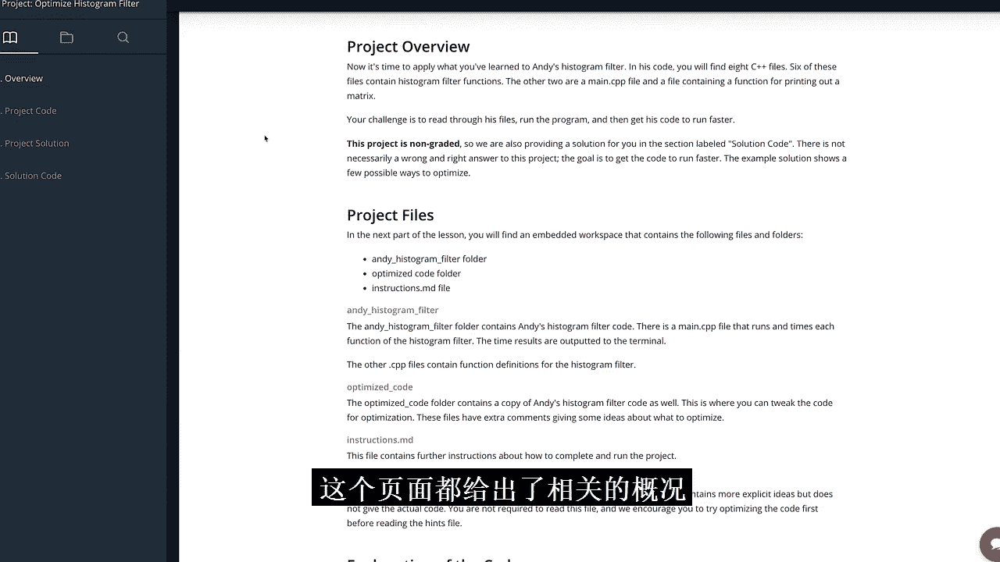
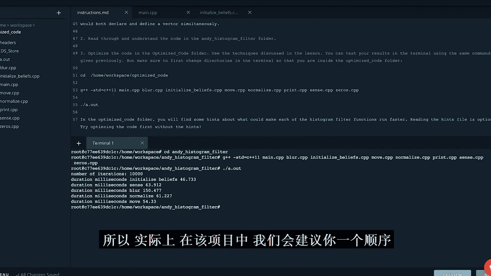
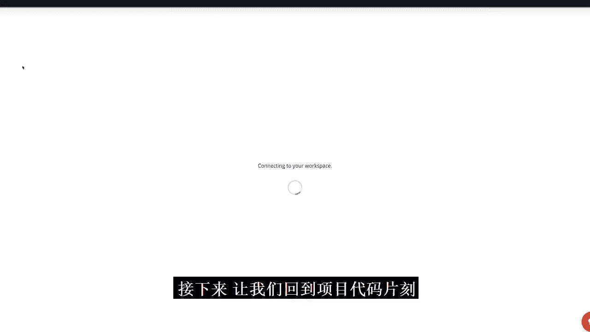
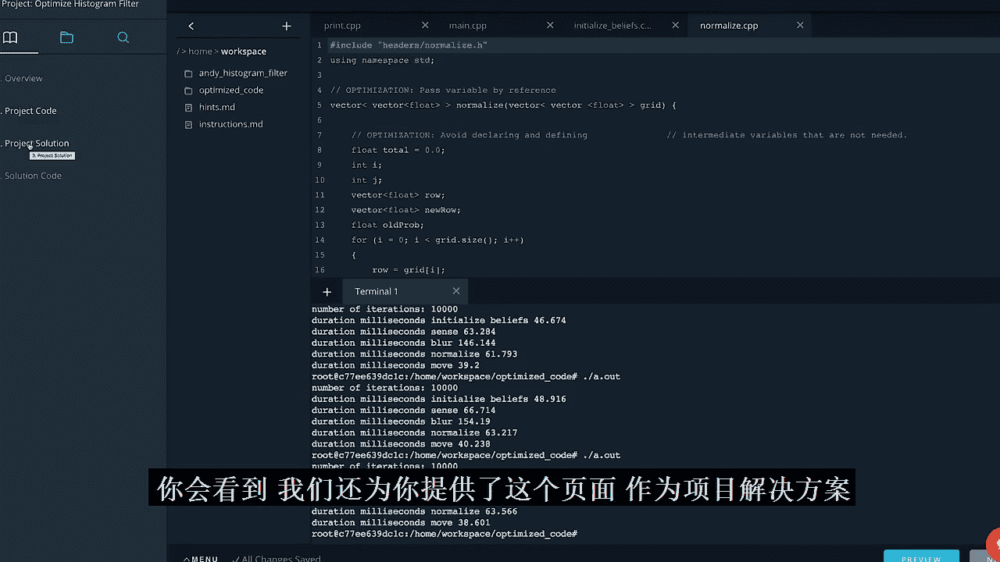
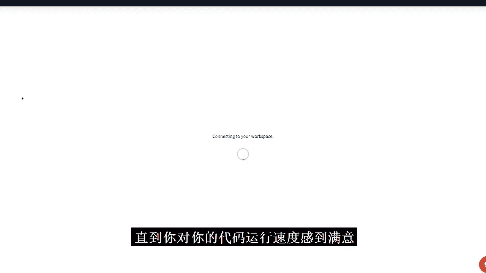
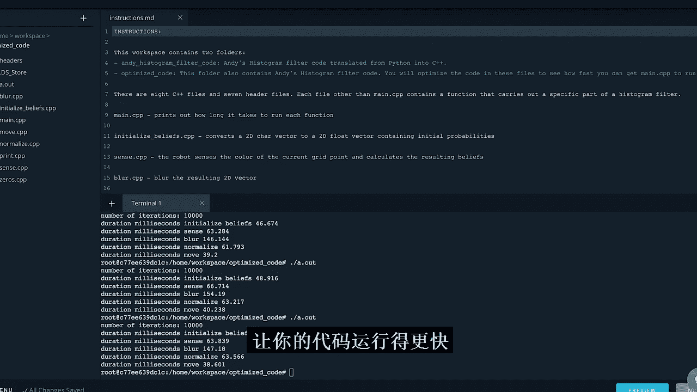

# 优达学城（Udacity）：无人驾驶汽车纳米学位项目-十位大牛亲授自动驾驶技术，硅谷前沿科技（计算机视觉⧸车道识别⧸感知控制⧸人工智能⧸谷歌） p26 26. Part 05-Module 01-Lesson 03_Project Optimize Histogram Filter [BV1Vd4y1r7QG_p26]

Hi， I'm Andrew Pastor and I am a content developer for the Intro to Self driving Car Na degreee。

So I wanted to do a walkthrough of the C++ optimization project。So in this project。

 you're given histogram filter code in C++ that already works， so you can run it， it runs correctly。

 and everything's fine。 The issue with the code is that it has a lot of inefficiencies So everything that you've been learning in this optimization lesson you can apply to this code and get it to run faster。

 And one of the fun parts about this project is that a lot of students are going on to Slack and competing with each other just to show how fast they're able to make their code。

 So if you're up for the challenge after you're finished。

 go on Slack and post your results in the C++ channel。

I also want to mention that this project is non graded。

 so it's up to you to do the project and get to the point that you want to。

 it's just there's a solution that's been provided at the end that you can compare your results with。

 but again， it's non graded。So let's just walk through the project and see what we've got here。

 When you open the project， you're going to go to this overview page。

 which I suggest you read through， I'm going to talk about some of this stuff today anyway。

 but its it gives an overview of what the project is about。

Then when you click here on project code， it's going to open this embedded terminal workspace for you。

 and there is this instructions file already here。So what have we provided for you exactly？

 So over here， we have this folder that says Andy histogram filter。

 and then we have this folder optimized code。 So both of these folders actually contain the exact same C plus plus code。

 If you open them up， double click on them。😊，Here are all the files。 Let's go back。

Open the optimized code folder has the same exact code。

 The reason why we've provided it twice for you is because that way， in Andy histogram filter。

 you have all of the original code and then you can put your optimized code and your changes into this optimized code folder。

 So that way you always have a copy of the original code and you have a copy of whatever changes you've made so that you can go back and compare them。

 We've also provided this text file called hints do M D。

 I'm not going open it because it's only provided if you feel like you're getting stuck and you're not sure what to do and what to optimize。

 but it provides extra hints for how to go about the project and how to think about what can be optimized in each of the files。

 So let's just go， and we're gonna open Andhiisttogram filter first。 So if I。😊，Open main。

 What do we see here？ So all of these include statements， all of these headers。Okay。

 this is the meat of it。 So here we have iterations 10000。

 What this is saying is that each function is going to be run 10000 times。 And we go down here。

 We're making this vector， which。Represents a robot grid， which you should be familiar with。

 And I we've said here， it's red， green， red， red， red， green， red， red， green， green， etc cetera。

Now， what does this code do。We have this clock that starts over again， goes through 10000 iterations。

 going through the sense function， and then print out how long it took to run that。

 Then we reset the clock。 We do 10000 iterations on blur， print out how long it took。

10000 iterations on this normalized function。 How long it took。Test out move。

So you can see we're going through each of these files。

 where each of these files represents a function and testing how long it's taking to run those and your job is to go into all of these files and say。

Hey， you what's going on， why is this so slow， what can we do to make it faster？

So if we go back to the instructions file， like you've seen previously， we have。Given。

The terminal code to get everything running。 So if I go change directory， And histogram filter。

 hit enter。 Okay， now I'm in the histogram and histogram filter folder。

I'm just going to copy and paste this because it's kind of along。This is going to compile the code。

Hit enter。Okay， and so you'll see over here that it's created this a dot out file。

 and then the last command。Dot/lash a dot out。And it runs the file， so it says number of iterations。

 10，000 duration milliseconds initialized beliefs， et cetera， et cetera。

 and it gives you how long it took to run each of these functions。

So let's go back here to the workspace and change to optimize code becauseuse this is where you're actually gonna be writing your code and changing your files。

 So if you go and。Open initialized beliefs， for example。Okay， you'll see。

We've got all of this code for already working functioning histogram filter。

 you don't need to actually do anything to get it to work。

 but you'll see that there are places where you can optimize and what we've done is we've given some ideas for what you can do to make things faster like optimization。

 which of these variables are necessary optimization reserve space and memory for vectors。

 So for example， this is just kind of a hint that maybe you don't need all the variables。

 maybe there's some extra variables being created that take up memory are creating unnecessary read and writes and slowing down your program。

As you saw in the lessons， reserving space and memory for vectors can make things go faster as well。

 So that's something to think about。Here， there's a nested for loop。

 which we talked about in the lesson as well。 The nested for loops can be pretty inefficient。

 So maybe there's a way to do it with just one for loop or initializing things differently。

 you're gonna to have to read through the code and figure out What could go better。

 What could What could I do to make this run faster。

 What could I do so that there are fewer reads to memory and writes to memory that the CPU is asking for。

So there's actually a suggested order that you do in the project。

If you go back to the overview section over here， you'll see order as a suggestion。

 do the the project in the following order。I highly suggest doing it in this order。

 starting with zeros。cppP initialized beliefs sense blur normalized move。The reasoning behind this。

 zeros dot CPP， I think， is one of the quickest。Optimizations， and it doesn't have too much code。

 So it's kind of a good warm up。 The other files we've put in this order。

 because this is the order in which they get called in main dot CP PP and some of these functions。

 And I use some of the other functions， so。As you say。First， start with zeros dot CPP。

 I believe blur dot CPP uses zeros dot CPP。 So if you've already optimized here。

 your blur should already start to run faster。So let's go back to the project code for a second。

So your main process for tackling all of this is going to be the following。 So like I said。

 open zeros dot CP P P。Okay， so we have。Zeros dot CPP。

 which is going to initialize a 2D vector that has just a bunch of zeros in it。ve said here。

 optimization， reserve space and memory for vectors。 New grid， Okay。

 optimization nested for loop not needed because every row， the matrix is exactly the same。

 There might be other optimizations you think of as well。

 That might get your code to be even faster than the solution we've provided。

 So this is not the be all and end all of optimization。

 These are just definitely ways that you can get the code to run faster。

 So I'm going go here into the terminal。😊，And change my directory。

 So all I've done here is have changed directory。 dot dot means go back up one step。

 which takes me back to workspace。 And then I say， go into optimize code。

 So that's what this line is doing。 So now I'm in the optimized code folder。

 which you can see here on the left。 And I have zeros dot CPP open。I am going to compile the code。

Let's look for that command here in the instructions。Compil it。A dot out to run it。 Okay。

 and this is the code in its natural state as given。 Now。

 zeros dot cP doesn't show up here because a lot of these functions use it。

 So it's not being tested separately。But getting this to run faster。

 we'll get this to run faster as well。So what do we have here， We say optimization。

 reserve space and memory for vectors。 So we have this height and width。As our inputs。

 and we have new grid and new row。 So I'm just saying here， okay， new row。

 or let's start with new grid。 We have new grid dot reserve。😊，Height。

 so we're saying nugrid dot reserve is going to be a vector and it needs to have length of height。

And then。We are going to say new row dot reserve。With。AndSo if you remember back in the lesson。

 the reason why this might make your code run faster is because。When you create a vector in C++。

 it reserves a certain amount of space， but the program doesn't know in advance how much you're going to end up actually using。

 So if you go past the reserved amount of space that C++ the compiler automatically reserved for you。

Then the compiler needs to take the entire vector， find a new section of memory that's available and reccopy the entire vector over。

 which is really inefficient。 But if you know the length of your vector in advance。

 and you reserve the amount of memory it's gonna need。 Well。

 then your compiler isn't gonna have to do this whole rec copypying step。 So what are we gonna do。

 We just made this change， And I'm thinking it's going to make the code run faster。

 but do I really know， I can't know for sure， I need to test it out。

 That's a big part of optimization， you have ideas and you have kind of your instincts in your feelings。

 But instincts and feelings aren't always right。 So you need to test it out。

 So I'm going go back here。😊，I'm gonna use this command again， to compile the code。

Dot/lash a dot out。O。So now let's compare what we had before what we have now。

 This whole section is what we had before we made the change。

 and this whole section is what we had after making the change。

 So looks like initialized beliefs got a little bit faster， but it's not a lot faster。

 So let's see does initialized beliefs used。0eros dot CPP。 it looks like it does not。

 So this difference is probably just because some randomness， every time you run your code。

 there's gonna be some sort of difference。 But it looks like this normalize in this move function had a relatively significant change in time。

 So I'm gonna open move。And hey， look here， zeros dot H。

 That means that this is using the zeros function and doing that really small change where we went into zeros dot C P P。

 and we reserved space in memory in advance， See like it got us a good chunk of time off of our code。

 Let's just run the code again。 You know， it's sticking around 40 milliseconds here at move， so。😊。

Looks like that helped。 And how cool is that。 I mean。

 shaved off 20 milliseconds just by reserving the space and memory in advance。

 And so when the move dot CPP function ends up calling your zeros function。

 this section of code is already running faster。😊，I don't w to give away everything'cause this is a really fun project to just kind of think about and。

 and just work and see what gets things faster and what doesn't。

 And I've we've also provided the hints in the hints that M D file。 If you go back to the workspace。

 But that's essentially the project。 what you're gonna do is go through each of these files。😊。

And see what you can get to run faster。 And every time you make a change， test， test， test test。

 because you might think something is going to make things faster。

 and it might be something that in the past has made something faster。 But every code is different。

 every machine is different。 So it's really， really important to test。 if you。Don't test。

You might end up doing something that makes your code slower and then doing something else that makes it faster。

 And you don't realize that your code is not as efficient as it could be。 So test test， test。

The other thing I just want to mention here is that so blur initialize， move。

 normalize sense and zeros， all of those files have places that you can optimize。

So print dot cP and main dot cP， you do not need to change。

Main do cP just runs your code and prints out how long it's taking to do as I explained before。

 print do cP is just included here。 If you want to use it to debug， it has two functions in here。

 One is print vector float and one is print vector char。

 And the reason these two different functions are provided is in case you want to print out your 2D vectors We wrote the code for you so that you don't have to do it over again。

 but it'll be your responsibility to put in the header files correctly and put them in the right place。

 And again， each of these files has ideas about what can be optimized and you might come up with other ideas as well。

If you go back to the workspace folder， actually， if you go back here on top。

 notice we've also provided this page that says project solution in the next section。

 we are providing a solution to the code optimization project each file contains comments。

 noting what changes have been made to make the code run faster。

So， again， and this is up to you。 We suggest that you do everything on your own without looking at the solution code until you're satisfied that your code is running quickly。

 but we have provided a solution。

Our solution is not necessarily the fastest， fastest， fastest thing possible。

 but it shows what we were able to come up with based on what was taught in the lesson。

 The other thing I want to mention again is going to the C plus plus slacklack channel once you have completed the project。

 It's a lot of fun to post your results up there and compare your results with other students。😊。

And even get suggestions for what can run faster。 So hopefully， after you finish this project。

 you'll have a real appreciation and understanding about how you can take this sort of inefficient code here in Andy histogram filter and go to optimized code here and make kind of small changes and get your code to run a lot faster just based on your knowledge of what the CPU is doing and how it uses Ram。

😊。

