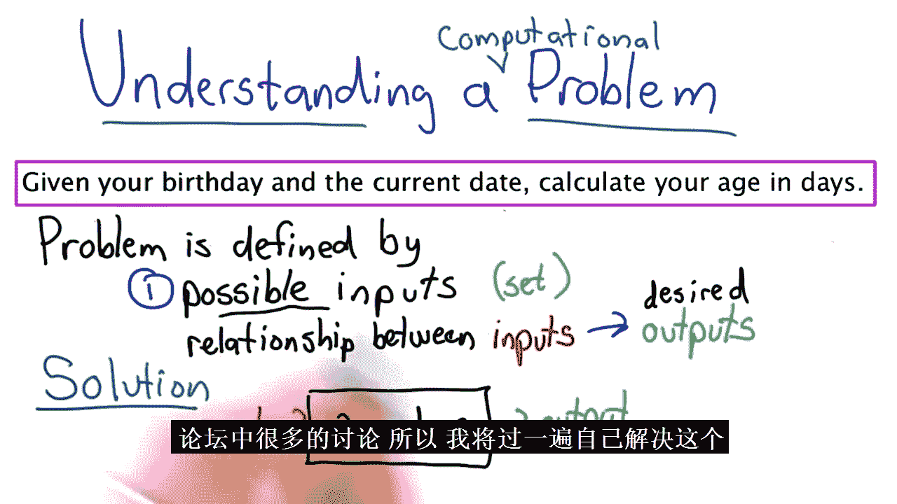
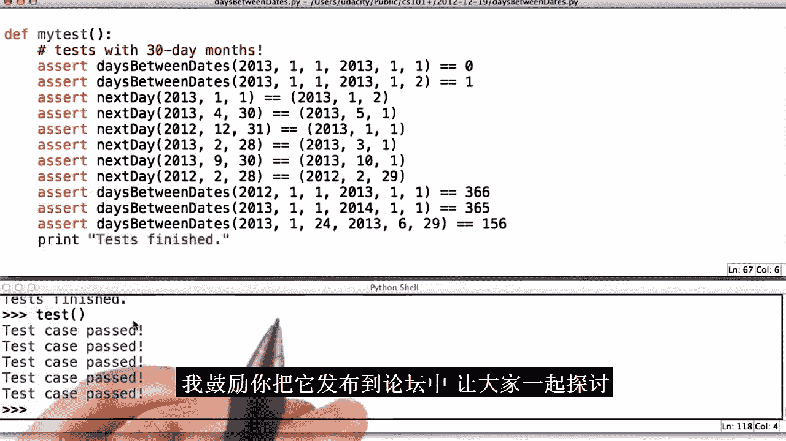

# 优达学城（Udacity）：无人驾驶汽车纳米学位项目-十位大牛亲授自动驾驶技术，硅谷前沿科技（计算机视觉⧸车道识别⧸感知控制⧸人工智能⧸谷歌） p27 27. Part 06-Module 01-Lesson 01_How to Solve Problems [BV1Vd4y1r7QG_p27]

So you spend a lot of sweat on this and you learn a lot about Python and C++ and gotten us some very efficient software。

 I hope you liked this。 you liked playing with software code and I hope you liked this introduction because if you do。

 you have a great future ahead of you and you're got to be a great engineer going forward。😊，But now。

 okay， for the next class。You're going to solve a really hard， real problem。

You're going to build Google Maps okay， you know， Google Maps。

 when you punch in an address and you hit the button shortest path。

 it routes you on the best path to get there。😊。

You are going to build this and as you find out， all the tools you learned so far in Python will be super useful in making this a real joy。

So let's dive in。The lesson you're about to watch is called how to solve problems。

 And it's one of those lessons that I have seen several times。 And every time I watch。

 I get something new from it。 It comes from one of Viudacity's introductory computer science classes。

 and it's taught by an instructor named Dave Evans。 And in this lesson。

 he's going to lay out a very systematic approach to solving hard problems in computer programming。

 I really love this lesson。 I think you will， too。 enjoy。😊，Hello。

 welcome to lesson on how to solve problems。 solving problems is one of the most important skills you can learn。

 and calling a skill is really an understatement。 Nearly everything you can do can be viewed as solving problems and improving as a problem solver is a lifelong challenge。

😊，One short lesson is not going to be enough to make anyone an expert problem solver。

 But for this lesson， we're going to look at some aspects of how to approach more complicated programming problems。

 And hopefully that will help you in solving any problem that you're faced with from now on。

 But it doesn't really make sense to talk about solving problems without thinking about particular problems。

 So we're going to look at a specific practice problem and talk about how I would go about solving that and our go by looking at a particular problem is not just to solve that particular problem。

 but to draw some general lessons about how we can get better as problem solvers in general。

 The problem that we'll use for this lesson was one that was suggested by one of our students for the make practice for unit 2。

 And this is the one that we'll use。 And it was a problem that was suggested by Matthiiaas Wexson from Sweden as a practice problem for unit 2。

 And here's how he stated the problem。This is days old number2。

 And it says given your birthday and the current date， calculate your age in days。

 You have to beware about leap days。 Ds are complicated things。

 And you can assume that the inputs are correct dates。 And then there's an example here to say that。

 well， if you were born on January 1，2012 and the date today is January 2，2012， you're one day old。

 So this is a great practice problem。 Thanks， Mattiaas， for suggesting it。

 And it's generate lots of discussion on the forms。

 So I wanted to step through how I would solve this problem。 If you have not tried it yourself。

 I would strongly encourage you to do so， there's a link to the problem in the additional homework to try it yourself。

 And I suggest keeping notes on how you solve it。 Whether you're able to solve it or not。

 I hope you'll come back and watch the rest of this lesson。 If you got stuck。

 this lesson will give you some ideas of how to get unstuck。 And then when you get unstuck。

 go back to trying to solve it on your own before continuing with a lesson。

 If you were able to solve it yourself。 That's great。 This is quite a challenging problem。

 But I hope you'll still come back to see how I solve it。

 I think you'll perhaps learn some things from the way I would approach it。

 And probably I can learn some things from the way you approach。😊。

So I hope you'll post on a form about how you approached it that was different。

 The hardest thing about solving problems is often just figure out how to get started。

 So let's start with a quiz。 What's the first thing we should do when confronted with a problem like this one。

 The choices are start writing code。 make sure that we understand the problem。

 search Google or duck go if you prefer for the answer。 work out an algorithm that solves it。

 Check the one that you think is best。 So I think the best answer is the second choice。

 that we should make really sure that we understand the problem before we progress on trying to solve it。

 I'll talk next about what it means to understand a problem and how to do that。

 But let me go through the answers before It's often tempting to start writing code too early。

 W code is fun， and that's what we like to do as programmers and computer scientists。

 The problem with starting the right code before we understand a problem is we might write the wrong code。

 we might get very frustrated， trying to write code before we really understand the problem or how to solve it or we might end up writing a lot of code that doesn't actually solve the problem we wanted to solve The third choice is actually a very good answer。

 If this weren't a practice problem。 If it's a practice problem， you're gonna learn a lot more。

Trying to solve it yourself， then finding an existing answer。

 and then maybe understanding the answer， you'll still learn something。

 you'll learn a lot more by trying to solve things yourself。

 If it weren't a practice problem and you just wanted to solve this and move on to the next thing。

 searching to see if someone has already solved the problem And for a problem like this。

 Probably there are good solutions out there already is a better use of your time than writing your own solution unless your goal is to learn something by writing your own solution。

 The fourth choice to start working on an algorithm also depends on understanding the problem until we understand the problem。

 Well， we don't know what algorithm we need to create。 So what does it mean to understand a problem。

 And I should emphasize， we're talking about computational problems here。

 And what all computational problems have in common is that they have inputs。

And they have desired outputs。 So a problem is defined by the set of possible inputs。

 This is usually an infinite set for most interesting problems。

 And the relationship between those inputs and the desired outputs。

 So that means a solution to a problem is a procedure that can take any input in that set and produces output a desired output that satisfies the relationship that we want。

 In this case， the relationship we want is that the output is the number of days between the birthday and the current date。

 So the first step to understanding a problem is to make sure that we understand what the possible inputs are。

 So the first rule in our pythonist' guide to solving all problems in the known computational galaxy is to always ask what are the inputs。

 Now， there is one rule before the first rule。 That's the zeroth rule。

 and the zeroth rule is don't panic。 If you panic， you're never going to solve the problem。

 But the first substantial rule is to figure out what the inputs are。

 So the first question we need to answer for any problem is what are the inputs for this problem。

They're fairly clearly stated。 says given your birthday and the current date。 Well。

 that's the input to the problem。 What's the set of inputs we really want this to work for。

 Should it really just work for my birthday and today's current date。

 If that's all we wanted to work for well， then we can figure this out once。

 we don't actually need to write a procedure。 So I think what is really intended by this is something much more general。

 So the inputs are really two dates。 and that gives us the type of input that gives us a set of all possible inputs。

 we need to think a little more carefully to know if they're all valid。 Well。

 the statement of the question gives us a good clue here。 It said。

 assume that the birthday and the current date are correct dates and no time travel。

 This probably is a valid assumption， if we're talking about birthdays and current dates。

 If we're comparing any two dates。 Well， this says that the second date needs to be after the first one。

 assumptions like this make life easier for programmers。

 They mean it's easier to write our code since it has to work for fewer possible inputs。

 I like the way Mattea stated this is no time travel。 for a program specification。

 we probably want to be a little more precise。 and just states。

The second date must not be before the first date。 And if we're being good defensive programmers。

 we should check this true。 It's an assumption。 It's up to the user of our code to satisfy this because we've said。

 well， that's a requirement to use our solution you have to make sure the second date is not before the first date。

 But if we're going to be smart。 we're going to program in a more defensive way because sometimes other people might make mistakes。

 or we might make mistakes， and we're actually going to check this in our code。

 The other assumption we might want。 Its something about the range of dates。

 calendarends are very complicated。 and they've changed over history。

 We're going to require that the dates are valids in the Gregorian calendar。

 which started in October 1582。 Our code will probably work for dates outside this range。

 but it might not get exactly the right answer since when the calendar changed the meaning of dates changed for most realwl problems。

 It's up to you to figure out how to encode the inputs。

 And this is one of the most important decisions that you can make in solving a problem。

 for the problems that we've used。CS101 because they need to be automatically graded and we want to run your code on tests。

 Well we need to specify carefully what the inputs are and how they're encoded。 In this case。

 the template for the problem indicates how the inputs are represented that their' six parameters to the days between dates procedure year1 month。

1 day1 and year two month to day2。 And that means we're going to be passing in six different values to represent those two dates。

 Those of you who've gone a little further in the class will realize that they're better ways we might have used to package the year month and day into one object。

 but based on what we've seen only through unit2， passing them in a separate values make sense。

 So our solution needs to use inputs represented this way。

 So the next thing we need to understand about the problem is what are the outputs。

 The statement of the question gives some idea what the output should be and the calculate your age and days part。

 but it doesn't specify really explicitly what we want the output to be。 So let's make that a quiz。

 see if there's enough information here for you to decide how we should specify the output。

 The choices are print a number， giving the number of days。

Between the first date and the second date， the second choice is return a number。

 giving the number of days between the first date and the second date。

 and the third choice is output three values， giving the number of years。

 months and days between the two input dates。 selectlect the one you think is best。

I would argue that the second answer is best。 The difference between the first and the second is whether we print out a number or if we return the number。

 Return a number is much more useful。 if we return the number。

 than we can do more computation with it。 if we print it out well。

 then it gets printed out and it's hard to use for anything else。

 So I'm going to assume that what we want to do is the second choice。

 the third choice doesn't really match what was stated right， we want the age and days。

 the third choice says we'll give the age in years， months and days。

 Note that this answer depends on the assumption we have about no time travel。

 We haven't described without what should be if the first date is after the second date。

 and we don't need to， because we're going to assume that could never happen that the first date must always be the same or before the second date。

 So now we have the second step in our universal guide to solving all problems。

 which is understanding what the outputs are。 All we have left to do is the third step。

 and this is kind of the hard one。 This is to solve the problem。

 So now we're going to talk a lot more about how we actually do this。

 But I want to emphasize that if you don't do the first part。

Youre going have a really hard time solving the problem that you always want to start by thinking about the inputs and the outputs and then go on the hard part of figuring out how do you map inputs to the correct outputs。

 So now we have our problem statement we know what the inputs are and we know what the outputs are。

 what we want to do is make sure that we understand the relationship between the two by working out some examples。

 So what should we do next we could start coding we could panic or we could work out some examples。

 and I hope no one panicked。 you could start coding if you're real confident。

 What I think you really should do at this point is work out some examples。

 Just understanding the inputs and outputs is not enough。

 we need to understand the relationship between the two and the best way to do that is to work out some examples。

 and these are also going to give us some test cases to use to know if our program is correct。

 So that's what we'll do next So to see that we understand the problem well let's work out some examples for each of the examples。

 give the expected output or write undefined if there's no defined output。

 meaning the inputs given were not valid。 their five examples。 The first is December 7 to December 7。

2012。 The second is from December 7，2012。Decem 8，2012， the third is from December 8。

2012 to December 7，2012。 The 4 is from June 29，2012 to June 29，2013。

 and the final one is from June 29，2012。 to June 31，2013。 The answers are for the first one。

 the dates are the same。 We said that was okay， the requirement is that the second date cannot be before the first date。

 It's fine if they're the same and then the answer should be0。

 their are note dates between those two。 The second one。

 the second input is one day after the first input， so the output should be one for the third one。

 The second date is before the first date。 The way we specify the problem。 That's an invalid input。

 That means the output is undefined。 And our procedure could actually be correct。

 No matter what it does for this input。 it would be more useful if it gives a clear error message or maybe even more useful if it gives negative1。

 but the way we specify the problem， we don't have to worry about what the output is there。

 because we're saying that these inputs are invalid。 for the fourth one， the dates are a year part。

 June 29 and。2013 is one year after June 29 and 2012。 And so there are 365 days in a non leapap year。

 and it's non leap year because the February that's included is the February in 2013 For the final one。

 we're going from June 29， 2012 to June 31，2013， If you know your calendar well。

 you know that there's actually no June 31。 The way we specify the problem。

 We said that both input dates have to be validates in the Gregorian calendar。

 That means the output here is undefined。 We'd like to get some kind of error output。

 but there's no requirement for our procedure。So now we've done three main steps towards solving the problem。

 We understand the inputs。 We understand the outputs。

 and we understand the relationship between the two based on some examples。 At this point。

 you might be ready to start coding。 But if the problem is a challenging one， you're probably not。

What I'll suggest that the next step is that you should really think about how to solve the problem as a human。

 If you don't understand how to solve the problem yourself in a systematic way。

 you're probably not ready to start writing code。 So let's think more carefully about how we actually compute this。

 So what I would suggest to do next， is to try working through a few cases in a very systematic way as a human。

 And we're going to try a difficult case that covers many of the things that we would need to think about in an algorithm。

 So let's try example， suppose we wanted to find the days between dates 2013， January 24。

 and 2013 June 29。 If we were going to do this as a human， we might look at a calendar。

 and I happen to have a calendar handy。 And thanks my auntie in Belfast for sending me the calendar。

 and we could count the days using the calendar。 So let's look at the calendar。

 we have our starting day is January 24。 and we might count the days between January 24。

 how many days we have left in January。 So there would be 1，2，3，4，5，6，7 days left in January。

 So there would be 7 days in January then。We have all of February。 All of February is 28 days。

 then we have all of March。31 days。All of April。30 days。All of May 31 days。 And then we have June。

 We don't want to count all of June because we're stopping on June 29。

 So we're going to add 29 days from June。 And if we sum all those up， we should get our answer。

 And as a human， we know how to compute sums by entering the numbers into Google。 And we get 1056。

 So that gives us some idea how to solve it systematically。 if we thought about a harder problem。

 Let's say we increased the year。 Well， then we would need to add the days in the years。

 And some of those years we'll have 365 days。 Some of those years will be leap years。

And we'll have 366。 So you see this is a fairly complicated problem。 Maybe based on this。

 we have enough of an idea to write down as an algorithm。 what we did as a human。

 So that's what I'm going to try to do next。 Let's try to write down an algorithm thats systematizes how we solved it。

 And we're going to write this as pseudocode。 That means we're not worrying about the details of how to write exactly correct Python。

 We're trying to get the idea down and see if it makes sense。

 So let's think about how we solve the problem as a human again。 Here's how we started。

 We looked at our start date， which was January 24。

 And we counted the number of days remaining in January。 We did that by just counting up。

 if we start it earlier， we might not want to count it every day。

 so we can subtract the total number of days in January from the day we started on。

 So that will be our starting point。 And we're going keep the result in a variable called days And we'll start by initializing days to the number of days in the current month。

Minus。The day that we're starting on。 So for the example。

 that was 31 for the number of days in January，-24， which I believe is 7。 And once we've done that。

 well， we finished month one， so we should increase the value of month1 by one。

 So now we were February。 And now we started going through the month until we got to the month we were on。

 So we went through each month until we got up to the month we were looking for， which was June。

 So that's sort of like a while loop。 We're doing something over and over again until we get to the stopping condition。

 So we can write that as pseudo code。 We're going keep going while the current month is less than the target month We're gonna add the number of days in the current month。

 and we're going to increase the current month by one。 Now we're not quite done。

 We still need to account for the day in the month that we arrived at And there we just add that day。

 So if it was day one of June， we would add one since we didn't actually get into June。

 Now we're going add 29 since the 29th was our target day。

 We haven't yet accounted for years for this example。That was okay。 But for other cases。

 we're gonna need to account for years。 So let's think about how to do that。

 We can do it similarly to how we account it for month。 Well， we're not up to the same year。

 We're going add the number of days in that year。 So here's a pseudocode description of an algorithm that follows what we did as humans。

 Now， let's think about this a little more carefully。 So the question is。

 should we go ahead and implement this algorithm。 Are we close enough to start writing the actual python code。

 There are four choices。 First is it。 Yes， we should go ahead and implement this。

 and we'll end up with a correct solution。 The second is that we should start implementing this。

 It doesn't address all cases， but this is a good start and we'll figure out the details as we go。

 The third choices know that we should figure out how to address all the cases first and make sure that we have correct pseudocode before we try writing any actual Python code。

 And finally， no， we should give up on this direction and try to find a simpler way to solve this problem。

 I'm going argue that the best answer to this is no。 This code is already fairly complex。

 It's got two loops in it。 lots of statements。 and it doesn't handle lots of cases。

Think about the cases that it doesn't handle。 It doesn't handle the case where the initial days are in the same month and it doesn't handle that because we're adding all the days in month1 to the days。

 And then if day two was also in month1， we're gonna add that。 we're gonna get the wrong answer。

 We could handle this。 Maybe we subtract the difference between the days we have a special case for that。

 maybe we need to do something different with this loop to account for when the month are the same。

 But that's painful。 We're going to need a new special case。 adding one special case is okay。

 There are other cases it doesn't handle。 It doesn't handle the case where month2 is before month1。

 And this could happen if the years are different， it would still be the case that the second date is after the first date。

 even though the second month is before the first month。 And this won't handle that correctly。

 The other thing it doesn't handle quite correctly is counting days and leap years。

 this loop where we add the days in year  one， we'd have to be careful depending on whether February is included based on what month we're in。

 whether we should pay attention to the days in year 1 or the days in year 2。

 There's a lot of things it doesn't handle。 We could definitely fix this code to handle those。

 And if you answer。The second answer， I'd encourage you to try and do that to try to turn this into a correct working program。

 And you should be able to do that。 But our goal as programmers should be to try to find a simple solution first。

 something that's complicated is very difficult to get correct。

 Once you start handling lots of special cases。 and I've seen lots of discussions on the form of people who tried to handle all these special cases。

 It's really hard to get them all right。 and it makes the code very complicated。

 So let's start by thinking of a simpler way。 Often。

 the way human solveable problem is not the simplest way。 because humans are lazy。

 we want to find shortcuts instead of doing things in a real simple mechanical way。

 under hand computers are not lazy。 doing things in a simple mechanical way is great for computers。

 makes the program easier to write， makes it more likely to be correct。

 So let's think of a really simple way。 we might solve this problem。

 And what I'm gonna suggest is a little like how we started。

 we're going to start on the day of the first date。 and we're gonna just count the days。

 We're going go one day at a time。 We're not going to do anything special when we go three months。

 We're just going keep counting days， keep adding as we go。

 and we're gonna keep doing this until we get to our target date。 And I got156。😊。

So here's our pseudocode for a really simple brain dead way of doing it。 We initialize data to 0。

 We have a loop that keeps going as long as date 1 is before date 2。

 And each step we advance date 1 to the next day， and we add one to the。

 So this seems really brain dead。 And before we go further on this。

 We should do a sanity check of whether this is actually practical for a human it certainly wouldn't be。

 If the dates are a few years apart， you really wouldn't want to count every day。

 But what about for a computer。 So the question is， roughly how long do you think it would take。

 using this brain dead approach to count the number of days in10 years between December 121912 and December 12。

2012。 So here are the choices a few nanoconds。 That's a billionth of a second， a few milliseconds。

 That's a thousandth of a second， a few seconds， a few minutes， a few hours or way， way too long。

 This requires a little bit of guessing and thought。

 But I think you should know enough to be able to get the correct answer。

 And the answer is a few milliseconds。 So here's why we have 100 years a year is roughly 365 days。

 If it's a leap year it one more。 But we're going have。Some are around 36000 days。

 A modern processor can do about  a billion instructions per second。

 So that means1 nanosecond per instruction。 And now these aren't instructions like statements in a Python program。

 Each statement in a Python program probably involve several instructions for the processor。

 So we're going to estimate that for each time through this loop。

 We're going to need about 1 thousand instructions。 And that's the hardest part of this to guess。

 And that's a very rough number。 That's going to depend on a lot of specifics about how we write the Python code。

 But it's going to be somewhere between a few hundred and say 100 instructions if we do in a sensible way。

 So we'll estimate 1 thousand instructions。 So that means we need 1 thousand instructions。

Times 36000 days。 So we need about 36 and a half million instructions total。

 If we were executing this as a human， we certainly would not want to do this。

 But for a processor that can do a billion instructions in a second。

 Do 36 million instructions is no big deal。 So that's going to be about 36 million nanoseconds。

 which is 36 milliseconds， which is 。036 secondsd。 So this seems like a really brain dead way of doing things。

 but maybe that's good enough。 We need to look at how we're actually using this procedure。

 If we're going to use it for a human to tell how many days old they are in an interactive way。

 The fact that we have to wait 30ths of a second for the answer doesn't matter。

 That's plenty fast enough， getting that down to less than1 hundredth of a second is not worth extra effort。

 If we're using it in a service that's doing this computation lots and lots of times for lots and lots of different dates。

 We then maybe it's not fast enough， and it's worth putting time and effort into doing something better。

 But we shouldn't put that time in an effort until we know that we need it to be faster。

 This point isn't important in enough。 that I want to put it in our guide to solving all problems。

So we have our first steps。 Don't panic。 Make sure we understand the inputs and the outputs。

 work through some examples by hand to think about how we would solve the problem systematically and then try to develop a simple mechanical solution。

 And the key here is simple。 The simpler it is， the more likely we're gonna to be able to program it correctly。

 Eventually， we might need to worry about making it faster。

 but let's not worry about that until we So now we've got a simple mechanical solution。

 and we've written it out a pseudocode。 So now we're ready to start coding。

 but we should think carefully about how to do that。 So now the question is what should we do first。

 The choices are we should write the days between dates procedure that solves the whole problem。

 We should write a next day procedure that takes a current date given as a year month and a day and returns the next day。

 But only deal with simple cases。 Let's assume all months have the same number of days。

 We should write an is leap year procedure that takes a year and returns true or false。

 determining if that year is a leap year or we should write a days and month procedure that takes a month and returns the number of days in that month。

 This is quite a subjective question。 You could certainly make an argument for at least two of these answers。

😊，But I want you to try to figure out which one is the best answer。

 And the one that I think is best is the next day procedure。

 This is sort of the most important thing to make the solution work。 If we can't do this。

 then we would need to think of a different approach。

 And the reason that I think this is best is that we can solve this in a simple way for the simple case。

 which is what we'll do next。 not worrying about the complexity of how many days or in different months and get a good feeling that we're able to get close to the right answer for some cases。

 The other answer that I think would be okay is doing is leap year。

 This is something we know we're going to need at some point we need to determine whether the years are leap years to know how many days there are in the month of February。

 but it's kind of a grungy， painful thing to write。

 It's something we know we're going to be able to do。 And it's something that's not too interesting。

 So we're going to leave that until later。 You could certainly make a case for doing that first。

 The other two are really not good answers。 trying to do the whole problem at this point is a little early。

 We still want to break it down into simpler parts and make progress and know that we're making progress。

The one is closer to something reasonable。 The problem is this is probably not really the procedure that we want。

 And until we write these other procedures and think more about how we're going to do this。

 we might not know enough to implement this correctly。

 And the reason I'm going to suggest that this is not what we want is the number of days in a month actually depends on the year。

 If the month is February。 So let's start by writing the next day procedure。

 And to keep things simple will assume that all months have 30 days。

 because your goal is to define a next day procedure that takes input a validate in the Gregorarian calendar。

 which is encoded as three numbers， the year， the month and the day。

 and then returns the next day as a threetple of the year， the month and the day。

 and to keep the simple， you should assume that all months have 30 days。This， of course。

 will not be correct。 In some cases， but will be a good start solving the problem。

 So here's my solution to implementing next day。 And you'll note that I start with a dock string。

 This is treated as a special comment by most python systems。

 And I've put in this morning to make sure that people realize this implementation is not actually correct。

 So it shouldn't be used to schedule， say the apocalypse。 but it's good for our testing for now。

 And the logic is quite simple。 if the day is less than 30。

 since we're assuming all month have 30 days。 We increase the day by one。

 and I'm returning three cha of the year the month in the day。 Otherwise。

 we need to increase the month。 So we're gonna to advance to the next month， Re the data one。

 If we're in December， then we need to increase the year by one and reset the date to January 1。

 As with a larger problem， you should start this by thinking about some test cases。

 and see that those behave as expected。 we provided some in the example。

 One nice thing you'll notice here using the python shell provided by idle。

 is that when I try to use next day， I see the dock string right here。 and normally。

We want doc strings that are descriptive here。 The warning is very useful。 And I give a sample month。

 day and year。 And I see that I get the right result。 I should note that for some cases。

 say January 30， the day following January 30 should be January 31。

 I'm going get February 2 because of this assumption about all months having 30 days。

 and we should try a more difficult case such as the end of the year。 And here I'll use December 31。

 It would advance the year whether it's December 31 or December 30 because of that assumption。

 and we get January 1 2013。 So now I want to make a key point here。 and we should have a smiley face。

 We haven't solve a problem。 but we're making progress and making progress is really good。

 We should be happy that we're making progress。 And the way to make progress is not to write loss of code is to write small bits of code to test them and then know what they do。

 We haven't solve the problem yet。 We've got lots of simplifications。

 And we've only solve one part of it。 But because of our solution。 Well。

 once we implement next day correctly a good part of the way there。

 So let's keep that in mind and think about what we should do next。 So now what should。😊，Do next。

 the choices are we could refine next day to work correctly for real months。

 We could go ahead and start defining the days between dates procedure to give approximate answers using the next day procedure we have or we're really close enough。

 we're happy with this next days and 30 day months。 Let's go to the beach and celebrate。

 And I prefer number two。 Any of these could be correct。

 depending on how close you live to beach and having us the weather is today。

 but I'm going to suggest that we do number two。 and the reason that we do number two rather than refining next day is I like to procrastinate the grungy work of dealing with all the complexity of real months。

 Let's put that off to later。 the advantage of doing number two first is we'll have a lot of confidence that we're on the right track if this works。

 we'll be very close we'll be getting approximate answers we'll see that we're on the right track。

 And then we can figure out those details。 but we won't need to change this cold later。

 So let's go ahead and see if we can write days between dates using the next day procedure。

 We won't get exact answers that are correct here。 because our next day procedure not quite correct。

 So now it's time to see if you can define a days between dates procedure。😊。

That will produce approximately correct results using the current next day procedure。

 If we had a correct next day procedure， your date between dates should produce exactly correct results。

 And I'm going suggest one thing as a hint。 doing days between dates by itself is still going to be more complicated than we want one procedure to be。

 So I'm going to encourage you to start by defining a helper procedure。

 And if you're following the problem solvinglving strategy we've set out so far。

 you should test the helper procedure independently before you try to build the complete days between dates procedure。

 But I'm going to leave it up to you to figure out what would be a useful helper procedure and how to do this。

 So to answer this。 let's think about the pseudocode we had before。

 we have this y loop where we need to know as the stopping condition。 if date 1 is before date 2。

 And then we have the body that keeps incrementing the date。 Well。

 we've got our procedure now to do this part。 We implemented the next day。

 that were ready to turn into code。 If we're going to write a helper procedure。

 We should write something that makes it easier to do this date comparison。

 And that's going to be a lot better to do as a helper procedure than to try to do that。😊。

Inside the date between dates code， knowing whether dates before another date is something that is。

Possibly useful in other contexts， we'll actually see another use for it in writing this。

 The other advantage of writing that as a separate helper procedure is we can test that separately。

 So instead of starting by writing days between dates right away。

 it would make a lot more sense to start by writing a helper procedure that determines the stopping condition。

 So let's do that。 we're gonna write a procedure date is before the takes as inputs two dates。

 still encoded as three values。 and it's going to return true or false， telling us whether year 1。

 month 1 and day 1 is before year 2， month2 and day 2。

 If you weren't able to write the code for days between dates on your own。

 Now that you've heard this hint， please try again。 See if you can do it。

 writing dates before first and testing that that's correct before you go on to writing the days between dates procedure。

 I'll show you my code next。 So here's my code for the date is before helper procedure。

 If year 1 is before year 2。 then we can return true right away。

 we don't care about the months and the days。 If the years are different。 If the years are equal。

 then we need to look at the months。 if month 1 is before month 2， we return true。 if。Ans the same。

 then we look at the days。 and note that we don't have elses here。 But if we don't hit the returns。

 we're going to fall through to this last statement and return false。

 And that could happen if either year1 is greater than year2。

 or the years are equal and month1 is greater than month2 or the months are equal。

 and day 1 is greater than day 2。 In all of those cases。

 the first date is not before the second date， and we should return false。

 Now that we've got the helper procedure。 defining dates between dates is pretty simple。

 We have our while loop condition checking if date 1 is before day 2。 And then we update the year 1。

 month1 and day1 values with the next day。 and we add one to the number of days。

 So let's try a few examples。 And this was the one we worked out by hand earlier。 we got 155。

 That's not exactly correct， but that's pretty close。 We got 156 when we tried this by hand。

 And given that our next day assumes all months have 30 days。

 it's not surprising we don't get exactly the right answer here。 Let's try another example。

 This will be a good sanity check。 that our solutions still fast enough。 We've got 100 years。

And we get 36000 days seemss correct， right with our 12 months of 30 days。

 Our year is 360 days long instead of the correct length of the year。 Let's try one more example。

 try to guess what will happen here before I run it。 I get the answer is 0。 It's not really correct。

 right Those aren't the same day。 It's a valid answer in the sense that the statement of what days between dates should do said we could assume that the first date is not after the second date in this case。

 the first date is after the second date。 But it's not a very satisfactory answer。

 We really don't want to get the answer 0。 we could change the specification to say that if the first date is after the second date。

 then the result is 0。 But that's sort of a strange way of looking at things。

 What would make more sense would be either to give a negative result for this。

 that's going to make our code more complicated。 We'll leave that as an exercise for you to do after this lesson。

 What I'm going advocate instead is to programd defensively。

 If the assumptions that the function depends on are not satisfied by the inputs。

 It's a lot more helpful to raise an assertion to give a failure。 rather。

To continue and give a mysterious result or behave in some other unexpected way。

 So I'm going to ask you to do that yourself in a quiz。

 So what I want to do is add an assertion to the code that will give a failure when inputs are invalid in this way。

 and the syntax for assertions or you can do assert followed by any Python expression。

 If the value of the expression is false。 The assertion fails。 execution will stop with exception。

 So this question is a little trickier， than it seems because we need to make it so if the two dates are the same。

 we should really get the result 0， not the exception。

 So the solution is to use a not and switch the order of the dates。

 So we're going assert that the second date is not before the first date。

 which is exactly what the requirement is here。 So now we've added the assertion when we run this instead of getting the value0。

 we get an assertion error like this not a really friendly error message for a regular user。

 but for our programmer， this should help us a lot。

 it points us to the line in the code where the assertion failed and we can look at that and understand what went wrong。

Now， we should be pretty happy。 We've got the guts of our program working。 We've tested it。

 We've got some confidence it's going to work correctly， but we've got a problem。

 We're not getting the right answers and we're not getting the right answers because not all months have 30 days。

 We've tried to put off this grungy detail of dealing with the reality of the real world。

 And most computational problems in the real world eventually run into issues like this。

 that aren't that interesting， but are very complex。

 So now we've got to deal with the complexity of how many days there actually are in a month。

 That's the only thing we have left to deal with。 One of the good ways about solving the problem this way。

 is we've got close to an answer without dealing with all that complexity。

 but we've got to deal with it at some point。 And nows the time when we have to deal with。

 So for this quiz， I want you to think carefully about a strategy that will be the most effective way to finish the problem。

 We've got a lot of different things we might do next。 We don't necessarily need to do all of these。

 And the order in which we do them will make a big difference in how efficiently and correctly。

 we solve the problem。 So I want you to think about this。

 and give an answer that lists the steps you would do。😊。

order and an example to show you the format for the answer is just to put the letters in order。

 This is not a correct answer。 but note that you can include some of the steps more than once。

 and you don't need to include all of the steps。 This is pretty tricky。

 And I don't expect you to match exactly what I think the best answer is。

 But there are several different ways to answer this that would be accepted and you should be able to come up with one of those。

 So see if you can order these steps。 So here's what I'll suggest is my favorite ordering。

 as we're going to first write a stub days and month that will take a year and a month and return always 30。

 generally not correct。 Then we'll modify our next day routine to use that stub。 And then right away。

 we'll test it。 at this point， we won't have done anything that will actually change the outputs from what we were getting before。

 if things are correct。 But we're now restructure the code in a way that all we have to do is improve days and month。

 And then we've got the correct answer。 The next thing we'll do is modify days and month。

 to be correct， except for leap years。 I'm putting off leap years as long as I can。

 because I think leap years are。Really annoying。 But there're also a complexity that only comes up occasionally。

 And we can get really close to correct answer and know that we've got all the structure for the code and everything in good place putting that off。

 So I'll do that。 Then I think it's a good idea to test again。

 So we're going do the testing again in step 5。 And it would have been perfectly okay to do the testing using days and month。

 I think it's easier to do it using next day。 since I can just keep rerunning the same test that I did first step 3。

 Now I've got to the point where I really can't put off leap years any longer。

 So I'm going to do the leap years next。 And I'll write a helper procedure is leap year as step 6。

 and I'm going to test that separately。 That's another step that you could argue， well。

 I could test that using days and month or using next day。 In this case is leap year。

 there are enough special cases that it makes more sense to test that separately to me。

 And after I've done that。 I should have a fully correct solution。 I could test it separately。

 but I'm pretty confident in the rest of my code at this point。

 I'm going jump right ahead to step K and run。All the test cases。 So this is the order I'd recommend。

 but there's plenty of other orders that make sense。

 One thing that would certainly make sense would be to move the leap year stuff to the beginning。

 if you like leapers and don't want to put that off， easy to do that separately first。

 The other thing that could happen is instead of using the next day tests use the days and month tests that would be perfectly reasonable as well。

 So there are lots of correct answers to this question。

 The property that they should all have all the correct answers is that you're writing small bits of code that you can test independently as you go。

 You don't want to be writing a lot of code and not being able to test it。

 That's one of the most important things to learn as a developer is to think of ways to structure a code to organize the way you build code So you're able to do meaningful tests as you go and see the code incrementally get closer to the solution that you need for the end。

 as you get more confident as a programmer， you might skip some of these steps。

 But part of my motivation in asking this question is when I tried to solve this problem myself。

 I had a bug in my solution because I didn't do these steps carefully enough。

 And I tried running all the test cases and they all fail。

And debugging it took a lot longer than if I'd follow this pattern。

 What I'm going to encourage you to do as you develop your solution is to write code to run all these tests as part of your solution。

 And what I hope will happen if you do these steps testing as you go when you finally get to step K and run in on all the test cases。

 it will magically all work correctly the first time。 So if it won't be magic。

 it'll be the result of building things in a systematic and careful way。 Now。

 I hope everyone feels confident that they can finish days between dates on their own。

 And so that's the final quiz for this lesson。 So for the answer， we're going to show you。😊。

How I actually solve this。 I'm going to step through how I would solve this。

 and maybe I'll make some mistakes。 Hopefully I will that will make it a little more interesting。

 We'll keep those in the edited answer。 If you get stuck trying to solve it yourself。

 go ahead and start watching part of the answer。 But then go back to try to solve it yourself after you see how I solve the first part。

 So I'm starting with the code we had before that works correctly except for with this assumption that all months have 30 days。

 So the first step is going to be to define a stub procedure days and month that gives the number of days in a month。

 But for our stub procedure we're just going to always return 30。

 And I'm going modify next day to call days and month。 That's pretty simple。

 but I should start testing。 And I'm going to write some code to do testing。

 We don't want to have to keep typing the same test cases in the shell。

 We want to write some code for testing for the problem is provided there were some provided test cases。

 I'm going to write my own starting now。 and I'm going to make sure that now these test cases。

 we don't expect the correct results yet because I'm testing with 30 day months。

 So I'm going to test two dates that are the same to boundary case。 It's a useful one to test。

to test from one day to the next that should give us one day。

 And these are test cases for days between dates。 I should really be writing some test cases for next day。

 The reason for that is that if they fail， well， it's gonna to be more easy to understand what went' wrong。

 rather than just writing all my test cases for days between dates。

 So let's try some next day test cases。 We've got one where the day advances。

 Let's get one where the month advances。 And I will use a month that has 30 days。

 So it will be correct in 38 months， but we'll still be correct once we fix this。

 and I'll use advancing the year。 a few test cases， Probably we should have more。But let's try that。

 We should save， and let's run this and we'll run our test and something failed。Not too surprising。

 This happens。 Let's see what fail。 And the failure is a type error that I'm calling days in month。

 not passing in the right number of parameters。 In fact， I passed in0。

 I should have passed in both the year and the month。

 So this is one of the reasons for writing things in stubs。

 We can find these kinds of errors quickly。 So let's try again。 And now our test passed。

 And our test case is using assertions。 I'm going to be a little more careful and print something out when the test finishes because it's a little bit dangerous to have nothing to tell us when the test finished。

 Maybe we didn't get any output for some other reason。 So now I've written my stub。

 I'm going to modify days and month to be correct for all months except for February in leap years。

 So to do that， we got to know how many days there are in the month。 And I need Wikipedia for this。

 You may already already now。 Here we go。 Here's the number of days in months。

We have 31 days in January， March， May。July， August， October and December。 So let's write our code。

 And I'm writing this using only things we've seen through unit 2。 If I was writing this for real。

 I would do something a little bit easier to type。 And those are the 31 day months。

 an easier way to write this would be to just list them all like this。

 that would mean the same thing， but using a tuple。

 we'll keep things only using things we've seen through unit2。 So if the month is one of those。

 we return 31。 if the month is February， we're going return 28。

 and this is the case we're going have to do something more complicated if it's a leap year。

 And otherwise， we're going to return 30。 So at this point。

 we should be able to add some tests that should be correct now， if we are not in leap year。

 The day after February 28 is going to be March 1 And a month that has 30 days。

 let's pick one is September will be October1， I think that's enough the other test case。

 I think it would be good to add at this point is something that looks at a whole year。

 If it's a non leap year。We should correctly have 365 days。 Okay。

 so now I've got some more test cases， and they should be correct。

 even for months that don't have 30 days。 So let's try see if I made any mistakes and all the tests finished。

 So it sounds like they're correct。Okay， so now I've left the most annoying thing for last。

 I've got to deal with leap years。 and my campaign to eliminate leap years has not been successful。

 So we've got to figure out a way to figure out if it's a leap year。

 And the rules for leap years are pretty complicated。

 Let's see what Wikipedia has to tell us about that。 This is quite interesting。

 And you can see how accurate the clsices over time as the leap days go。

 But the great thing here is it actually has code。 And it's not Python code， but it's pretty close。

 but this is a very clear way to describe the algorithm for determining whether a year is a leap year or not。

 if it's divisible by 400， then it's a leap year。 if it's divisible by 100。

 then it's not if it was not divisible by 400。 if it's divisible by4 then it's a leap year。

 Otherwise it's not a leap year。 So let's turn that into code。 I'm going to cut and paste that。

 So I can see if I was doing this with a smaller font size or a larger screen。

 I could see that at the same time。 So I wouldn't have to cut and paste it。

 but it's a good thing to have as a comment anyway。 So all we've got to do now is turn that into。

Python， and I could do it in a straightforward way。

 I'm going to be a little bit laziier and save some typing by doing it in one line。

 Let me reconsider。 I'm going to try to get this right the first time。

 we'll use a few more lines of code， and I will follow what Wikipedia says more carefully。

 So if the year mod 400 is equal to 0， we're going return true， it is a leap year。

 if the year mod 100 is equal to 0， we're going return false。 It's not a leap year。

 if the year mod 4 is equal to 0， we're going return true。 And if not。

 but we don't actually need the else because we've been returning。 we're going return false。

So let's test that。 And if I wasn't thinking this was simple。

 I would probably write some special test cases to test leap years。

 I'm going do it by hand with a few test cases now。

 because I think there aren't too many difficult ones。 So 2000 is divisible by 400。

 so should be a leap year，2100 is not divisible by400。

 so should not be a leap year and 2012 should be a leap year and 2013 should not be a leap year。

 So I think I'm fairly confident that I got that right。

 So now we're gonna try to put that in days in month。

 We need to change the case for days and month when the month is February。

 Now we need to check the year。 And if it's a leap year， we return 29。 Otherwise return 28。

 And I don't need the elsi here。 I'm going to put the Elsin just to make it look more balanced。 Okay。

 so now let's run our current test， make sure we didn't break something。 They all finish。

 That's a good sign。 let's add some tests that depend on leap years。

 So we're going to test the next day for February。ary 20 that is a leap year。

 and we should do some long year tests。 The number of days in a leap year should be 366。

 So I've got those two。 Let's also add the tests that we did by hand。

 and let's see And the tests all passed。 And now we should try running it on the tests that were provided。

 So here they are， these are the tests from the provided question。 and that was called test as well。

 So I'm gonna rename my test my tests。 and let's see now if we pass all the tests。 And we do。

 So I'm fairly confident my code is correct now。 if we wanted it to be faster。

 There's lots of things we could do better than this really simple。

 stupid approach of just going day by day。 But in terms of getting correct code。

 the simple approach had a lot of advantages。 So I'll encourage you if you want to extend this as another programming exercise to try to make it faster。

 But in this case， we're pretty happy with this。 The other thing I'll mention if this were not a programming exercise。

 Python has built in types for managing dates。 And that would make your life a lot easier to use those。

 There are lots and lots of。😊，wayss to solve this problem。

 Some of you may have come up with better ways than the one that I did。 Certainly。

 most of you probably came up with more efficient ways。 If you have an interesting way of solving。

 I would encourage you to post that for discussion on the class form。

 So that concludes this lesson on problem solving。 But developing better problem solving skills is really a lifetime of effort。

 I hope some of the guidelines I've given you today will be useful for solving many problems you'll encounter in the future。

 Our first step is always to not panic。 then to think about the inputs and the output to make sure we understand the problem by working through some examples by hand。

 then to try to come up with a simple mechanical solution that will be able to turn into code。

 And then the final step I'll mention， which is what we've been doing the last part。

 is to develop our solution incrementally and small steps that we can test as we go。

 Thank you for sticking with the lesson。 And I hope you'll solve lots of hard problems in future。😊。

