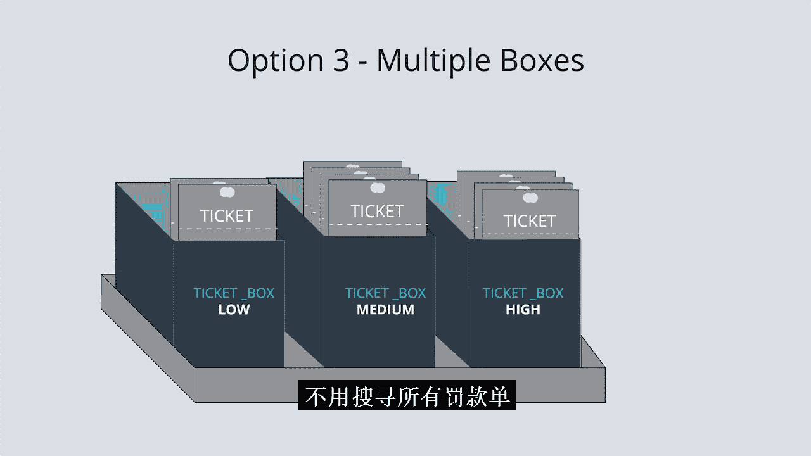
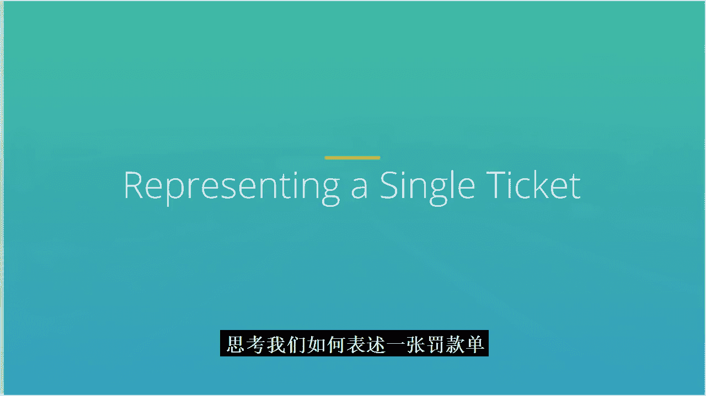
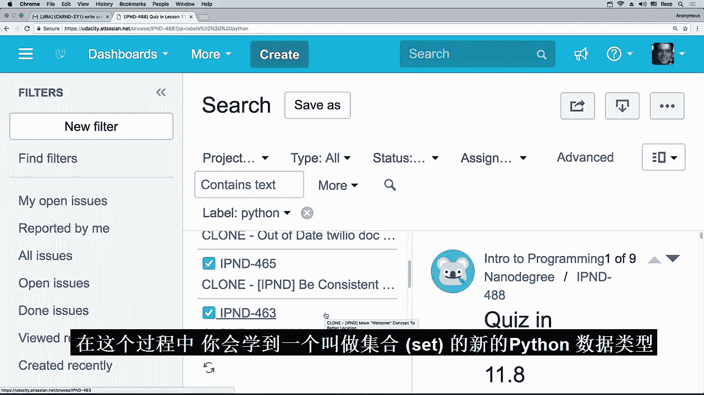

# 优达学城（Udacity）：无人驾驶汽车纳米学位项目-十位大牛亲授自动驾驶技术，硅谷前沿科技（计算机视觉⧸车道识别⧸感知控制⧸人工智能⧸谷歌） p28 28. Part 06-Module 01-Lesson 02_Data Structures [BV1Vd4y1r7QG_p28]

Up to this point in the nanoree， you've been using Python lists a lot。

 You've represented one and two dimensional worlds， both with lists， matrices and vectors。

 also lists。 And later in the standard degree， you'll see how even an image can be represented as a list。

And lists are great， especially when the data they contain is ordered in some meaningful way。

But the list isn't the only data structure that you have to work with。 And in this lesson。

 you're going to learn about two additional data structures called dictionaries and sets。

 and learning to use these data structures correctly will allow you to write code that's easier to read faster to write and more efficient to run。

And these data structures also tend to show up on programming interviews pretty frequently。

 so knowing a bit more about them is never a bad idea。

But before we jump into these new data structures， let's get a sense for what it even means to talk about the structure of data。

When you work on a self driving car team， at some point。

 you will inevitably have to get in the vehicle and actually observe its driving behavior。

And when the vehicle does anything unexpected， you're probably going to have to file a ticket。

And in reality， this is something you'd be doing on a computer。

 but the analog version of a ticket tracking system is something that's useful to think about for now。

So in this analog version， a ticket is a physical thing。And as you can see， the ticket has fields。

 in this case it has a place for the date， the priority， and a description。

And once youve filled out the ticket， you'll have to file it away。

 maybe in some box of outstanding tickets， and likely this box is sorted by date with the oldest tickets in the back and the newest in the front。

So you could just put the new ticket right in the front of the box。

Now it's important to note that this choice to store tickets in a single box ordered by date is a design decision。

 and somebody made that design decision when planning this ticket tracking system。

But it's not the only way it could have been designed。

So now I'd like you to think about this particular design and some of the trade offs that it made。

The ticketing system we discussed before made it really easy to find the oldest ticket。

 All we had to do was pull out whatever ticket was in the back of the box。

 And this is a good feature of the system。 It's totally possible that whoever handles these tickets will want to address them in chronological order to make sure that the oldest issues get resolved first。

But what if we want to handle the most important issues first？

The system doesn't give us any good way to do that。

So hopefully spend some time thinking about how you might design such a system。

When I thought about that question， I came up with three ideas。 I considered their pros and cons。

 and eventually I settled on the one that I thought was best。 Now。

 I'd like to walk you through my thought process， because the sort of thinking we do when we think about designing ticketing systems is almost exactly the same as the thinking we do when we choose data structures when we're programming。

😊，For my first attempt， I took the problem at face value and thought。

 what if all I cared about was a ticket's priority level and nothing else and in that case I could just have three bags。

And after filling out each ticket， I would just toss it in the appropriate bag。We that tie。Lu。

Or medium priority。And this really isn't a terrible solution， in fact。

 it's a great solution if a ticket's priority really is the only structure in the data that we care about。

But it's probably not， we probably do care about when a ticket was filed as well。

And that thinking led me to option two。Which is to sort by priority on insert。And in this option。

 we go back to having a box。😊，But now the goal is to make sure that these tickets stay sorted first by priority and then by date。

So all the high priority tickets would be in the back。

All the tickets in the middle would be medium priority and all the tickets at the front would be low priority。

Now let's think about how I' would have to use this system。In this system。

 when I go to file a high priority ticket， for example。

 I'm first going to have to find where it belongs。 So in this example， I would need to。

Search through all of these tickets that are already in the box until I find the first high priority ticket。

And that's where I would have to put this one right in front of the first high priority ticket。

And initially， I did really like the solution。 But this extra time required to file a ticket started bothering me when I'm in the vehicle。

 I should be focused on the vehicle， not on filing my tickets。 So when I do file tickets。

 that process really ought to be as fast as possible。 And this LED me to the third option。

 And the 1 I ended up ticking。We just have multiple boxes。And in this option。

 I just replaced my one box of tickets with three。One for each of the priority。

 so here I have a low priority box， a medium priority box， and a high priority box。

And just to keep everything tidy， I keep all three of these in the little box itself。

And then now when I want to file a ticket， I just put it at the front of the appropriate box。

 no rifling through old tickets required。

So far we've been talking about systems for storing multiple tickets in the physical world。

 using boxes and bags， but now we're going to go back into the digital world and think about how we want to represent just a single ticket。

Remember， a physical ticket looks something like this。But we want to talk about a digital ticket。

 which means we only care about the data this ticket contains。Which in this case is text？

But it's not really just text， a string doesn't feel appropriate here。

Because really there's two different types of text here。On the left。

 we have the names of the various fields。Every ticket has a field name date， a field name priority。

 and a field name description。But the text on the right is what changes from ticket to ticket。

 and at this point， I want to call something out about this data。 as I presented it。

 the string for the date。Came before the prairie。Which came before the description。

But there is no real meaning behind the ordering， in fact。

 we could have just as easily put the description first。

When data doesn't have any inherent sequential ordering to it。

 it often but not always means that we should be using a data structure other than a list。

In the next section， we're going to explore the trade offs associated with various data structures。

 Eventually， we're going to settle on using a Python dictionary as the preferred way to store unordered but related data。

You just saw how a dictionary can improve code readability and help us avoid making mistakes by allowing us to access data through a key like date or priority。

 This key is associated with a value。 So ticketss description key may be associated with the value vehicle unexpectedly stopped at green light。

😊，But sometimes we don't actually want to associate the key with any value。

 Sometimes the key itself is enough， like if we want to add tags or labels to a ticket。

Let me show you how Uudacity actually handles tickets with ticket tracking software called Jra。

So this is Jra's createre issue dialog box and the word issue they're using just like we've been using the word ticket just so you know。

And as you can see， an issue has an associated project， an issue type in this case。

 we're going to call it a bug。😊，And a summary， in this case， literally everything is broken maybe。

Okay， so this is a pretty bad bug。 I'm going to ignore some of these fields here。

 but I am going to give it a priority of highest。And let's add some labels to it。

Maybe I think the issue is in the Python code， so I'll type PY T。

 and I can see up here that an autocomplete is suggesting Python as a label so I can click that。

And maybe also I want to give it the label of book。Also， a suggestion。Now。

 let's see what happens if I'm not thinking and I try to add Python again。No matches。Somehow。

 Jra is ensuring that this data structure。Not have duplicates of the same label。 Now。

 there's a data structure in Python that does exactly this called the set。

 And that's what I want to teach you about， next。But before we do that。

 let's create our issue and let's click on this Python。内蒙。And as you can see。

 this is something that Jra supports， it's showing me everything with a label of Python and it's showing me every issue that has that associated label。

In the next notebook， you're going to implement similar functionality to the ticket tracker we've been working with。

 and in doing so， you're going to learn about a new Python data type called the set。

Choosing a good data structure to solve a hard problem actually requires you to do a lot of things well。

 First， you have to define the problem well， then you have to understand the data structures you have available to you。

 like lists， dictionaries and sets， as well as the trade offs and their limitations。

Then you have to choose a good data structure to actually represent the problem so that you can then write a good algorithm that actually solves it。

And that's a lot， and it takes a lot of practice before any of this becomes easy。

As you continue through this nanoegree， I really want to encourage you to actively think about the algorithms you write and the data structures you're choosing to use。

When you find yourself uncertain， it's really helpful to talk about these things with other people。

 so use the Noon degree Slack Cha， ask questions and get involved in discussions about all the new concepts you're learning。

