# 优达学城（Udacity）：无人驾驶汽车纳米学位项目-十位大牛亲授自动驾驶技术，硅谷前沿科技（计算机视觉⧸车道识别⧸感知控制⧸人工智能⧸谷歌） p29 29. Part 06-Module 01-Lesson 03_The Search Problem [BV1Vd4y1r7QG_p29]

In this unit， we're going to talk about problem solving The theory and technology of building agents that can plan ahead to solve problems。

 In particular， we're talking about problem solving。

 where the complexity of the problem comes from the idea that there are many states。

As in this problem here， a navigation problem where there are many choices to start with and the complexity comes from picking the right choice now and picking the right choice at the next intersection and the intersection after that。

 streaming together the sequence of actions。 This is in contrast to the type of complexity shown in this picture。

 where the complexity comes from the partial observability that we can't see through the fog where the possible pass are。

 We can't see the results of our actions and even the actions themselves are not known。

 This type of complexity will be covered in a later unit。Here's an example of a problem。

 This is a route finding problem where we're given to start city In this case。

 a rod in a destination， Bucharest， the capital of Romania from which this is a corner of the map。

 And the problem then is to find a route from Arrod to Bucharest and the actions that the agent can execute are driving from one city to the next along one of the roads shown on the map。

 The question is， is there a solution that the agent can come up with。

 given the knowledge shown here to the problem of driving from Arrod to Bucharest。

 And the answer is no， there is no solution that the agent can come up with。

 because Bucharest doesn't appear on the map。 And so the agent doesn't know any actions that can arrive there。

So let's give the agent a better chance。 Now， we've given the agent the full map of Romania。

 The start is in Arrod， and the destination or goal is in Bucharest and the agent。

Is given the problem of coming up with a sequence of actions that will arrive at the destination。

 Now， is it possible for the agent to solve this problem。 And the answer is， yes。

 there are many routes or steps or sequences of actions that will arrive at the destination。

 Here's one of them。Starting out in a rod， taking this step first。Then this one。Then this one。

 then this one， and then this one to arrive at the destination。

 So that would count as a solution to the problem， a sequence of actions chained together that are guaranteed to get us to the goal。

 Now， let's formally define what a problem looks like。

 A problem can be broken down into a number of components。First。

The initial state that the agent starts out with in our route finding problem。

 the initial state was the agent being in the city of Iraq。Next。

A function actions that takes a state as input and returns。

A set of possible actions that the agent can execute when the agent is in this state。

In some problems， the agent will have the same actions available in all states and in other problems。

 they'll have different actions dependent on the state In the route finding problem。

 the actions are dependent on the state。 When we're in one city。

 we can take the routes to the neighboring cities， but we can't go to any other cities。 Next。

 we have a function called result， which takes as input， a state。And an action。

And delivers as its output。A new state。So， for example。

If the agent is in the city of Arrod and takes that would be the state and takes the action of driving along routeute E671 towards Timmaorra。

Thenhan the result of applying that action in that state would be the new state where the agent is in the city of Timmior。

Next。We need a function called gold test。Which takes a state and returns a boolean value。

True or false， telling us if this state is a goal or not in the route finding problem。

 the only goal would be being in the destination city。

 the city of Bucharest and all the other states would return false for the goal of test。And finally。

 I need one more thing， which is a path cost function， which takes a path， a sequence of state。

Action transitions。And returns a number， which is the cost of that path。Now。

 for most of the problems we'll deal with， we'll make the path cost function be additive so that the cost of a path is just the sum of the costs of the individual steps。

And so we'll implement this path cost function in terms of a step cost function。

The step cost function。Takes a state。An action。And the resulting state from that action。

And returns a number N， which is the cost of that action。In the route finding example。

 the cost might be the number of miles， traveled， or maybe the number of minutes it takes to get to that destination。

Now let's see how the definition of a problem maps on to the rootfounding domain First。

 the initial state were given， let's say we start off in a rod， and the goal test。

 let's say that the state of being in Bucharest is the only state that counts as a goal and all other states are not goals。

 Now the set of all the states here is known as the state space。

 and we navigate the state space by applying actions。

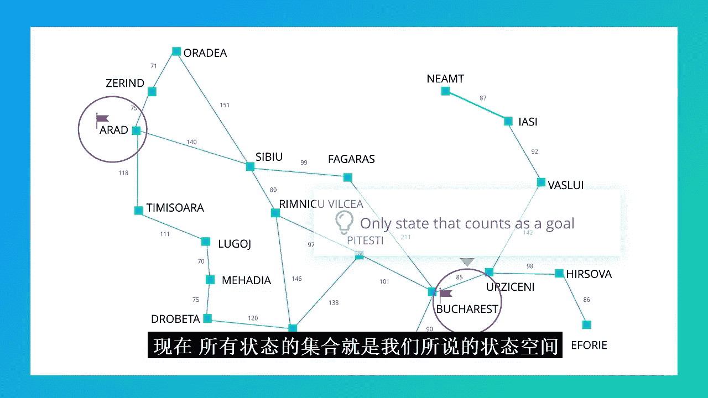

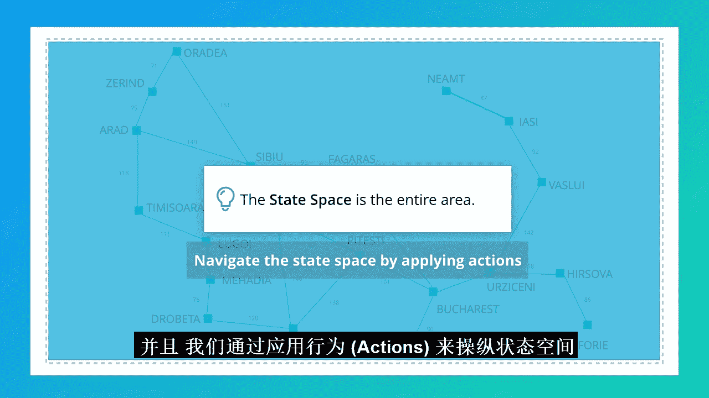

The actions are specific to each city， so when we're in a rod。

 there are three possible actions to follow this road， this one， or this one。And as we follow them。

 we build paths or sequences of a， so just being in a rod is the path of length 0。

 and now we could start exploring the space and add in this path of length 1。This path， at length1。

In this path at length one， we can add in another path here of length 2。

 another path here of length2。Here's another path of length2。Here's a path。Of length 3。

 another path of length 2 and so on。 Now， at every point。

 we want to separate the state out into three parts。 First， the ends of the path。

 the farthest path that been have been explored。 we call the frontier。

 And so the frontier in this case consists。Of these states and the farthest out we've been explored。

 and then to the left of that in this diagram， we have the explored part of the state。

 and then off to the right we have the unexplored， so let's write down those three components。

We have the frontier， we have the unexplored region， and we have the Exped region。One more thing。

In this diagram， we've labeled the step cost of each action along the route。

 so the step cost of going between Nimed and Iasi would be 87 corresponding to a distance of 87 km。

 and then the path cost is just the sum of the step cost。

 So the cost of the path of going from Arrod to Orodea would be 71 plus 75。

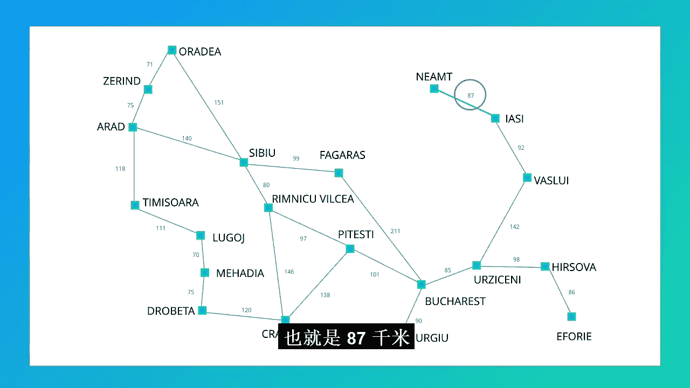

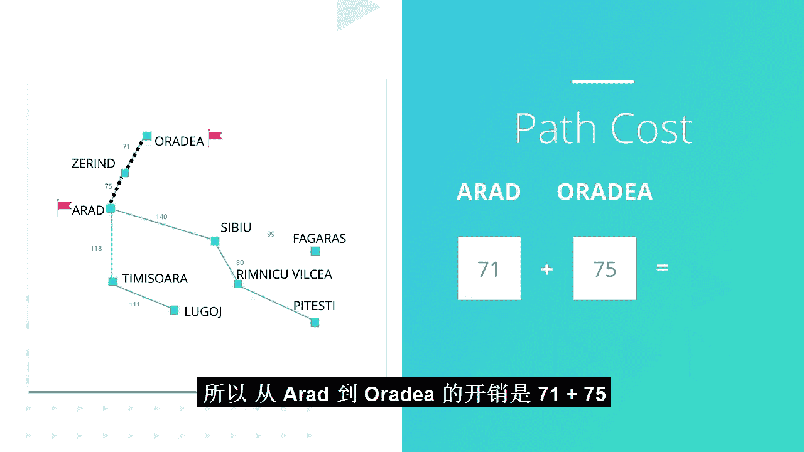

Now， let's define a function for solving problems。 It's called tree search because it superimposes a search tree over the state space。

 Here's how it works。 Start off by initializing the frontier to be the path which consisting of only the initial state。

 and then it goes into a loop in which it first check。

 see do we still have anything left in the frontier。 If not we fail， there can be no solution。

 If we do have something。 Then we make a choice。 And tree search is really a family of functions。

 not a single algorithm， which depends on how we make that choice。

 And we'll see some of the options later。 We go ahead and make a choice of one of the paths on the frontier and remove that path from the frontier。

 We find the state which is at the end of the path。 And if that statess a goal， then we're done。

 we found the path to the goal。 Otherwise， we do what's called expanding that path。

 We look at all the actions from that state。 And we add to the path。

The actions and the result of that state， so we get a new path that has the old path。

 the action and the result of that action， and we stick all of those paths back onto the frontier。

Now tree represents a whole family of algorithms。And where you get the family resemblance is that they're all looking at the frontier。

 popping items off and looking to see if their goal test。

 but where you get the difference is right here in the choice of how you're going to expand the next item on the frontier。

 which path do we look at first？And we'll go through different sets of algorithms that make different choices for which path to look at first。

The first algorithm I want to consider is called Bth first search。

Now it could be called shortest first search because what it does is always choose off the frontier one of the paths that hasn't been considered yet that's the shortest possible so how does it work Well。

 we start off with the path of length zero starting in the start state。

And that's the only path in the frontier， so it's the shortest one。

 so we pick it and then we expand it and we add in all the paths that result from applying all the possible actions。

So now we've removed。This path from the frontier， but we've added in three new paths。This one。

This one。In this吧。Now we're in a position where we have three paths on the frontier。

And we have to pick the shortest one。 Now， in this case， all three paths have the same length。

 length 1。 So we break the tie at random or using some other technique。

And let's suppose that in this case， we choose this path for marriage toivu。Now。

 the question I want you to answer is once we remove that from the frontier。

What path are we going to add next？So show me by checking off the cities that ends the paths。

 which paths are going to be added to the frontier。The answer is that in CU。

 the action function gives us four actions corresponding to traveling along these four roads。

 so we have to add in pass for each of those actions。One of those paths goes here。

 the other path continues from a rod and goes out here， the third path continues。Out here。

 and then the fourth pass goes from here， from Ar to Sibiu， and then backtracks back to。Herrad。

Now it may seem silly and redundant to have a path that starts in arod。

 goes to Siibu and returns to Errod， how can that help us get to our destination in Buarest？

But we can see if we're dealing with a tree surge， why it's natural to have this type of formulation and why the tree surge doesn't even notice that it's backtracked。

What the tree search does is superimose on top of the state space， a tree of searches。

 and the tree looks like this。We start off in state A and in state A， there were three actions。

 so it gave us passs。Going to Z。Yes。选T。And from S， there were four actions。

 So that gave us path going。2，0。Have。Her。And A， and then the tree would continue on from here。

 we take one of the next items and remove it and continue on， but notice that we returned。

To the A state in the state space， but in the tree， it's just another item in the tree。

Now here's another representation of the search space。And what's happening is。

 as we start to explore the state， we keep track of the frontier， which is。

The set of states that are at the ends of the pass that we haven't explored yet and behind that frontier。

Is a set of explored states and ahead of the frontier of the unexplored states。Now。

 the reason we keep track of the explored states is that when we want to expand and we find a duplicate。

 so say when we expand from here， if we pointed back to state T， if we hadn't kept track of that。

 we would have to add in a new state。For tea down here。

 but because we've already seen it and we know that it is actually a regressive step into the already explored state now。

 because we've kept track of that， we don't need it anymore。

Now we see how to modify the tree search function to make it be a graph search function to avoid those repeated paths。

What we do is we start off and initialize a set called the Expord set of states that we've already explored。

Then when we consider a new path， we add the new state to the set of already explored states。

And then when we're expanding the path and adding in new state to the end of it。

 we don't add that in if we've already seen that new state in either the frontier or the explored。

 Now， back to Bretford search。 And let's assume we're using the graph search so that we've eliminated the duplicate path。

 Ar rod is crossed off the list。 the path that goes from rod is subed back to a rod is removed。

 and we're left with these 1，2，3，4，5 possible paths。 Given these five paths。

 show me which ones are candidates to be expanded next by the Brethford search algorithm。

And the answer is that Breth first search always considers the shortest path verse， and in this case。

 there's two paths of length1， the one the pass from Er to Zin and Er to Temaauura。

 So those would be the two paths that would be considered。

Now let's suppose that the tie is broken in some way and we chose this path from Herd to Zin Now we want to expand that node。

 we remove it from the frontier and put it in the explored list。

 and now we say what paths are we going to add so check off the ends of the paths。

 the cities that we're going to add？In this case， there's nothing to add because of the two neighbors。

 one is in the explored list and ones in the frontier。 And if we're using graph search。

 then we won't add either of those。 So we move on。 We look for another shortest path。

 There's one path left of length 1。 So if we look at that path。 we expand it。Add in this path。

Put that one on the explored list。And now we've got three paths of length2， we choose one of them。

 and let's say we choose this one。Now， my question is。

 show me which states we add to the path and tell me whether we're going to terminate the algorithm at this point because we've reached the goal or whether we're going to continue。

The answer is that we add one more path。The path to Bucharest。

 we don't add the path going back as it's in the explored list。But we don't terminate yet。 Tru。

 We have added a path that ends in Bucharest， but the gold test isn't applied when we add a path to the frontier。

 Rather， it's applied when we remove that path from the frontier， and we haven't done that yet。Now。

 why doesn't the general tree search or graph search algorithm stop when it adds a goal node to the frontier。

 The reason is because it might not be the best path to the goal。 Now。

 here we found a path of length 2 and we added a path of length 3 that reached the goal。

 Now the general graph search or tree search doesn't know that there might be some other path that we could expand that would have a distance of。

 say，2 and a2。But there's an optimization that could be made if we know we're doing breath first search and we know there's no possibility of a path of length2 and a half。

 then we can change the algorithm so that it checks states as soon as they're added to the frontier。

 rather than waiting until they're expanded， and in that case。

 we can write a specific breadth first search routine that terminates early and gives us the result as soon as we add a goal state to the frontier。

Bretfordt search will find this path that ends up in Bucharest。

 And if we're looking for the shortest path in terms of number of steps。

 Bretford search is guaranteed to find it。 But if we're looking for the shortest path in terms of total cost by adding up the step costs。

 then it turns out that this path。Is shorter than the path found by breathre's first search。

So let's look at how we could find that path。An algorithm that has traditionally been called uniform cost search。

But could be called cheapest first search。Is guaranteed to find the path with the cheapest total cost。

Let's see how it works。We start out as before in the start state。And we pop that empty path off。

 move it from the frontier to explore。And then add in the path out of that state。As before。

There'll be three of those paths。And now which path are we going to pick next？In order to expand。

 according to the rules of cheapest first。Cheefest first says that we pick the path with。

 with the lowest total cost。And that would be this path。

 It has a cost of 75 compared to the cost of 118 and 140 for the other paths。So we get here。

We take that path off the frontier。Put it on the explored list。Add in his neighbors。

 not going back to a rod， but adding in this new path， summing up the total cost of that path。

71 plus 75。

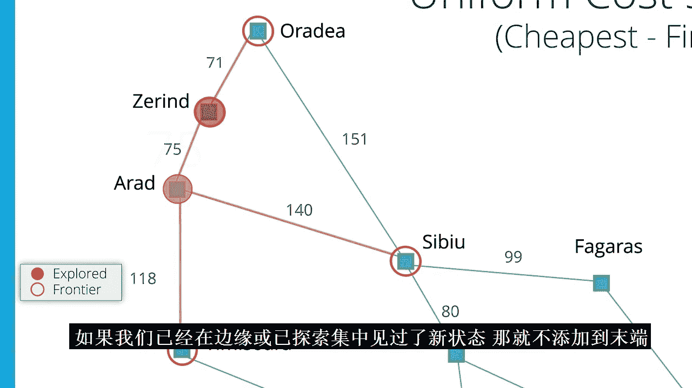

Is 146 for this path。And now the question is， which path gets expanded next？

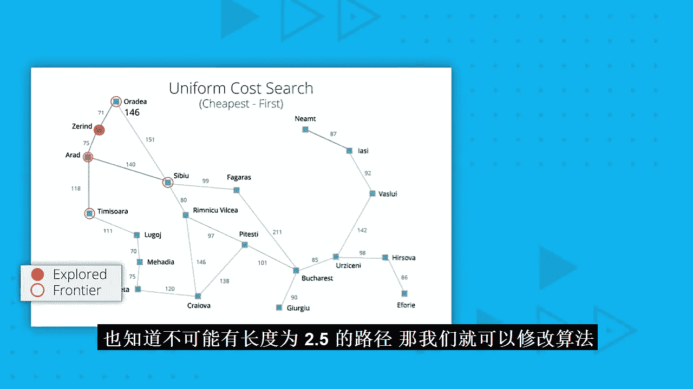

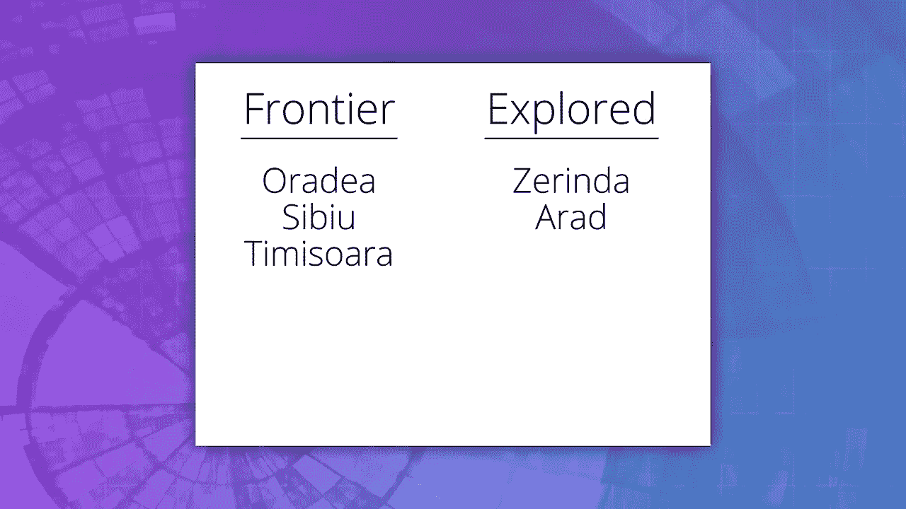

Of the three paths on the frontier， we have ones with cost of 146，140 and 118。

 and that's the cheapest。 So this one gets expanded。 We take it off the frontier move it to explored。

 Add in its successors。 In this case， it's only one。 and that has a path total of 229。

 which path do we expand next while we got 146，140 and 229， So 140 is the lowest。

 take it off the frontier， put it on Expd。 add in this path with total cost 220。

 and this path with total cost 239。And now the question is， which path do we expand next？

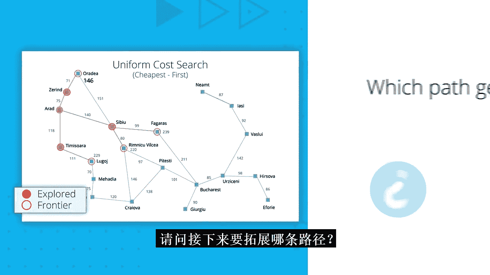

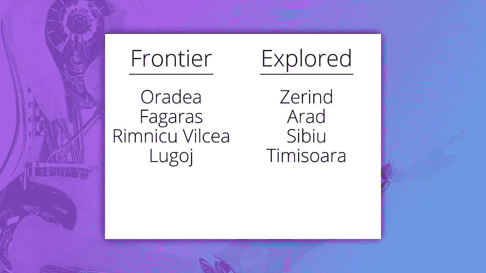

The answer is this one，1，46， put it on explored， but there's nothing to add because both of its neighbors have already been explored。

 Which path do we look at next。

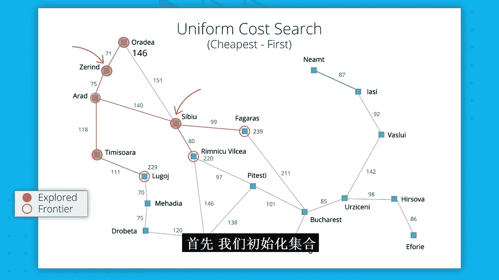

The answer is this one，220 is less than 229 or 239。 Take it off the frontier， Put it unexplored。

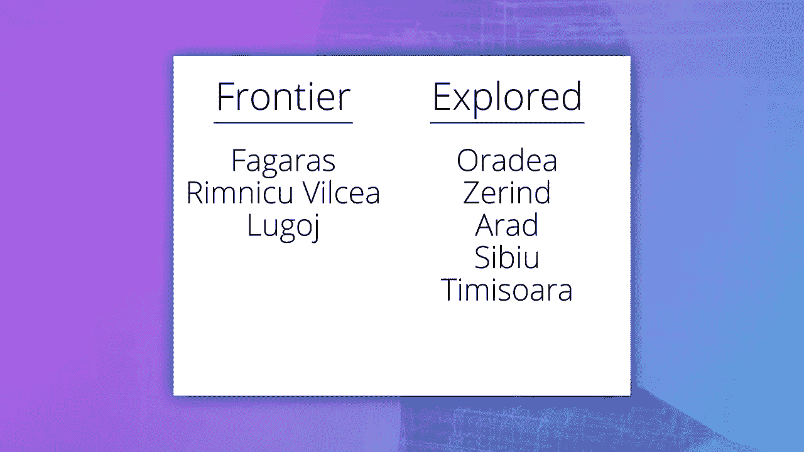

Add in。Two more paths。And sum them up， so 220 plus 146。It's 366。And 2，20 plus 97。Is。3，7。Okay。

 and now notice that we're closing in on Bucharest， we've got two neighbors almost there。

 but neither of them is their turn yet。Instead， the cheapest path is this one over here。

 so move it to the explored list， add 70 to the。Path costs so far。And we get299。

Now the cheapest node is 239 here。So we expand。Finally， hint Bucharest at a cost of 460。

 and now the question is， are we done， can we terminate the Albert？The answer is， no。

 We're not done yet。 We have reached a goal state。 We put a path on the frontier that reaches the goal Bucharest。

 but we haven't popped that path off the frontier。And uniform cost search continues to search until we pop it off the frontier。

 We continue looking to see if there's a better path that also reaches the goal。 So let's see。

 I forgot to say Taggarass is explored。 So let's continue。 Looking on the frontier。

 The cheapest now is here at 299。 We'll expand that。 We get a path。 of cost 3，74。

 put that on the frontier。 Now， let's go again。Now， the cheapest path is over here at 3，17。

 We'll mark that as explored and add two more paths， one here。 That's a worse path。

 So it gets dropped and one path that also reaches the goal。 and that has a total cost of 4，18。

So that just shows iss a good thing we waited。 a good thing we didn't stop when we found the first path to the goal。

 because now this second path found is actually cheaper than the first path found。

 But we're not going to stop here because we still haven't popped off a path that reaches the goal。

 So we'll continue。 What's next。 Now， the cheapest path on the frontier is here at 366。

 We expand that and we get paths that our worst path to points we've already seen before。

 So nothing new goes on the frontier。 next， the cheapest path on the frontier is at 374。 again。

 expanding that。Leads nothing useful， only worse paths than we've seen before。 And now， finally。

 that cheapest path on the frontier is this 418 path to Bucharest。 So we pop that off。

 And now we reach the goal。 And now we stop。 So even though we found the 4，60 path first。

 we don't stop there because there might be another path that also reaches the goal that's cheaper We keep on going until we pop a path off of the frontier that reaches the goal。

 And that's why uniform cost search is guaranteed to find the cheapest path to the goal。

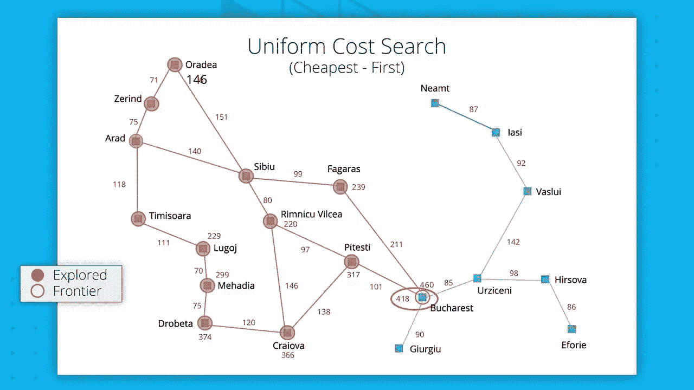

So we've looked at two search algorithms， one breakfast search in which we always expand first。

 the shallowest path， the shortest pass。Second， cheapest first search in which we always expand first the path with the lowest total cost。

 and I'm going to take this opportunity to introduce a third algorithm， depth first search。

 which is in a way the opposite of breadth first search， and depth first search。

 we always expand first， the longest path， the path with the most links in it。

Now what I want to ask you to do is for each of these nodes in each of the trees。

 cu us in what order they expanded， first， second， third， fourth。

 fifth and so on by putting a number into the box。And if there are ties。

 put that number in or resolve the ties in left to right quarter。

Then I want you to ask one more question or answer one more question， which is。

 are these searches optimal， That is， are they guaranteed to find the path solution。

 And for breakfast first search， optimalti would mean finding the shortest path。

 If you think it's guaranteed to find the shortest path。 Check here。 for cheapest first。

 It would mean finding the path with the lowest total path cost。

 check here if you think it's guaranteed to do that。

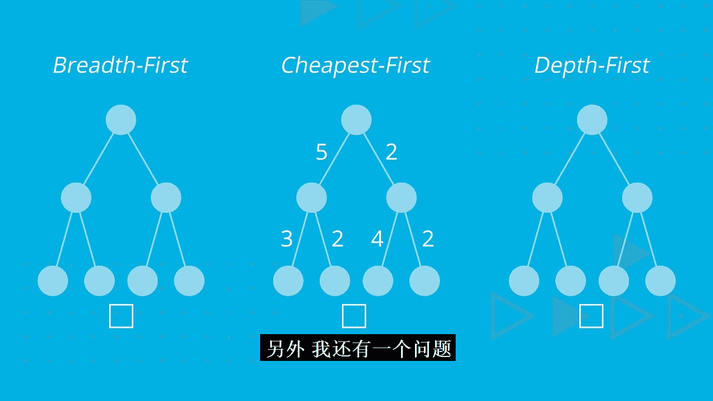

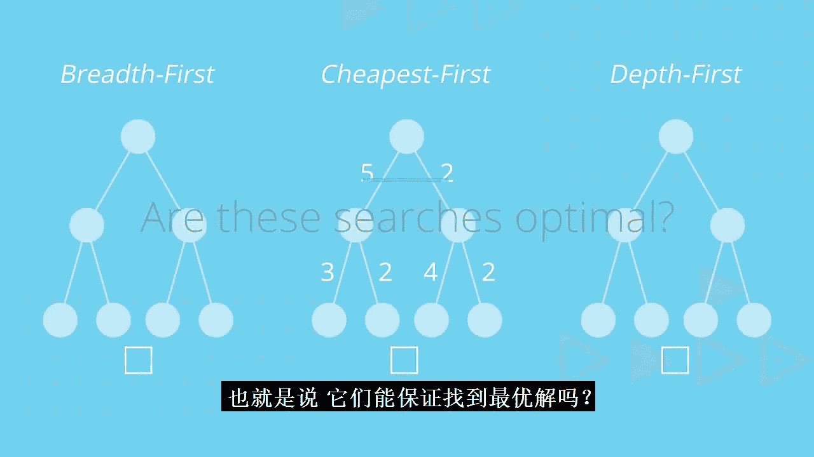

And will allow the assumption that all costs have to be positive。And in depth first。

Cheapest or optimal would mean， again， as in breath first。

 finding the shortest possible path in terms of number of length。

 Check here if you think depth first will always find that。Hit the answers。 Bedfords search。

 as an aim implies。Expands nodes in this order。2。3。4。5，6。7， so going across。A stripe at a time。

 read first。Is it optimal， Well， it's always expanding the shortest pass first。

 And so wherever the goal is hiding， it's going to find it by examining no longer pass。 So， in fact。

 it is optimal， cheapest first。First week band。The path of length 0。Then the path of length2。

 Now there's a path of length 4。Path of length 5， path of length 6。A path of length，7。

 and finally a path of length 8。And as we've seen， it's guaranteed to find the cheapest path of all。

 assuming that all the individual step costs。Are not negative De first search tries to go as deep as it can first。

 so it goes 1，2。3 then backs up，4， then backs up5，6。7。

And you can see that it doesn't necessarily find the shortest path of all。

 Let's say that there were goals。In position5 and in position 3。

 it would find the longer path to position 3 and find the goal there and would not find the goal in position 5 so it is not given the nonopity of depth for search。

 why would anybody choose to use it Well， the answer has to do with the storage requirements here I've illustrated a state space consisting of a very large or even infinite binary tree as we go to levels 1。

2，3 down to level n， the tree gets larger and larger。

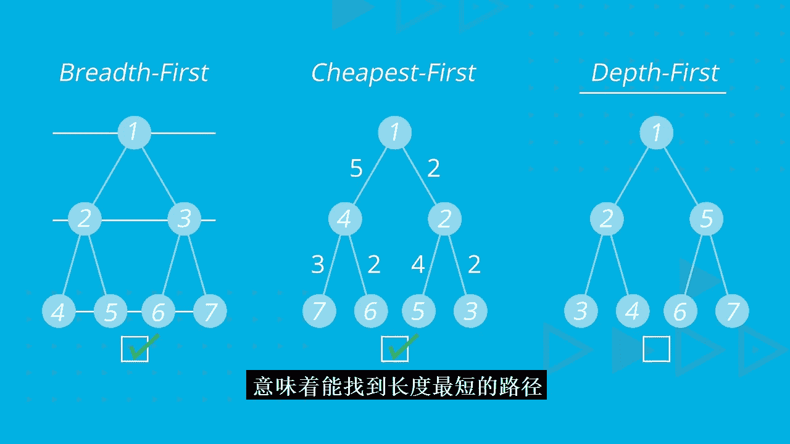

Now， let's consider the frontier for each of these search algorithms。For Bford Search。

 we know the frontier looks like that。And so when we get down to level N。

 we'll require storage space of two to the n a path in a breaththford search。For cheapest first。

 the frontier is going to be more complicated and it's going to sort of work out this contour of cost。

But it's going to have a similar total number of notes。But for depth first search。

 as we go down the tree， we start going down this branch。And then we back up。 But at any point。

 our frontier is only going to have end nodes rather than two to the end nodes。

 So that's a substantial savings for depth first search。 Now， of course。

 if we're also keeping track of the explored Sa。Then we don't get that much savings。

But without the explored set， depth first search has a huge advantage in terms of space saved。

One more property of the algorithms to consider is a property of completeness。

 meaning if there is a goal somewhere will the algorithm find it。

So let's move from very large trees to infinite trees。

 and let's say that there's some goal hidden somewhere deep down in that tree。

 and the question is are each of these algorithms complete， that is。

 are they guaranteed to find a path to the goal？Mark off the check boxes。For the algorithms。

That you believe are complete in this sense。The answer is that Bretford search is complete。

So even if the tree is infinite。If the goal is placed at any finite level， eventually。

 we're going to march down and find that goal， same with cheapest first。No matter where the goal is。

 if it has a finite cost， eventually we're going to go down and find it。

But not so for depth for search。If there's an infinite path。

 depth first search will keep following that， so it'll keep going down and down and down along this path and never get to the path that the goal consists of and never get to the path on which the goal sits。

 so depth first search is not complete。

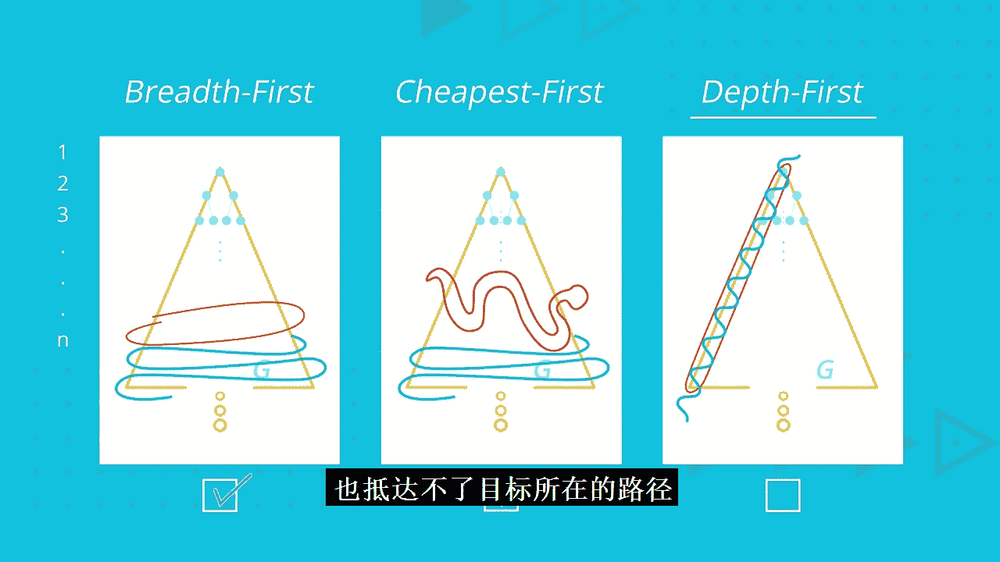

Let's try to understand a little better how uniform cost search works。We started a start state。

And then we start expanding out from there， looking at different paths。And what we end up doing。

Is expanding in terms of contours， like on a topological map。

 where first we span out to a certain distance， then to a farther distance and then to a farther distance。

Now， at some point we meet up with the goal， let's say the goal is here。

Now we found a path from the start to the goal， but noticed that the search really wasn't directed at any way towards the goal。

 it was expanding out everywhere in the space。And depending on where the goal is。

 we should expect to have to explore half of the space， on average before we find the goal。

 If the space is small， that can be fine。 But when spaces are large。

 that won't get us to the goal fast enough。Unfortunately。

 there's really nothing we can do with what we know to do better than that。

And so if we want to improve， if we want to be able to find the goal faster。

 we're going to have to add more knowledge。The type of knowledge that's proven most useful in search is an estimate of the distance from the start state。

To the goal。 So let's say we're dealing with a route finding problem and we can move at in any direction in up or down right or left and we'll take as our estimate。

 the straight line distance between a state and a goal。

 and we'll try to use that estimate to find our way to the goal fastest。 Now。

 an algorithm called greedy best first search does exactly that。 It expands first。

 the path that's closest to the goal according to the estimate。

So what do the contours look like in this approach？Well。

 we start here and then we look at all the neighboring states。

And the ones that appear to be closest to the goal， we would expand first。

So we'd start expanding like this。And like this。And like this。And like this。

And that would lead us directly to the goal。 So now。

 instead of exploring whole circles that go out everywhere in the search space。

 our search is directed towards the goal。 In this case， it gets us immediately towards the goal。

 but that won't always be the case if there are obstacles along the way。Consider this search space。

 we have a start state and a goal， and there's an impassable barrier。

And greedy Best first search will start expanding out as before。Trying to get towards the goal。

 And when it reaches the barrier， what will it do next。 Well。

 it will try to increase along a path that's getting closer and closer to the goal。

 so it won't consider going back this way， which is farther from the goal， Rather。

 it will continue expanding out along these lines， which always get closer and closer to the goal。

 and eventually will find its way towards the goal。

So it does find a path and it does it by expanding a small number of nodes。

But it's willing to accept a path， which is longer than other paths。 Now。

 if we could explored in the other direction， we could have found a much simpler path。

 a much shorter path by just popping over the barrier and then going directly to the goal。

 But greedy best first search wouldn't have done that。

 because that would have involved getting to this point。

Which is this distance from the goal and then considering states which were farther from the goal。

 what we would really like is an algorithm that combines the best parts of greedy search。

 which explores a small number of nodes in many cases。And uniform cost search。

 which is guaranteed to find the shortest path will' show how to do that next using an algorithm called the a star algorithm。

 A star search works by always expanding the path that has a minimum value of the function F。

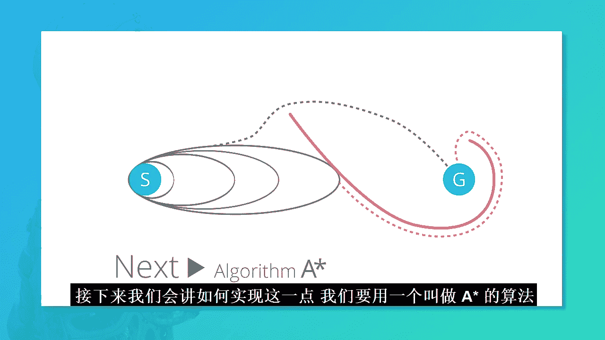

Which is defined as a sum of the G and H components Now the function G of a path its just the path cost and the function H of a path。

Is equal to the h value of the state。Which is the final state of the path。

Which is equal to the estimated distance to the goal。Here's an example of how a star works。

 supposeupp we found this path through the state space。To estate x。

And we're trying to give a measure to the value of this path。 The measure F is the sum of G。

 the path costs so far and H， which is the estimated distance that the path will take to complete its path to the goal。

 Now， minimizing G helps us keep the path short。And minimizing H helps us keep focused on finding the goal。

 And the result is a search strategy that is the best possible in the sense that it finds the shortest length path while expanding the minimum number of paths possible。

It could be called best estimated total path costs first， but the name A star is traditional。 Now。

 let's go back to Romania and apply the A star algorithm， and we're going to use a heuristic。

 which is a straight line distance between a state and the goal。 The goal， again is Bucharest。

 And so the distance from Bucharest to Bucharest is， of course，0。

 And for other all the other states have written in red， the straight line distance。 for example。

 straight across like that。

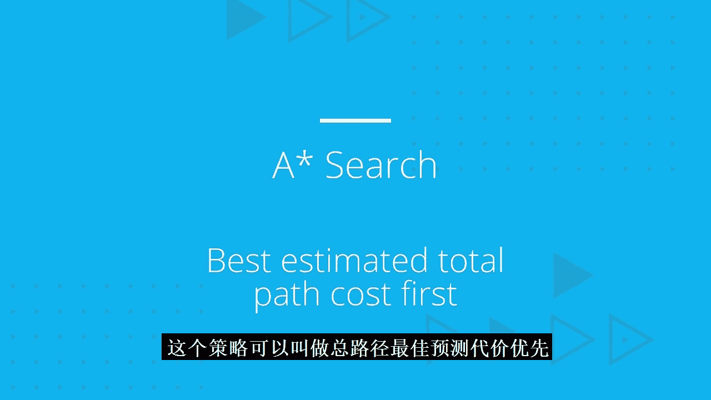

Now， I should say that all the roads here I've drawn as straight lines。

 but actually roads are going to be curved to some degree。

 so the actual distance along the roads is going to be longer than the straight line distance。 Now。

 we start out， as usual， will start in a rod as the start state， and we'll expand out a rod。

 and so we'll add three paths and the evaluation function。 F will be the sum of the path length。

Which is given in black。And the estimated distance， which is given in red。And so the path length。

From this path。Will be 140 plus 253 or 393 for this path 75， plus 374， 449， and for this path。

 118 plus 329， 447。And now the question is， out of all the paths that are on the frontier。

 which path will be expanded next under the A star algorithm？

The answer is that we select this path first， the one from Arrod to Sibiio。

 because it has the smallest value 393 of the sum F equals G plus H。

LetGo ahead and expand this node now。 So we're going to add three paths。

 This one has a path cost of 291 and an estimated distance to the goal of 380 for a total of 6，71。

 This one has a path cost of 2，39 and an estimated distance of 176 for a total of 415。

 And the final one is 220 plus 193 equals 4，13。 And now the question is。

Which state do we expand next， The answer is we expand this path next。

 because its total 413 is less than all the other ones on the frontier。

 although only slightly less than the 415 note for this path。So we expand this node。

Giving us two more paths， this one with an F value of 417， and this one with an F value of 526。

And the question， again， which path are we going to expand next？

The answer is that we expand this path at Faggars next。

 because its F total 415 is less than all the other paths in the frontier。

Now we expand Faggars and we get a path that reaches the goal。

 and it has a path length of 450 and an estimated distance of 0 for a total F value of 450。

 And now the question is， what do we do next， click here。

 if you think we're at the end of the algorithm and we don't need to expand next。

 or click on the node that you think we will expand next。

The answer is that we're not done yet because the algorithm works by doing the gold tests when we take a path off the frontier。

 not when we put a path on the frontier。 Instead， we just continue in the normal way and choose the node on the frontier。

 which has a lowest value， and that would be this one the path through pottee with a total of 417。

So let's expand the node at Petti， we have to go down this direction up。

 then we reach a path we've seen before。And we go in this direction and now we reach Bucharest。

 which is the goal and the H value is going to be 0 because we're at the goal and the G value works out to 418。

 Now， again， we don't stop here just because we put a path onto the frontier。 Rather we put it there。

 we don't apply the gold test next。 Now we go back to the frontier and it turns out that this 418 is the lowest cost path on the frontier。

 So now we pull it off do the goal test and now we found our path。To the goal， and it is， in fact。

 the shortest possible path。 In this case， A star was able to find the lowest cost path。

Now the question， which you'll have to think about because we haven't explained it yet。

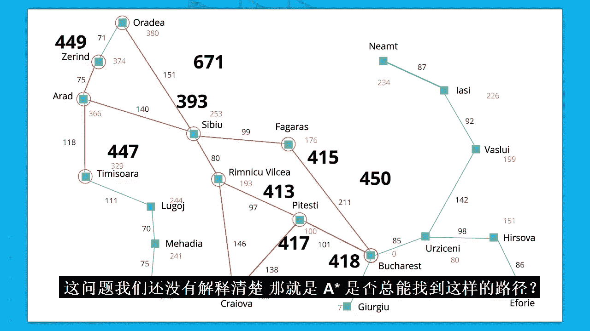

Is whether A star will always do this。Answer yes， if you think a star will O it find the shortest cost path。

Or answer no if you think it depends on the particular problem given。

 or answer no if you think it depends on the particular heuristic estimate function H。

The answer is that it depends on the H function。A star will find the lowest cost path if the H function for a state。

Is less than the true cost of the path to the goal through that state。 In other words， we want the H。

To never overestimate the distance to the goal， we also say that H is optimistic。

 another way of stating that is that H is admissible。

 meaning that it is admissible to use it to find the lowest cost path so think of all of these as being the same way of stating the conditions under which A star finds the lowest cost path。

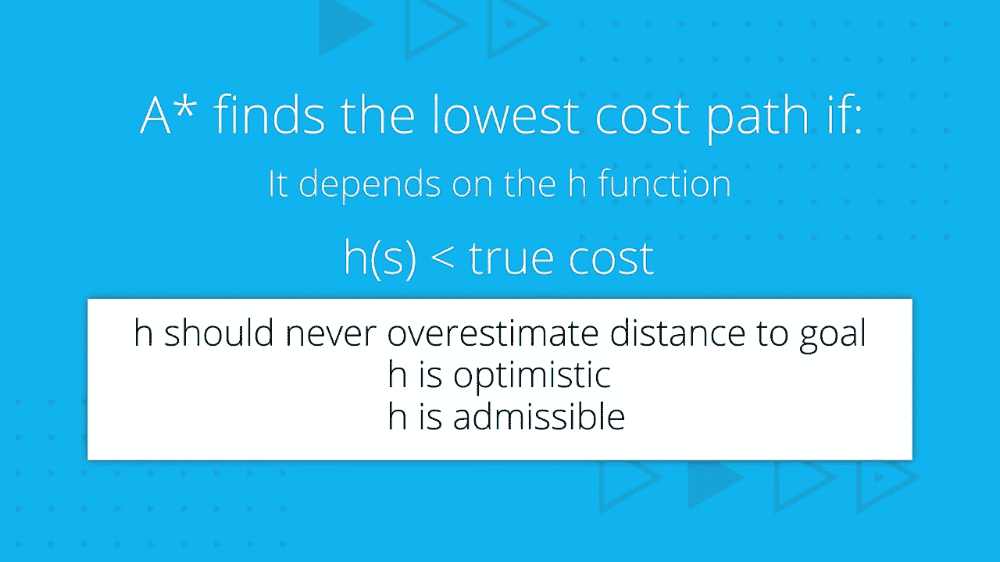

Here， we give you an intuition as to why an optimistic heuristic function H finds the lowest cost path。

 When8 star ends， it returns a path P with estimated cost。

C and it turns out that C is actually also the actual cost because at the goal， the H component is0。

 and so the path cost is the total cost is estimated by the function。 Now。

 all the paths on the frontier have an estimated cost that's greater than C。

 and we know that because the frontier is explored in cheapest first order， but if H is optimistic。

 then the estimated cost is less than the true cost。

So the path P must have a cost that's less than the true cost of any of the other paths than the frontier。

 and any paths that go beyond the frontier must have a cost that's greater than that because we agreed that the step cost is always zero or more。

 so that means that this path P must be the minimal cost path。Now this argument I should say。

 only goes through just as is for tree search， for graph search。

 the argument slightly more complicated but the general intuitions hold the same。

 I want to introduce one more problem that can be solved with search techniques and this is a sliding blocks puzzle called the 15 puzzle you may have seen something like this。

So there are a bunch of little squares or blocks or tiles， and you can slide them around。

And the goal is to get into a certain configuration。

 so we'll say that this is the goal state where the numbers 1 to 15 are in order left or right top to bottom。

 and the starting state would be some state where all the positions are messed up Now the question is can we come up with a good heuristic for this。

And let's examine that as a way of thinking about where heuristics come from。

 The first heuristic we're going to consider。 We'll call H1。

 and that's equal to the number of misplaced blocks。 So here。

10 and 11 are misplaced because they should be there and there respectively，12 is in the right place。

13 is in the right place。 and 14 and 15 are misplaced。 So that's a total of 4 misplaced blocks。

The second heuristic H2 is equal to the sum of the distances that each block would have to move to get to the right position。

 So for this position，10 would have to move one space to get to the right position。

11 would have to move  one。 So that's a total of 2。 so far。13 is in the right place。

14 is one displaced and 15 is one displaced。 So that would also be a total of 4。 Now。

 the question is， which， if any of these heuristics are admissible。 Check the boxes。

Next to the heuristics that you think are admissible。

H1 is admissible because every tile that's in the wrong position must be moved at least once to get into the right position。

 So H1 never overestimates。 how about H 2。H2 is also admissible because every tile in the wrong position can be moved closer to the correct position。

 no faster than one space per move， and therefore， both are amissible。

 But notice that H2 is always greater than or equal to H1。

 that means that with exception of breaking ties。 an A star search using H2 will always expand fewer paths than one using H1。

Now， we're trying to build an artificial intelligence that can solve problems like this all on its own。

And you can see that the search algorithms do a great job of finding solutions to problems like this。

But you might complain that in order for the search algorithms to work。

 we had to provide it with a heuristic function。 Heuristic function came from the outside。

 You might think that coming up with a good heuristic function is really where all the intelligence is。

 And so a problem solver that uses a heuristic function given to it really isn't intelligence at all。

 So let's think about where the intelligence could come from。

 And can we automatically come up with good heuristic functions。

I'm going to sketch a description of a program that can automatically come up with good heuristics given a description of a problem Now suppose this program is given a description of the sliding blocks puzzle where we say that a block can move from square A to square B。

 if a is adjacent to B and B is blank。Now， imagine that we try to loosen this restriction。

 we cross out B is blank， and then we get the rule a block can move from A to B if a is adjacent to B。

 and that's equal to our heuristic H2， because a block can move anywhere to an adjacent state。

Now we could also cross out the other part of the rule and we now get a block can move from any square A to any square B。

 regardless of any condition。And that gives us。Heurristic H1 So we see that both of our heuristics can be derived from a simple mechanical manipulation of the formal description of the problem。

Once we've generated automatically these candidate heuristics。

 another way to come up with a good heuristic is to say that a new heuristic H is equal to the maximum of H1 and H2。

And that's guaranteed to be admissible as long as H1 and H2 are admissible because it's still never overestimates。

 and it's guaranteed to be better because it's getting closer to the true value。

 the only problem with combining multiple heuristics like this。

 is that there is some cost to compute the heuristic and it could take longer to compute。

 even if we end up expanding pure paths。 crossing out parts of the rules like this is called generating a relaxed problem。

 What we've done is we've taken the original problem where it's hard to move squares around and made it easier by relaxing one of the constraints。

 And you can see that as adding new links in the state space。

 So if we have a state space in which there are only particular links。By relaxing the problem。

 it as if we were adding new operators that traverse the state in new ways。

 and so adding new operators only makes the problem easier and thus never overestimates and thus is admissible。

We've seen what search can do for problem solving。 It can find the lowest cost path to a goal and it can do that in a way in which we never generate more past than we have to。

 We can find the optimal number of paths to generate and we can do that with a heuristic function that we generate on our own by relaxing the existing problem definition。

 But let's be clear on what search can't do。 All the solutions that we have found consists of a fixed sequence of actions。

 In other words， the agent here in Aradd thinks comes up with a plan that it wants to execute。

 and then essentially closes its eyes and starts driving。

 never considering along the way if something has gone wrong。

 and that works fine for this type of problem。 but it only works when we satisfy the following conditions。

 Proble solving technology works when the following set of conditions is true。

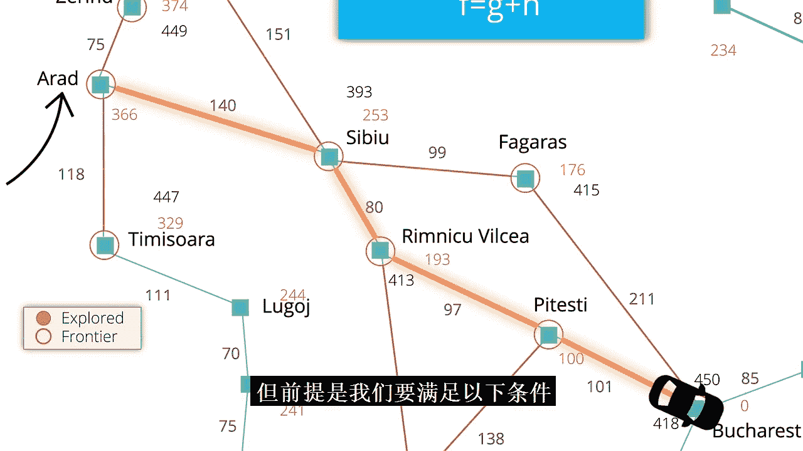

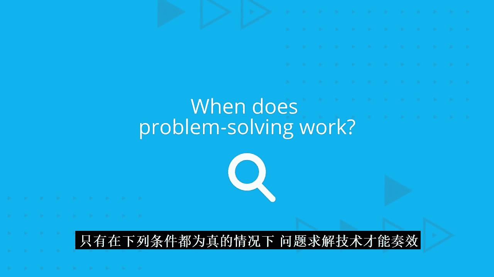

First。The domain must be fully observable， In other words。

 we must be able to see what initial state we start out with。Second， the domain must be known。

 that is we have to know the set of available actions to us。 And third， the domain must be discrete。

 There must be a finite number of actions to choose from。Fourth。The domain must be deterministic。

 we have to know the result of taking an action。And finally， the main must be static。

 There must be nothing else in the world that can change the world except our own actions。

 If all these conditions are true， then we can search for a plan which solves the problem and is guaranteed to work in later units。

 We will see what to do if any of these conditions fail to hold。😊。

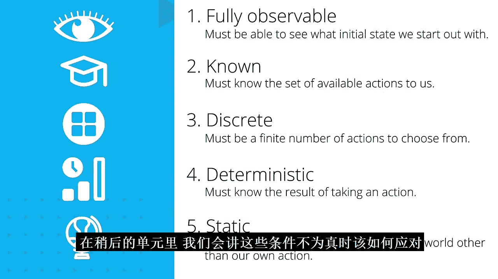

Our description of the algorithm has talked about paths。In the state space。

 I want to say a little bit now about how to implement that in terms of a computer algorithm。

We talk about paths， but we want to implement that in some ways。

 and the implementation we talk about node。A node is a data structure， and it has four fields。

 The state field indicates the state at the end of the path。

 The action was the action it took to get there。The cost is the total cost。

And the parent is a pointer to another node。In this case。The node that has date S。

And it will have a parent， which points to the node。That has state A。

And that will have a parent pointer that's no。So we have a linked list of nodes representing the path。

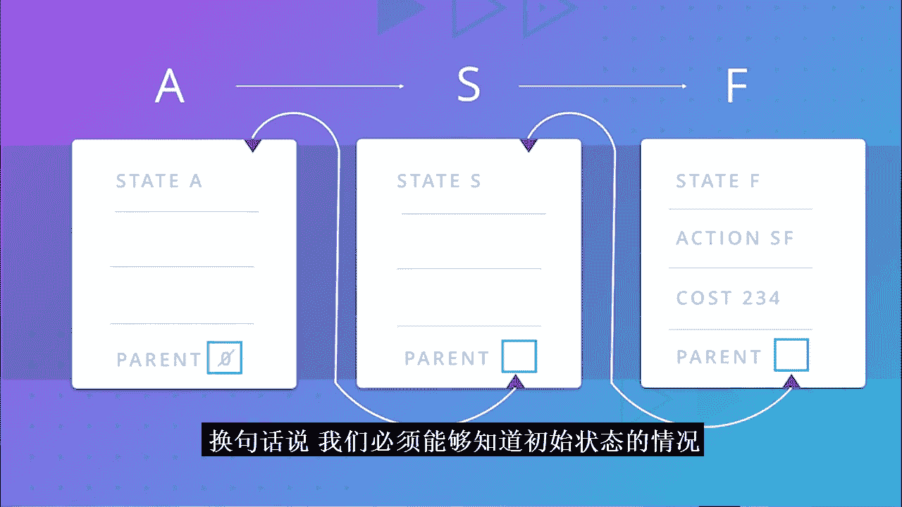

We'll use the word path for the abstract idea and the word node for the representation in the computer memory。

 but otherwise you can think of those two terms as being synonyms because they're in a one to one correspondence。

Now there are two main data structures that deal with node。

We have the frontier and we have the explored list。Let's talk about how to implement them。

In the frontier， the operations we have to deal with are removing the best item from the frontier and adding in new ones。

 and that suggests we should implement it as a priority queue。

 which knows how to keep track of the best items in proper order。

But we also need to have an additional operation of a membership test is a new item in the frontier。

 and that suggests representing it as a set， which can be built from a hash table or a tree。

And so the most efficient implementations of search actually have both representations。

The explored set on the other hand is easier， all we have to do there is be able to add new members and check for membership。

 and so we represent that as a single set which again can be done with either a hash table or a treat。

