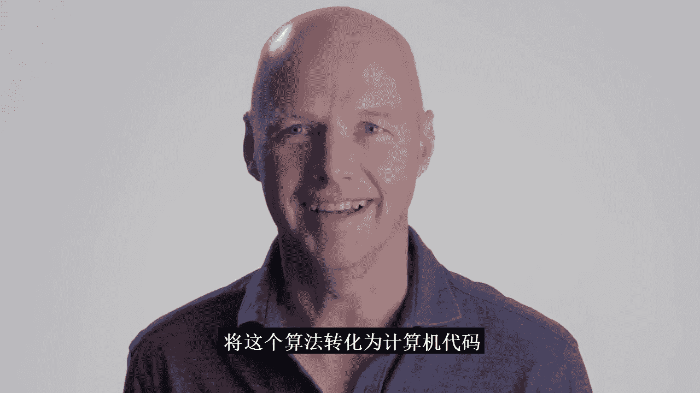
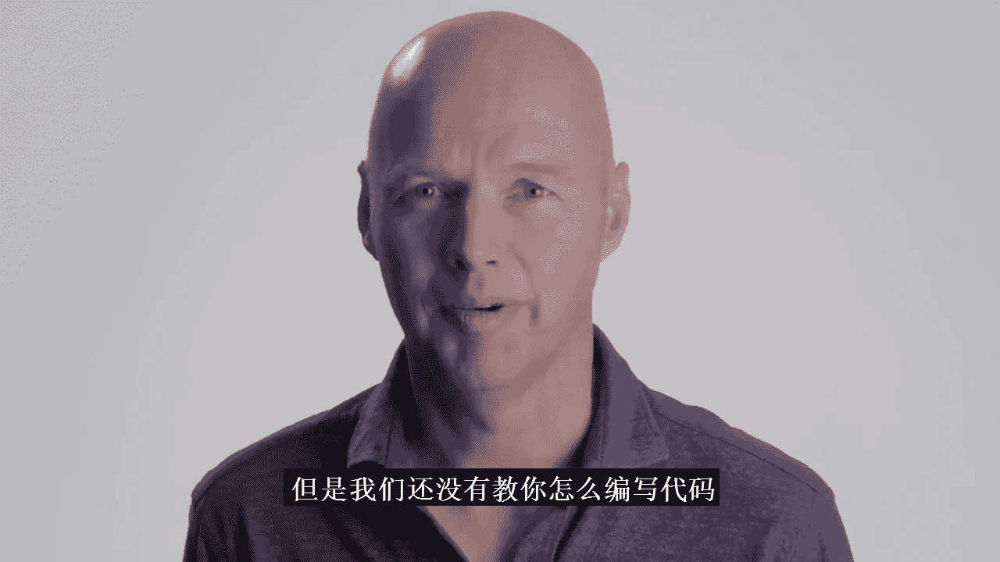
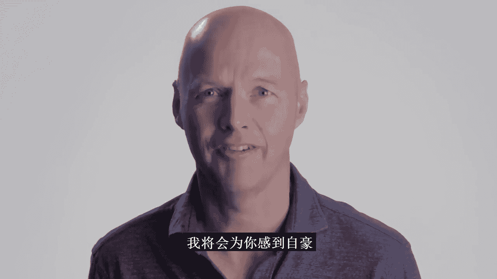

# 优达学城（Udacity）：无人驾驶汽车纳米学位项目-十位大牛亲授自动驾驶技术，硅谷前沿科技（计算机视觉⧸车道识别⧸感知控制⧸人工智能⧸谷歌） p30 30. Part 06-Module 01-Lesson 04_Implement Route Planner1 [BV1Vd4y1r7QG_p30]

So I hope you had fun listening to my good friend and colleague。

 Peter Noric explaining a star an algorithm。Developed at Stanford many decades ago by Peter Hart。

 Nurness and others。 good friends of mine。 turns out， colleagues of mine。

 Now the challenge should you choose to accept it。Is to turn this into computer code。

 so you hopefully you understood the algorithm， but we haven't given you a word about how to code it。

If you manage to code it， I will be officially proud of you。

