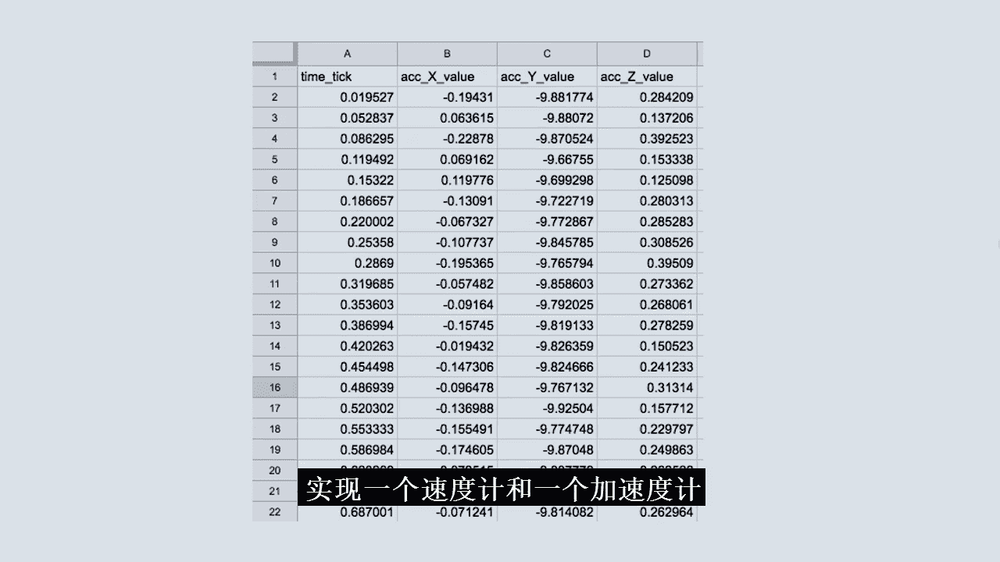

# 优达学城（Udacity）：无人驾驶汽车纳米学位项目-十位大牛亲授自动驾驶技术，硅谷前沿科技（计算机视觉⧸车道识别⧸感知控制⧸人工智能⧸谷歌） p32 32. Part 07-Module 01-Lesson 01_Odometers, Speedometers and Derivatives [BV1Vd4y1r7QG_p32]

Oh。I like to build， I like to write code， I also like to sell， so basically I'm an entrepreneur。

My name is Sha Maximoff， I'm the CEO of Phantommatoto and I built Phantommatoto to provide the tell operationeration service for driver cars。

🎼，🎼The。So I have three things that I love in my life which is you know games communication and cars and really what bothered me was transportation we all have this problem of commute and I thought that cell driving cars really solved the problem and my passion to cars communication and gaming it just sort of like clicked to me。

What happened basically is I was sitting in this simulation of racing cars with your VR headsets。

 right？I kind of you know， realized wait a second， you know。

 what if you can drive a real car from you know a virtual Heset right so like you have a steering wheel and pedals and if you move the steering wheel we move in the car。

What could that be useful for and that's how we the idea of supporting autonomous vehicles and assisting when they needed help？

So this is the remote operator console， it is the way we control the car remotely over cellular signals as you can see I can have three screens showing me what 180 degrees and I have a view of the interior to see the passengers and talk to them so to take control of the car I can turn on drive by wire。

And once the car is on， you can see that any movement I put in to the steering wheel translates。

into movement in the car， and then shy， since he's driving around hands free。

 can take the time to send texts or email or whatever and be a productive member of society instead of sitting in his commute。

You can see that Ben is moving the steering wheel， the remote operator in real time。

 you also have a map with our GPS location so we can navigate。

So I'm building a service and hope to work with all the big companies that build these cars and therefore Uudacity was a great way to just like jump into this industry and learn the basics of how everything works and then write some codes so I actually practice it and see the challenges and then right away you know start my own you know startup around it。

Seell driving cars are really like， for me， it's the next big thing。

Welcome back students。 It's great to see you again today。 We can talk about audititory。😊。

Aometry sounds crazy， is the robot's ability to integrate internal measurements。

 like it's real rotation， other stuff。To figure out how far it's gone。 Okay， and before we do this。

 I want to make a human automated experiment with you。 Okay， so next quiz。Get up in your feet。 Okay。

 close your eyes。Walk forward，5 steps。Turn around 18 degrees and walk forward5 steps again。

Open your eyes。Did you manage to get to the same spot？Well， why you were doing this。

 Your own brain performed autoitory， integrate the motion from your muscles and and with sensors and figure out where you are。

 And just like me， you're not perfect。 You're probably little bit off。 You're not really perfect。

 robots aren't perfect either。 But robots constantly take sensor data from inside and calculate how far they've gone。

😊，Now robots data a little bit different， they use the rotation of their wheels。

 they use inertal measurements， inertial measurements are magnetnometers and gyroscopes and accelerometers。

 and putting this data together into a coherent belief how far we've gone is what this next lesson will be all about。

Welcome to vehicle motion and control。 Imagine your riding as a passenger in a car with your eyes closed and your ears plugged。

😊，What would you be able to know about your motion。

 You could probably tell when the car accelerated quickly or came to a sudden stop。

 or if it made a sharp turn。But what are the limits of this knowledge。

 Could you reconstruct your entire path for a drive， if so， how。This course is a crash course。

 no pun intended in vehicle motion。 and in this course。

 you're going to explore exactly this question。As you do。

 you'll also learn very basics of calculus entry trigonometry， tus of mathth。

 which are used extensively in self driving cars。I love driving， but sometimes I get a little bored。

On my last road trip， I decided I wanted to keep track of some data about my drive。

 So I reset my trip oometer to 0 at the very beginning of my trip and started driving。

At exactly 2 PM， I noticed that my trippodometer had just hit 30 miles。 And later， at exactly 3。

 I looked again and noted that the odometer had just hit 80。

Can you tell me what was my average speed between 2 and 3 o'clock？Hopefully。

 this was a pretty straightforward calculation， but I still want to go over the solution so I can introduce some terms that might be new。

 First， let's just go through the steps。😊，The problem is to calculate the average velocity between 2 and 3 o'clock。

Well， average velocity is just distance traveled， divided by time elapsed。

 or in more mathematical terms， distance travelled is given by Delta X or change in position。

 and time lapse is given by Delta T or change in time。

This triangular character is the uppercase Greek letter delta， and it usually means change。

When you see something like deelta next to an x， you should not think of that as deelta times x。

 Instead， you should just think of it as one variable called Delta x。

And the way you calculate deelta x is like this。Final position， minus initial position。Likewise。

 for change in time。 And in this example， that would be 80-30 divided by 3-2。Or 50 over 1。

 which is just 50 miles an hour。 And this should all make sense if I want to know my average speed between 2 and 3 o'clock。

 I need to know how far I moved in that time。 Delta X。

 and I need to know how much time actually elapsed， Delta T。Now。

 there are a few points Id like to make about this calculation。 First。

 I want to highlight that what we calculated here was the average velocity。

 And this is not what you measure when you look at your speedometer。

 We'll explore this more in a bit。Next， I just want to introduce this term displacement。

 I'll be using this term interchangeably with distance travelled or Delta X。Previously。

 I told you the mileage at 2 o'clock， and then again at 3 o'clock。

 and you could calculate my average speed as 50 mph。 So in that example。

 we could say make two measurements of my position or displacement with a time interval of one hour between them。

😊，Now， something we'll explore the rest of this lesson。

 and the next is what happens when we make that time interval smaller and smaller and smaller。

So let's think， what happens when we make position measurements more and more frequently？

Data often tells a story， and often a good plot can really help reveal what that story is。

Now I'd like to show you how I think about these position verse time graphs to figure out the story the data tells。

Here we have our two axes。In this case， time is the horizontal X axis。

 and position is the vertical y axis。 And to begin。

 let's start with the simplest version of our story by adding two data points。

 One for a starting position of 30 miles at 2 o'clock。

And one for our ending position of 80 miles at 3。 Now， whenever I see data like this。

 it's often helpful to imagine or even actually plot a line that connects the points。

And this line represents where the car would have been at every moment between 2 and 3 o'clock。

 if it were travelling at a single constant speed the whole time。

 a line like this can be pretty helpful in making sense of these plots， because once I have the line。

 it's easier to see the change in position or deelta X。

 which is just the vertical separation between the two points。And change in time or deelta t。

 which is just the horizontal separation of these points。And as you saw earlier。

 you can also calculate average speed by dividing Delta x by Dlta T。

Now I want to point something out that has some pretty profound implications for calculus。

The calculation of V average is the same calculation you would make to find the slope of this line。

If you remember back to algebra， slope is calculated as the vertical change in a graph divided by the horizontal change。

Or as I learned it， slope equals rise over run， which in this case is Delta x divided by Delta t。

So you can see that the slope of this line gives us the average speed between these two points。

 and when the slope is steeper， it means the average speed is faster。Now。

 we have to be careful to remember that this line is really just something we drew。

 It does not necessarily reflect where the car really was during the whole trip。

If we want to know a more complete story， we're going to need more data。

 So let's say we had sampled at 20 minute intervals and found that at 220， the odometer read 40。

 and at 2，40， it read 70。Well， once again， I'm going to draw some lines to connect these dots。

And now， remembering that the slope of the line between any two points gives the average speed between those points。

 I immediately can see that here in the first 20 minutes， the car was， on average。

 going much slower than it was in the next 20 minutes since the slope isn't nearly as steep。😊。

Then in the last 20 minutes， the car， on average， was moving slowly again。

And this really helps make the story clearer。 And if I want an even better understanding。

 I would need even more data sampled with an even shorter time interval。Like every 10 minutes。

Or five minutes。And with this much data， we don't even really need the connecting lines as a visual cue。

And now I can see that the average speed appears to have been greatest between 230 and 235。

And I know that because I can see that the slope is steepest here。

Which just means that Delta x over Delta t is greatest here。

And now I'd like to give you a chance to interpret some graphs on your own。

Now we're going to take another step towards calculus so far。

 you've seen how you can look at one journey at different resolutions or time intervals In the early example。

 we first use a one hour time interval and then 20 minutes and then so on。

And every time we decrease the time interval， we get closer to the full story。

And you've also seen how you can use these measurements of position and time to calculate average speed。

But if you think about it， this is a pretty weird way to figure out your speed in a car。

 If you want how fast you're going， you can always just look at this speedometer because a speedometer measures speed directly and the speed that this speedometer shows is your instantaneous speed。

 It's how fast you're going at the instant that you look at the dashboard。And speed are very useful。

 but for the purposes of this lesson and learning something about calculus。

 the question I want need to think about and explore in the next notebook is this。

We know that it's possible to measure instantaneous speed with this phenomenameter。

 but is it possible to calculate instantaneous speed using the position and time measurements we've been discussing？

If it is， then how？And if not， what can we do to approximate instantaneous speed as closely as possible？

So far， we've been talking a lot about velocity and position。

 and the reason for that is because these two quantities are related to each other in three important ways。

First， velocity is the instantaneous rate of change of position。

Now we tried to approximate the instantaneous rate of change in the previous examples。

 when we made Delta t smaller and smaller and smaller。

And we saw that as Delta T got closer and closer to 0。

 our estimate of the true instantaneous speed got better and better。

Another important relationship between velocity and position is this。

Velocity is the slope of the tangent line of position。

 and what this means is that if we have a single continuous graph of position verse time。Like this。

And we want to know the velocity at some point， like let's say here。

Then what we do is we first draw what's called a tangent line。

 which is a line that just grazes the graph at this point。So in this case。

 the following would not be a tangent line。 even though it passes through the orange point。

 it doesn't graze the graph。 It slices right through it。

The tangent line to the point would look more like this。

 since this line just grazees the graph at the orange point。And this makes statement number two。

 a pretty amazing fact。 When you have a graph of position versus time and you want to know the instantaneous velocity at any moment。

 you can just find the tangent line to the graph at that moment and calculate its slope。😊，Now。

 the third relationship， which is really just another way of saying these verse two， is this。

Velocity is the derivative of position。And in calculus。

 the derivative is defined as the instantaneous rate of change。It tells you how one variable。

 like position， changes with respect to another， like time。

 and derivatives tend to show up in situations where we care about how various quantities change together。

 So， for example， how much will my wheels turn， when I turn my steering wheel 1 degree or how much will my acceleration increase or how will my localization uncertainty change when I increase my sensor update frequency by 10 per cent。

In order to answer any of these questions mathematically， you'll need to use derivatives。

 And if these questions or these three statements don't quite make sense yet， don't worry。

 we're going to keep exploring derivatives for the rest of this lesson。In this typical problem。

 the vehicle's position is given to you in terms of this nice algebrage brakeic expression and the corresponding graph。

And when you know the algebraic description of a function like position。

 then there are all sorts of clever things you can do to calculate the derivative exactly。

 And by exact， I mean， you can actually find another algebraic equation that gives you the derivative at any point。

😊，So for this function， the derivative winds up being negative 2 t plus 10。

And that looks like this as a graph。And it's actually pretty amazing that it's possible to get an algebraic description of something like velocity from an algebraic description of position。

 But the problem is that in reality， when you're dealing with a real car navigating in the real world。

 You are never given this kind of description of motion。 Nobody ever tells the self driving car。 Hey。

 your position for the next 10 seconds will be described by the following equation in reality。

 what you're going to get is data。😊，And that data will come from your accelerometers， your odometers。

 your cameras and lidars and radars， and it won't necessarily be pretty。In the rest of the lesson。

 you'll do exactly this。 You're going to work with odoometry data to implement a speedometer and then an accelerometer。

Congratulations in this lesson， you got a brief introduction to the derivative and you saw how the derivative of a function is both the instantaneous rate of change of that function and the slope of the tangent line to a graph。

In the next lesson， we're going to keep exploring the motion of self driving cars。 See you soon。

