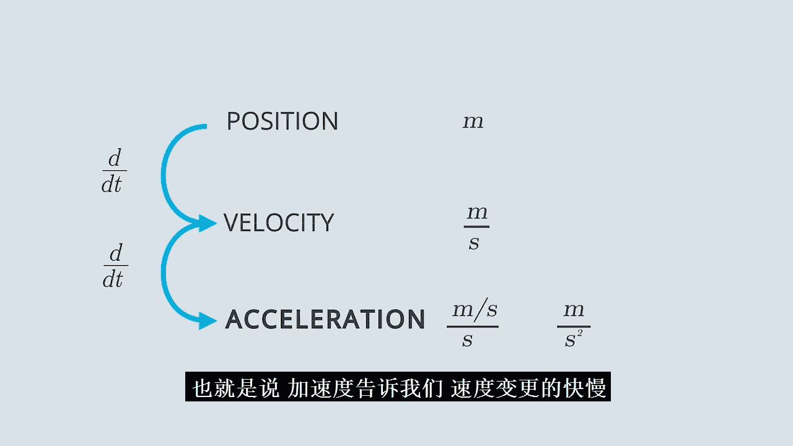
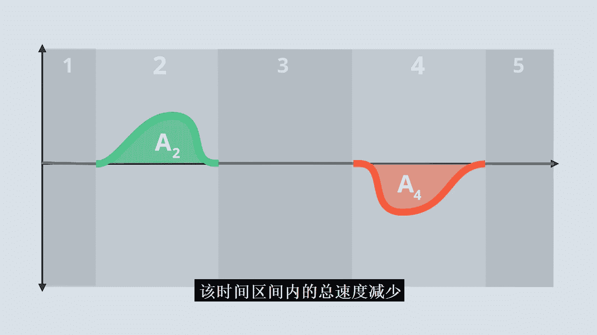
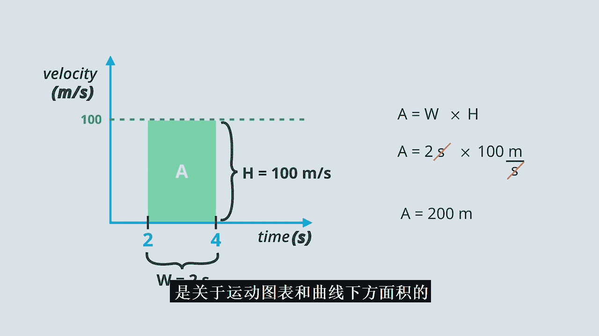
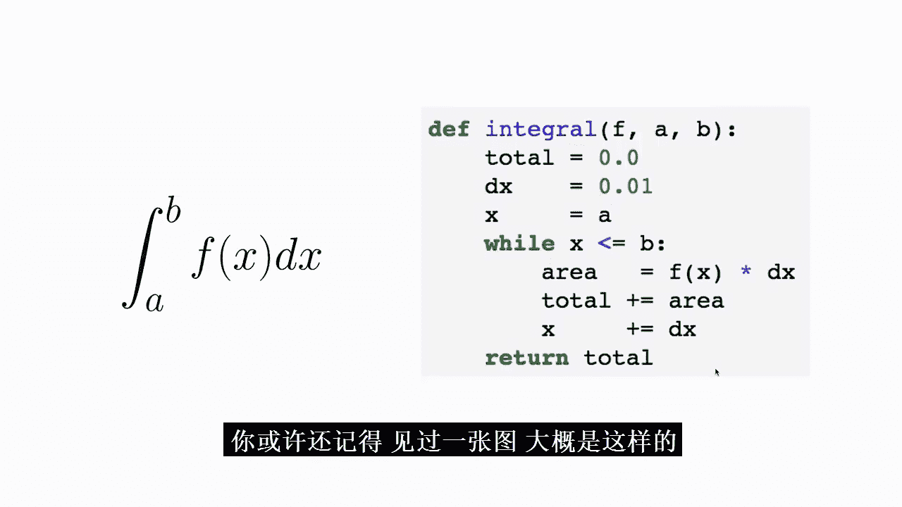
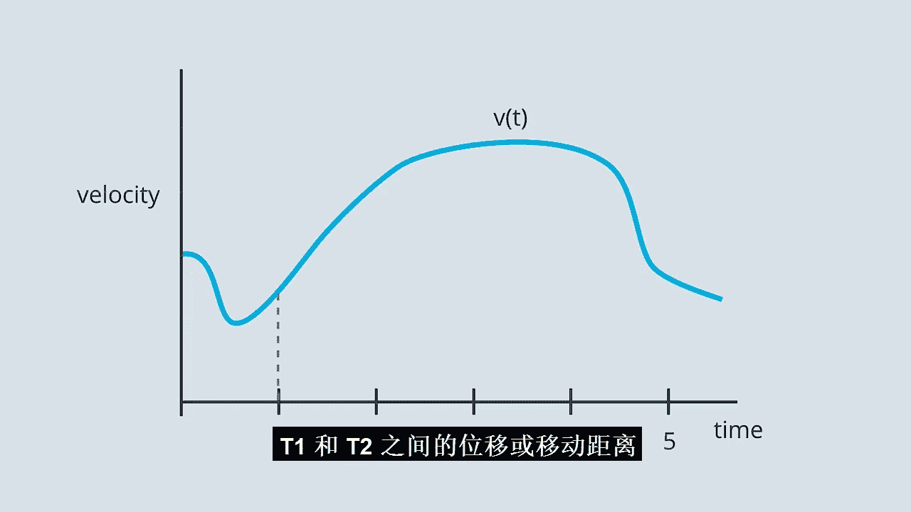
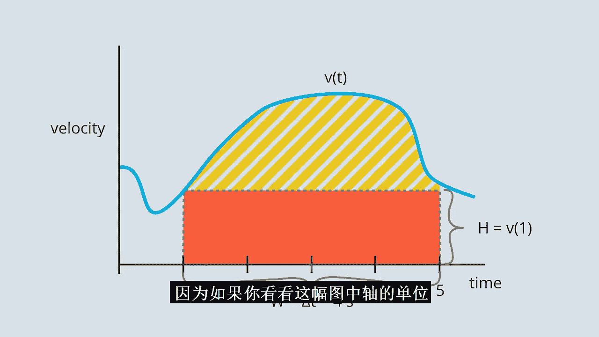
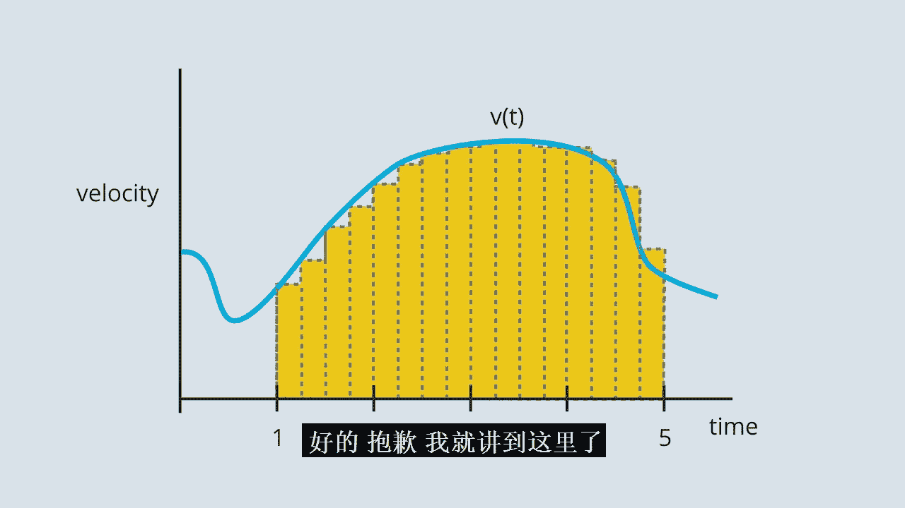

# 优达学城（Udacity）：无人驾驶汽车纳米学位项目-十位大牛亲授自动驾驶技术，硅谷前沿科技（计算机视觉⧸车道识别⧸感知控制⧸人工智能⧸谷歌） p33 33. Part 07-Module 01-Lesson 02_Accelerometers, Rate Gyros and Integrals [BV1Vd4y1r7QG_p33]

Welcome back In the last lesson， you worked primarily with odoometry data。

 which is just data about distance traveled， and specifically you saw you can calculate the rate of change of a vehicle's position with respect to time to figure out a vehicle's velocity。

At the very end of the lesson， you saw how you can do the exact same thing with velocity data to get acceleration。

And calculating these rates of change is known as differentiation or taking the derivative。

So the derivative position is velocity and the derivative velocity is acceleration。

 and this idea is really helpful。 Understanding the derivative means that whenever you have access to position data。

 you can also calculate the velocity and acceleration data。

But what if we start with acceleration data and we want to say something about velocity or position？

In this lesson， you're going to learn exactly how to do that by calculating something called the integral of acceleration data。

Position。Vellocity and acceleration are all related。

And you've seen the velocity is the derivative of position。

 and acceleration is the derivative of velocity。Before we jump into calculus。

 it's important to get a feel for what acceleration really means。

 and one way to do that is to look at the units associated with each of these quantities。Position。

 for example， might be measured in miles or kilometers。But most commonly， we're going to use meters。

 which we abbreviate。With a little M。And velocity is typically measured in units like。Km per hour。

Or miles per hour。Or again， more commonly。Meters per second。

But notice that each of these units has a unit of distance in the numerator and a unit of time in the denominator。

And that's because velocity is the derivative of distance traveled。

 It's the rate of change of distance， with respect to time。

So what are the units associated with acceleration？Well。

 I already said it's the rate of change of velocity with respect to time。

 So that means that the numerator should have units of velocity。

And the denominator should have units of time。 And， in fact。

 these are the units we'll be using for acceleration。 And when you see them written this way。

 you can read them as meters per second。Per second。Though often you'll see them written。This way。

In which case it's pronounced meters per second squared。And personally。

 I really prefer the first way of writing these units。

 since it serves as a good reminder for what acceleration actually is。

 it's the rate of change of velocity with respect to time。

So that means acceleration just tells you how fast your velocity is changing。

You just made a plot of acceleration versus time， for an elevator as it goes upwards from the ground floor and then stops two floors above。

And that data looks something like this。Now， I want to call your attention to five regions of this data。

 The first section is from when I started collecting data until when the elevator just started moving upwards。

The next section is that period of time when the acceleration is positive。

 This is where the elevator gets up to speed。 But it's also when you might feel a little lurch in your stomach。

Then。The acceleration is pretty much 0 for a while。

 This is when the elevator was just moving upwards at a more or less constant speed。Next。

 in this segment， the acceleration becomes negative for a few seconds。

 and this is the elevator actually slowing down。Finally。

 this last region is just everything I collected after the elevator had stopped。

 but before I stopped the accelerometer。And these two bumps。1 in region 2 and the other in region 4。

 They look very， very similar。 The only obvious difference is that one is positive。

 and one is negative。Besides that， they look basically like mirror images。 And， in fact。

 if you were to calculate the area under this curve and compare it to the area under this curve。

 you would find that they were exactly the same， except for the fact that a 4 is negative in a sense。

 And that's just because it extends down below the horizontal line corresponding to0 acceleration。😊。

This is not a coincidence。In the next few segments。

 I want to convince you that the area under the green curve corresponds to the total speed increase that happened in that time interval and the area under the red curve corresponds to the total speed decrease that happened in that time interval。

For now， I want you to think about this elevator's motion a bit more。

When you calculate the area under a curve， what you' are actually doing is taking an integral。

 And the mathematical symbol for the integral is this stretched out S looking shape。

 And often it'll have what are called bounds of integration at the bottom and the top。

So in this case， T1 is the lower bound， and T2 is the upper bound。

And the integral is the opposite of the derivative。

So since velocity is the derivative of displacement。

This means that displacement is the integral of velocity。Let's go back to the graph。Now。

 remember that the area under this graph gives us the total displacement。 Now。

 I want to show you how to express this fact in integral notation。

The integral that expresses this exact same statement looks like this。

And the way I would read this is by saying deelta x equals the integral from 2 to 4 of 100 Dt。

And that's a lot。 So let me try to explain what this means。 It won't all be perfectly clear just yet。

 but that's okay for now。Total displacement。Well， that we just represent with deelta x。

 and that should be pretty familiar。Let's take a look on the right hand side。Well。

 on the right hand side， we have this integral sign with the bound of integration。

 the 100 and a Dt to the right of it。Let's talk about this DT for a second。

There's always going to be a D something in an integral。 And whatever that something is。

 And in this case， it's T， it's just meant to tell you what these bounds of integration actually mean。

So the fact that the something here is a T， Well it means that this lower bound of integration is t equals 2 and not x equals 2 or v equals 2 or anything else。

Now， all that's left is this 100。And the reason this just happens to be a simple 100 is because the velocity function was so simple。

If， on the other hand， the velocity function were more complicated， like， let's say。

50 plus 20 times t。 Then instead of 100， we'd have 50 plus 20 times t。And in general。

 this V of T can really be anything。So we can write this generic version of the integral。

 and this would work for any weird velocity function。Now， if this all feels pretty overwhelming。

 that's normal for now， I just wanted to introduce you to a notation that you're going to be seeing throughout your self driving car career。

And fortunately， computers make using this notation pretty straightforward。

We're going to come back to the elevator example in a little bit。First。

 I want to remind you of something you saw a few courses back。Earlier in this nanoree。

 when you were learning about matrices and motion models。

 you may remember seeing a graph that looks something like this。 and this was a graph of velocity。

In meters per second versus time。In seconds。And back then。

 Czanne told you that if you want to calculate the displacement or distance moved between T1 and T2。

 you could do so by finding the area under this curve。And in this case， if T1 were 2 and T2 were 4。

Well， that would mean that the width of this rectangle is just 4-2， which is 2。

And the height of the rectangle， well， that's just 100 meters per second。

I can use this equation area equals width times height to calculate that area。And in this case。

 that would be 2 seconds， times 100 m per second。 And with it written out this way。

 you can see something interesting。 The seconds actually cancel。And all I'm left with。

Is this an area of 200 m。 And now you can see why I've been so focused on the units associated with motion。

 because if you look at the units for the axes on this graph。

 you can see that the vertical axis has units of meters per second。

 and the horizontal axis has units of seconds。 And when you multiply these units together。

 you're just left with meters。😊，Whenever you calculate an integral。

 you'll be doing some sort of multiplication just like this。

 and you'll be looking at the units on the axis of your graph to get a hint for what the integral or area under the curve actually represents。

Now I'd like you to think about a few questions involving graphs of motion and areas under the curve。

In the next notebook， you're going to learn a technique that will let you integrate any function of a single variable and all it's going to take is a loop。

Before you jump into this code， let me briefly explain the theory behind what you're going to be doing。

So let's say you want to integrate velocity with respect to time。

 but your velocity is given by some pretty complicated function。

 as is often the case in the real world。And let's say you want to use this velocity data to calculate your displacement from t equals 1 to t equals 5。

How do you calculate the area。When the shape isn't a rectangle。The trick is this。 You just don't。

Instead， you approximate。So let's start by making a really bad approximation where we just pretend the speed at the beginning is the speed throughout the entire four second time interval。

 Well， then our area。It's just the height times the width。And in this case， the height。

Would be the value of the velocity function evaluated at T equals 1。And the width。Well。

 that's just the time interval Delta T， which in this case is 4 seconds。 But clearly。

 this is a really bad approximation。 It fails to account for all of this area above the line。

 but no problem。 Let's improve our approximation。 One way to do that is by breaking the single interval with a deelta T of 4 seconds into four time intervals with Delta T of one second。

 And then for this first time interval from t equals 1 to 2。 We just draw a rectangle。😊。

And again， we use the velocity at t equals one as the velocity for the whole interval。

 And then we just repeat this procedure for 2 to 3。3 to 4。N for T equals 4 to 5。

And this will give a better approximation of the actual area under the curve。

 But you probably notice it isn't perfect。 In addition to underestimating in the first two segments。

 it actually overestimates in this last segment。So while this is an improvement。

 it's still just not good enough。Howd we solve the problem， Well。

 we'd chop our graph up into smaller rectangles。 For example。

 we could use a time interval of half a second。 And this is definitely getting better。

But we could go even smaller。And as we reduce the width of these time intervals closer and closer to0。

 we're going to get closer and closer to the true area under the curve。Okay， sorry。

 that's enough talking from me。 I get very excited about integrals。

 Why don't you go ahead and do this yourself。

So far， you've seen how you can integrate accelerationcc data from an accelerometer to get change in velocity。

 and you've seen how you can integrate velocity to get change in position or displacement。

And displacement and velocity are important quantities to a self driving car。

 so it's really fortunate that we can calculate them from accelerometer data。But what about heading。

 a self driving car needs to know which way it's pointing。

 and one way it can do that is by keeping track of how much it turns。And luckily。

 the inertial measurement units on all self-driving cars contain what's called rate gyros。

 and these gyros measure something called angular velocity in the rest of this section and the following notebook。

 you'll see how you can use angular velocity data from these rate gyros to keep track of a car's heading。

At this point， you've calculated integrals of velocity data。

 acceleration data and angular velocity data。 And hopefully。

 you're building a good intuitive sense for what it means to take an integral。 Now。

 I have a confession to make。 Some of the real data I've been showing you has actually not been real。

 in fact。😊，Occasionally， I may have generated fake data so that the plots you made were clean and well behaved。

 and the integrals all made sense。But in reality， sensors are never perfect， they're noisy。

 and they're often biased， and it turns out that when you integrate imperfect data。

 your errors tend to amplify。I don't want you to leave this name degree thinking that all you need to localize a robot is an accelerometer and a rightarrowro。

 because while these tools do help， they have their flaws as well。In the following segments。

 you're going to integrate real data and explore some of the problems that arise when you do。

Congratulations on completing the lesson in the previous lesson。

 you saw how the derivative of something like displacement gives velocity。

 and in this lesson you saw how the integral lets you go the other way and calculate displacement from velocity or even velocity from acceleration。

And I hope at this point， you have a conceptual understanding of what integral is and why it can be useful for understanding the motion of a self driving car。

But I also want to say that if you have never taken a calculus class before or even if you have。

 you might be feeling a little overwhelmed right now， and that's totally normal。

 Calalculus is really hard， and traditional calculus classes spend months covering integrals。

As you keep working with and talking about motion and rates of change and accumulation of change。

 you become more and more comfortable with concepts like derivatives and integrals。For now。

 I recommend you accept any intellectual discomfort that you might be feeling and prepare yourself for the next challenge。

 because in the next lesson， you're going to be taking a crash course in another amazing branch of mathematics called Trigonometry。

