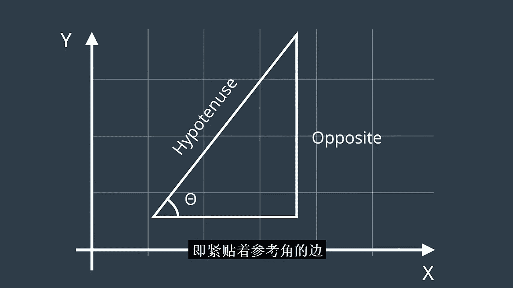
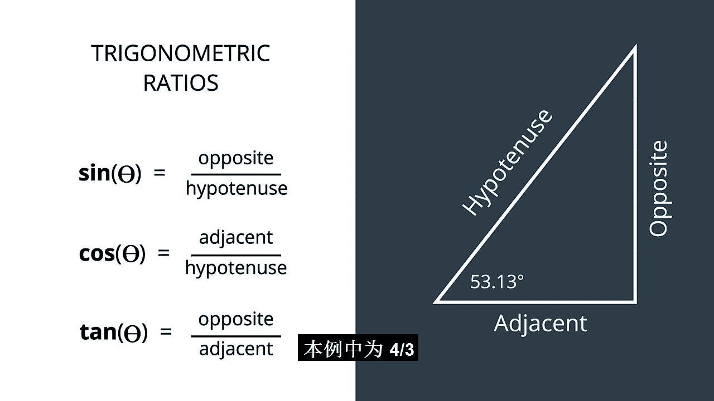
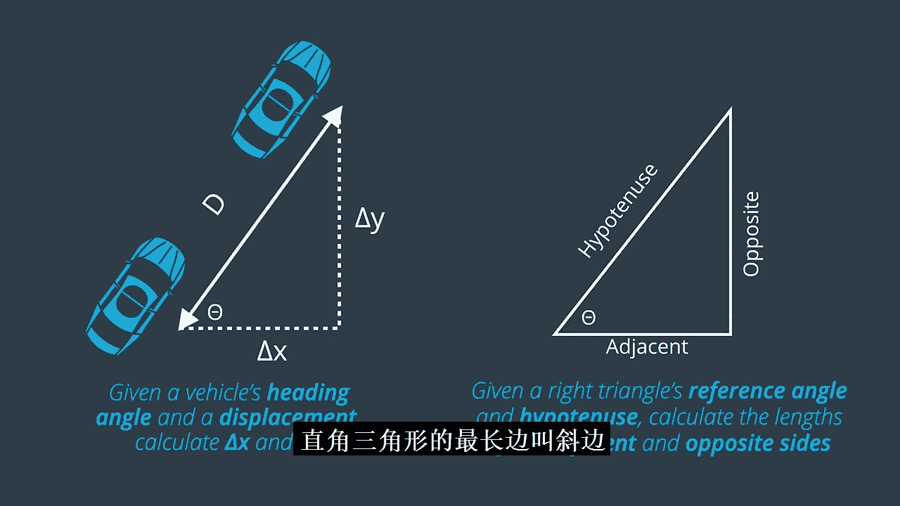
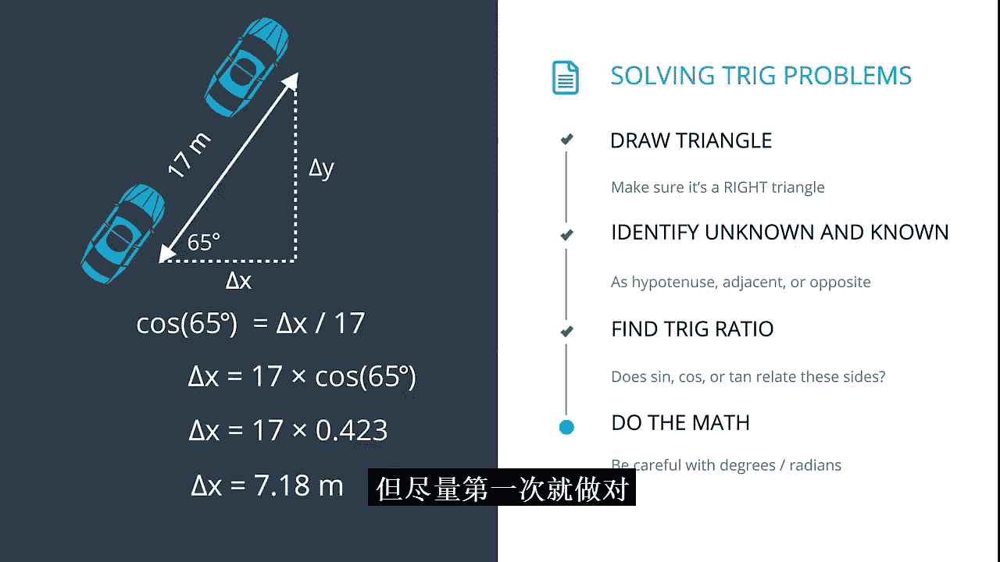

# 优达学城（Udacity）：无人驾驶汽车纳米学位项目-十位大牛亲授自动驾驶技术，硅谷前沿科技（计算机视觉⧸车道识别⧸感知控制⧸人工智能⧸谷歌） p34 34. Part 07-Module 01-Lesson 03_Two Dimensional Robot Motion and Trigonometry [BV1Vd4y1r7QG_p34]

Welcome back， you're getting close to the final project for this course。

 and in this project you'll be using data from accelerometers。

 rate gyros and odometers to reconstruct the actual XY trajectory of a self drivingriving car。

And you already know how to take something like acceleroeroator data and convert it to distance travel data。

 and you also know how to use rate Iro data to a heading。

But once you have a car pointing in a certain direction， and you know how far it moves。

How do you figure out exactly how far it's moved in the X direction or in the Y direction？

That is what you are going to learn in this lesson。

How to go from a heading and a distance traveled to a change in X and Y， and to do this。

 we're going to need to learn the very basics of trigonometry。In the previous notebook。

 we only allowed orientations that pointed east， north， west or south。

And because we constrained the robot's posed this way。

 it was easy to figure out what happened when the vehicle moved forward by D Mters。 for example。

 So in this case， if we have a car that starts here pointing east。

And then moves to distance D to get here。Well， I can see that the x coordinate just increases by D。

And the Y coordinate， well， that doesn't change at all。Likewise。

 if the car is pointing north and then moves forward by D meters。

 then the y coordinate will increase by D， and the X coordinate will be left unchanged。

But now the question is， what if the heading isn't along the x or y axis？

What if the car is pointing at some weird angle like this？

Now what happens when the car moves forward by， let's say， D meters。

What can you say about the value for deelta x？And F Delta Y。In a situation like this。

When a car is pointed like this and it moves forward by D meters。

 its x and y coordinates both increase by an amount that's greater than 0 but less than d。Now。

 if we're going to make scatter plots of position data。

 we need to know exactly what the values of Delta x and Delta y are。

And this will require some trigonometry， which is the mathematics of right triangles。

 So it's not surprising that our first step is to find a right triangle。

 and the right triangle I want to identify is right here。

And I know it's a right triangle because two of the sides meet at a right angle。

 And what's amazing about trigonometry is this。 If you give me an actual numeric value for D and this angle。

 which I'm going to call theta， I can tell you exactly what Delta X and Delta Y will be。

 But before we solve this for any angle and any displacement。

 we're going to start with some very specific values。😊，So as a first example。

 I'm going to make things a little easier by picking a very particular angle for this car's heading。

I'm going to pick theta to be 53。13 degrees。 And D is going to be 5 m。

 And the reason I pick these numbers is because it turns out that when a car with a heading of 53。

13 degrees dries forward by 5 m。 Well， if you measure Delta X and Delta Y。

 you'll find they are exactly equal to 3 m and 4 m。And in fact。

 if you ever have a right triangle where one of the angles is 53。13 degrees。

 the sides will have lengths in these ratios，3，4， and 5。

What this means is that if I ever find that my car has a heading of 53。13 degrees。

 and I know how far it moves forward， I'll be able to figure out Delta X and Delta Y。

If a motion of 5 corresponds to Delta x of 3 and Dlta y of 4， then a motion of 10。

 which is just5 times 2。Corresponds to a Delta x and Delta Y of 6 and 8。 And in fact。

 whenever a vehicle is driving with this particular heading。

Delta y over d will always be equal to 4 over5。If you drive some distance D add a heading of 53。

13 degrees， then your delta x will be that distance D multiplied by 4 over 5。

 and Delta y will be that distance D multiplied by 3 over 5。And these multipliers are really useful。

 They let us go from distance traveled to Delta X and Delta Y。But that's just one angle。

 what if you're driving with a heading of 27。2 degrees or negative 112。5？

How can we calculate Delta x and Delta Y in those situations？

We'd like to use multipliers just like we did with a 34，5 triangle。

 and that is where trigonometry comes in。Trig gives us a way to easily calculate these multipliers for any angle。

AndWe're going to come back to cars in a minute， but for now。

 we're going to dig deeper into triangles themselves。

 and the first thing we're going to need is a naming convention for talking about the sides of a right triangle。

In our previous example， we only really cared about one of the three angles in the triangle。

 and when we're solving tri problems， we generally only care about one angle at a time。

 We're going to call this angle the reference angle。And in the previous example。

 the reference angle was 53。13 degrees。But now I want to consider some generic reference angle。

 which I'll just call theta。When we have a right triangle and some reference angle。

 we'd like a way to refer unambiguously to the three sides。

And the naming convention we use intrigue goes like this。

The longest side of the right triangle is always called the Hy potuse。The side on the right。

 the one that's opposite the reference angle。 Well， that's just called the opposite。

And this last remaining side。The one that's next to the reference angle， well。

 we call that the adjacent side。

Now that we can talk about the sides of a right triangle。

 using words like opposite adjacent in hypotenuse， I want to talk about the ratios of those sides。

The trigonometric ratios we're going to discuss are called sine， cosine and tangent。

 and the sine of an angle。 Well， that's the ratio of the opposite to the hypotenuse。

 and its abbreviated S I N。The cosine of an angle is the ratio of the adjacent to the hypotenuse and its abbreviated COOS。

Finally， the tangent of an angle is the ratio of the opposite to the adjacent。

And to make this all a little more clear， let's just go back to our 53。13 degree triangle。

And in this triangle， the sides have length with the ratios 3，4， and 5。

 So if I want to calculate the s of 53。13 degrees， I need to find the opposite。

And divide that by the hypotenuse。So in this case， that would be 4 over 5。

 which means the sign of 53。13 degrees is 4 over 5。Can you tell me the cosine and tangent of 53。

13 degrees？Well， the cosine of 53。13 degrees is the adjacent divided by the hypotenuse。

 So in this case， that would be 3 over 5 or 0。6。 and tangent is just opposite over adjacent。

 which in this case would be 4 over 3。

Remember our initial problem， given a vehicle's heading angle and a displacement。

 calculate Delta X and Dlta Y。Well， you can now solve that problem。But now。

 instead of thinking about a vehicle and a displacement。We can just think about a right triangle。

 and this lets us change our problem statement to this。

Given a right triangle's reference angle and hypotenuse。

 calculate the lengths of the adjacent and opposite sides。

And now that we can phrase our driving problem as a triangle problem。

We can solve it with trigonometry。So let me demonstrate how to solve a problem like this。

 Here we have a vehicle with a heading of 65 degrees and a displacement of 17 m。

I'm going to show you how I would find Delta x systematically。 and the first thing I'm going to do。

Insr the triangle。Here we have a right triangle with a reference angle of 65 degrees。Next。

I'm going to identify the known and unknown sides of the triangle。So in this case。

 the known side is the hypotenuse with a length of 17 m， and the unknown side is this deelta x。

 and that's the adjacent side。Now， I want to find the trigonometric ratio that relates the known and unknown sides。

 so in this case， I'm looking for the ratio that relates the hypotenuse to the adjacent。

That happens to be the cosine， because cosine is adjacent over highuse。

 which in this case is Delta x over 17。Now， all that's left to do is do out the math。

So the first thing I'm going to do now that I've cleaned things up on the left over here is rearranged this equation to get deelta X alone。

Then I can use Python or a calculator to look up the cosine of 65 degrees and remember you really have to be careful with degrees and radance here。

But once I get the answer。I see the cosine of 65 degrees is 0。423。

 and now I just do the multiplication。To find that deelta x is 7。18 meters。Now。

 I want you to try to find the length of the opposite side， Delta Y。Go slow。

 be careful with your math and feel free to rewatch this video if you find that helpful。

 But try your best to get it right on your first attempt。😊。

Congratulations in this lesson， you've seen how you can use trigonometry to deconstruct motion into X and Y components。

 you'll use this ability， along with your knowledge of derivatives and integrals in the final project for this course。

In this project， you will be reconstructing the Xy trajectory of a vehicle using the raw data from its motion sensors。

And note that this project is more open ended than most of the previous projects。

 and it will not be submitted for review。Technically。

 this means you don't need to complete the project to pass the no degree。

 but I hope you do if you get stuck or just want to discuss the project。

 you should feel free to use the noun degree s channel to chat and share your code Good luck。

