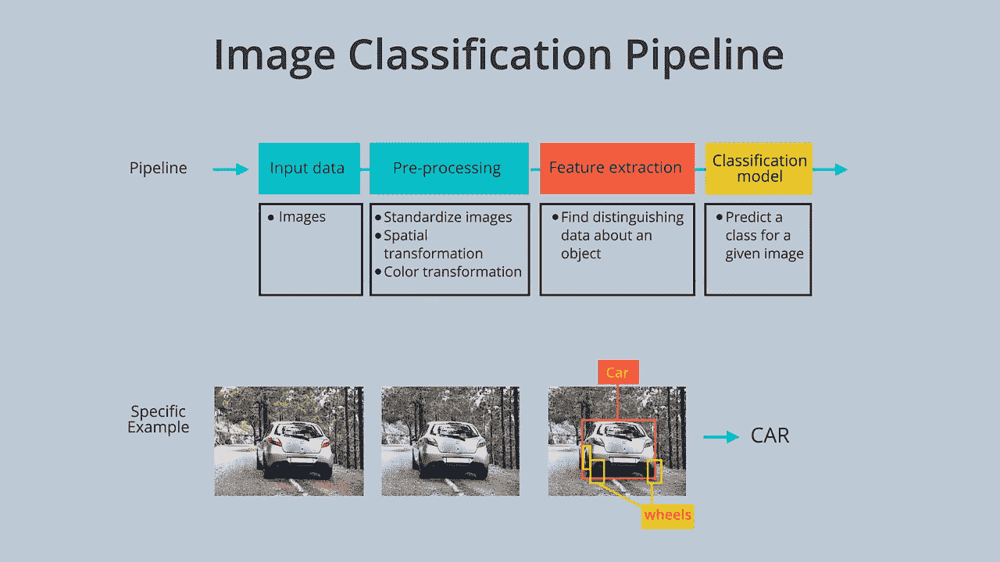
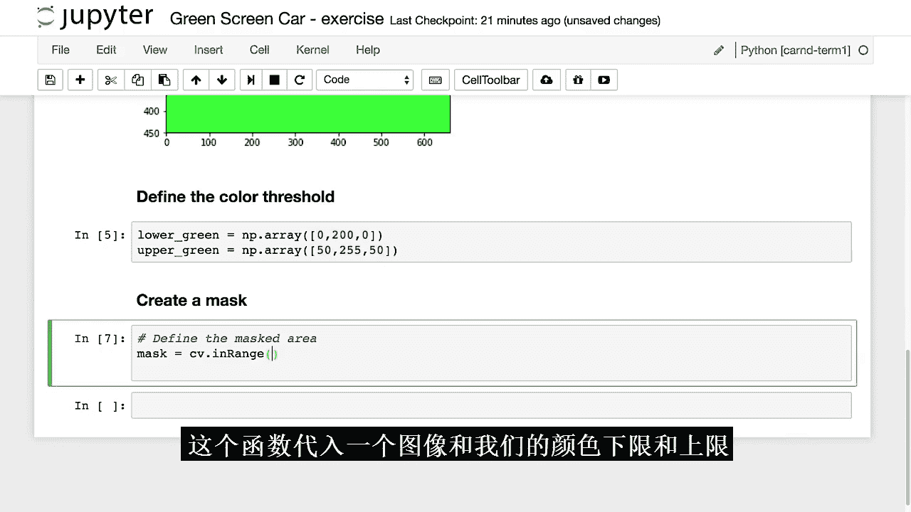
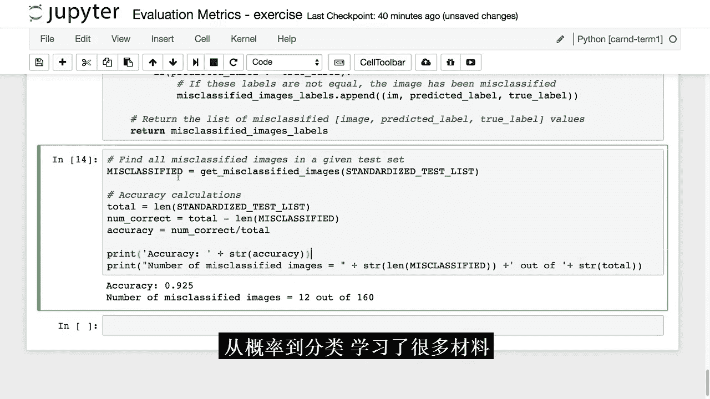

# 优达学城（Udacity）：无人驾驶汽车纳米学位项目-十位大牛亲授自动驾驶技术，硅谷前沿科技（计算机视觉⧸车道识别⧸感知控制⧸人工智能⧸谷歌） p35 35. Part 08-Module 01-Lesson 01_Computer Vision and Classification [BV1Vd4y1r7QG_p35]

I'm Danny Shapiro， I'm the Se director of Automotive A NVIDdia。

 NVIDdia is a technology company that's developed a lot of different computing platforms specifically we've developed an AI supercomputer for self-driving vehicles。

 whether they're cars， shuttles， trucks or any kinds of other vehicles that well soon see on our roads and maybe even in the skies above us。

So NVIDdiaA is not making cars， but NVIDdia has its own fleet of self driving test vehicles。

And we've dubbed at BB8 as a robotic and advanced robotic vehicle。

 and we're testing those here on the streets in California， out of New Jersey， in Germany as well。🎼。

Well we've been working with the auto industry for almost two decades now， in fact every car， truck。

 plane or other mode of transportation， and even consumer goods are designed on NVIDdia， graphics。

 hardware and software systems。About a decade ago we started bringing our technology into the car。

 we started working on infotainment systems and digital cockpits and head up displays。

More recently though our technology because of the role we're playing in artificial intelligence is being used for self-driving vehicles。

 so instead of us generating information out in the form of pixels on displays。

 we're also now processing information coming in， so radar， LiDar。

 camera information all comes in to the NVIDA system and we're using artificial intelligence now to make sense of it。

Now we have a specific product just for vehicles and it's called Drive PX。

It's an AI supercomputer that has the power of over 150 MacBook Pros all in a very small form factor about the size of a license plate。

 essentially all the inputs come into the drivePX from cameras from sensors like radar and Liar and ultrasonic all generating data so our process there has to take all this information and make sense of it。

 basically identify what's another vehicle， what's a pedestrian， what's a crosswalkk。

 what's a sign and all this happens within a fraction of a second we have cameras generating 30 frames every second we have to analyze those frames and understand a full 360 environment around the vehicle。

🎼The GPU or graphics processing unit was invented by NviDA in 1999 this is a massively parallel processor and it's different from a CPU or central processing unit that you find in your PC you've probably heard a CPU described as a dual core or quad core and so essentially that means it's two lanes or maybe four lanes of information that will flow through that CPU at once The GPU on the other hand has now over 5000 cores so imagine if this was a highway instead of a two lane highway or four lane highway we now have 5000 lanes so a lot of traffic。

 a lot of information can go through that processor simultaneously。

And then we're able to bring all that computational horsepower down into the car in the drivePX to be able to process all the sensor data in real time。

DrivePX2 is one of several products from NVIDdia that are all using deep learning。

 so we have the system for the car but other people who are developing can develop on a PC you can use deep learning in the cloud or our embedded device called Jetson if you're a hobbyist or a maker the benefit of this unified architecture is again you develop on one platform and you can deploy it on any platform and so I think that's the challenge today is for students and now the industry to develop new algorithms。

 new deep neural networks and leverage AI to build a complete self-driving car system that is specific to the vehicle。

Given the types of jobs out in the marketplace today and the lack of talent。

 I think there's a lot of opportunity for anyone just getting started who can take courses to understand the fundamentals of computing today and now there's a whole number of things that are unique to the self-driving challenge so understanding that the complexity of what happens throughout the computing pipeline of developing a self-driving car will be essential to getting a job in this industry。

Now we come to the real magic in this course， one of my favorite topics， which is computer vision。

 making self driving car C。 So when， when you open your eyes， then somehow magically。

 you understand what the coffee cup is， what the smartphone is， what Sebastian is。

 Some of your brain doesn't tell you the raw pixel information tells you all the objects in the scene。

😊，Now， selfreing cars， unfortunately， are a bit disadvantaged。

 They have a camera just like this one over here。 and the camera produces an image。

 like this image over here。 And the image is a big matrix of numbers。

 There is a pixel and the top left corner。 That's pixel 11。 And then there's a pixel next to it。

 pixel 21 and pixelix 31 and so on。 till pixel of whatever 2024024 whatever the number is。

 And each of these now have a coloration。 They have a amount of red and amount of blue and amount of green。

 that's all you get。 Okay， so you won't get this nice。 Oh my God。

 there's obviously some reflector over here in the image。 You will get to this pixel matrix。

 And computer vision is all about extracting from that vast matrix of image data。

 the objects that you can see。😊，So picture this now you've got to get an image of a stop sign and for each of these number fields you get the right coloration number and you have to say where in the image is the stop sign。

 not yourself， not your brain， not your visual cortex， but your piece of computer software。

You've been building up a solid foundation of programming and data analysis skills。

 and in this section I'm excited to introduce you to one more self- drivingiving car tool Computer visionion Computer vision is how machines like self drivingiv cars visually perceive the world and respond to it。

Imagine that you're driving a car， you have to use your senses to notice pedestrians， other cars。

 bicyclists， and all the road and traffic markings around you。

This is similar to how a selfd car sees the world， it gathers data through cameras and other sensors and then uses that input to safely navigate and move through the world。

In this lesson we'll learn about common computer vision techniques that are used to analyze camera images and extract important information from them。

 like the color or shape of different objects， we'll also briefly talk about machine learning and how it's used in combination with computer vision to give machines a way to learn from data and recognize patterns in images let's get started。

To help us learn about computer vision techniques and applications we have with us an industry expert Terran Ziae。

 the cofounder and chief technology officer of Voyage， a selfdriving car company。 Hi， thank you。

 Suzanne， very glad to be here。 And thank you for having me。 Yes。

 computer vision is very close to our hearts here at Voyage。

 It's something that's ubiquitous in the industry and also very important。

 The obvious uses of computer vision here are， for example。

 the recognition of what data Traly is in or the detection of lanes， et cetera。😊。

One cool thing about computer vision， though， is that those techniques that we will learn about may not only be used with the camera images。

 but also images created with other sensors。 In fact。

 as long as your data has what we call spatial coherency， you can use computer vision techniques。

And spatially coherent data can be thought of as any data that predictably varies over space。

 like sound， for example， if you hear sound from a speaker close up， it will sound very loud。

 but the farther you get away， the softer the sound will get And so the volume of the sound can give you spatial information。

 That's right。 So in addition to cameras， selfdriving cars use sensors like sonar， radar and Lidar。

 which use sound waves and electromagnetic waves to gather data about the car's surroundings。 Next。

 let's take a closer look at these sensors。😊，Traditionally。

 radars are used for long range detections， while cameras are used for rich sensory inputs。

 when it comes to sensory configurations for self drivingriving cars。

 we have to note the details thererein。 Liars and radars are what are known as active sensors。

 That is a sensing environment based on transmissions of energy。Cameras， on the other hand。

 are passive sensors。 They can only sense the environment based on energy。

 photons already in the scene。These sensor details have serious repercussions on the type of algorithms we end up using。

Computer vision has many powerful tools， but part of good design also means knowing what not to do。

 even though it's possible。Furthermore， computer vision should not necessarily be associated with camera images only。

It is possible to also construct lighter images with your lighter sensor thereby giving you measure depth。

 but also with classified pixels。 Here are some results。

A great way to learn a variety of computer vision techniques is by building an image classifier。

A lot of what we'll focus on in this lesson is grouping image data into classes like humans。

 bikes and cars or images taken during the day versus at night。

 And some of these classification tasks are quite challenging。😊。

We'll be exploring two main ways to separate this data by programming explicit rules that separate data into groups or by machine learning techniques that can automatically separate this data。

Both approaches can be used to build an image classifier。So what exactly is an image classifier。

An image classifier is an algorithm that takes in an image as input and outputs a label or class that identifies that image。

 For example， one type of classifier used in self driving cars will look at different images of roads and be able to identify whether that road contains humans。

 cars， bikes and so on。 Dising and classifying each image based on its contents。

And there are many types of classifiers used to recognize specific objects or even behaviors like whether a person is walking or running。

But all these classifiers involve a similar series of steps。

 I'll refer to these steps as part of the image classification pipeline。First。

 a computer receives visual input from an imaging device like a camera。

 This is typically captured as an image or a sequence of images。

Each image is then sent through some pre processing steps whose purpose is to standardize each image。

Common prepro steps include resizing an image or rotating it to change its shape or transforming the image from one color to another。

 like from color to grayscale。Only by standardizing each image， for example。

 making them the same size， can you then compare them and further analyze them in the same way。Next。

 we extract features。 Features are what help us define certain objects。

 and they're usually information about object， shape or color。

Some features that distinguish a car from a bicycle are that a car is usually a much larger shape。

 and it has four wheels instead of two， the shape and wheels would be distinguishing features for a car。

 And we'll talk more about features later in this lesson。And finally。

 these features are fed into a classification algorithm。

 also referred to as a model that classifies the image。

This step looks at any features from the previous step and predicts whether。

 say this image is of a car or a pedestrian or a bike and so on。

You'll be programming each of these classification steps manually so that you really understand each step。

 and by the end of this lesson， you'll have all the skills you'll need to complete the final project。

 building a traffic light classifier， which takes in images of traffic lights and separates them into three classes。

 red， yellow or green lights。

You've just seen a complete classification pipeline for an image classifier starting with some input images。

 computer vision techniques are used to process those images and extract features like distinguishing colors or shapes in that image。

 then a classifier looks at these features and outputs a class。

 which is a label that describes the image。A classifier should predict that images with similar shapes or colors have the same class。

 We usually tell a classification model what to look for。 For example。

 say we're looking at a bunch of images and we want to classify them into two classes。

 car and not car to classify a car， we might write a program that looks for the different parts of a car wheels。

 lights， windows and so on。 And then if those things are found。 we'll classify an image as a car。

 We decide what traits are important to look for。 But there's another way to create a classifier。

 and that's with machine learning。😊，Machine learning allows a computer to figure out things on its own by giving it lots of examples。

 so instead of telling a model what traits to look for with machine learning。

 we'd just give it lots of images of cars and not cars and let it learn to recognize traits that differentiate them。

It can learn to recognize wheels and windows and which classification algorithm is best for accurately classifying any given image as car or not car。

Now you might be wondering how exactly does a model like this learn to classify different images Next we'll look at how machine learning techniques can actually be trained to classify sets of images。

When we talk about machine learning， you'll often hear the termsde learning and neural networks come up。

 and this might conjure up an image of a brain or some strange graphic of layers of mathematical formulas and data。

 but at their core， all of these learning techniques are about separating data into different classes。

The image that this conjures in my head is of a child playing on a beach。

 The child sees some blue and yellow shells in the sand。 Then someone says to the child。

 put these shells into groups and draw a line between them。Without me telling you anything else。

 how would you group these shells？You might separate them by color and shape and draw a line in the sand。

Now for a computer， this scenario might be that we give it individual images of shells。

 and just like a child， a neural network can learn how to separate these images of shells based on similarities or differences in the given examples。

After this separation step， if a network sees a new image， when it hasn't seen before。

 it sorts and classifies it based on which side of the line it falls。

Realistically， data is often a lot more complex than this。

 but neural networks just layer separation on top of separation layer to create more complex boundaries and group all kinds of data。

Next， we'll look at how a neural network can be trained to separate data。

One of your first tasks will be to classify a binary set of data。

 images taken during the day or night。But before you can complete this task。

 you first have to learn about how images are seen by machines。Let's take this image of a car。

 This is actually a self driving car on the road and look at how a computer understands it。

We'll be working with a gray scale image like this first。

 because color adds another layer of complexity。 But the same general principles will apply。

 as we'll see soon。So when I show you this image， you might say， oh， it's a picture of a car。

 and it is。 but it's also a 2 D grid of values， also known as an array with some width and height。

Let me show you what I mean。This and all digital images are all made of a grid of pixels。

 which are very small units of a single color or intensity。😊。

And if we zoom in on the image of the car， like this area around the wheel。

 we can get a better look at these pixels。Now you can see it's really starting to look more like a grid。

Each pixel color in this grid has a corresponding， numerical value。For grayscale images like this。

 the value of each pixel ranges from 0 to 2，55。0 is black，255 is white。

 and gray is anywhere in between。So a value of around 1。

20 is a medium gray in between black and white， and the value of around 20 will be a very。

 very dark gray close to black。And each of these pixels， in addition to having a color value。

 also has a location X， Y in this image grid。These axes are a lot like axes for a graph。

 only for digital images， the top left coordinate is at the origin or the point x equals 0。

 y equals 0。Now， our image of a car is 427 pixels in height and 6，40 in width。

And the pixel locations are on a grid that starts at index 0， from 0 to 3，69 columns and from 0 to 4。

26 rows。As an example， at the location， x equals 1，90 and y equals 375。

We have a pixel on this wheel at the bottom left of the image。The pixel value is 28， a dark。

 dark gray。And you might ask how I know this。 Well， in code。

 we can actually find any single pixel value by location。 So let's do that。

We'll read in our image of a car。 But first， I'll import the libraries I need。

 This includes Matpllib dot image， which lets us read in any image。You'll also see C V2。

 which is a computer vision library， and you'll learn more about that soon。

I'll also be using Matte Platlibb Q T。 Q T makes this image pop up in an interactive window when I display it。

So I'll read in the image of our car using Matpotlib's Iread function。

And I'll pass in the name of our image file。I have the image of our car and an images directory in the same location as this notebook。

Next， I'll actually print out some information about this image。

I want to print out its dimensions by referencing image dot shape。Now。

 we can see its height and width in pixels。 And we see another value 3。

 which corresponds to the number of color channels this image has。

 and we'll learn more about this value soon。For now， we'll convert our image to be grayscale。

 and they'll convert it to grayscale using our computer vision library。For now。

 know that this has built in color conversion code， like changing an image from red。

 green blue color to grayscale。Then I'll display this grayscale image。

This opens our interactive window。 And as I pass over this image with my mouse， you can see the X。

 Y location displayed in the bottom left of the screen， as well as the corresponding pixel value。😊。

Down here by the wheel， we have dark pixel values around 28，29。And up here in the sky。

 we have some light pixel values。 You can see around 2，20 or even higher。

And if we go back to our notebook， we can print out the value of a single pixel by accessing it by location。

I'll say x equals 1，90， and y equals 3，75。And I can access that pixel value by looking at that location in our gray image。

 Y comma X。Finally， I'll print out that value。And we can see that。 it's 28。

Every pixel in an image is just a numerical value， And we can also change these pixel values。

 We can multiply every single one by a scalar to change how bright the image is。

 We can shift each pixel value to the right or left， and many more operations。😊。

Treating images as grids of numbers is the basis for many image processing techniques。

 Most color and shape transformations are done just by mathematically operating on an image and changing it pixel by pixel。

Now， you've seen an example of an image broken down into a 2 D grid of gray scale pixel values that has a width and a height。

 but color images are a little different。Color images are interpreted as 3D cubes of values with width。

 height and depth。The depth is the number of color channels。

Most color images can be represented by combinations of only three colors， red。

 green and blue values。These are known as RGB images， and for RGB images， the depth is 3。

It's helpful to think of the depth as three stacked，2D color layers。1 layer is red。

1 green and one blue。 And when stacked together， they create a complete color image。Now。

 color images contain more information than grayscale images。

 and they can add unnecessary complexity and take up more space in memory。 However。

 color images are also really useful for certain classification tasks。😊，For example。

 say you want to classify lane lines in this image of a road。

 One of these lines is yellow and one is white， but which is which。

You might see a slight difference in the grayscale intensity of the lane lines。

 but the difference is so small， and it varies under different lighting conditions。

 So this grayscale image does not provide enough information to distinguish between the yellow and white lane lines。

Let's see the color image for comparison。Here， we can clearly see the difference between the white and yellow lane lines。

 And so we can tell a machine to recognize this difference， too。

So because this identification task is dependent on color。

 it's important that we work with color images。 In general。

 when you think of a computer vision application like identifying lane lines or cars or people。

 you can decide whether color information and color images are useful by thinking about your own vision。

If the identification problem is easier in color for us humans。

 it's likely easier for an algorithm to see color images， too。

Now that you know how images are represented as grids of numerical values。

 let's talk about the next step in our classification pipeline， pre processing。

Prepros images is all about standardizing input images so that you can move further along the pipeline and analyze images in the same way。

 The most common pre processing steps include one， changing how an image looks spatially by using geometric transforms。

 which can scale an image rotate it or even change how far away an object appears。 And  two。

 changing color schemes like choosing to use grayscale images over color images。

It's easiest to see how these transformations are useful in an example。

Let's say we're trying to build a traffic sign classifier that recognizes two types of image data。

 stop signs and not stop signs。Our classification pipeline might look like this。

 Take a look at the input image and count up the number of red pixels in the image。

 If there are a lot above some threshold number， say 300 pixels， Then we'll label it as a stop sign。

 But if there are not enough red pixels， we'll label the image as not stop sign。 Now。

 for this to work on any image， we need to have a consistent measure for the color red。

 We can't just sum up grayscale pixel values in one image and RGB and another。

 we need to convert these images to be in the same color space。

 and use the same measure for red pixels as we analyze each image。

It will also be useful to have images of the same size since we're planning on counting up red values pixel by pixel。

 So standardizing the color and shape of each input image is a necessary step in reaching the end goal。

 recognizing important patterns in image data and classifying the images。

We know about how color images are represented numerically and next I want to show you how color can be used in image analysis and transformation We'll start by learning how to use information about the colors in an image to isolate a particular area in an image This is easiest to understand in an example We'll be selecting an area of interest using a color threshold color thresholds are used in a number of applications。

 including extensively in computer graphics and video。😊，A common use is with a green screen。

 a green screen is used to layer two images or video streams based on identifying and replacing a large green area。

So how does all this work？Well， the first step is to isolate the green background and then replace that green area with an image of your choosing。

This task seems simple enough。 So let's see how to do this programmatically with our own image。

 We'll be starting with this image of a car on a green screen background。

 We'll first have to identify the screen region。 Then later。

 you'll replace it with a background image。 We're in a Python notebook。

 And my first step is to import the libraries I need， and we'll use these throughout this lesson。

For plotting and reading in images， I'll import Matpllib， piepl and image。For operating on an image。

 I'll use NumpI and the computer Vision Library Open CV， which is named CV2。

Next you can see I've read in the image of the car using MPimage。mread。

This image is in the same directory as this notebook in a folder named I。Once it's written in。

 I'll actually want to print out some information about the image。

This information will be helpful later when you want to add a different background to the green section。

So I'll print it shape， which will tell us the dimensions of the image。

And I'll also display the image。And we see the expected output。 The image is an array of values。

 and its shape contains three values that represent the dimensions of the image array。First。

 its height，4，50 pixels， then its width 6，60 pixels。And finally， how many color components it has。

 in this case，3， one for red， green and blue values。Okay， now that we have our green screen image。

 let's jump into green screen masking。And masking just means blocking out a certain area of an image。

To create a mask， I'll create a color threshold。I'll define lower and upper bounds for the color I want to isolate green。

So I'll define a lower threshold that contains the lowest values of red， green。

 and blue that are still considered part of the green screen background。

This will be an array of three values in the order， red， green， and blue value。For red and blue。

 I'll set these as 0， meaning it's O to have no red or blue when identifying this green screen area。

But the lowest value for green should still be quite high， Not all the way up to 255。

 but let's say 200。Then I'll define the upper threshold。

 I'll define it to allow a little more red and blue， say， 50 each。

 and I'll set the highest value for green to be 2，55。Now。

 any color within this range between the low and high thresholds will be an intense green color。

I am doing some estimation though， so if I find that this range isn't finding the green screen area that I want。

 I'll come back and change these values。Next， I'll use these color thresholds to create an image mask。

Masks are a very common way to isolate a selected area of interest and do something with that area。

We can create a mask over the green area using Open CV's in range function。

This function takes in an image and are lower and upper color thresholds。

So you've seen how to detect and mask a green screen background。

 But this detection relied on a few assumptions to work。

 It assumed that the scene was very well lit and that the screen was a very consistent green color。

 What would happen if the lighting changed or if part of the background was in shadow or washed out and bright。

 A simple RGB threshold wouldn't work very well in this scenario。

 So how can we consistently detect objects under varying light conditions。 Well。

 there are many other ways to represent the colors in an image beside just composed of red。

 green and blue values。 These different color representations are often called color spaces。

RGB is red， green， blue color space。 You can think of this as a 3D shape， a cube in this case。

 where any color can be represented by a 3D coordinate of R G and B values。 For example。

 white at this corner has a value of 2，55 for red， green and blue values。

There's also HSV color space for hue saturation and value and H L S for hue。

 Lightness and saturation。These two spaces separate out the apparent brightness and the color in an image into separate components。

For example， in H SV color space， the value or V component is a good measure of brightness。

 A high value means its very light and a low value means it's very dark。😊。

The saturation component is a good measure for color intensity。

Hue is a measurement that indicates the actual color of something like whether it's red or green or purple and so on。

 and it should stay fairly consistent in shadow or excessive brightness。

Because these spaces separate color and brightness into different channels。

 these are some of the most commonly used color spaces in image processing。Next。

 we'll see why they're so useful by going through an example of converting an image to HSV color space。

We'll be going through an image processing example in RGB and HSV color space HSV color space isolates the value or V component of each pixel in an image。

 and this is the component that varies the most under different lighting conditions。

The H or H channel stays fairly consistent under shadow or excessive brightness。

 And if we rely mainly on this channel and discard the information in the V channel。

 we should be able to detect colored objects like the green screen background more reliably than an RGB color space。

😊，So in this notebook， I've imported the usual resources in read in an RGB image。

It's our green screen car。 Only this time It's lit unevenly with shadow and areas of varying brightness。

And I'll try to mask this green area， looking at both RGB color space and HSV to see what works in each case。

 Right now， each pixel in this image has an X and Y value for its position and RGB values for its color。

And the first thing I'll do is recreate the RGB threshold that you've seen previously。

So to go over the steps again， I create lower green and upper green thresholds in RGB color space。

 I create a mask using CVv2 do in range， and then I actually mask the portion of the image where the mask is not equal to0。

 where it's white。And I'll display the image。 Now， this is using the exact same thresholds that we used in the previous case。

 Only this time， you can see that because of the shadow。

 this only masks about half of the green screen background。

 Let's see if we can do a little better in H SV color space。😊，So first。

 I'll need to convert the image to HSV color space。 I'll use OpenCv's CVT color function。

 which is a color conversion function， and I'll use the conversion code RGB to HSv。

 This will return a new converted image， which I'll just call HSV。

 Then I'll actually isolate each of these channels of color so that I can visualize them。

 to isolate the hue channel。 I can just take the image array。

 I'll take all the X and Y values in these first two array columns。

 Then the zero index of the third column， which is the hue value for each pixel。 Similarlyly。

 for saturation and value， I'll take all the X and Y coordinates of the image pixels and take the first and second index of the third column to get the saturation and value components of each pixel。

😊，Then I can plot each of these color channels in gray scale to see their relative intensities。

Here are the three channels represented in grayscale intensity。

The brighter pixels indicate higher values of hue saturation or value， respectively。

And we can see that even in shadow， the hue level is pretty consistent。

 but the saturation and value components vary a lot more， especially under shadow。Now。

 you know how to create color thresholds and mask an image。 And next。

 it will be up to you to use this information and what you know about H SV color space to mask this image。

 I won't show you my exact values， but I did use the hue channel of H SV color space to mask the green background for this image。

 and you should be able to produce a similar result。

Now you're on your way to being able to build a complete classifier。

 You know how to analyze color and brightness in a given image。

 and that skill alone can help you distinguish between。

 say a red stop sign and a green informational sign。

 And I'm going to give you a classification challenge。

 What if I asked you to classify two types of images taken during either the day or at night when the sun has set。

 And I want you to separate these images into two classes， day or night。😊。

This is actually an important classification challenge for self-driving cars these cars need to know what kind of conditions they're driving in so that they can safely navigate a road at any time of day and so that they can still recognize other vehicles and surrounding objects。

 whether it's dark or light outside。We'll walk through each classification step together。

 but what do you think would be the first step in creating a classification model for day and night images？

Before you can classify any set of images， you have to look at them。

Visualizing the image data you're working with is the first step in identifying any patterns in image data and being able to make predictions about that data。

So we'll first load in this image data and learn a bit about the images we'll be working with。

After exploring the day and night image data， you may have noticed a part of the data that we haven't yet gone over。

 a label associated with each image。 So what exactly is a label and why do we need it。

A label is kind of like a tag that's attached to a specific image。

 and that tells you something about that image。You can think of a label sort of like a name tag。

 I wear a name tag to events when I meet new people， and my name tag labels me as Cnne。Now。

 an image can have multiple labels that describe it。

 which would be like if I had multiple labels like human or wears glasses that each described something about me。

 But for this lesson， we'll be working with one label per image。

 These labels separate the image data into classes。 And classes are like general categories。

 So the label for me， might be human， which is a category distinct from a label like a table or a car or any other thing。

 And it's more general than a label like Cson。So for the image data sets we work with。

 we should have as many labels as we have classes。In the case of our day and night images。

 we have two labels， day and night。Now， why do we need these labels。

 You can tell if an image is night or day， but a computer cannot unless we tell it explicitly with a label。

 This becomes especially important when we're testing the accuracy of a classification model。

A classifier takes in an image as input and should output a predicted label that tells us the predicted class of that image。

Now， when we load in data， like you've seen， we load in what are called the true labels。

And a true label is just the correct label for that image。To check the accuracy of our classifier。

 we compare the predicted and true labels。If the true and predicted labels match。

 then we've classified the image correctly。 But sometimes the labels do not match。

 which means we've misclassified an image。After looking at many， many images。

 the accuracy of a classifier is defined as the number of correctly classified images for which the predicted label matches the true label。

 divided by the total number of images。So say we tried to classify 100 total images。

 and we correctly classified 81 of them， meaning we misclassified 19 of them。

That would mean we'd have 0。81 or 81% accuracy， and we can only tell a computer to check the accuracy of a classifier when we have these predicted and true labels to compare。

We can also learn from any mistakes the classifier makes， as we'll see later in this lesson。

As a note， it's good practice to use numerical labels instead of strings or categorical labels。😊。

Numbers are easier to track and compare。 So for our day and night， binary class example。

 instead of day and night labels， we'll use the numerical labels0 for night and one for day。Okay。

 now you're familiar with the day and night image data and you know what a label is and why we use them。

 You're ready for the next steps。 We'll be building a classification pipeline from start to end。

 Let's first brainstorm what steps we'll take to classify these images。😊，Alright。

101 feature extraction。 feature extraction is what your brain does with you all the time when you look okay so you get in your retina。

 you get the same coloration effects， not exactly the same matrix。

 but for the time being assumed' the same。 and then your visual cortex the brain tissue behind your eye all the way to the back of your brain goes and extract higher and higher levelve features all the way to this is a Sebastian。

 This is a stop sign。 in these layers of feature extraction， you become more and more abstract。

 you're going to start very simple right now， you're going to look at traffic scenes and extract simple feature。

 like is a daytime or as it nighttime。 and you'll be asked to develop computer software that does this as the very first step into making self-ding cars intelligent and later on。

 you're going to give you traffic lights。 and we will have your extract features from traffic lights。

 It's not going to be all of self-diving cars。 but hopefully you understand how beautiful and imaginative on how great it is to make a car see。

😊，When you approach a classification challenge， you may ask yourself。

 how can I tell these images apart。 What traits do these images have that differentiate them。

 And how can I write code to represent their differences， addinging on to that。

 How can I ignore irrelevant or overly similar parts of these images。

 You may have thought about a number of distinguishing features。

 Day images are much brighter generally than night images。

 night images also have these really bright small spots。

 So the brightness over the whole image varies a lot more than the day images。

 There's also a lot more of a gray blue color palette in the day images。😊。

There are lots of measurable traits that distinguish these two types of images。

 and these measurable traits are referred to as features。

 A feature is a measurable component of an image or object that's ideally unique and recognizable under varying conditions like under varying light or camera angles and we'll learn more about features soon。

 but we're getting ahead of ourselves to extract features from any image we have to preprocess and standardize them Next we'll take a look at the standardization steps we should take before we can consistently extract features。

😊，Your first steps in building a day and night image classifier were to visualize the input images and standardize them to be the same size。

 To do that， we imported our usual resources and loaded the image data sets。

And we created a standardized list of all the images and their labels。Finally。

 we could visualize the standardized data。Here I'm selecting the first image in our standardized list and its label。

I then display the selected image and some information about it。

You can see its dimensions and its label one for day。And finally。

 we're ready to look at all of these images and start separating them into two classes。

 Day and night。 We'll separate day and night images based on their level of average brightness。

 This will be a single value， and willll assume that day images have a higher average brightness than night images。

 Now， to calculate the average brightness of an image。 We'll be using H SV color space。😊。

Specifically， we'll use the value channel， which is a measure of brightness and add up the pixel values in the value channel。

Then we'll divide that sum by the area of the image to get the average value of the image。 So first。

 I'll convert a test image to H SV color space。 I want to look at a couple day images and a couple night images to find the differences between the two。

In this example， I'm plotting the H S and V channels individually。

 So here is a day image and the color channels， H S and V。

 We can see the V channel is especially high in the sky。

 And this classification is based on assuming that a day sky is brighter than a night sky。

 So our next step will be to find the average brightness using the value channel。 Now。

 I'm going to define a function for finding the average value of an image。 This function。

 average brightness will take in an RGB image。 And the first step will be to convert it to HSV color space。

 Next， I want to add up all of the pixel values in the value channel。

 And I'll do that using nuy's sum function。 This looks at the V channel of our HsV image and adds up all of the pixel values。

 Then I'll calculate the area of my image， which I know is 600 by 1100 since we standardized each image。

 and to find the average brightness of the image。 We divide this brightness sum by the area of our image。

 Then this function will return that average。 So this gives us one value。

 The average brightness or the average value。😊，Of the image。

 Our next step will be to look at day and night images and their average brightness values。

 The goal will be to look at their average brightness and see if we can find a value that clearly separates day and night images。

 So let's first look at our standardized image number 0， which we know is a day image。😊。

We see that its average brightness is around 1，75。 Now， let's look at a night image。

 This is a pretty dark image， and the average brightness value is just about 35。

 And we want to look at a variety of these images。 Here's another day image。

 and its average brightness is around 1，43。 Now， with just a couple of these values in mind。

 you might be thinking about how you can use the average brightness to predict a label for each image。

0 for night or one for day。 And it will be up to you to define that threshold。

 The next step will be to feed this data into a classifier。

 and the classifier might be as simple as a conditional statement that checks if the average brightness is above some threshold that you define。

 Now， this average brightness value is considered a feature。

 And a feature is just a measurable component of an image that ideally helps distinguish it from other images。

 And we'll soon learn more about testing the accuracy of a model like this。 Next。

 we'll learn a bit more about features and why they're useful for self drivingriv cars。😊。

So it's a feature。 A feature can easily be thought of as a sumr of something。

So features of images are really just nice concise summarizes of image data， Furthermore。

 just as how images are really just a collection of numbers in an array。

 features are also just another collection of numbers in an array。

 although usually they are much smaller than images。So what does this mean， Let's be even simpler。

 Forge images。 Consider humans。 An individual person has many facets about themselves。

 and it may be hard to fully describe someone in totality。 What are， however。

 some compact features that we may extract about a person。

 Compact here because you want those features to describe something about this person。

 But we want this description to be a summary of sorts to what is relevant。For example。

 if you wanted to place boxers into their weight class。

 we may want to do feature extraction on each fighter。

 and we would extract a two dimensional feature height and weight。

 Those are features in this sense because they nicely ignore the irrelevant。

 They describe this person's weight and height， features that are useful for placing the boxer into their proper weight class。

 And they also ignore things like skin color or say hair length， etc。 So in this sense。

 you can think of feature extraction as a way to extract relevant information while also smartly ignoring the irrelevant。

 A good feature is always very succinct。Features are distinct and measurable pieces of information in an image。

 And we'll go through examples of features and how to compute them。

 One of the breakthroughs in computer vision actually came from being able to automatically compute those features that are good。

 However， you can also do this on your own manually。 In fact。

 you've already been creating your own features。 That's right。 In the last exercise。

 you had to come up with a distinguishing feature to classify an image as taken during the day or night time。

 This feature was based on the overall brightness of the image。😊，In this section。

 we'll see that features can be based on colors or shapes within an image。

 and we'll see how these features can be used for object recognition and classification tasks。

Let's get started by talking about how features are used in industry applications。 Now。

 we've seen how to use color to help isolate a desired portion of an image and even help classify an image。

 In addition to taking advantage of color information。

 We also have knowledge about patterns of grayscale intensity in an image。

 intensitysity is a measure of light and dark， similar to brightness。

 and we can use this knowledge to detect other areas or objects of interest。 For example。

 you can often identify the edges of an object by looking at an abrupt change in intensity which happens when an image changes from a very dark to light area or vice versa。

😊，To detect these changes， you'll be using and creating specific image filters that look at groups of pixels and detect big changes in intensity in an image。

These filters produce an output that shows any edges。

 Let's learn more about these filters and see where they're useful in processing images and identifying traits of interest。

Let's see exactly how a high pass filter works。I mentioned that high pass filters detect big changes in intensity over a small area。

And patterns of intensity can be best seen in a gray scale image。 For example。

 if we put this image of a car through a high pass filter。

 we expect the edges of the car to be detected。 like the edge at the top of the car。At this point。

 the image goes from a very light area on the car to a dark background。

And there are a lot of small areas like this that change from light to dark and vice versa。

The complete filtered image might look like this with the edges of the car and road lines emphasized in white。

You can also see where there' is no change or little change in intensity in the original picture。

 such as in these large areas of darkened light， a high pass filter will block these areas out and turn the pixels black。

The filters I'll be talking about are in the form of matrices， often called convolution kernels。

 which are just grids of numbers that modify an image。

Here's an example of a high pass filter that does edge detection。

 It's a 3 by three kernel whose elements all sum to 0。It's important that for edge detection。

 all of the elements sum to 0 because this filter is computing the difference or change between neighboring pixels。

Differences are calculated by subtracting pixel values from one another。 In this case。

 subtracting the value of the pixels that surround a center pixel。

And if these kernel values do not add up to 0， that would mean that this calculated difference will be either positively or negatively weighted。

And this would have the effect of lightening or darkening the entire filtered image。

To apply this filter， an input image， which I'll call F of x， Y for a function of x and y space。

 is convolved with this kernel， which I'll call K。This is called colonel convolution。

 and convolution is represented by an asterisk not to be mistaken for multiplication。

Colonel convolution is an important operation in computer vision applications。

 and it's the basis for convolutional neural networks。It involves taking a kernel。

 which is our small grid of numbers and passing it over an image pixel by pixel。

 creating another edge detected output image based on what these numbers in the grid are。

And we'll see that by changing the numbers in our kernel。

 we can create many different effects from edge detection to blur an image。

I'll walk through a mathematical example using this 3 by3 edge detection filter to better see the pixel level operations。

 I'll zoom in on this image right around this edge of the car to see the grayscale pixel values。

First， for every pixel in this grayscale image， we put our kernel over it so that a pixel aligns with the center of the kernel。

And I'm just choosing this pixel， as an example。Then we look at the three by three grid of pixels centered around this one pixel。

We then take the numbers in our kernel and multiply them with their corresponding pixel in pairs。

So this pixel value in the top left corner， 150 is multiplied by the kernel corner 0。

And next to that， we multiply the value of 45 by negative 1。And the next， 25 by0。

And then we move on to the next row。And we do this for all 9 pixel kernel value pairs。

Notice that the center pixel with a value of 200， will be multiplied by 4。Finally。

 these values are all summed up to get a new pixel value， 175。

A high value like this means a pretty strong edge has been detected。

 which we can see just by looking at this3 by three area in the image。

It changes from very light to darker on top。The multipliers in the kernel are often called weights because they determine how important or how weighty a pixel is in forming a new output image。

In this case， for edge detection， the center pixel is the most important。

 followed by its closest pixels on the top and bottom and to its left and right。

These are negative weights that increase the contrast in the image。

The corners are the farthest away from the centre pixel。 And in this example。

 we don't give them any weight。So this weighted sum 175 becomes the value for the corresponding pixel at the same location X。

 Y in the output image。And you perform this convolution step for every pixel position in the original image until you have a complete output image that's about the same size as the input image with new filtered pixel values。

The only other thing you need to consider is what to do at the edges of your image。

 since the kernel cannot be nicely laid over 3 by three pixel values。Next。

 let's get a little more practice with these kinds of high pass filters。

 then get into coding our own。So what are kernels and convolutions and how do they relate to features extracted from an image？

To answer that， we first have to understand how information is intrinsically represented in images and to understand that。

 we need to understand what we refer to as the frequency content of images。Images， however。

 are just another form of natural signals。 soundss are also natural signals。

 and all signals have what we call fucy content。Now。

 this is very similar to how we think of frequencies in a musical sense。

 High frequencies and sounds are made by dolphins cs， for example， versus let's say。

 low frequencies made by a base。The same applies to images， rapidly high changing pixel values。

 like those found between the edges of objects， correspond to high frequencies， whereas。

 say a slowly changing and blurry part of an image will correspond to lower frequencies。

It also turns out that a lot of important information relevant to good pattern recognition is encoded in the edges between objects。

 hence the high frequency content of those parts of the images。

So how do we extract those edges and thus high frequency components？ Well。

 specific kernels correspond to specific features of images。 That is to say。

 specific kernels can extract specific features of images。 So， for example。

 if we have an edge kernel such as say， a Roberts cross。

 we simply convolve it with an image and in doing so。

 were able to create a new image that has all these edges extracted。😊。

Let's go back to our notebook and complete our day and night classifier。

 After we extract this brightness feature， the average value of an image。

 We want to turn this into a predicted label that classifies any image。😊。

We've looked at the average brightness of both day and night images。

 and you should have an idea for what value will separate them into their respective classes。

 It's common to create a numerical label。 since we have a binary data set。

 meaning there are only two classes of data。 I'll create a label that is one for day and 0 for night images。

And I can create a complete classifier by writing a function estimate label that takes in an image。

 extracts the brightness feature， and then checks if the average brightness is above some threshold。

😊，So I'll define my estimate label function， which takes in an RGB image。

Then I'll extract the average brightness feature from that image using our function。

 average brightness from above。 Then I'll use the average brightness to predict a label 0 or1 for the image。

😊，I'll set the default value of our predicted label to be0， which is our label for a night image。

Next， I'll define a brightness threshold。Now we've created a complete classifier that takes in an RGB image and outputs a predicted label for any image。

The next step is to look at the accuracy of our model。

 the accuracy of any classification model is found by comparing predicted and true labels。

If the predicted label matches the true label， then this is a correctly classified image。 If not。

 it's misclassified。The accuracy is given by the number of correctly classified images over the total number of images。

 and since we're using a pretty simple brightness feature here。

 we may not expect this classifier to be 100% accurate。

We'll also be testing our classifier on new images。 This is called a test set of data。

And test data is previously unseen image data， the data you have seen and that you use to help build a classifier is called training data。

And training data are images like these。 The idea in creating these two sets。

 training and test is to have one set that you can analyze and learn from and one that you can actually test your classifier on。

You could imagine creating a classifier that can classify all of these training images correctly。

 but you actually want to build a classifier that recognizes general patterns in data so that when it's faced with a real world scenario。

 it will still work。😊，And so we'll load in a new test set of data to see how a classification model might work in the real world。

And we'll use this to determine the accuracy of the model。

 We load in the test images and standardize them， and then we finally shuffle them so that the order will not play a role in testing accuracy。

 So to determine the accuracy， I'm going to iterate through this test data。

 And I'm going to do this with a function called gett misclassified images。

 and I'll pass in my test images。I'll start with an empty list， misclassified images and labels。

 and I'll iterate through each image in our test images。 I'll extract the true data， the image。

 and its true label。And I'll run our classifier code to get a predicted label using our estimate label function and passing in the image。

So for any image， we're using our classification code to produce a predicted label for that image。

Then I'll compare the predicted label and the true label。 If these match。

 this image is classified correctly， But if they don't match， this image has been misclassified。

 and I'll add the misclassified images。 They're predicted to and their true labels to a list called misclassified images labels。

 So again， I'm appending the image。 Its predicted label and its true label。Finally。

 I'll return this list of all our misclassified images and their labels。Next。

 I'll do my accuracy calculations。First， I'll run this function。

 get misclassified images on our standardized test list of images。

And I'll store all the misclassified images and labels in a list， misclassified。

Then I'm going to store the total number of images by getting the length of our standardized test list。

 The number of correctly classified images will be this total number minus the number of misclassified images。

Finally， we can calculate the accuracy。Which， as you recall。

 is our number of correctly classified images over our total number of images。

Then I'm going to print these stats out。And if we run this， we get 0。925 or 92。

5% accuracy that's actually not bad， but with more features I bet you could improve this algorithm。

And to see how to improve， it's useful to take a look at the misclassified images and what they were mistakenly labeled as。

And it will be up to you to look at these images and think about how to improve the classification model。

Congratulations， you've really made it through a lot of material from probability to classification。

 In this lesson， you learn how to manually program a classifier step by step。 First。

 by looking at a classification problem and your images and planning out a complete approach to a solution。

 These steps include pre processing images so that they could be further analyzed in the same way。

 This included changing color spaces。😊，Then we moved on to feature extraction in which you decided on distinguishing traits in each class of image and tried to isolate those features。

 Finally， you created a complete classifier that output a label or a class for any given image and analyzed your classification model to see its accuracy。

😊，Now you're ready to build a more complex classifier and complete this program。

 Good luck and great work。😊，Oh my God。 Im so proud of you。

 You've just finished the entire none a degree introduction to self driving cars。

 And I know it wasn't easy。 You've climbed a mountain。 You've never climbed before。😊。

But now you understand so much about the field and I'm proud of your grit to make it to this point。

 congratulations。Now， you should know we have a follow on nano degree program on Sur of Ina。

 that one is in many ways more real， you're going to revisit all the topics you've learned like path planning and controls and perception anometry。

But going to make it more real by putting real data in and making the challenges much more challenging。

 That is the one that's not degrees where our students massively find jobs here in Silicon Valley and companies like Wayo。

 Memo and Tesla and many others。 And you are invited to take it。 But meanwhile。

 I wanted to celebrate and tell your parents and your friends about it。

 This has been a great accomplishment。 Congratulations。😊。

