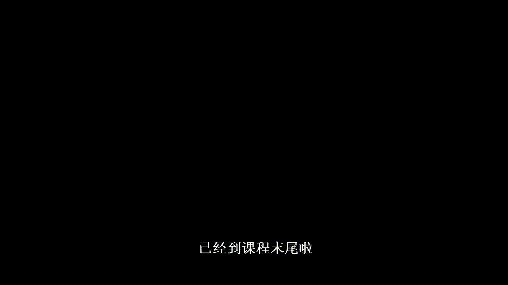
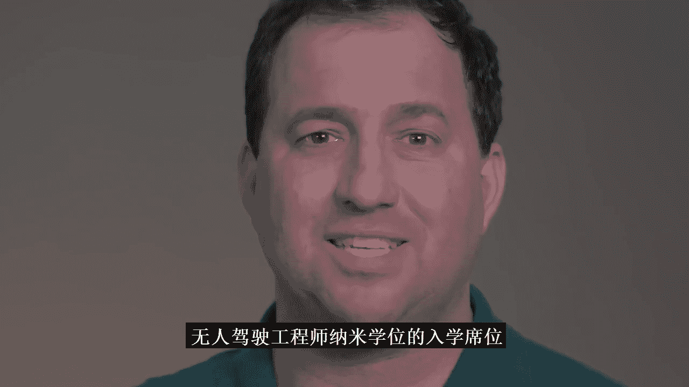

# 优达学城（Udacity）：无人驾驶汽车纳米学位项目-十位大牛亲授自动驾驶技术，硅谷前沿科技（计算机视觉⧸车道识别⧸感知控制⧸人工智能⧸谷歌） p36 36. Part 09-Module 01-Lesson 01_Congratulations! You've finished! [BV1Vd4y1r7QG_p36]

You did it， you finished the Uudacity Inuction to Se-diving Car9 degree program congratulations。

 the commitment and the hard work that you've put forward in this program have let you take the first steps towards becoming a self-driving car engineer。

You've really solidified your programming and math skills。

 and you've even solved some novel approaches to self drivingiving car problems。

 Now you're ready to take your skills to the next level。 And the next level。

 is standing on this side。 This is David Silva， who runs the advanced self drivinging car。

 not only you programme here at Uacity by graduating the intro to self drivinging car and nano degreeee program。

 you've shown that you have not only the skills and most importantly。

 the determination to be successful at Udacity。 You've also earned yourself guaranteed admission to the Udacity Self drivingriving car engineer and nano degree program。

 Okay， I see you in class。😊。

