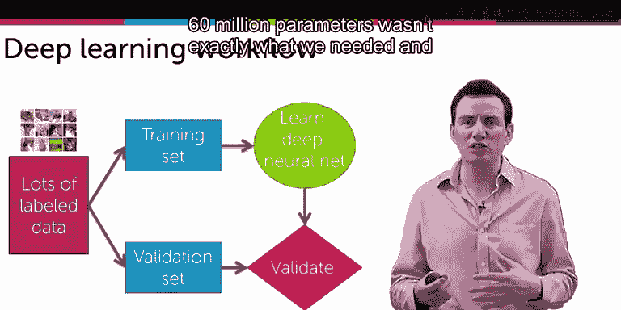

# 华盛顿大学《机器学习（基础篇，第1课／共4课）｜Machine Learning》中英字幕 - P100：99_深度学习的挑战.zh_en - GPT中英字幕课程资源 - BV1zw4m1e7Zh

。

Now neural networks provide some exciting results， however they do come with some challenges。

So on the pro side， they really enable you to represent these nonlinear complex features and be having impressive results。

 not just in computer vision， but in some other areas like speech recognition。

 so systems like Siri on the phone and others use deep neural networks behind the scene as well as some text and analysis tasks and its potential for a much more impact in a wide range of areas。

😊，Now they do come with some challenges and to understand those challenges。

 when you talk about the workflow of training in neural own network。

So you need to start with lots and lots and lots of data and that data has to be labeled every image has to have know what dog goes in the image is it a labbrador is it a poo is it know go the retriever。

 Chihuahua and so on and that requires a lot of human annotation and that can be hardened but we start with lots of images。

 we feel that we split them into train and test or validation setup we discussed and we learn a deep neural network and that can take quite a while and once we validate we realize that that complex eight layer structure of 60 million parameters wasn't exactly what we needed and we need to revise it or we need to adjust parameters or change how we learn it and we have to iterate again and again and again。

And in fact， to get that winning Ne network， the Alex Network one。

 they really needed to connect various layers with different representations and lots of complexity in the learning algorithm。

 so that was hard。😊，So although there's some great pros， neural networks。

 deep neural come with some console。 they require lots of data to get great performance。

 They're computationally expensive， Even with GPUs。

 they can be computationally expensive and they extremely hard to tune。

 So you have a lot of choices in what layers you use how many layers or parameters you use and that can be pretty hard。

 So if you combine the。😊，Computational choices and costs with so many things to tune。

 you end up with an incredibly hard process for figuring out what neural network to use。

