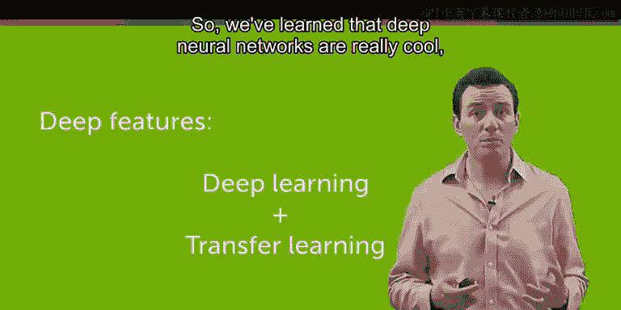
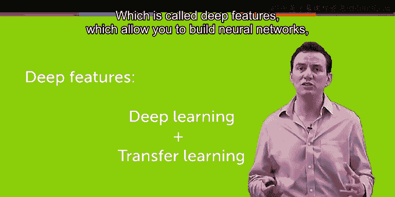
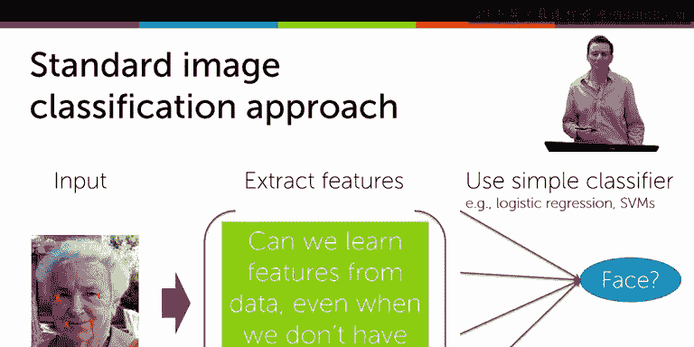
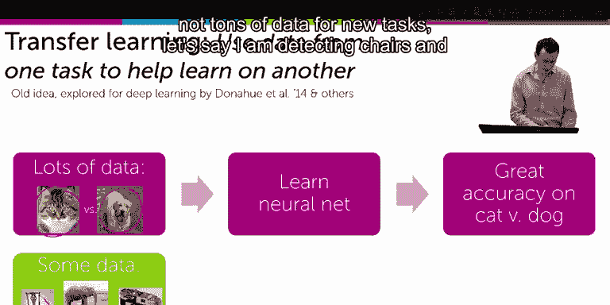
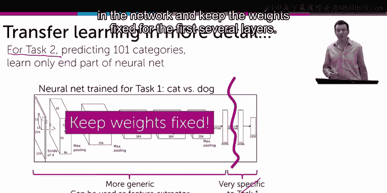
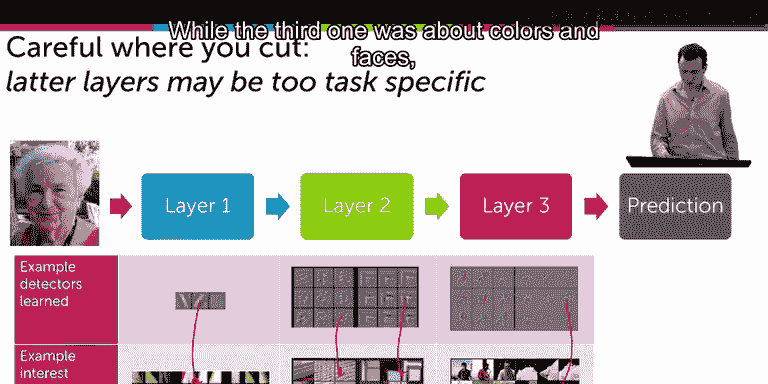
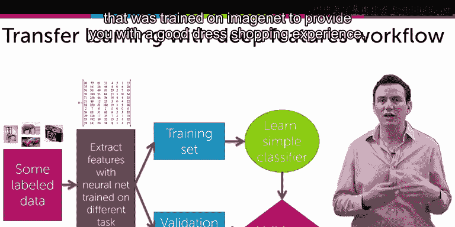
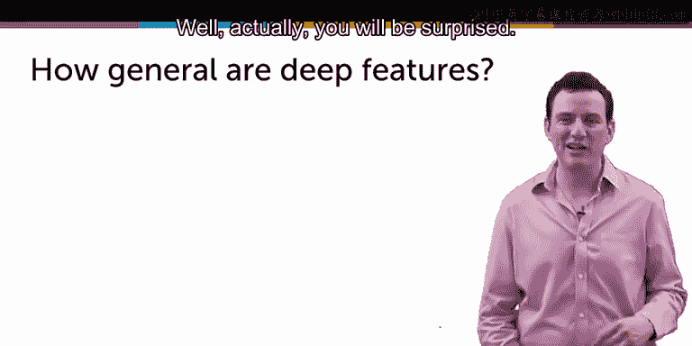

# 华盛顿大学《机器学习（基础篇，第1课／共4课）｜Machine Learning》中英字幕 - P101：100_深度特征.zh_en - GPT中英字幕课程资源 - BV1zw4m1e7Zh

。

So we've learned that deep neural networks are really cool， high accuracy too。

 but they can be really hard to build and learn and require lots and lots of data。

So next we're going to talk about something really exciting， which is called deep features。

 which allow you to build neural networks even when you don't have a lot of data。😊。

So if we go back to our standard image classification pipeline where we start with an image。

 we detected。Some see features or other representations。 And we fed that to a simple classifier。

 like a linear classifier。The question here is， can we somehow use the features that we learn through the neural network。

 those cool ones that take corners， edges， and even faces to feed that classifier？😊。

So can we do something a little different？The idea here。

 the idea of deep features is something called transfer learning。

 So transfer learning is pre old idea。 that's been around for quite a while。

 but had a lot of impact in recent years in the area of deep neural networks。

 So the idea here is I train the neural network in a case where I have lots and lots of data。

 So for example， in a task of differentiating cats versus dogs。 And I learned know8 layers。

60 medium parameter， complex neural network。 And I get great accuracy in the task of cats versus dog。

😊，Now， the cool thing is to say， okay， what if I have a little bit of data。

 not tons of data for new tasks， let's say I'm detecting chairs and elephants and cars and cameras in hundreds of categories。

😊。

Can we somehow use the features that we learn on cats versus dog to combine with a simple classifier and feed that and get great accuracy on these 101 new categories？

That's the idea of transfer learning， the features I learned from cat versus dog get transferred to provide accuracy in a new task which is detecting elephants cameras and so on。

To understand transfer learning deep neural networks。

 let's revise the idea of what a deep neural network might learn so here's a deep neural network of cat versus dogs and let's say they would get really good accuracy there for that task task one cats versus dogs if you look at the last few layers they really focus on the cat versus dog task very specific kind of like I showed you in the original example where there was a detection of corals inside that last layer。

😊，Now， the ones in the middle are much more general。

 they can represent things like corners and edges and circles and sququigggle patterns and things that can。

😊，Really generalize from the cut versus dog task to this more general。101 categories task。

So let's talk about how we can deal with the second task， 101 categories。

 so we learn a deep neural network for the cat versus dog， can you apply for task2？😊，Now。

 if you think about it， this end piece of the neural network is very specific to cut versus dog。

 so it's not that useful for detecting chairs perhaps so we can do this cut chop off the last few layers。

 the last layer， let's say of the neural network and keep the weights fixed for the first several layers because those are good those detected good features and then I'm going to feed this last layer with a simple linear classifier。

 which is simple so I can just train it the little bits of data that I have about chairs， cars。

 elephants and cameras。😊。

So going back to the example that we described earlier where we had three layers。

 the first layer detected diagonal edges and edges。

 the second one squiggly patterns and cos well the third one was about corals and faces we now can use those layers for a new task but we have to be a little careful。

 the layer3 might be too specific， but layers one and two can be quite useful so now that we learned about transfer learning the concept let's review that deep learning pipeline but using this deep features so we're going to start with some label data not tons just a little bit is enough and then I'm going to extract features using that deep neural network just like we described I'm going to split this data set into a training and test or validation set I'm going to learn a simple classifier like a linear classifier。

 support vector machines， linear regression， simple things and as I validated。

Since it's a simple classifier， there's not many parameters to tune pretty easy to do。

 can be learn little data and do quite well。And in fact。

 we've seen an application after the application where this idea works extremely well。

 and this is exactly the idea that I showed you in the demo。

 the beginning of the module when it showed you how to buy new dresses。

 we didn't have lots of data about visual description dresses。

 but we used something that was traineded on imageNe to provide you with a good dress shopping experience。

😊。

Now we may ask how general are these deep features， can they really be used for interesting。

 extremely unusual tasks？Well， actually， you'll be surprised。

In fact， let's talk about trash。A company called Kology is a pretty interesting company。

 They're trying to。Reinvent how trash collection is done。Normally。

 the trash truck goes from house to house from business to business and collects trash on regular basis every day。

 once a week and so on。They want to change that and optimize the path of trucks and how trash is collected to minimize the amount of time spent and the way they do that is by installing cameras on trash cans to figure out what's in there and how full it is well they don't have tons of label data of how images look for full trash cans but what they did is use deep features and a little bit of training data from humans marking the depth of trash cans to learn a trash detector and be able to optimize the path of trucks in order to better serve decreased amount of time trucks need to collect garbage so deep features are useful even for garbage。

