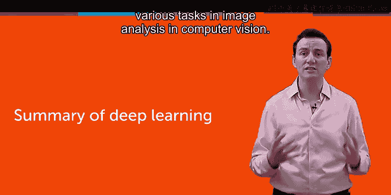
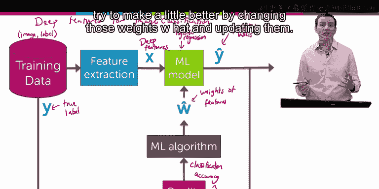

# 华盛顿大学《机器学习（基础篇，第1课／共4课）｜Machine Learning》中英字幕 - P102：101_深度学习机器学习模块图.zh_en - GPT中英字幕课程资源 - BV1zw4m1e7Zh

。

We've now seen how cool deep learning can be， we can apply in a wide range of areas and get really high accuracy by learning really detailed features of our data and how neural networks can support that。

 we've seen how it can be applied for various tasks in image analysis in computer vision。😊。

Let's know wevisit the block diagram that we saw summarizing regression and classification and other machine learning tasks and how can be applied here for computer vision for deep learning。

 so in particular， let's talk about deep features for classifying images。😊。

So deep features for image classification。 The input here are pairs of images。With their labels。

 So the labels that we've looked at were things like， you know， whether it's a cat， a dog。

 a house or some other object in the image。And now we feed that through the feature extractor。

 and in this case， we're using a deep learning model as a feature extractor。😊。

So the output here are what we call the deep features。For this particular image， for every image。

And now we feed in this image as representative features through a machine learning model where we use a simple classifier like logistic regression in here。

😊，Say logistic。Regression， as an example。And the output is our predicted labels。Predicted。Labels。

And so we're going to feed then a predicted labels Y hat and the true labels。Why？

Into our measure of quality， so why and why hat， and a measure of quality depends on your task for this task we use classification accuracy。

😊，And so the parameters， W hat are really the parameters of the weights of the logistic aggressor。

 so these are our weights on features。😊，And what the machine learning algorithm is going to do is take the classification accuracy。

 try to make it a little better by changing those weights W hot and updating them。

 We've now seen how deep learning can give you really cool and exciting results for various tasks in computer vision and we saw those applied both to classification and to retrieving of new images using raw neural networks as well as deep features and our notebooks that we explored。

 show us that's really easy to build such deep learning models and actually applied to really cool machine learning tasks in computer vision。

 both in classification and image retrieval， which allows me to find exactly the kind of shoes that I'm really excited about。

😊。

And with this， you'll be able to build a really exciting intelligent application that uses one of the most you sought after techniques today in machine learning。

 deep learning。😊。