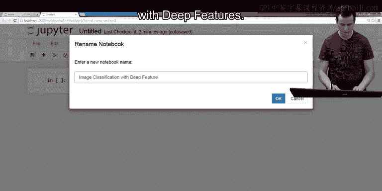
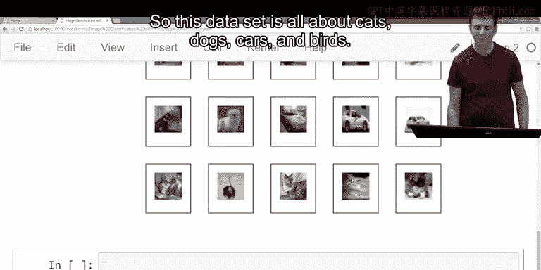

# 华盛顿大学《机器学习（基础篇，第1课／共4课）｜Machine Learning》中英字幕 - P103：102_加载图像数据.zh_en - GPT中英字幕课程资源 - BV1zw4m1e7Zh

。

So in this deep learning module， we talked about two really cool things they can do of deep learning。

 one is classify images and the other one is retrieve images and in both of them we talked about deep features so let's just go ahead and build a notebook for image classifications using deep features。

😊。

So let's give this notebook a name， so this is going to be image。Classification。我也第。Features。

And I'm going to hide the header and the twobar together get a little bit more space as usual。

 and we'll fire up。 actually。I just the little typo here， so。We will。Fire up Graphlab creates。

 so let's import Graphlab。So here we go， so the first thing that we're going to do is load a common image analysis data set。

So this is a benchmark data set called the C far 10。

 and we select a subset of those where have just have four categories of of objects we're trying to recognize。

 So I'm going to load。The data set。 and this data set has already been split into a train data and test data。

 because in computer vision， often that split happens a priority。

 So every researcher uses the same training set and the same test set。

 So the papers become more comparable。 So I'm just gonna load。😊，And that frame。That contains。

The data set。 so graphralab dot S frame and for the。Train data。

 there's a director here called I Tra data。And then for the test data。

 something going to call that image test。We have another aspirin。Cd image。Deest data。

You go so we're loading these two data sets and let's start by exploring the data a little bit。

Exploring。で엠て。So what we're going to do is use Can。

 so I'm going to point canvas to show it on the notebook as weve been doing on several notebooks。

 so it becomes all one thing that we can take home， so I'm going to set graphralab。 canvasvas。

I'm going to set the target to be the i Python。Notebook。

So it's going to print anything on the Python notebook that we do and let's start by taking a look at this training data。

 so image training has a few columns with the column that we really care about here is the image column。

And I'm just going to type the show on it and we're going to take a quick look at that image column。

 and these images are not too large， so I'm temporarily going to increase。嗯。The front here。

 so you can take a look at the images。And so if you look at it， there's a bird， there's some cat。

 there's some dogs and some cars。So this part of data is all about cats， dogs， cars， and birds。

