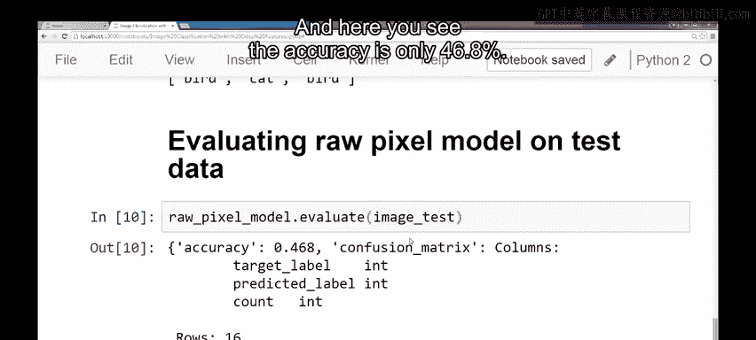
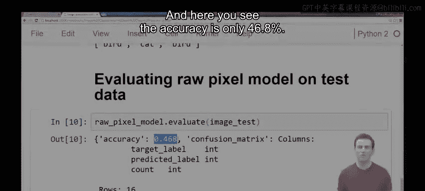
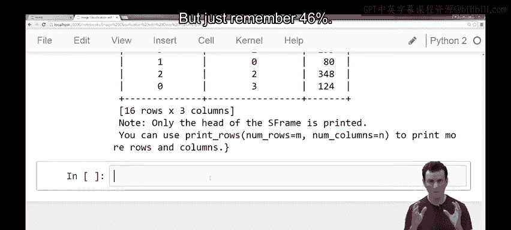

# 华盛顿大学《机器学习（基础篇，第1课／共4课）｜Machine Learning》中英字幕 - P104：103_使用原始图像像素训练并评估分类器.zh_en - GPT中英字幕课程资源 - BV1zw4m1e7Zh

。

So we're decreasing the font and we're going to train a basic model on this data set。

 So the first thing they're going to do。I not use the features。

 but just use the pixels of the image and train a classifier on the pixels of the images and see how well that does。

Let let's just go ahead and do it so train。Clasifier。I misspellt it here， so train a classifier。

On the raw。Image。Pixels。So these are going to be by features， the raw image pixels。

 not those deep features， and so I'm going to call this the raw。Rg， sorry。Rap pixel model。

And the classifier I when I use I couldn't use any classifier。

 the performance would be about the same， I'm going to use logistic regression。

 which is what we use also in the sentiment analysis notebook and so in logistic regression we're going to give it a data set so this is going to be the training data set。

😊，So this is my image train， I'm going to tell it what the target is。

So the target is a column in this data set called labelbel。

And that column has the label for each image。And I'm going to tell it for features to use。

So in this case， the features are。A column called image。Aray。And so I'm going to run this。

 which I must miss plus module。Oh， yes， I forgot one thing and you should have reminded me in GraphLb create the ver you do to create a model is create。

 so GraLb the Lo regression logistic classifier dot create。😊，Creates that classifier。

 so now it should execute。So we're using the raw image pixels to build a classifier。

And just as a quick review， I don't expect that to be very good， but let's go ahead and do it。

 it just is done right now。So let's see how it performed。

So the first thing that I'm going to do is just make a prediction with the model。So， let's make。

A predictionre。With the simple。Model。Based on raw pixels。

So I'm going to take some images from the test data set。

 and I'm going to see what the classifier says they are， so I'm going to say image。Test。

And let's look at the first three images， so images0， column 3 goes image 0，1 and 2。

 and I'm just going to look at those images。And I'm going to type dot show on them just to show you what those images are。

So here we are， the images， as I said， are a little bit small。On the data。

 but I'm going to make this bigger so you can see the images here are a cat， a car and another cat。

 so two cats in a car， car cut， no cat car cut。And so I'm just going to leave the。

It font big so we can actually see the results so now let's look at the labels for this image so this is the test data and this is elements0 through3 so the first one three I visually said it was cut carca but let's see what the actual labels are so the label column。

And you'll see it is cut automobile cut， so it's automobile， not car， but， same thing。Okay。

 so let's see what this bra。Pixel。Model predicts。So let me see what it predicts for this data set of three images。

 so the image。Test。嗯。Of0 through 3。So the truth is cat automobile cat， and it predicts bird cut bird。

 so it gets all three wrong， he thinks the cat is a bird， he thinks the car is a cat。

And he thinks cat the other cat is also bird， so it got all wrong。

 but this is only kind of a fluke qualitative thing it could be that just the first few images it got wrong。

 so let's take a look at what the actual predictions are。😊，So let's evaluate， let's just say。

 let's evaluate the model in the test date and see what the actual classification accuracy is。

 So evaluating。Brought picks， so。Model on test data。So I'm going to take this raw pixelixel model。

Pixel model， and I'm going to call evaluate。And what Evalu does is just go and compute some of those errors。

 those error metrics， and I'm going to use the test set。

And here you see the accuracy is only。46。8%， it's terrible， you have four classes。

 random guests is 25%， they balanced here it gets 46%， not that exciting。

So。There's more details there， the confusion matrix gets plotted， I'm not going to go through that。

 but at home you can explore those a little bit more， but just remember 46%。

