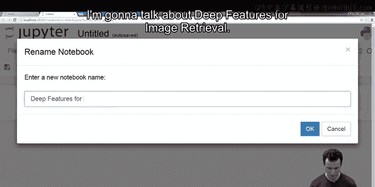
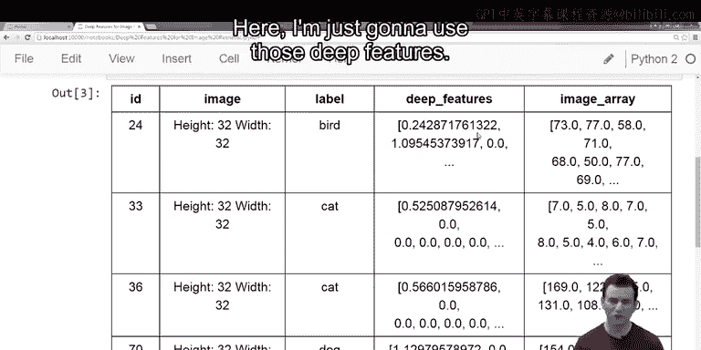

# 华盛顿大学《机器学习（基础篇，第1课／共4课）｜Machine Learning》中英字幕 - P106：105_加载图像数据.zh_en - GPT中英字幕课程资源 - BV1zw4m1e7Zh

。

We saw how deep features were great for image classification。

 they allowed us to get quite high accuracy， even with just a little bit of training data on a particular classification task by first finding features from this deep learning model that won the 2012 imagenet competition so that was pretty exciting but if you remember the motivation at the beginning。

 kind of the sample use case at the beginning of this module。

 we're talking about finding images or products that I like， you know I like shoes。

 I want to find shoes that are similar to my shoes。

 I want to find imagess similar to the products that I care about。

 so instead of doing image classification task now we're going to take those deep features and do an image retrieval task so let's go ahead and do that。

😊。

Okay， so we're going to name our notebook， so I'm going to talk about。

We're going to talk about deep features。

For image。Retrieval。And I'm going to hide the header and hide the toolbar so we can go ahead and get a little bit more space and I'm going to fire up Graphlab create。

And。I'm also going to load。呃细fire。10 data set， which is the same data set that we loaded earlier。

When we talked about deep features for classification， so in this case， I'm just going to load。

The training set because we're just going to the retrieval and the training set。

 so let's start from there， so I'm going to call it image train and I'm going to use graph lab。

The S frame。 and as input， I'm going to give it the image。Training data。

And just as a little reminder。If I look at this image train data set。That head。In this S frame。

 we have。The image I， the actual image， the label， which we're not going to use for retrieval。

 we're not going to look at the label at all， the image array with the pixels which are also not going to use。

 but it already has the deep features pre computeuted in the notebook on。

Deep features for classification， we looked at those lines that you need to compute that column deep features here I'm just going to use those deep features。

😊。

你个。

