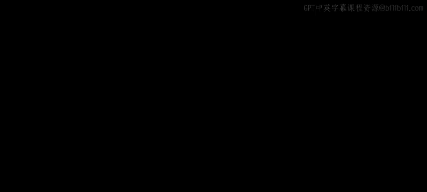
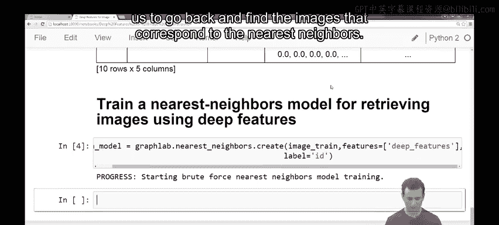

# 华盛顿大学《机器学习（基础篇，第1课／共4课）｜Machine Learning》中英字幕 - P107：106_创建用于图像检索的最近邻模型.zh_en - GPT中英字幕课程资源 - BV1zw4m1e7Zh

。

So this going to be pretty simple。 It would be similar to the document retrieval notebook that we we did to find documents that were similar to Barack Obama。

 to Clinton， to backham and others so lets let's go ahead and。We we're going to do is train nearest。

Neighbs model。For retrieving。Retrieving。Images。Using deep。Fuatures。

So this is going to be pretty simple。 and we're going to call it the。K and N model。

 just like we did with document retrieval and。We're going to use Graphlabss nearest neighbors。To it。

And we're going to code the create verb to actually create this nearest neighbors model。

 and just like in the nearest neighbor model， we're going to give it some data。

 so in this case it will be my training data。I'm going to tell it what features to use。

 so the features that I're going to use are going to be exactly those deep features。And then。

Just as a reminder， you can give it a label ID， so the label here， we're going to use the image ID。

 which will then allow us to go back and find the images that correspond to the nearest neighbors。

你。