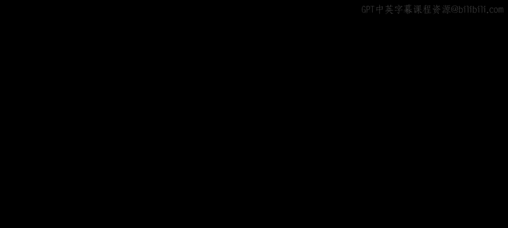
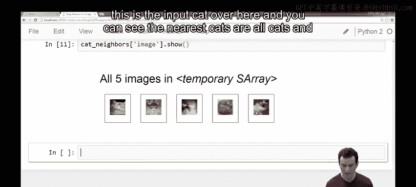

# 华盛顿大学《机器学习（基础篇，第1课／共4课）｜Machine Learning》中英字幕 - P108：107_查询最近邻模型以检索图像.zh_en - GPT中英字幕课程资源 - BV1zw4m1e7Zh

。

Now we can use the model。Use image。Retrieval model with。Deep。Features。To find。Similar images。

So here we go we're going to take that model and use it to find similar images so let me go ahead and do exactly that so first remember let's take a particular image so lets take I'm going to call this CA you'll see a CA image so out of my image training data。

😊，I'm going to take the 18th image， so this is we take 18th images like this and just so that you know what it is I'm going to do CA。

Image。Dot show to actually show that image and so it shows on the notebook here。

 I'm going to set the canvas target。To be the iPadon notebook。

So all the things that we've been doing so far so here we are。

 here's an image of a cat and it's a tabby for those familiar with the cats it looks here is a little small but it's an image of a cat you can play with it so now we can find the nearest neighbors to the cat。

😊，So let's go ahead and do that like that。 Now let's take this image of a cut and just find it in stables。

 So what I can do is take my K and N model。😊，And query it。For the image of the cut。

And so after a query you'll see that for this image of the cat， the nearest images are image 384。

 690， 60，910 and so on， and it's a little hard to get those images from the numbers。

 so I'm we'll create a helper function together that takes those indices and actually shows you those images so going actually take an opportunity to define a function。

😊，So we're going to define a new Python function。😊，It's going to say get。Images。From。Is。

So I'm going to in this column reference column here has IDs， this one here。

 and then I'm going to get the images back。So let's， let's give it。

The output here is going to be the。Sorry， the output here is going to be the result of the query。

 so let's call it query result。And it's a function。

 so all we're going to do with the query result is return。I。Train。

 so I'm going to take that training data， and I'm going to do an operation called filter by。

 which just selects a set of rows of that data。 and I'm going to select selected by the。Ki。😔。

Result that we just created and once I've done that。呃。I select for a query result。

 perhaps say a column and the column here is the reference label column。😊，Qury result of。

A reference label。And what we're going to do is say return。

All images in the table whose ID matches this reference label column over here。This this column here。

So that's what this helper function is。 So I don't have to type it all the time。

 We can go ahead and use it， but I'm going to do a little bit。Of experimentation with it。

 so let's just define this function。We've weve no。Define it， get image。

Images from Is actually that make more sense， right， So let's call it get images。From IDds。And so。

Let's go ahead and do it。 So remember for the cat， we had an image of a cat。 so let's just say。😊，Get。

Let's call them cat。Neighbors。And so the cut neighbors are going to be lets called this function。

 get images from IDs， and as input， I'm going to take my K&N model。And query it with the cut。

Ass an input。Okay， so these are the CA neighbors， the image neighbors。

 and now what I can do is just show those images so CA neighbors of images。你没去。The choke。

So we had to play a little bit for data to see， but this was the input cut over here and you can see the nearest cuts are all cats and they're all kind of like tabies。

😊。

