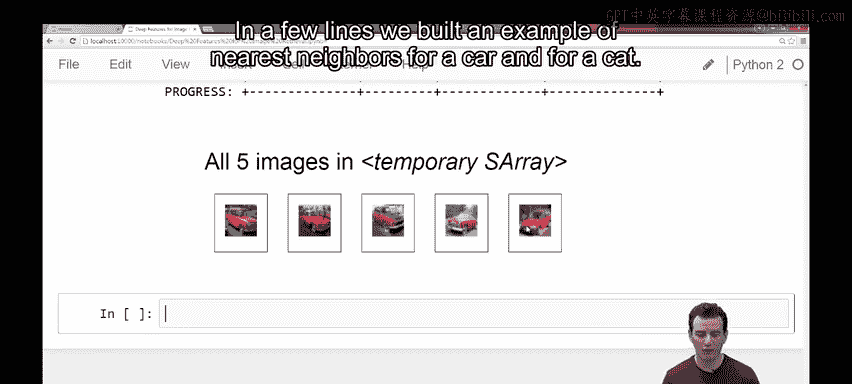

# 华盛顿大学《机器学习（基础篇，第1课／共4课）｜Machine Learning》中英字幕 - P109：108_查询与汽车图像最相似的图像.zh_en - GPT中英字幕课程资源 - BV1zw4m1e7Zh

。

So now that we've created this helper functions， let's do this for another image here。

 this is one that I cheated a little bit， I found a car and then we'll just try a few examples so we found a car and this car is image train。

😊，And it's the eighth image， so I just want image by image into final car and then just so the you see。

 let's take the car。Image。呃可。Image。Go Cho。And we'll see the actual car we're talking about and this is a red car。

 you see it right here， red car and the question is what are the nearest neighbors for that car and that was this command that we did over here。

 get images from IDs where we query the car but I'm going to kind of shortcut things a little bit。

 so I'm going to say get images。😊，From Is where I'm going to take my K and then model。

And give it as input the car image， So Canon model， I'm going to query that car image。

And the output is going to be a list， an S frame， and I'm going to select the image column of the F's frame。

And I'm gonna to type out showing it。And now after I do this。

 you see the input car was this red car and now we have a bunch of red cars as nearest neighbors。

 so this is really cool in a few lines we built an example of nearest neighbors for a car and for a cut。

😊。

