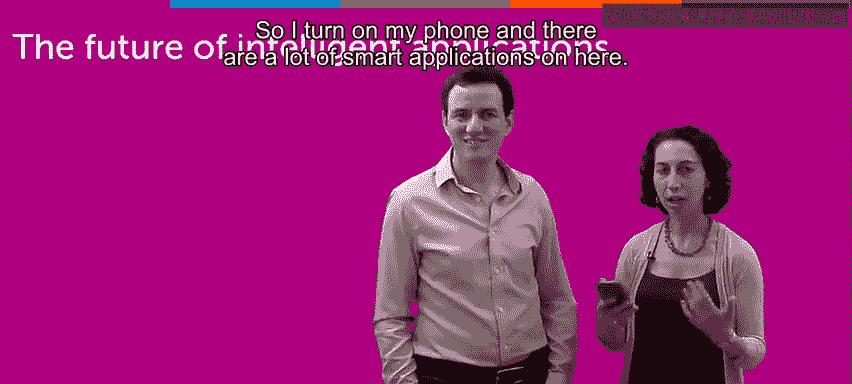
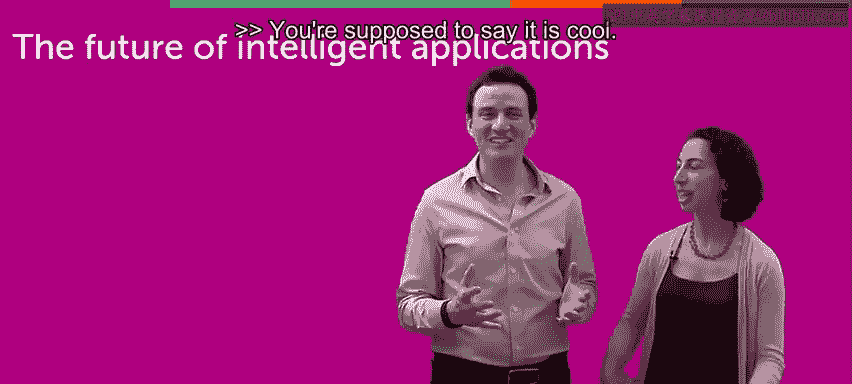
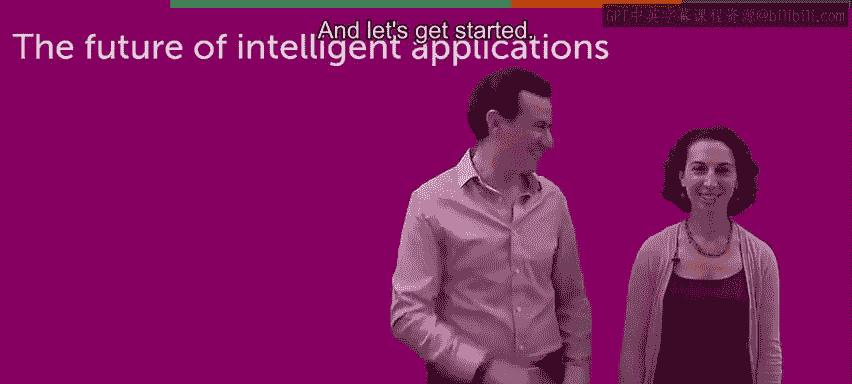

# 华盛顿大学《机器学习（基础篇，第1课／共4课）｜Machine Learning》中英字幕 - P10：9_智能应用的未来.zh_en - GPT中英字幕课程资源 - BV1zw4m1e7Zh

。

Okay， so it's a really exciting time to do a machine learning specialization because we see machine learning everywhere in our everyday lives。

 so for example， Carlos is always on my case that I'm on my phone so I turn on my phone and there are a lot of smart applications on here and there are things that are personalized to me as a user。

😊。

And they're all using machine learning at their core which is exciting today every time you go to a website。

 most likely there's a machine learning algorithm behind the scenes， analyzing the data。

 analyzing the interactions and really change experience using machine learning and we're seeing that the wide range of settings Yeah so not just on my phone one device that Carlos loves is this thing the wearbow device that tracks my activity analyzes my sleep。

 analyzes my exercise routines captures what I'm doing and really takes a data。

 understands it and helps me look at you know how my health is evolving over time which is pretty cool。

So that's why it's exciting to think about machine learning now。

 but of course there's a lot more that machine learning has the possibility of doing in our lives You can see the world changing with self-tracking cars with personalized medicine with internet things we' embedding sensors everywhere with smart systems everywhere and so in this specialization you're gonna to learn the fundamentals to do all of these things in fact after the specialization you'll be future ready future proof for future proof you'll be futureturized you'll be the future of machine learning you are the future and that is cool and that is and in fact you are the future because we recorded this in the past so it's actually true and that is also cool。

Clearly， Carlos is still watching and reading， mainly watching too much scifi Yeah did you see are in the future Did you see the latest season of Dr who？

Pretty cool。Anyway， on that note， this is cool and it's going to be a really cool supposed to say it is cool it is cool and it's going to be a really cool specialization and let's get started。

😊。

