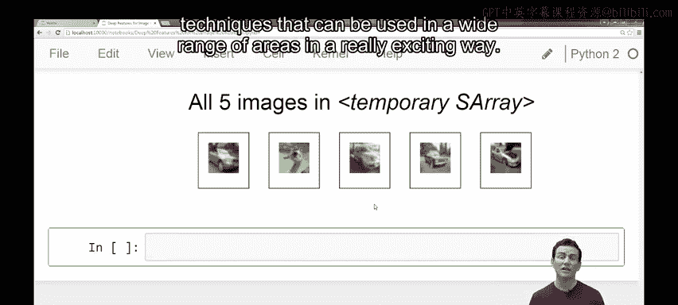

# 华盛顿大学《机器学习（基础篇，第1课／共4课）｜Machine Learning》中英字幕 - P110：109_使用Python lambda显示其他图像检索示例.zh_en - GPT中英字幕课程资源 - BV1zw4m1e7Zh

。

Okay， now I want to do one last thing because it would be just fun。And then we can all be excited。

What I did here， query on a particular car for a particular image。

 let's create a function that does all of that and we can query it anytime I want and so this would be kind of a fun thing to do。

😊，Just for fun。Let's create。lambmbda。To find。And so。Mest。Neighbor images。

So this is a little bit of Python trickery and we get to play with it together。

 So we're going to call this lambda find。😊，No， that's not good just go directly to show show neighbors。

Show neighbors。And this is going to be a lambda。And it's going to take the index i of the image。

And here is what it's going to do， it's going to do exactly what we saw。

 so it's going to get images from IDs queryd in nearest stable model， but instead of query for car。

 let's query from image train。😊，Of I2 i plus 1。And then we're going to take the image and we're going to call do showing it。

 This is a crazy long lambda。😊，But after we created it， we can do something pretty neat with it。

 So now I can just call show。😊，Show neighbors。And I give it the index of the car， which was eight。

 and if you scroll down， you see those red cars。Really cool now。

We can call Sha neighborighbs on some other image。I actually haven't thought about。

 haven't played with this， I just made this lambda up together。

 so actually let's just try and run a number， so how about the number 26？😊。

So now it's going to find the neighbors that even know what it this， 26 is this car over here。

 actually let me make this a little bigger so we can now see。😊。

So show neighbors of 26 is this blue car this a few other cars， which is pretty cool。

 let's pick some other number， show neighbors of。This 2000 images maybe be image 1222。

 I actually don't know what that would be but。Now we can see， oh。

 it's a bird and you find the neither's neighbors are all birds and they'll have similar kind of poses。

 oh no that these are like ostrich heads and these are other kinds of birds， but they're all birds。

Wwhichch is pretty cool and remember we're just using those deep features and now for last one。

 so show neighbors and you can play with all of this at home， let's show neighbors of image 2000。😊。

Oops。Shift enter and were the neighbors of image 2000 okay you have a car it got confused it got ostrich but the rest were all cars so simple features work quite well at image retrieval so I made one mistake in the few examples that we tried but it actually gives you really good results and really nice performance and it was never trained on this data set on these images。

 the images of a different sizes， different categories but still worked quite well and quite excitingly so these are tools and techniques that can be used in a wide range of areas in a really exciting way。

😊。

