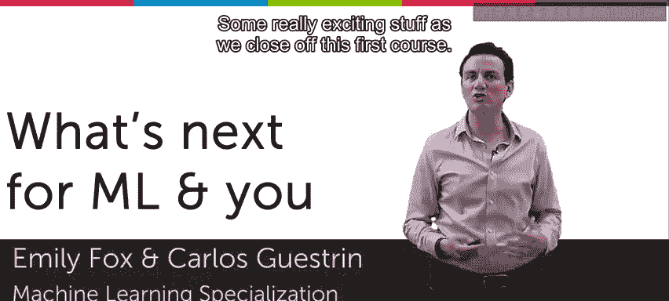

# 华盛顿大学《机器学习（基础篇，第1课／共4课）｜Machine Learning》中英字幕 - P111：110_你做到了.zh_en - GPT中英字幕课程资源 - BV1zw4m1e7Zh

。

Emily and I really hope you've enjoyed the course so far we've really explored the foundations of machine learning on a wide range of domains with a range of different applications and really touched many of the practical issues around deploying and building machine learning systems and now in this closing module we're going to really summarize some of the concepts that we learn talked about how to deploy these ideas is machine learning systems in production and then what's ahead in the specialization and machine learning as a whole。

 some really exciting stuff as we close off this first course。😊。

