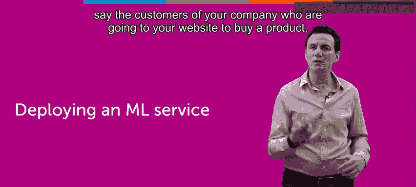
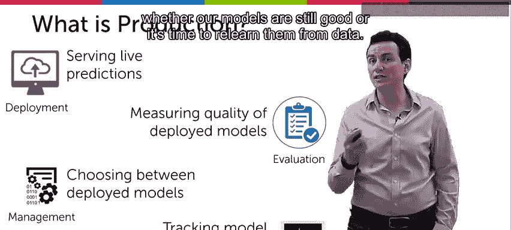
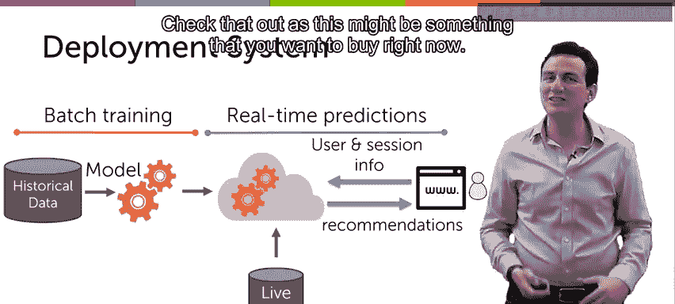

# 华盛顿大学《机器学习（基础篇，第1课／共4课）｜Machine Learning》中英字幕 - P112：111_部署机器学习服务.zh_en - GPT中英字幕课程资源 - BV1zw4m1e7Zh

。

Now so far we've really just talked about you how do you build a machine learning model using data。

 how do you measure its quality and how do you understand whether it's working or not。

 but that's not enough to build an intelligent application when you build an intelligent application you want to take that model that you learn and then really put it in front of say the customers of your company we're going to your website to buy a product so what is the process actually look like there are many different aspects of CO2 with it what we call model deployment where we're taking the model and really allow it to serve predictions in real time and'll talk more about that then we have talked about how do we evaluate a model to make sure what we did offline as we train the model is still good in the long run as we're using it。

😊。

Then we have to think about all the management pieces， how do we make sure the model is still good。

 how do we replace it when the model improves and how do we react to measurements that we make。

 which are actually the metrics that we monitor over time to try to understand whether models are still good or it's time to relearn them from data Now all the pieces are really coming together they're not just individual separated ones but all of interact in pieces that we need to understand deeply and create a cycle of improvement of the models that we have so let's start with the first one。

 let's start with the deployment piece。😊。

Now consider the following setup， you're building a really cool new kind of product recommender system and you're using a bunch of data with millions of product reviews and users and you want to take the model that you learned on the laptop or in your desktop or in the big cluster machines and deploy it on the website that really interacts with your users what does that look like Well that whole system starts with some historical data。

 some data that you collected about the users of your system， the reviews they've written。

 what preferences they have and we take that data and we feed it to train the model like we saw in the recommender systems module that Emily talked。

😊，That process with historical data is usually done in what's called a batch offline setting。

 you learn a model， say on your desktop machine or in a cluster and then you know take that model and deploy it for example in the cloud so that you can do what's called serving predictions this is the online realtime part of the system So for example if you have a website if this is what we're serving for the website is going to give me information about my users。

 what you're doing right now what pages they look what products they're thinking about buying and then from that we're gonna to serve predictions in real time they say oh check out this giraffe to time remember that check that out this might be something that you want to buy right now Now the user see that giraffe offering and they may may not buy that giraffe So that's a kind of feedback we're going to get back from the system did the user buy it they they not buy it and that's going influence both a realtime decisions and go back to historical data and really be collected in the long run so they improve。

Model as we collect more and more data from the world。

 So that's what a holistic deployment system for machine learning might look like。😊。

