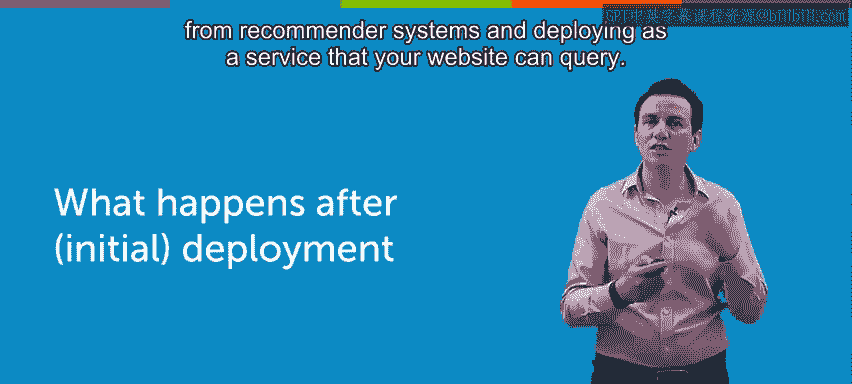
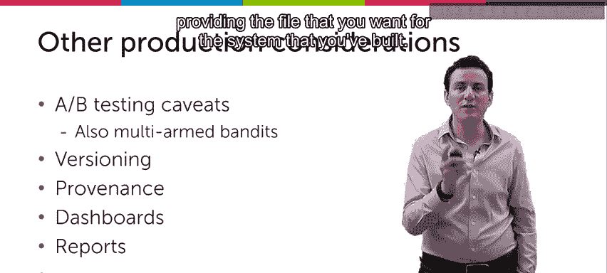

# 华盛顿大学《机器学习（基础篇，第1课／共4课）｜Machine Learning》中英字幕 - P113：112_部署后会发生什么.zh_en - GPT中英字幕课程资源 - BV1zw4m1e7Zh

。

Now we've talked about that initial deployment， taking a model that we learn for recommender systems and deploying it as a service that your website can query。

 but there's more to that deployment process and to machine learning in production there is that deployment piece but there is also the management of models there is the evaluation and there's monitoring collection of metrics so let's talk about those last three pieces and those pieces are really about taking those models that we've learned seeing how they're performing in practice not just in the batch off process but with real users in practice。

😊。

And use that information to train new models and deploy new models and update the models as we gather more information about the world。

 So if we go back to our pipeline， which involved the batch process and the real time process。

 now that feedback piece where the user maybe bought the product or didn't buy a product they were recommended that gets fed back。

😊，Into both the realtime data， but also the historical data is going to be very useful for us。

 We're going to use that feedback to go back and learn new models。 So for example。

 now that we have more historical data， I might learn a second model it's call model two for recommenders which I think is better and I want to start serving that model in production and I figure out is this model two really better then the old model one that I had Which one is better how do I figure that out that's some of the key questions around managing models in production So when to figure out when to update to model2 if it's worth it and how do we choose between models and this is really about monitoring the models in production with real users and understanding what those usage patterns look like。

😊，And the key piece to monitor models is the evaluation of models in production。

 so this is really combining the predictions that we're making with the metrics what are users doing in real time with our system So the questions around here that you need to address when you deploy models are what is the data they you're collecting from users。

 not just the data that you have historically， but what data you're collecting from that real-time interactions where the users are buying or not and what are the metrics they going to use to measure whether those interactions are good。

 whether you're getting the right kind of response you're hoping for。

 what the machine learning is actually working for you in the system that youve built。😊。

Now if we go back to our pipeline， you can imagine saying okay。

 I'm going to collect that data and I'm going to use to measure the metrics that we use to train my model。

 so for example， when we talked about recommend system we talked about one such metric。

 we discussed some minimizing some squared error。😊，Now。

 is this the right metric to evaluate in production？It's a good metric to optimize a model offline。

 but in production， you really care about whether people are buying a product or not or whether this machine learning model is getting your users more engaged for website。

 whether that model is helping people use their smartphones better or their wearable watches or whatever technology that' is using machine learning in the background so some squared errors or some offline training。

 those models are really about those metrics are really about optimizing the model offline and figuring out whether a model is good and perhaps whether it can be updated。

😊，Now the online metrics， let's see who's buying the usage metric。

 how is this changing you know the bottom line for my business。

 this is really about kind of choosing whether the old model is better than this new model I've created and let's talk a little bit about what the process looks like。

So the question here is， should I update my old model with a new one that I learned that to have new data？

😊，And there's many questions around us Why should I update Why should I take what I've done before and change it with something new and this has to do with well you know the trends in the world have changed new products have come in。

 user taste have changed a f like you the chewy giraffe that we talked about goes out of fashion。

 nobody else wants it so we want to change that model we want to update it so that's what we have to do to say okay this is why we should update it but when do we update it when we say okay it's time to take that old model and switch it out and put in some new one so is about tracking real world statistics it's not about intuition it's not about yeah this sounds like a right time or you talking to some person who is not looking at data maybe some you intuitive business analysis this is really about data it's about tracking those metrics that we measure those statistics and really coming up with like a quantitative。

Quality， as to say， things have changed。 it's time to update model。

 This is what's going to happen when we update a model。

 and this combines those offline metrics and we used to train the model。

 but really online metrics that we're capturing。 So let's talk about how online metrics get used。

One example of how to choose between models using online metrics is what's the idea of AB testing。

 let's say you have two models， Model one and model2 and I want to figure out which one is going to be better which one should I give it to my system so what I can do is give some of my population we call them group A let's say some of the people or people from a search geographic region to say that people from the United States get model one and then say people from different geographic region say people from Canada get model B model2 and so you look at the behavior between the two models capture some metrics and let's say that model one does better model one does worse it only has 10% clickthrough rates so CTR so that means only 10% of the time people are buying the product well with model two it's amazing 30% of time people are buying the product so the CTR is clicked through rates it's 30% so what you do after you've done this test is say okay I've done a test enough I collect enough test samples now and。

Start serving model two instead of model one。Now there are many other issues and caveats around the ideas we talked about so far you know AB testing deciding when it's time to switch a model how much data you have to collect what to do is very tricky and it requires a lot of thought and we'll talk more about it towards the capstone。

 but really something that you need to think about quite deeply Now also thinking about what versions of model have model one and model2 of simplification and typically you have many data scientists capturing their own models with their own ideas。

 the question is how do you keep track of that， how do you know what data was used to train different models。

 how do you keep track of how do you're performing。

 which ones are performing wells which don't is it because of some fluke is it because of some real property of the data。

 how do you monitor these dashboards， how do you come up with reports say okay this is what's happening this room machine learning is doing what difference is making all that can be quite complicated and so it's very important for you to think about not just how do you use machine learning algorithms。

 how do you write your own methods。How do you pick your features。

 but how do you keep track of that and make sure the models are working and providing the value that you want for the system that you've built？

😊。

