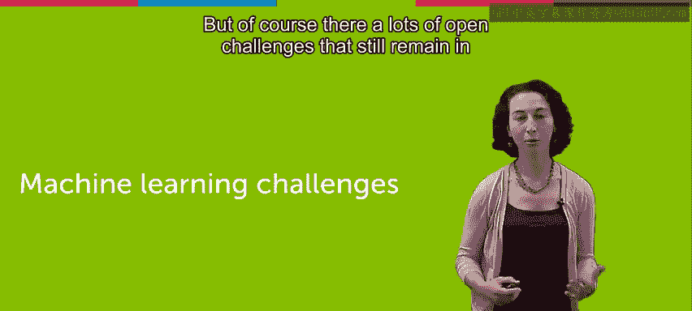
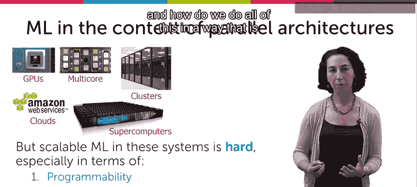

# 华盛顿大学《机器学习（基础篇，第1课／共4课）｜Machine Learning》中英字幕 - P114：113_机器学习中的开放性挑战.zh_en - GPT中英字幕课程资源 - BV1zw4m1e7Zh

。

Okay， so in this course we've talked about lots of different machine learning methods and lots of applications where these types of methods can be very impactful。

 but of course there are lots of open challenges that still remain in machine learning。

 so let's discuss some of them。

One is the fact that we often have a choice of which model to use so for example when we talked about recommending products we said we could use a classification model where we take features of the user and the product。

 pass it through this classifier to say whether yes or no the person will like or not like this product。

 but then we also talked about using matrix factorization where we were going to learn features about users and products and use that to recommend products to the users and then we also talked about featureurized matrix factorization combining these two ideas but the list often of possible models we can consider for tasks is very large。

 so typically this leaves the practitioner very perplex which model should I use and searching over this set of possible choices is still an open challenge in machine learning。

Another really important challenge that we're often faced with is how do we represent our data so for example。

 when we talked about our document modeling our document retrieval task， we said。

 well we could use just raw word counts or we also talked about we could normalize the vectors we could use things like TFIDF to account for very popular words and to more emphasize the important words in the document but honestly there are lots of different variants of TFIDF。

 we just provided one example of doing this you could also think about using biograms and trigrams and there are lots and lots of ways we can think about representing the words that appear in a document that's our data set of interest that we'd like to represent but that's just for a document then maybe we have images how do we represent an image we've talked about some ways we'll talk about others but there's lots of challenges with that。

Then maybe you have data that's really network based， okay， things like from Facebook。

 so you can have very complicated data structures and from very， very different diverse data sets。

 we want to be able to use the types of methods that we've described。

So how we represent our data of course， is going to have significant impact on the types of inferences that we make on that data。

 so this is a really， really important problem and there's no one method for choosing the right representation of your data。

One of the other really important and really significant challenges we're faced with machine learning these days is how to scale up in multiple dimensions。

 so one aspect of this is the fact that data is getting bigger and bigger so this is something that's been talked about extensively in the media so let's just describe a few situations in which we're faced with a growing amount of data。

 one is the fact that there's just a large number of different platforms out there for social networking collecting data via crowdsourcing and different things like this sharing your photos。

 your videos and reviewing restaurants and the list of possible ways in which you can now go online and。

Give data to the world is growing and the amount of people doing this and providing data is just growing at this huge。

 huge rate。 So we have lots of new data sources available to us。 And in addition。

 the way we think about buying products you know we no longer often just go to store and have some handwritten record of what product was purchased we now have vendors like Amazon who have these huge online marketplaces and collect data about different products and customers and the purchases being made and lots and lots of data from different sources like this and beyond these types of websites。

 there's also a lot of devices that we can now wear So there are these wearable devices I can wear a watch that monitors all the activities I'm doing how I'm sleeping at night I can wear glasses that record everything that I'm seeing。

I can also talk about the Internet of things which is just lots of connected devices and lots of different sources of information communicating with one another so these are just some of the areas in which we're seeing lots and lots of new data sources but of course that's nonexhausive we can also talk about things like medical records again no longer do you go into your doctor's office and just have them write notes by hand that gets put in some file often they're taking electronic health records and these are now communicating across systems and we have lots and lots of electronic health records that it's just a source of data to be parsed and understood and use to innovate in in medicine so lots of new data sets which is exciting you know we can learn a lot about how people operate about our bodies about how people purchase and make friends and how they go about their daytoday activities。

of course， we need to have methods that scale to analyzing these types of data sets and also to the unique structure of data that's presented in these data sets and the noisy structure and the list of challenges is really extensive。

 but so this is one of the very big challenges in machine learning is how to deal with this big data。

And simultaneously to data being really large， we're also faced with a challenge with the fact that the models that we're using to analyze these increasingly complex data sets are also growing so the models themselves are becoming bigger and more complicated in order to extract information from these ever growingly ever growingly。

 I don't know if that's a word， but you get my point。

 these very intricate data sources and very large data sources。

 so just as an example when we talked about clustering we talked about this application where you have recordings of brain activity taken over time。

 so this is just one quick example of a model that was used to analyze this type of data set and without going into the details of what's shown here on this slide just realized that there are lots of circles and lots of arrows and what that means is that this is a really complicated big big model。

So you might think， okay， well， data's getting bigger， models are getting bigger。

 but that's okay because processors are getting faster。Well， that was the story for a while。

 we were seeing this exponentially increasing rate of increased speed for our processors。

 but that stopped about a decade ago and now what we're seeing is really very marginal increase in the speed of an individual processor。

 so instead we have to think about new ways to scale up。

And the typical thing that we're leveraging these days is collections of processors and there are different architectures that we have we have things like GPUs and multicho and clusters and cloud computing resources and really。

 really fancy and expensive supercomputers so that's great that those are really really powerful or potentially powerful computing resources that we have but the question is how do we use these in machine learning and in machine learning we have a number of challenges we're faced with one is the fact that。

😊，Taking our machine learning algorithms and thinking about how to distribute them across these different processors and run everything we want to run in a coherent way is very challenging Another challenge is how do we distribute the data across these different machines and how do we do all of this in a way that's very tolerant to different failures we can have of the individual machines。

So these represent a number of challenges that we're facing in machine learning and a lot of lot of exciting research is coming out to start addressing these problems。

