# 华盛顿大学《机器学习（基础篇，第1课／共4课）｜Machine Learning》中英字幕 - P115：114_机器学习的发展方向.zh_en - GPT中英字幕课程资源 - BV1zw4m1e7Zh

。

Okay， given your great historical perspective on machine learning， calling you old。

 I am calling you old， it's always like this。I was wondering if you could give me a little perspective on the future。

Well， let's talk about the present， okay。I'll accept that。

 we can talk about the present He always makes things really long and really detailed。

 so just talk about the present， we'll get to the future eventually don't worry。Here we go。

The present。 what is the state of machine learning of machine learning today。

 honestly being old that you working machine learning for a long time。 But today。

 every time I open a web app， it uses machine learning inside and that's pretty cool。

 and I pull out my phone where my phone you always have phone actually don't have my phone right now。

 She's always on phone。 anyway， when you pull a phone， every time use it。

 there's a system that uses machine learning right inside you know the cloud that supports it。

 which is really pretty cool。 And now with devices check this out。 I got this watch。

 It's a wearable watch that tracks my activity。 knows when I'm running when I'm back。

s when he's sleeping or not sleeping， always this debate， who got less sleep with a baby so yeah。

 that's a wearable watch。 And underneath these things。 it's all using machine learning。

 So' the power of machine learning just kind again， again being used today。 But I think we've only。😊。

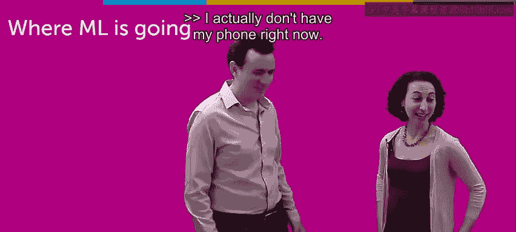

Scratch the surface of what machine learning can do。 Like。

 where do you see machine learning going in the future， You tell me Where do I see it。

I know probably a lot of ways in which it would be useful to Carlos One being the fact that he hates driving。

 So of course there's this smart car idea that this selfdri mean not smart car。 they're also smart。

 Are they smart， They're pretty smart， I guess it's a self-d car。 A smart car is a brand。

 That's not what I mean， I don't mean those little cars。 I mean， normal cars。

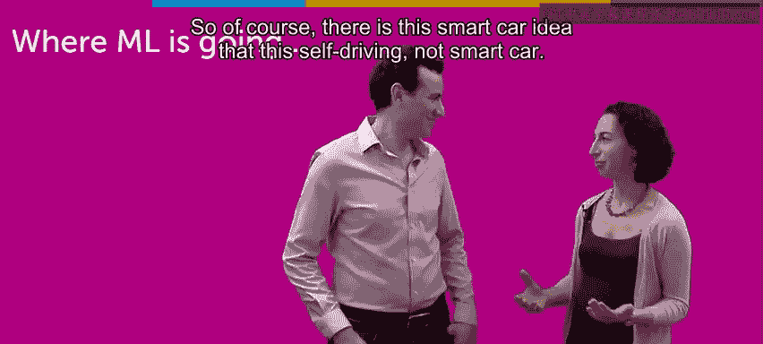

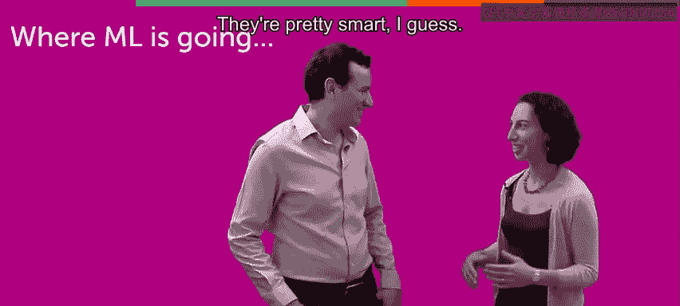

I drive themselves know that'll be really useful for me because I don't like driving I only like biking and so at least self driving bikes No I like that's for when you get really。

 really old。So I would talk about that but when I think about me getting old。

 I think about how machine learning can really have impact with steady of personalized medicine and the question here is why is it when I go to a doctor with a certain disease a certain condition this treatment that Emma gets is exactly the same as the treatment that I get I mean we're different people with different lifestyles with different body types as you can see and still with medicine we're getting exactly the same treatment that makes no sense the treatment is personalized to know who I am what I do how much couch potato I am what my DNA looks like and with machine learning we're gonna be able to do that all the time really super cool I'm excited Carlos is so optimistic which is good it's really nice but it's hard。

 it's really， really hard to do this， the data is really noisy because there's some doctor who's there taking these records making notes about Carlos's health conditions compared to mine and there's lots of missing data because you know maybe Carlos skipped his last checkup or the doctor for forgot。

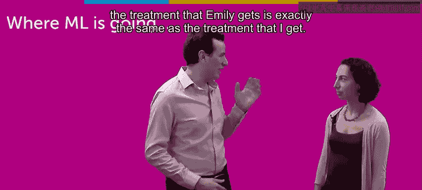

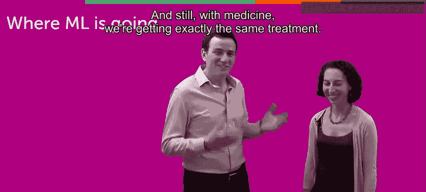

To enter something or maybe the doctor put something under a different entry than they did for me。

 And so somehow our machine learning and algorithms are going to have to be able to parse this really complex and noisy data in order to do this type of personalized medicine。

 which I think is a possibility I think is really cool。

 but it is those things we're talking about from self-diving cars。

 which we're seen as a reality today through personalized medicine it's so hard stuff but know in the future and this is the optim like the world is gonna be personalized to me know I mean so my grand goal everything for think we have our own world So the idea that know today when we go to the web when we buy things we have to go through very similar experiences others。

 but as the world becomes mild， there's more dentist collected as we come up with this algorithm which。

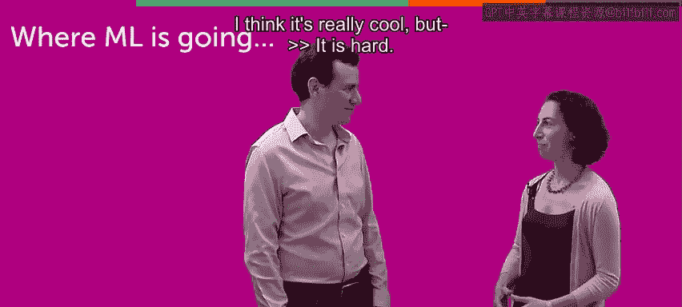

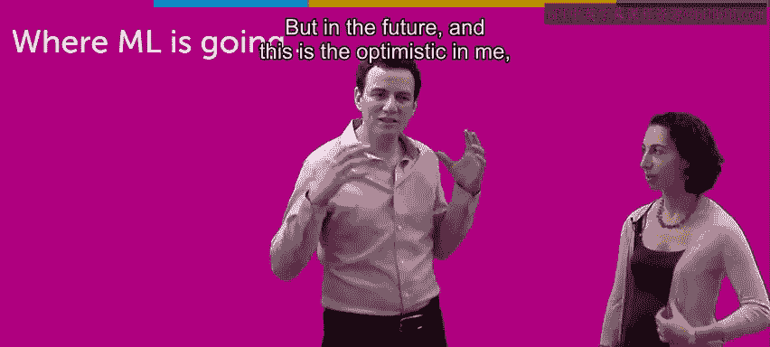

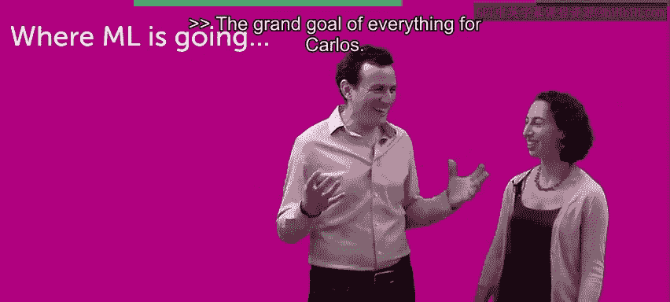

robuss to all this kind of noise in the data。 we're going to have experiences theyre really unique to us。

 idiosyncratic。 and we're not going to suffer as much from technology。

 technology is going to really adapt to us， which is really super cool。😊，I agree。

 I think that is a really， really exciting goal and I think that is one of the directions that machine learning is going in。

 but I think something else that's really cool is even doing the things we can do right now。

 but doing them as the data is coming in in real time with really complicated different types of data sets and putting all this information together and maybe it's just even still recommending products。

 something we've done before in the past， but with different types of data and again in this really fastrap online type of setting and getting feedback and incorporating this to make these types of prediction dealing dealing with temporal data。

 which is like the topic here as well as spatial data like location data all this kinds of different data sets。

 images， video audio sensing data combining all these different data sources in real time is one of the big challenges and what I'm excited to see is that there's a lot more machine learning work and a lot more algorithms。

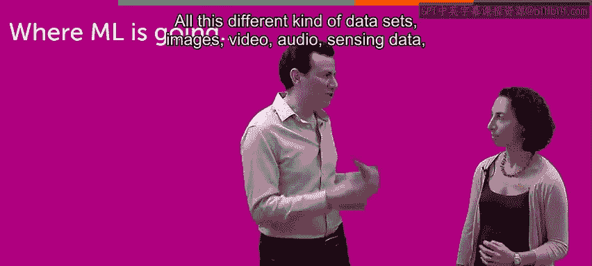

Developed to try to address this confusion of different data types and that's a really cool topic to work on right now for sure No so of course we hope that's really exciting to you in addition to us Yeah it is exciting and of course。

 the methods that we develop have to scale to this massive data sets that we're talking about different kinds of data be able to be really useful and robust as you have noise in the data and honestly。

😊。

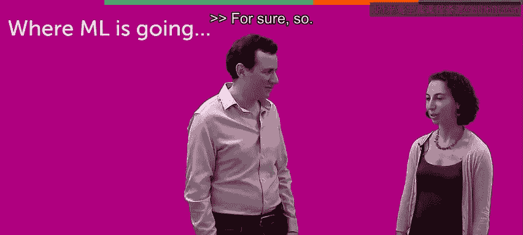

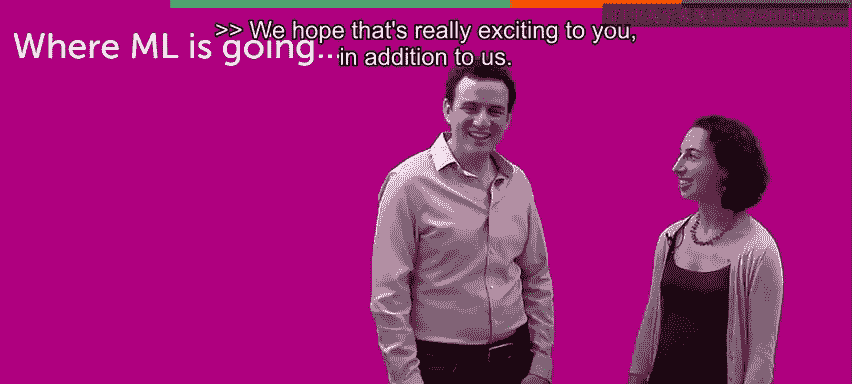

It shouldn't require。A PhD machine learning to be able to access the systems and be able to use it。

 So part of the challenge that we have to do is be able to make this algorithms robust and this method is robust so that a wide range of people。

 even those that don't have you know the most theoretical background。

 are able to build the smartest schoolest applications that is machine learning。

 And that's exciting to me as well， absolutely。😊。

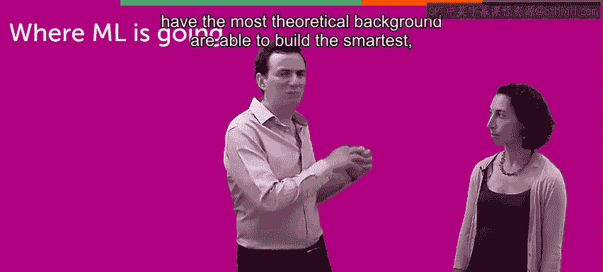

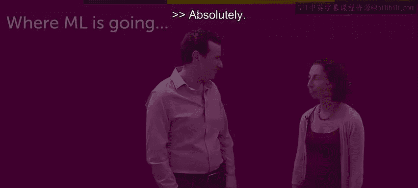