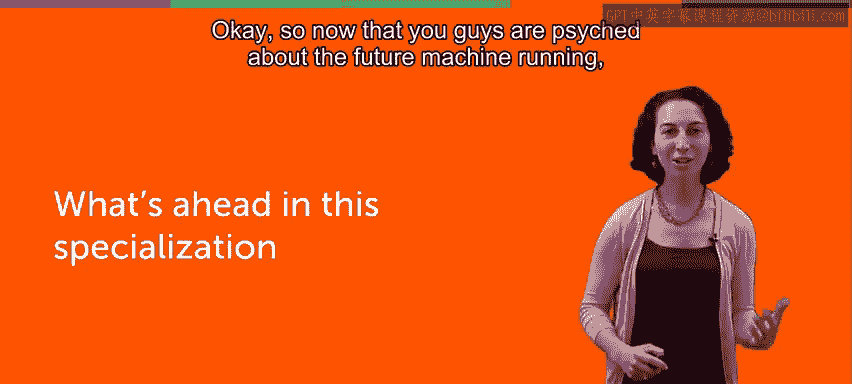
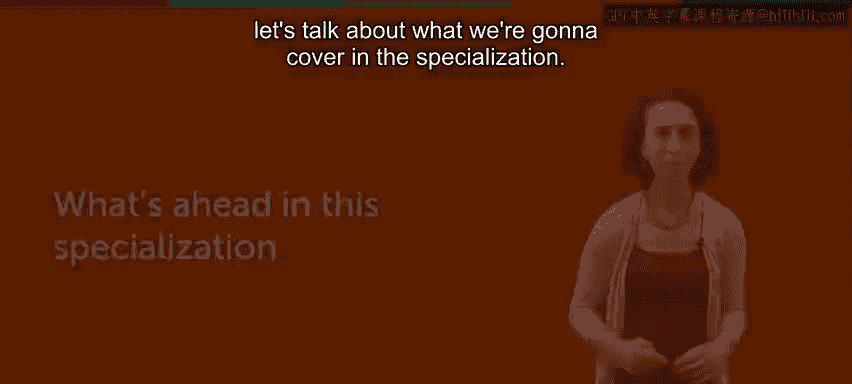
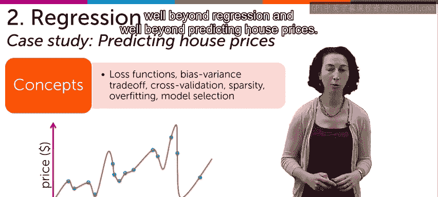
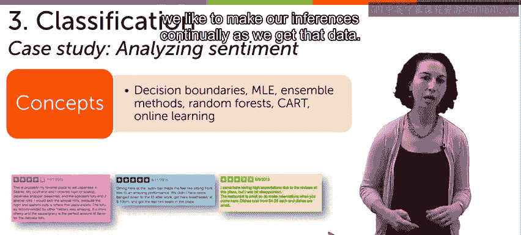
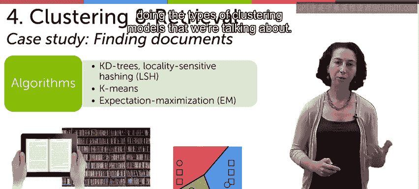
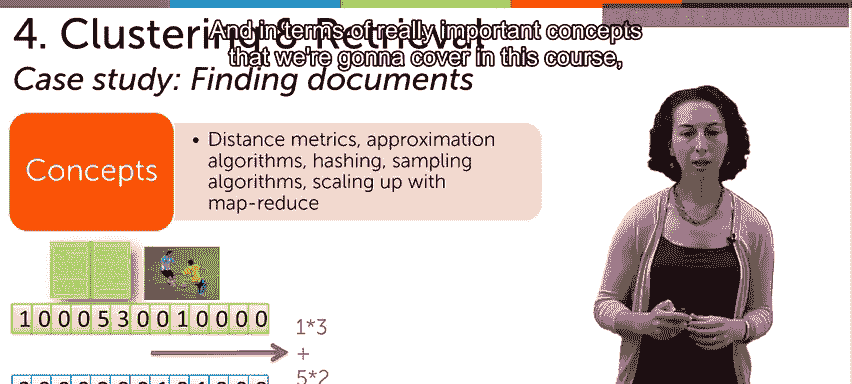
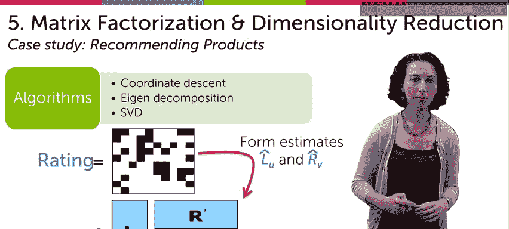
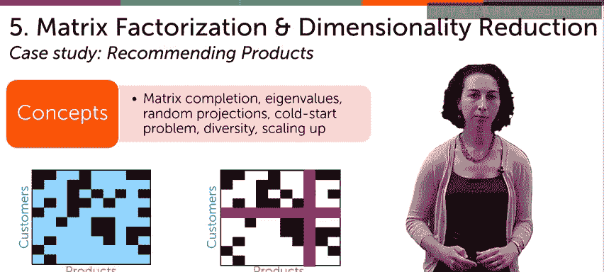
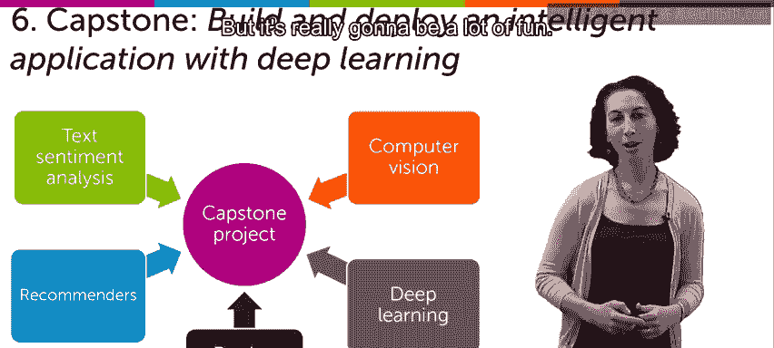
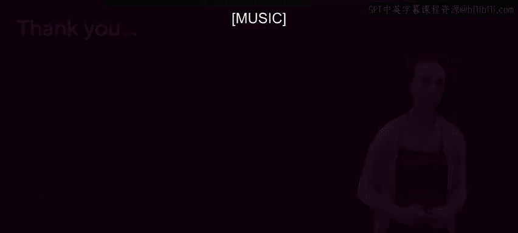

# 华盛顿大学《机器学习（基础篇，第1课／共4课）｜Machine Learning》中英字幕 - P116：115_专业课程中的后续内容.zh_en - GPT中英字幕课程资源 - BV1zw4m1e7Zh

。

Okay so now that you guys are psyched about the future machine learning。

 let's talk about what we're going to cover in this specialization Okay so in the regression course。

 now that you guys know what regression is， we're going to go through a lot more of the details on different formulations for models。

 for example， how to cope with lots of features， something that we alluded to in this course and we're also going to talk about in great detail algorithms for fitting these models。

 So different optimization algorithms remembering now that we've seen that there's this cost we can talk about residual sum squares and minimizing it。

 we're going to talk about different optimization algorithms like gradient descent and coordinate descent for actually doing this optimization。

😊。

And then through this case study in predicting house prices。

 we're going to cover a lot of concepts that are really foundational to machine learning in many different areas and some of these include how do we think about measuring cost。

 how do we think about choosing between models and dealing with overfitting of our model。

 so we're going to explore this in this context but again these ideas generalize well beyond regression and well beyond predicting house prices then when we get to the class course。

 we're going to talk about specific examples of linear classifiers。

 we're also going to talk about methods of how to scale up to using lots and lots of features and creating classifiers in this very high dimensionional feature representation。

And again， we're going to talk about algorithms for performing these types of classifications。

 specifically looking at an optimization algorithm that allows us to scale up to really。

 really large data sets， and we're also going to talk about this idea of how we can think about blending different models using something called boosting。

😊，And again， we'll look at many different concepts and one that I think is really interesting is how to do something called online learning where we get data that just continually streams in and we like to make our inferences continually as we get that data。

Then when we get to clustering and retrieval， again。

 we've gone through the foundational ideas of what does it mean to do clustering and what is our document retrieval task。

 but we're going to step it up even more where now for example。

 when we think about clustering a document might not just be about sports or world news or science or entertainment。

 maybe a document has some mixture of different topics you know we can very easily think about a document that's about both finance and world news and so we're going to think about how we model this more complicated structure that might be present in our data。

And for the algorithmic side of things， we're going to look at very efficient ways for searching over data when we're doing our retrieval tasks and lots of different algorithms for doing the types of clustering models that we're talking about。

And in terms of really important concepts that we're going to cover in this course。

 one thing is thinking about how to scale up doing the clustering to really。

 really massive collections of documents using something called mapRuce。

Next we're going to turn to our recommender systems and dimensionality reduction course and here beyond the types of collaborative filtering and matrix factorization that we already talked about in this course。

 we're also going to talk about ways to take high- dimensional data sets and think about modeling in terms of some lower dimensional representation and so for that we're going to think about different algorithms for doing this dimensionality reduction and we're also going to talk about algorithms for fitting the types of matrix factorization models that we described in this course。

And in this case， some of the important concepts we're going to go through。

 especially when we're thinking about matrix factorization is how we think about doing something like matrix completion。

 and that's where we're filling in all the unknown squares， if you remember that from this course。

 and then a more general problem， which is this cold start problem where we。

 in the case of our recommender systems might have no information about a user or a product and want to form those recommendations。

And finally we're going to get to the capstone， which is really。

 as I hope you guys have gotten in a sense， going to be very。

 very cool and now that you've gone through this course。

 you understand some of the concepts that we talked about in terms of what makes up this capstone in particular we're going to look at a recommender system that combines ideas of doing text sentiment analysis with important ideas from computer vision in terms of searching over different images and for doing this we're going to use deep learning so there're going to be some really important and more detailed information about deep learning presented in the capstone so please get to that point it's really going to be cool and very important and all of this is going to allow you to build this really intelligent web application and deploy it and do things that impress not just your friends and family but also potential employers so of course that's a potential。

Bonus to some of you out there， but it's really going to be a lot of fun。

 so we hope you get to that point and enjoy the capstone project。

