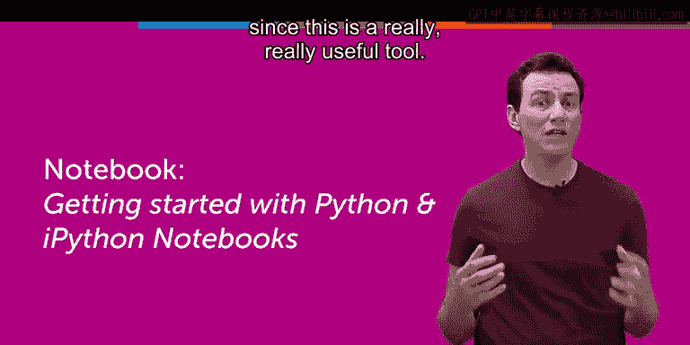
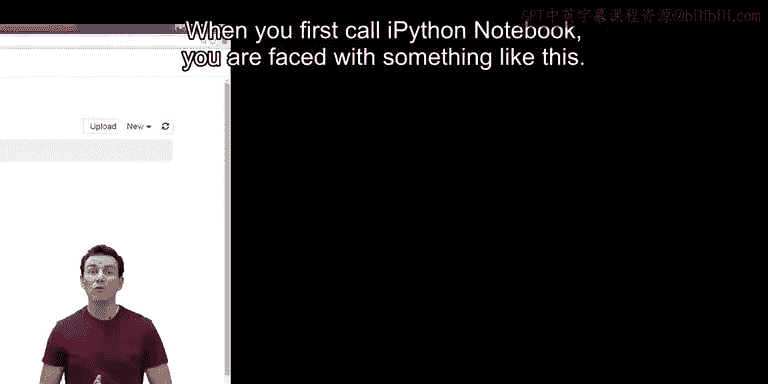
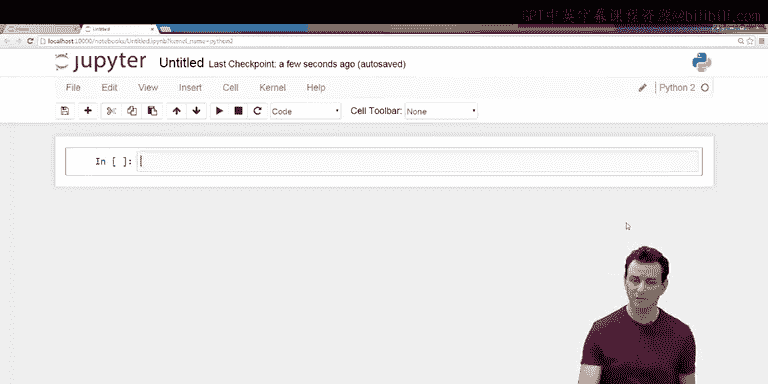
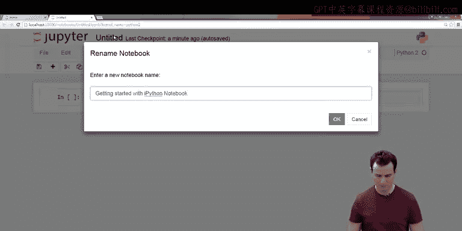
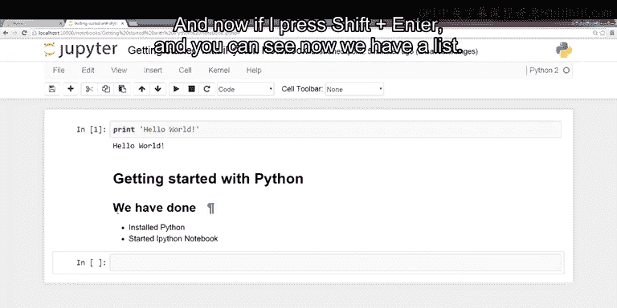

# 华盛顿大学《机器学习（基础篇，第1课／共4课）｜Machine Learning》中英字幕 - P11：10_启动Jupyter笔记本.zh_en - GPT中英字幕课程资源 - BV1zw4m1e7Zh

。

Today we're going to talk about two really exciting tools for programming machine learning algorithms and also useful in data science。

 One is the Python programming language and the other one is what's called the iPython notebook at this point I'll assume that you have already installed Python in your system if you've gone through those steps of installation and now I'm just to go over a few tips to get started there's lots and lots of resources available online for you to explore and familiarize yourself with all the techniques that you need to do but really I think it would be fun for us to go over this together since this is a really really useful tool and something that made a tremendous difference in practice when you first call iPython notebook you're faced with something like this is' basically a version of your directory with all the files in the directory there's some data files that I have as well as some iPython notebooks I've created earlier and some other data in that file this is more like a file browser so we're going。

😊。

It's just start a whole new notebook。So I'm going to go knee。Python 2。

 since we're going to have a notebook， that is a Python notebook。

And welcome this is iPthon Note this tool has been around for a few years now and has really changed how we build machine learning and data science algorithms and how we communicate about with others it's really useful too it blends two things that I love。

😊，Python， a simple scripting programming language with Wiiki pages。

 things which make it easily easy to communicate with others。

 so Python plus Wiki pages is their Python notebook。😊。

So today I'm going to both show you the iython notebook and also going to show you some tips and tricks in Python just to get started。

 assuming that you can program in Python or in other programming languages。😊。

So you've run iython notebook and you've started a fresh new one。

 let me just walk you over the interface。

So at the very top here is the title of the notebook。 and we're going to change it to something else。

 So I'm going to change it to。嗯。Getting started with。系。Byon。Notebook。

And there you go， we have a new notebook。And that's a title。

And so this notebook is kind of like a console for Python。

 but it also allows you to save the pages that you generate and include text and images in it。

 and we're going to play with all of that during this course because it's extremely useful。😊。

It has a menu here that allows you to do things like save the file that you have and load the new one。

 edit， copy， add new cells， and we're going to talk about those soon。

 but let's just get started so let's get started with Python I'm going to click on one of the cells which is kind of like an entry in a console and I'm going to type my first Python function so the first function we're going to do is just print So we're going to print a string and strings in Python can be single quotes or double quotes is up to you and the string we're going to print is the famous helllo world。

😊，And when I press。Shift， enter。It executes the cell， so you have to remember to press shift enter。

 we'll talk about pressing just enter in a second。And after executed， it says hellello world。So now。

Let's take a ride on a Python notebook and some of the Python functions that we're interested in using during the courses。

So the first piece of iPython notebook is that you can include text and really well formatted text。

 so there's two ways of accessing text cells， so the first one is to go over here to sell。

 sell type and call it markdown。😊，And then you click on it and you can start writing and it's really a markdown language kind of like wiki pages。

 so if I put a pound here，😊，I can do a header， getting started with。拜on。

And now if I press instead of pressing shift enter just press regular enter。

 it gives you a multiline cell， so enter， let's get started with Python and let's do a subheader now the first thing that we're going to assume is what you have done so far so we have done。

😊，The following。 So just press enter。 We， here's a list we've done， we've installed。Byon。

The Python programming in language， we've started。I passython。Notebook。And。Okay。

 so that did not work so well。 Okay， I executed that It's not quite right。 Let me see what I forgot。

 so I can double click on it and edits I forgot to put a space here。So。

Space between the different lines。 So if we installed aython and we started the Iython notebook。

 This is what we've done so far。And now if I press shift enter and you can see now we have a list。

。

