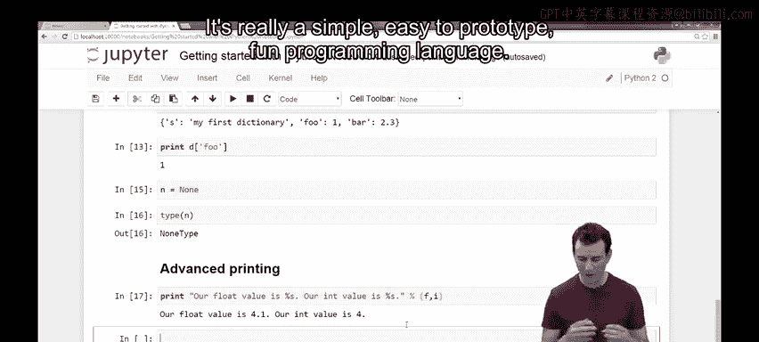

# 华盛顿大学《机器学习（基础篇，第1课／共4课）｜Machine Learning》中英字幕 - P12：11_在Python中创建变量.zh_en - GPT中英字幕课程资源 - BV1zw4m1e7Zh

。

🎼So we've done those things I'm going to go continue editing， so I double click again。And now next。

 we're going to do is create some variables。In Python。Shift enter。

 and now we're back to the Excel cell。Now Python is a scripting programming language just like many other scripting language right out there。

 which makes it really easy to prototype things and what we'll also see today is some machine learning tools that make it easy to run machine learning algorithms at scale even within the simple programming language like Python but for now let's start with the simple programming language so Python is a scripting language and you can create variables as you go。

 you don't have to declare them formally and you don't have to declare their types so for example。😊。

If I say I is equal to4。What I get out of this？Is an integer as well see so comments in Python can be done in various ways so for example I can put just a pound sign here int and just to tell me that I that I just created is an integer and in fact you can type type of I annual printed type and you see that you have an int。

Now I can just create a new variable， let's call it F equals 4。1 and now F is going to be a floatat。

 so the type of F。😊，Is。Ft。Now that you can make integers， you can make floats。

 you can also make all sorts of other types of variables。 so for example， B equals true。😊。

Makes a Boolean variable。Oh， I can't spell variable。And if I say for example， S equals。

 I said single quotes can be strings， also double quotes can be strings， so let's say double quotes。

This is a strange。Shift enter， we now have a string。So， for example， if I print S。I have a string。

Now these are the basic Python types now let's look at some more advanced Python types。😊，So。

I told you how to create a text cell by going to the cell menu。

And going to cell type and write clicking on markdown。

 another way that you can do it if I'm in a cell， I can hit S M。😊，And it creates a markdown cell。

 I had to press En to edit it。So now that we've talked about basic types。

 let's talk about some advanced。Python types。So where are some common advanced Python types okay so most common one is what's called a list。

 so let's say L is a list， for example 312 just a list of numbers， integers， floats， strings。

 anything can be formed into list in fact Python loves lists so if you and you can print it print L you'll see that we get a list back。

So this type here is called a list。Now you can also have other types which are called dictionaries。

 dictionaries， you can think about it kind of like hash tables with keys。

 so for example these are dictionary we can have let's say two entries in the dictionary maybe full。

😊，Is we put full is the name of the entry。Colon one。 So that entry is one。 coma。

 I'm going to create another entry， say bar。And then let's say that takes value 2。3。

 so that's a float and we can take another entry3， let's call that S。And the entry is。My first。

Dictionary。And now we've created a dictionary with three fields with different types。 so for example。

If you just print D， you will see the dictionary back that were created。

 not that the elements are not in the same order because they're on order inside the dictionary。

 I can access an element so for example， if I print。😊，The of。F。You'll see that gets by one。

Dicction is extremely useful。So now we talked about。Lists and dictionaries。

 one last thing that it's important to note is that Python's no type is called none。So， for example。

 if we say n is equal to oops。I press enter too quickly。

 sorry about that if we say n is equal to none。We now have something that has a non type。

 so type of n。Is non type。So those are the more advanced types in Python。 and let's talk about。

A little bit of ways we can print， do more advanced printing in Python。

 and then we're going to go into loops， conditional statements， and defining functions。

So let's start with just slightly more advanced printing。

 so I'm going to press SM and write advanced。20。And so that's what we're doing now。

 And now it's not just printing a single variable。 I'm going to print a string where you're going to insert some variables in it。

 So， for example， I'm going to print a string our。😊，Float。Value is。Percent S。

 so that's when I insert we' going I later on insert the variable F that defined above in that percent S。

And we're going to say our int。Value is。Percent S。And。

Now inserting it you just put a percent at the end of the string， and we're going to insert F。And I。

 so this is what this parenthesis is， is's called a tupo inserts F。Here。

This F in the first percent S and the I in the second percent S。 So if I just。

P there you see there our float values 5。1， and our integer value was4。

And you can do all sorts of more advanced string transformations which you should go explore in your own because it's extremely fun and we really benefit from using Python。

 it's really a simple， easy to prototype fun programming language， I really love it。😊。

