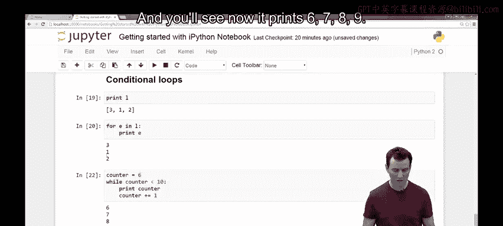

# 华盛顿大学《机器学习（基础篇，第1课／共4课）｜Machine Learning》中英字幕 - P13：12_Python中的条件语句和循环.zh_en - GPT中英字幕课程资源 - BV1zw4m1e7Zh

。

So we talked about variable types and we talked about。Small transformation。

 so now let's go to the next step and the next step we're going to do conditional statements。So。

 ask M。I'm going to define another section here。Conditional。Statements。In Python。Okay。

 so there are various ways to build a condition statement on Python depending on how long and how complicated it is。

 so let's do a very simple one。So for example， let's say that I want to ask if the intesger variable I that I created is equal to one。

 that's my test。And。The float variable that we created is greater than4。

 thus my condition statement is easy to read and if this is the case， colon。

 we put a colon after the if statement， we do something。😊，Now in Python。

 there's no open brackets and closed brackets like you have in C， for example， in Java。

 all you have to do is put any amount of spacing or tabulation in the next line and that's what defines kind of the pieces of inside the brackets inside for another programming language you just keep aligning them the same way and IPython notebook is nice because does that all that tabulation automatically for you。

😊，So。Let's say if I is equal to 1 and f is greater than4， something happened， so I'm going to print。

😊，The value of I is1。And。F is greater。Then4。No。I'm going to just print that。😊，If this is the case。

 but I also want to have another conditioner， I want to have an else condition。And so in Python。

 you could just type else。Something， but I want to have multiple conditions。

 So I want to do another else if if some other condition is true。

 and Python allows you to kind of concatenate Ls and ifs together。 So if you just create an L lift。

It's kind of a cute little synthetictaotic sugar here。

 so if the first condition I equal to 1 f is greater than 4 does not hold ask the following question is I greater than 4。

😊，Or so there's ans， so I me put a nice little space here and and or's， you just say or。

 you don't have any kind of that fancy vertical brackets or anything this just say and and or。

F is greater than。4our， do something else。So our something else is print。嗯。I is。

So let's just print I and F are both。Greater。Then4。Now， if。If this is not true。

 we can add another L at the end， so I'm going to backspacecing a line in the beginning。

 just put another else with a。Call on at the end and say， if this is not the case。

 then you say print。Sa both。So if this condition is not the case then what we know。

 we know that I is not greater than4 and I is not equal to1 F is not greater than4。

 so theres some things that have happened so we can just say something like both I and。F R less。Then。

 or。Equal to 4。And we also have that。Well， let's say that this is enough。Okay I'm done。

 I'm done with my statement and now remember the values of I and F I just printed it out here。

 I was4 and f was 4。1 so if you go to the first line you notice that I is not equal to one so you go to the next line you notice that I is not greater than4 so you go to the next line you' just going print this last statement both I and F or less they' equal to 4 so if I do shift enter I execute this conditional and there you go。

😊，I and F are both greater than 4， so that was good， we built our first conditional here。😊，诶早粉。

Now that we've done some conditionals， let's do some loops。So。Again， we're gonna go into the。

Editing mode mark down SM， and we're going to do some conditional loops。

So what kind of conditional loops can we do in Python so we can do four loops。 So for example。

 you can do a four。嗯。So remember we had a list， this is kind of fun。

 so let me just print it to remind ourselves。 So if I print that list L that we built in the beginning it was 3。

1，2。😊，So let's do a four loop that iterates over that list。😊，Let's say element。In L。

 for each element in L， I'm going to do something， I'm going to print the element。

So this goes L by element of L。And I just call it element。 I could call it anything。 Let's call it E。

So for E in L。Printed so it's going to go three print， one print，2 print。

 let's execute that and you see 312 and not the say in Python when called print you always insert a new line at the end so you got  three12 in new lines。

Now that is a simple for loop。 Lastly， let's create a simple while loop。So you can do fours。

 you can do while。 So for example， while might say while。A counter。Is。

Let's just say less than 10 do something。So， I'm going to print。The counter。

And I'm going to add one to the counter。 So I'm going to say counter plus equals one。

 So what this is going to do is create a counter。And print it and add one， print it。

 add one until we get to 10 when it's going to stop。So I notice that we have initialized counter。

 which should give us an error。😊，And so let's just run it and see what happens。

We got an error and whenever you get an error in Python the error messages somehow sometimes can be a little scary。

 so you just go here and look at the name of error and it says down here name counter is not defined remember we never initialize counter and it actually goes and tells you a little above what line of the code that error occurred in so when it first started to test while counters less than 10 counters never initialize it broke so let's go back and edit I'm going to insert a new line here。

 let's initialize the counter first to any number less than 10 so how about6。

So character is equal to6 and I'm just going to。Execute again， and you'll see now 6，7，8。

9 when it gets to 10 stops。

