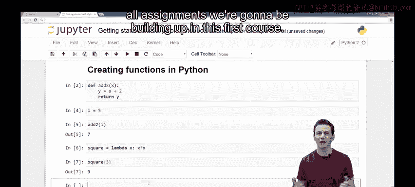

# 华盛顿大学《机器学习（基础篇，第1课／共4课）｜Machine Learning》中英字幕 - P14：13_在Python中创建函数和lambda表达式.zh_en - GPT中英字幕课程资源 - BV1zw4m1e7Zh

。

So hopefully this gets you started with Python the programming language with the iPython notebook and a little bit of itating the console when to be using this console again and again it's a really a fun simple way to manage and interact with data and there's lots tools for visualizing for navigating for doing machine learning in this Python space so it's really great programming language for us and in fact。

😊，There's been a lot of surveys that say most recently。

 Python is the programming language for data science and that's why we picked it for this course。

As a final step， let's talk about create creating functions in Python。

 It's actually pretty easy to create a wide range of functions within Python and it's pretty natural。

 So there's two ways of doing it。 so let's go ahead and get started So again ask M for text box and we're going talk about creating creating。

😊，Functions。In Python。Okay， so。The first way is using the depth command。

 so this is defining a function let's say。Findund function， add two。

which takes an element x and adds2 to it， so you write de add2。

 and in parenthses you put the number of parameters you have there this x， you could have x， Y。

 z and so on， and then you put a colon at the end。And just like with loops。

 we want to align it vertically。It's kind of tabulated until we've written out all the function we want to do。

 so for example， we could say y is equal to x plus2 and then we say return。😊，Why。

So here weve defined the function at 2， so let's remember our in value I。

 let's just study it to some number， let's say we say that i is equal to 5。😊。

And we say add to with the input I。And we get seven。我了。

The second way to define functions is using what Python calls lambmbdas and these are for simple functions and it's useful to know it it's useful in a variety of places where you just do a simple transformation even add two is a simple transformation so for example。

 let's create a function code。😊，Square。Allright。So this is the square function。Which is a lambda。

That takes to input X。And returns。X times x， so if I read S to you we're defining a function。

 this lambda is a function takes x as input and returns x times x。

 that's what's out after the column。 So we define that and now we can apply square to anything we want。

 So for example if we say what is the square of3。It should say nine and there we go。

 two ways to define functions in Python now we have the grasps of Python basics they can use for all the assignments that we're going to be building up in this first course。

